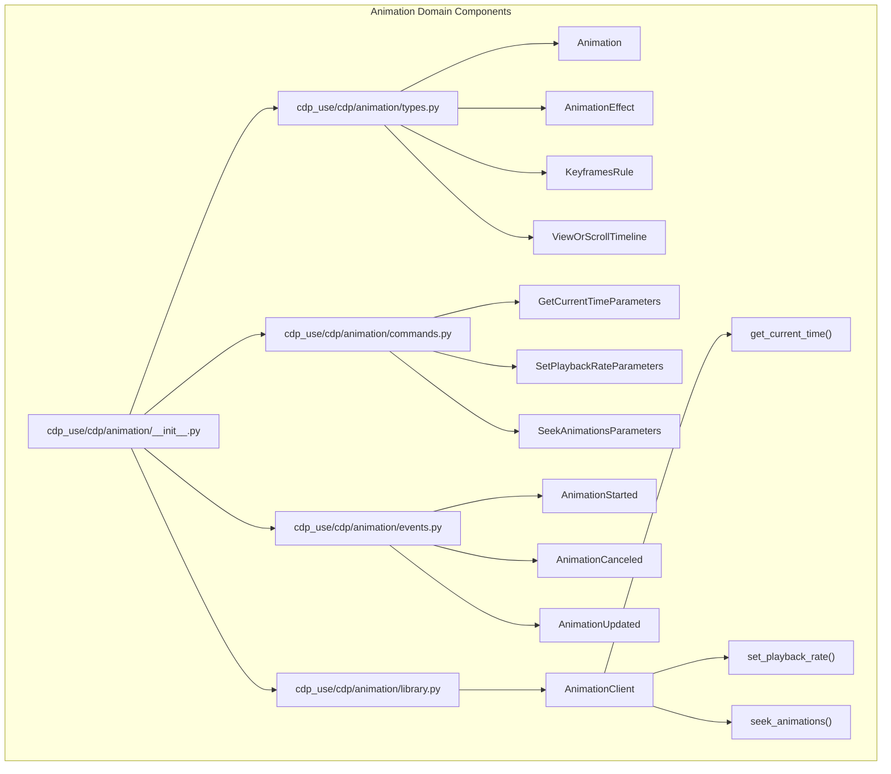
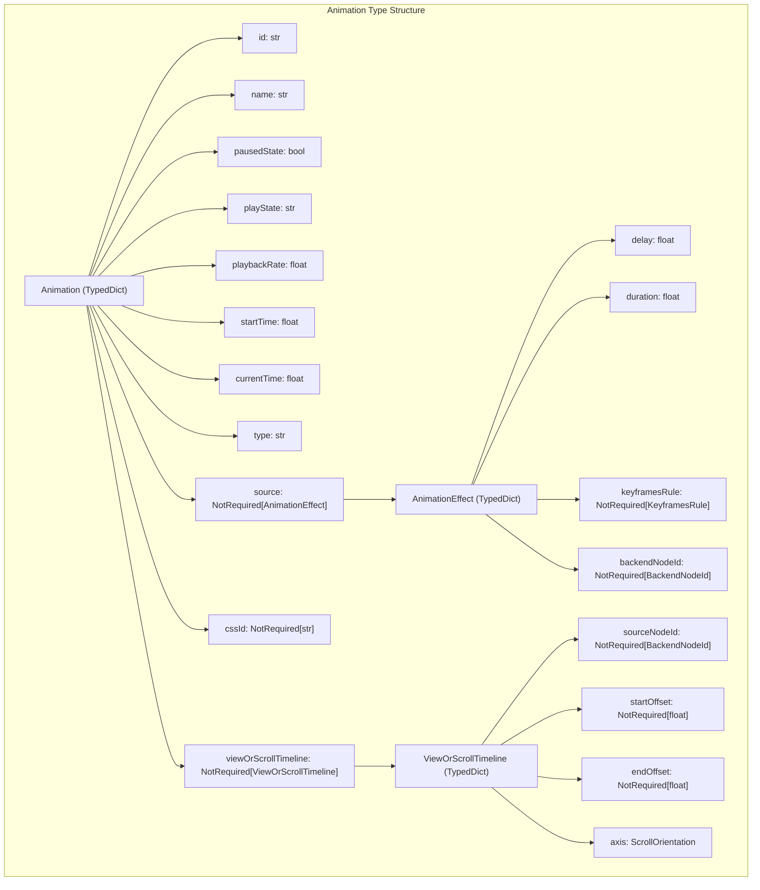
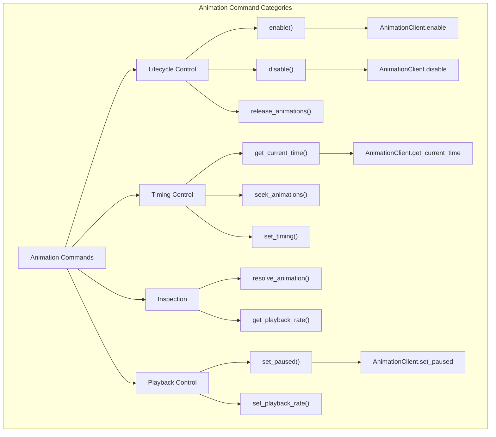
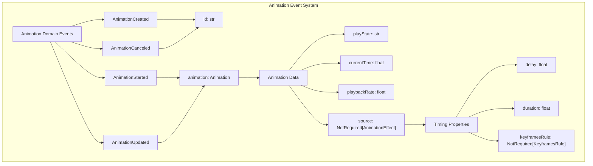
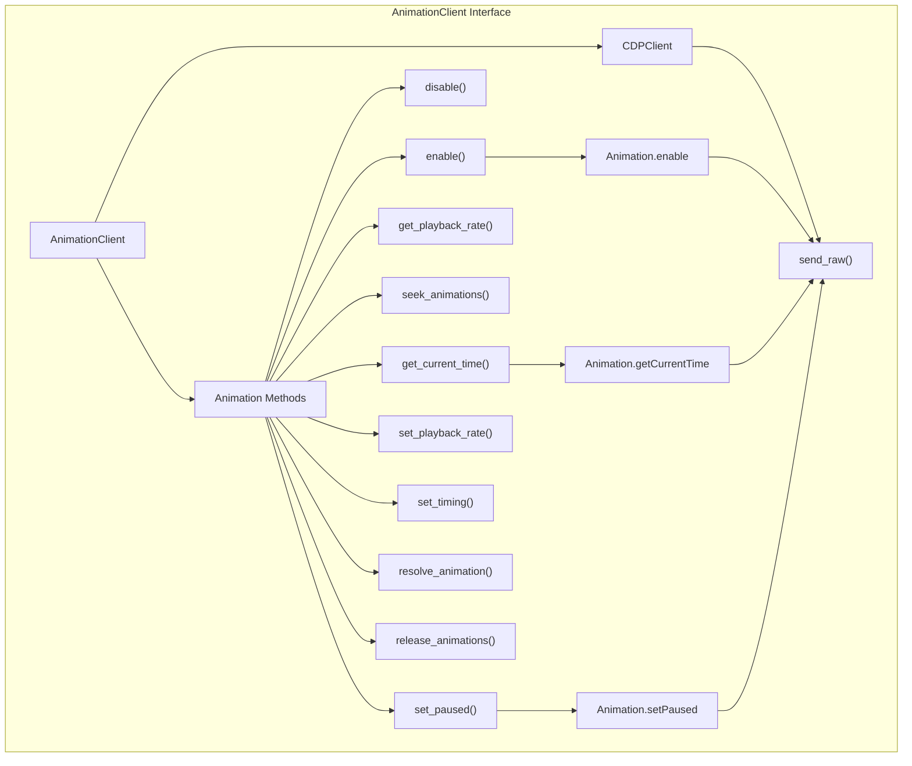
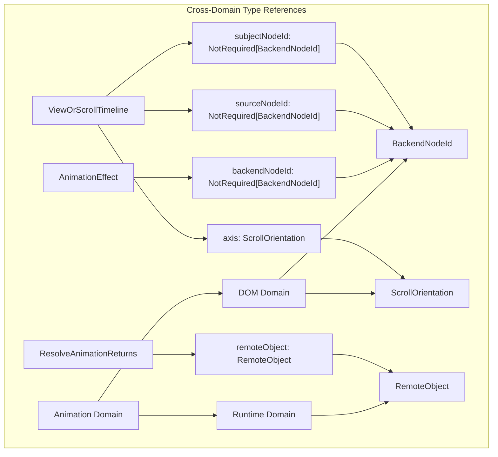

<!-- source: DeepWiki mcp.deepwiki.com · repo browser-use/cdp-use · page 6.2 Animation Domain · fetched 2026-10-30 -->

# Animation Domain

Relevant source files

The following files were used as context for generating this wiki page:

- [cdp_use/cdp/animation/types.py](cdp_use/cdp/animation/types.py)
- [cdp_use/cdp/browser/commands.py](cdp_use/cdp/browser/commands.py)
- [cdp_use/cdp/console/types.py](cdp_use/cdp/console/types.py)

The Animation Domain provides comprehensive control over web page animations, including CSS animations, transitions, and the Web Animations API. This domain enables developers to inspect, control, and manipulate animations running in Chrome DevTools Protocol sessions.

This domain covers animation lifecycle management, timing control, keyframe manipulation, and scroll-driven animations.

## Domain Architecture

The Animation Domain follows the standard CDP domain structure with four main components: types, commands, events, and a client library.

### Animation Domain Structure

Sources: [cdp_use/cdp/animation/types.py:1-111](), [cdp_use/cdp/animation/commands.py:1-110](), [cdp_use/cdp/animation/events.py:1-50](), [cdp_use/cdp/animation/library.py:1-150]()

## Core Animation Types

### Animation Instance Structure

The `Animation` type represents a complete animation instance with comprehensive timing and state information. It supports both traditional time-based animations and modern scroll-driven animations.

Sources: [cdp_use/cdp/animation/types.py:17-46](), [cdp_use/cdp/animation/types.py:48-65](), [cdp_use/cdp/animation/types.py:67-93]()

### Animation Timing and Keyframes

| Type | Purpose | Key Properties |
|------|---------|----------------|
| `Animation` | Main animation instance | `id`, `playState`, `currentTime`, `playbackRate` |
| `AnimationEffect` | Animation timing and target | `delay`, `duration`, `iterations`, `backendNodeId` |
| `KeyframesRule` | CSS keyframes definition | `name`, `keyframes` |
| `KeyframeStyle` | Individual keyframe | `offset`, `easing` |
| `ViewOrScrollTimeline` | Scroll-driven animations | `sourceNodeId`, `startOffset`, `endOffset`, `axis` |

Sources: [cdp_use/cdp/animation/types.py:17-111]()

## Animation Commands

### Command Categories

The Animation Domain provides commands for lifecycle management, timing control, and inspection. These are implemented as methods on the `AnimationClient`.

Sources: [cdp_use/cdp/animation/library.py:30-150]()

### Primary Animation Commands

| Command | Parameters | Returns | Purpose |
|---------|------------|---------|---------|
| `get_current_time` | `GetCurrentTimeParameters` | `GetCurrentTimeReturns` | Get current time of animation |
| `get_playback_rate` | None | `GetPlaybackRateReturns` | Get document timeline playback rate |
| `seek_animations` | `SeekAnimationsParameters` | None | Seek animations to specific time |
| `set_paused` | `SetPausedParameters` | None | Set paused state of animations |
| `set_playback_rate` | `SetPlaybackRateParameters` | None | Set document timeline playback rate |
| `set_timing` | `SetTimingParameters` | None | Set animation timing properties |
| `resolve_animation` | `ResolveAnimationParameters` | `ResolveAnimationReturns` | Get remote object for animation |

Sources: [cdp_use/cdp/animation/commands.py:15-110](), [cdp_use/cdp/animation/library.py:54-150]()

## Animation Events

### Event Types and Triggers

The Animation Domain emits events during animation lifecycle changes. These are defined as TypedDicts in `events.py`.

| Event | Properties | Trigger |
|-------|------------|---------|
| `AnimationCreated` | `id: str` | New animation created |
| `AnimationStarted` | `animation: Animation` | Animation begins playing |
| `AnimationUpdated` | `animation: Animation` | Animation properties change |
| `AnimationCanceled` | `id: str` | Animation cancelled or completed |

Sources: [cdp_use/cdp/animation/events.py:14-50]()

### Event Data Flow

Sources: [cdp_use/cdp/animation/events.py:14-50](), [cdp_use/cdp/animation/types.py:17-46]()

## AnimationClient Usage

### Client Interface

The `AnimationClient` provides async methods for all animation commands through the CDP WebSocket connection, utilizing `send_raw` for communication.

Sources: [cdp_use/cdp/animation/library.py:24-150]()

### Command Parameter Types

Animation commands use TypedDict classes for type-safe parameter passing. These are generated in `commands.py`.

| Command Method | Parameter Type | Required Fields |
|----------------|----------------|-----------------|
| `get_current_time` | `GetCurrentTimeParameters` | `id: str` |
| `seek_animations` | `SeekAnimationsParameters` | `animations: List[str]`, `currentTime: float` |
| `set_paused` | `SetPausedParameters` | `animations: List[str]`, `paused: bool` |
| `set_playback_rate` | `SetPlaybackRateParameters` | `playbackRate: float` |
| `set_timing` | `SetTimingParameters` | `animationId: str`, `duration: float`, `delay: float` |
| `resolve_animation` | `ResolveAnimationParameters` | `animationId: str` |

Sources: [cdp_use/cdp/animation/commands.py:15-110]()

## Cross-Domain Integration

### DOM and Runtime References

Animations reference DOM nodes through the `BackendNodeId` type and interact with the Runtime domain for object resolution.

Sources: [cdp_use/cdp/animation/types.py:13-14](), [cdp_use/cdp/animation/types.py:87-88](), [cdp_use/cdp/animation/types.py:51-63](), [cdp_use/cdp/animation/commands.py:107-110]()

---

