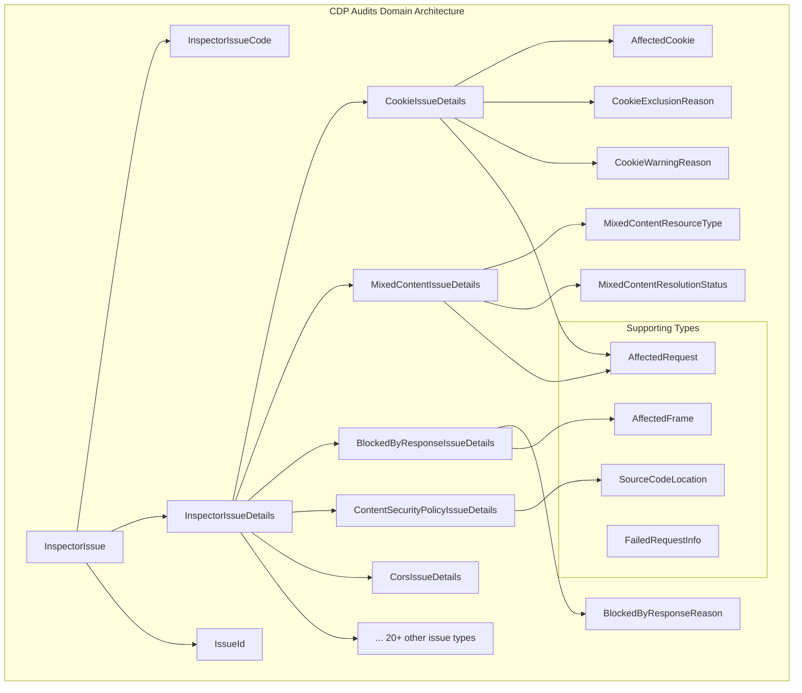
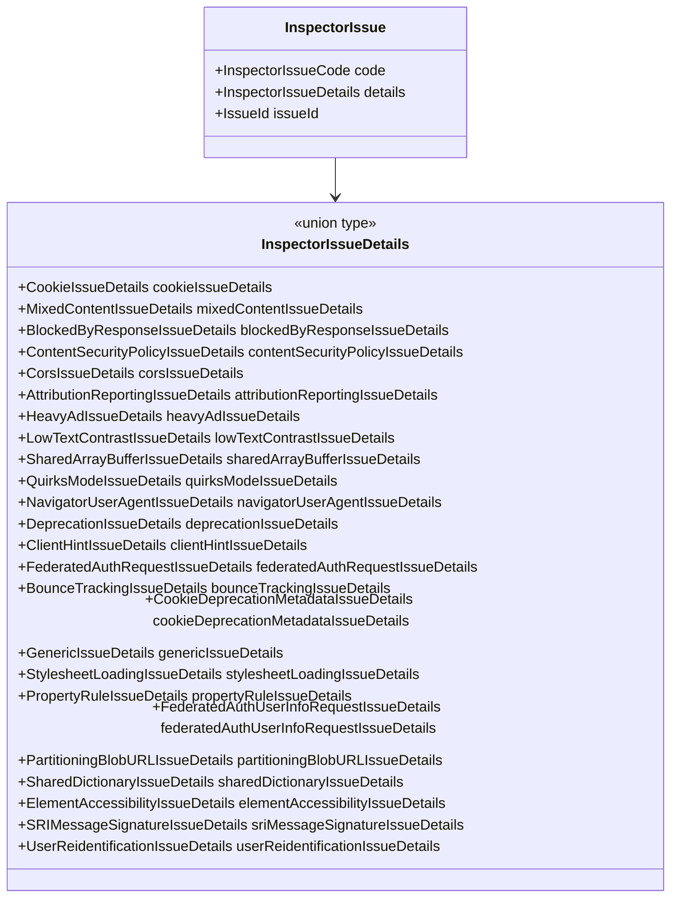
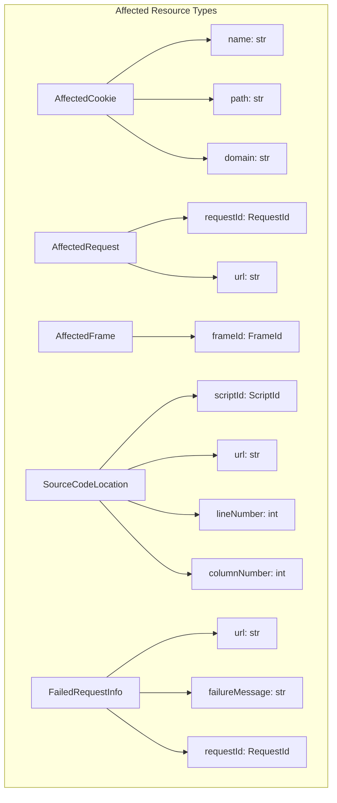
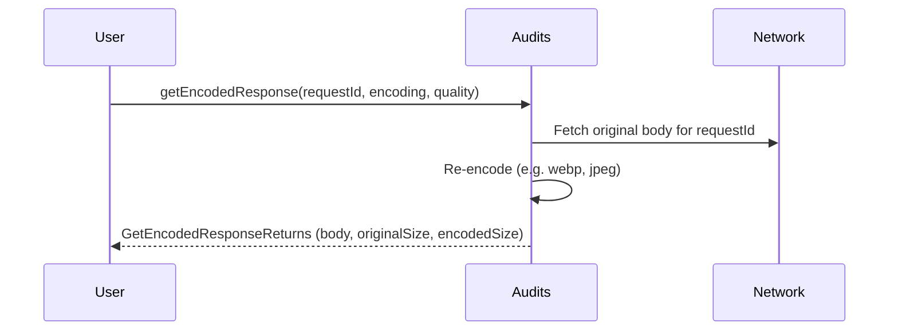
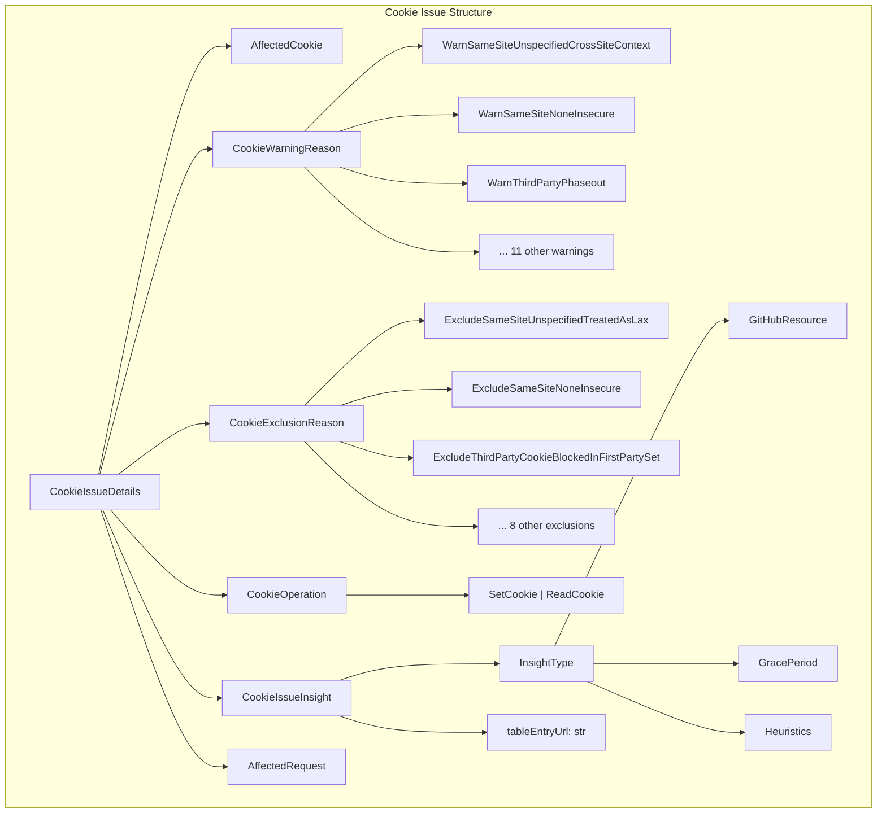
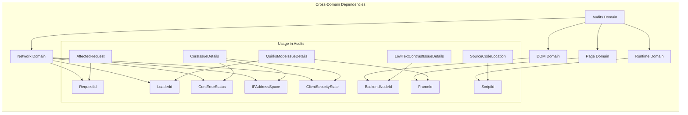
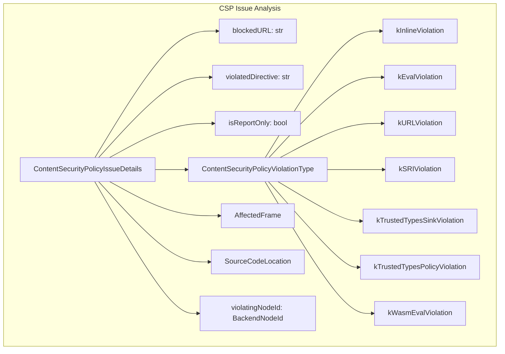
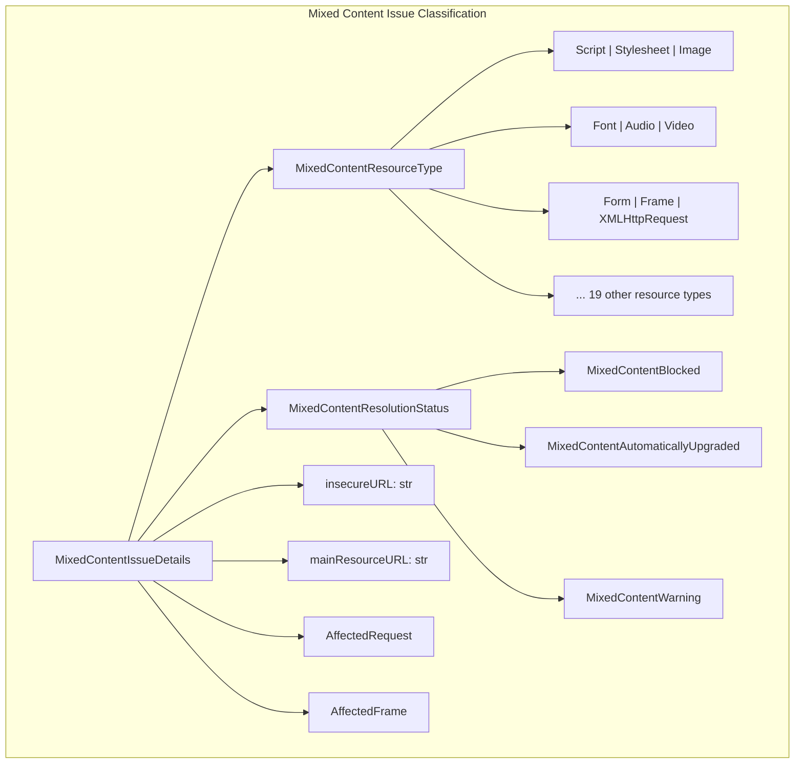

<!-- source: DeepWiki mcp.deepwiki.com · repo browser-use/cdp-use · page 6.3 Audits Domain · fetched 2026-10-30 -->

# Audits Domain

Relevant source files

The following files were used as context for generating this wiki page:

- [cdp_use/cdp/accessibility/commands.py](cdp_use/cdp/accessibility/commands.py)
- [cdp_use/cdp/audits/commands.py](cdp_use/cdp/audits/commands.py)
- [cdp_use/cdp/audits/types.py](cdp_use/cdp/audits/types.py)
- [cdp_use/cdp/autofill/commands.py](cdp_use/cdp/autofill/commands.py)
- [cdp_use/cdp/bluetoothemulation/commands.py](cdp_use/cdp/bluetoothemulation/commands.py)
- [cdp_use/cdp/bluetoothemulation/events.py](cdp_use/cdp/bluetoothemulation/events.py)
- [cdp_use/cdp/browser/events.py](cdp_use/cdp/browser/events.py)

The Audits Domain provides type-safe Python bindings for the Chrome DevTools Protocol's Audits domain, which enables detection and reporting of various web page issues including security violations, accessibility problems, performance concerns, and policy violations. This domain is primarily used for automated web page analysis and debugging.

For information about other CDP domains, see the main Domain Reference section [6](). For details on how these types are generated from CDP specifications, see Code Generation System [5]().

## Domain Overview

The Audits Domain centralizes issue detection and reporting across multiple web standards and browser policies. It provides a unified interface for accessing audit results from Chrome's built-in analysis tools, covering everything from CORS violations to accessibility issues.

*Diagram: Core structure of the Audits Domain type system*

Sources: [cdp_use/cdp/audits/types.py:24-509]()

## Issue Classification System

The domain organizes issues into a hierarchical classification system with over 25 distinct issue types, each with specialized detail structures.

### Primary Issue Categories

| Issue Category | Code | Purpose |
|---------------|------|---------|
| Security | `CookieIssue`, `CorsIssue`, `ContentSecurityPolicyIssue` | Web security policy violations |
| Content Policy | `MixedContentIssue`, `BlockedByResponseIssue` | Content loading and security issues |
| Performance | `HeavyAdIssue` | Resource usage and performance problems |
| Accessibility | `LowTextContrastIssue`, `ElementAccessibilityIssue` | Accessibility standard violations |
| Standards Compliance | `QuirksModeIssue`, `DeprecationIssue` | Web standards and best practices |
| Privacy | `BounceTrackingIssue`, `UserReidentificationIssue` | Privacy-related concerns |

```mermaid
graph LR
    subgraph "Issue Type Hierarchy"
        A["InspectorIssueCode"] --> B["Security Issues"]
        A --> C["Content Issues"] 
        A --> D["Performance Issues"]
        A --> E["Accessibility Issues"]
        A --> F["Privacy Issues"]
        A --> G["Standards Issues"]
        
        B --> B1["CookieIssue"]
        B --> B2["CorsIssue"] 
        B --> B3["ContentSecurityPolicyIssue"]
        B --> B4["SharedArrayBufferIssue"]
        
        C --> C1["MixedContentIssue"]
        C --> C2["BlockedByResponseIssue"]
        C --> C3["StylesheetLoadingIssue"]
        
        D --> D1["HeavyAdIssue"]
        
        E --> E1["LowTextContrastIssue"]
        E --> E2["ElementAccessibilityIssue"]
        
        F --> F1["BounceTrackingIssue"] 
        F --> F2["UserReidentificationIssue"]
        F --> F3["CookieDeprecationMetadataIssue"]
        
        G --> G1["QuirksModeIssue"]
        G --> G2["DeprecationIssue"]
        G --> G3["NavigatorUserAgentIssue"]
    end
```

*Diagram: Hierarchical organization of inspector issue types*

Sources: [cdp_use/cdp/audits/types.py:455-458]()

## Core Type Architecture

### Inspector Issue Structure

The `InspectorIssue` class serves as the root container for all audit findings:

*Diagram: Core inspector issue class structure with union type details*

Sources: [cdp_use/cdp/audits/types.py:501-509](), [cdp_use/cdp/audits/types.py:462-492]()

### Affected Resource Types

The domain defines several helper types to identify resources affected by issues:

*Diagram: Supporting types for identifying affected web resources*

Sources: [cdp_use/cdp/audits/types.py:24-30](), [cdp_use/cdp/audits/types.py:33-39](), [cdp_use/cdp/audits/types.py:41-45](), [cdp_use/cdp/audits/types.py:164-167](), [cdp_use/cdp/audits/types.py:374-380]()

## Commands and Quality Checks

The Audits domain provides commands to actively trigger quality checks or retrieve encoded response data.

### Encoded Response Retrieval
The `getEncodedResponse` command allows developers to retrieve a re-encoded version of a network resource, often used for performance auditing and size comparison.

*Diagram: Data flow for the getEncodedResponse command*

Sources: [cdp_use/cdp/audits/commands.py:17-34]()

### Active Audits
Commands like `checkContrast` and `checkFormsIssues` allow for manual triggering of browser quality checks.

- **`checkContrast`**: Scans the page for WCAG accessibility violations regarding color contrast [cdp_use/cdp/audits/commands.py:37-40]().
- **`checkFormsIssues`**: Analyzes forms on the page for best practices and potential issues [cdp_use/cdp/audits/commands.py:42-44]().

## Cookie Issue Analysis

Cookie-related issues represent one of the most complex audit categories, with detailed classification of exclusion and warning reasons.

*Diagram: Detailed cookie issue classification system*

Sources: [cdp_use/cdp/audits/types.py:47-116](), [cdp_use/cdp/audits/types.py:80-80](), [cdp_use/cdp/audits/types.py:83-84](), [cdp_use/cdp/audits/types.py:87-93]()

## Cross-Domain Type Dependencies

The Audits Domain extensively references types from other CDP domains, creating a rich interconnected type system:

| Referenced Domain | Import Count | Purpose |
|------------------|--------------|---------|
| Network | 6 types | Request identification, CORS details, security state |
| DOM | 1 type | Node identification for accessibility issues |
| Page | 1 type | Frame identification |
| Runtime | 1 type | Script identification for CSP violations |

*Diagram: Cross-domain type relationships in the Audits system*

Sources: [cdp_use/cdp/audits/types.py:11-21](), [cdp_use/cdp/audits/types.py:213-224](), [cdp_use/cdp/audits/types.py:250-261]()

## Security Issue Categories

The domain provides comprehensive coverage of web security issues with specialized detail types:

### Content Security Policy Issues

*Diagram: Content Security Policy violation analysis structure*

Sources: [cdp_use/cdp/audits/types.py:215-242](), [cdp_use/cdp/audits/types.py:245-248]()

### Mixed Content Issues

Mixed content issues track resources loaded over insecure connections from secure pages:

*Diagram: Mixed content issue classification and resolution tracking*

Sources: [cdp_use/cdp/audits/types.py:118-120](), [cdp_use/cdp/audits/types.py:123-153](), [cdp_use/cdp/audits/types.py:156-173]()

## Type Safety and Generation

All types in the Audits Domain are automatically generated from the official Chrome DevTools Protocol specifications, ensuring type safety and compatibility:

- **TypedDict Classes**: All issue details use `TypedDict` for structured data with optional fields marked using `NotRequired` [cdp_use/cdp/audits/types.py:9]().
- **Literal Types**: Enumeration values are represented as `Literal` types for compile-time validation [cdp_use/cdp/audits/types.py:8]().
- **Cross-Domain References**: Forward references and conditional imports handle circular dependencies [cdp_use/cdp/audits/types.py:13-21]().
- **Auto-Generation**: The entire module is regenerated when CDP specifications update [cdp_use/cdp/audits/types.py:1-4]().

Sources: [cdp_use/cdp/audits/types.py:1-21]()

---

