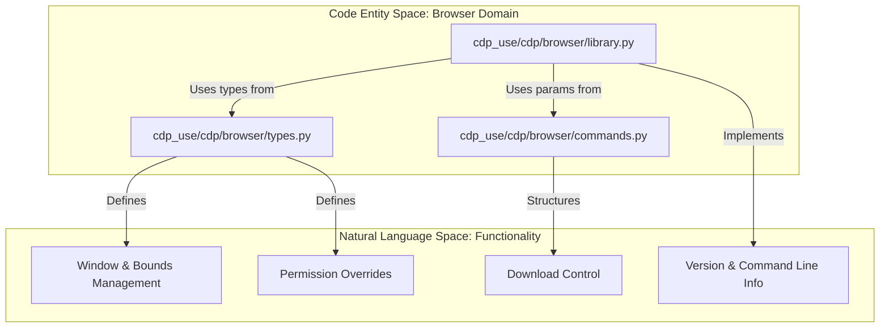
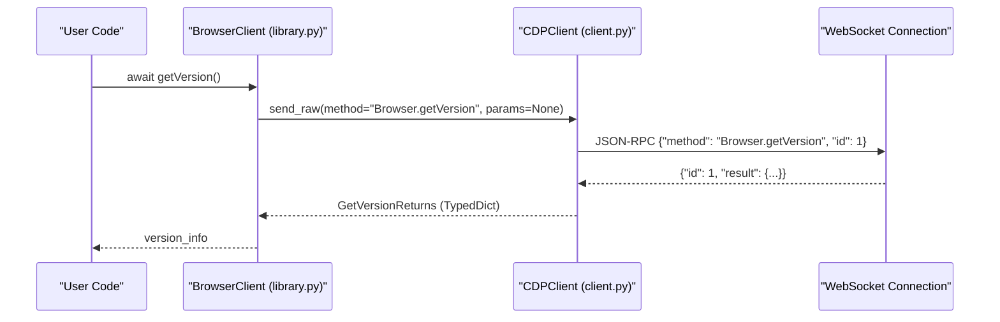

<!-- source: DeepWiki mcp.deepwiki.com · repo browser-use/cdp-use · page 6.4 Browser Domain · fetched 2026-10-30 -->

# Browser Domain

<details>
<summary>Relevant source files</summary>

The following files were used as context for generating this wiki page:

- [cdp_use/cdp/animation/types.py](cdp_use/cdp/animation/types.py)
- [cdp_use/cdp/browser/commands.py](cdp_use/cdp/browser/commands.py)
- [cdp_use/cdp/browser/library.py](cdp_use/cdp/browser/library.py)
- [cdp_use/cdp/browser/types.py](cdp_use/cdp/browser/types.py)
- [cdp_use/cdp/console/types.py](cdp_use/cdp/console/types.py)

</details>


The Browser domain provides type-safe Python bindings for Chrome DevTools Protocol browser-level operations. This includes window management, browser context handling, permission control, download behavior configuration, and access to Chrome internal histograms. These bindings are implemented via auto-generated `TypedDict` classes and the `BrowserClient` proxy.

## Browser Domain Architecture

The Browser domain is structured into three primary generated files that separate type definitions, command structures, and the high-level client implementation.



**Sources:** [cdp_use/cdp/browser/types.py:1-5](), [cdp_use/cdp/browser/commands.py:1-5](), [cdp_use/cdp/browser/library.py:1-5]()

## Browser Commands and Execution

The `BrowserClient` class in `cdp_use/cdp/browser/library.py` provides the primary interface for executing browser-scoped commands. Each method wraps a call to `self._client.send_raw`, mapping high-level Python calls to CDP JSON-RPC messages.

### Key Browser Commands

| Command | Method in `BrowserClient` | Purpose |
|:---|:---|:---|
| `Browser.getVersion` | `getVersion()` | Returns protocol version, product name, and User-Agent. |
| `Browser.getBrowserCommandLine` | `getBrowserCommandLine()` | Retrieves switches used to launch the browser (requires `--enable-automation`). |
| `Browser.setDownloadBehavior` | `setDownloadBehavior(params)` | Configures if downloads are allowed and sets the `downloadPath`. |
| `Browser.setPermission` | `setPermission(params)` | Overrides browser permissions (e.g., geolocation, notifications) for specific origins. |
| `Browser.getWindowForTarget` | `getWindowForTarget(params)` | Retrieves the `WindowID` and `Bounds` for a specific target. |

**Sources:** [cdp_use/cdp/browser/library.py:36-192](), [cdp_use/cdp/browser/commands.py:53-90]()

### Command Data Flow

The following diagram illustrates how a command like `getVersion` flows from the natural language intent to the low-level `CDPClient`.



**Sources:** [cdp_use/cdp/browser/library.py:163-176](), [cdp_use/cdp/browser/commands.py:74-85]()

## Type System and Definitions

The domain utilizes `TypedDict` for complex objects and `Literal` for fixed sets of strings, ensuring strict type checking for parameters and return values.

### Window and Bounds Management
The `Bounds` type defines the geometry and state of a browser window.

```python
class Bounds(TypedDict, total=False):
    left: "int"
    top: "int"
    width: "int"
    height: "int"
    windowState: "WindowState"
```

Valid `WindowState` values include `"normal"`, `"minimized"`, `"maximized"`, and `"fullscreen"`.

**Sources:** [cdp_use/cdp/browser/types.py:17-34]()

### Permission System
The permission system allows fine-grained control over browser capabilities. The `PermissionType` literal includes over 30 distinct permissions such as `geolocation`, `notifications`, `audioCapture`, and `clipboardReadWrite`.

The `PermissionDescriptor` is used to provide context-specific settings for these permissions, such as `sysex` for MIDI or `panTiltZoom` for cameras.

**Sources:** [cdp_use/cdp/browser/types.py:36-98]()

### Download Behavior
Using `setDownloadBehavior`, developers can automate file downloads by specifying a `behavior` (e.g., `"allow"`) and a `downloadPath`.

```python
class SetDownloadBehaviorParameters(TypedDict):
    behavior: "str"
    browserContextId: "NotRequired[BrowserContextID]"
    downloadPath: "NotRequired[str]"
    eventsEnabled: "NotRequired[bool]"
```

**Sources:** [cdp_use/cdp/browser/commands.py:53-65]()

## Metrics and Histograms

The Browser domain provides access to internal Chrome `Histogram` data, which consists of `Bucket` objects representing sample distributions.

| Class | Fields |
|:---|:---|
| `Histogram` | `name`, `sum`, `count`, `buckets` |
| `Bucket` | `low` (inclusive), `high` (exclusive), `count` |

**Sources:** [cdp_use/cdp/browser/types.py:104-125](), [cdp_use/cdp/browser/commands.py:92-116]()

## Implementation Details

The domain implementation relies on the `CDPClient` to handle the underlying WebSocket communication. When a command is called on `BrowserClient`, it is cast to the appropriate return type defined in `commands.py`.

```python
async def getVersion(
    self,
    params: None = None,
    session_id: Optional[str] = None,
) -> "GetVersionReturns":
    return cast(
        "GetVersionReturns",
        await self._client.send_raw(
            method="Browser.getVersion",
            params=params,
            session_id=session_id,
        ),
    )
```

**Sources:** [cdp_use/cdp/browser/library.py:163-176]()

---

