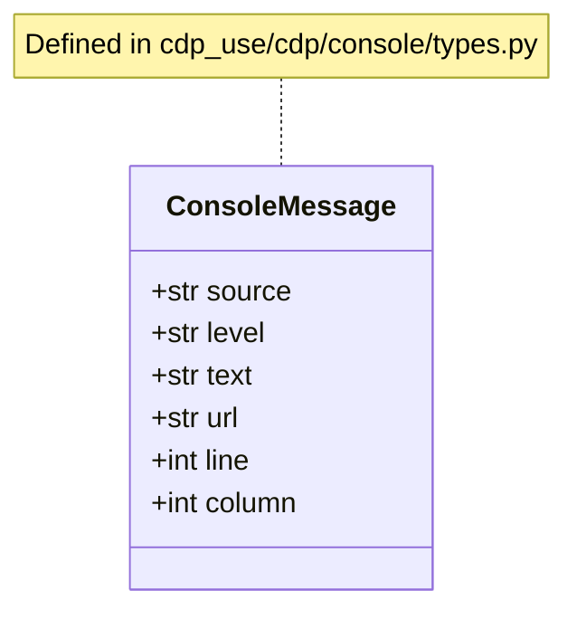
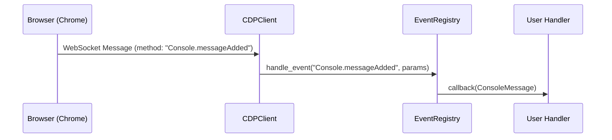

<!-- source: DeepWiki mcp.deepwiki.com · repo browser-use/cdp-use · page 6.6 Console Domain · fetched 2026-10-30 -->

# Console Domain

<details>
<summary>Relevant source files</summary>

The following files were used as context for generating this wiki page:

- [cdp_use/cdp/animation/types.py](cdp_use/cdp/animation/types.py)
- [cdp_use/cdp/browser/commands.py](cdp_use/cdp/browser/commands.py)
- [cdp_use/cdp/console/types.py](cdp_use/cdp/console/types.py)

</details>


The Console Domain provides types, commands, and events for interacting with the browser's console functionality through the Chrome DevTools Protocol. This domain enables programmatic access to console messages, including their source, severity level, and location information.

For information about other CDP domains, see the [Domain Reference](#6) section. For details on how domains are generated from CDP specifications, see [Code Generation System](#5).

## Overview

The Console Domain is part of the auto-generated CDP library that provides type-safe access to Chrome's console functionality. It handles console messages from various sources including JavaScript execution, network errors, and security violations.

```mermaid
graph TB
    subgraph "Console Domain Structure"
        ["cdp_use/cdp/console/"] --> ["types.py"]
        ["cdp_use/cdp/console/"] --> ["commands.py"]
        ["cdp_use/cdp/console/"] --> ["events.py"]
        ["cdp_use/cdp/console/"] --> ["library.py"]
    end
    
    subgraph "Integration Layer"
        ["CDPClient"] --> ["ConsoleClient"]
        ["ConsoleClient"] --> ["ConsoleMessage"]
        ["ConsoleClient"] --> ["messageAdded"]
    end
    
    subgraph "Chrome DevTools Protocol"
        ["CDP Specification"] --> ["Console Messages"]
        ["CDP Specification"] --> ["Console Commands"]
        ["CDP Specification"] --> ["Console Events"]
    end
    
    ["types.py"] --> ["ConsoleMessage"]
    
    ["Console Messages"] --> ["types.py"]
```

**Console Domain Integration with CDP Client**  
Sources: [cdp_use/cdp/console/types.py:1-24]()

## Types

### ConsoleMessage

The `ConsoleMessage` type represents a message from the browser console, capturing both the message content and its source location information. It is implemented as a `TypedDict` to ensure type safety when processing console output.



**ConsoleMessage Type Structure**

The `ConsoleMessage` TypedDict contains the following fields:

| Field | Type | Required | Description |
|-------|------|----------|-------------|
| `source` | `str` | Yes | Message source (e.g., "javascript", "network", "console-api"). [cdp_use/cdp/console/types.py:13-14]() |
| `level` | `str` | Yes | Message severity ("log", "warning", "error", "debug", "info"). [cdp_use/cdp/console/types.py:15-16]() |
| `text` | `str` | Yes | The actual message text content. [cdp_use/cdp/console/types.py:17-18]() |
| `url` | `NotRequired[str]` | No | URL of the message origin. [cdp_use/cdp/console/types.py:19-20]() |
| `line` | `NotRequired[int]` | No | Line number in the resource (1-based). [cdp_use/cdp/console/types.py:21-22]() |
| `column` | `NotRequired[int]` | No | Column number in the resource (1-based). [cdp_use/cdp/console/types.py:23-24]() |

The optional location fields (`url`, `line`, `column`) provide precise source mapping for debugging purposes, particularly useful for JavaScript errors and warnings.

Sources: [cdp_use/cdp/console/types.py:10-24]()

## Events and Commands

While the Console domain is primarily used for observing output, it operates through the standard CDP event system.

### messageAdded Event

The `messageAdded` event is emitted by the browser whenever a new message is logged to the console. This event carries a `ConsoleMessage` object as its payload.



**Data Flow for Console Events**  
Sources: [cdp_use/cdp/console/types.py:10-24]()

## Type Safety Features

The Console Domain leverages Python's `typing_extensions` module to provide compile-time type safety:

```mermaid
graph LR
    ["typing_extensions.TypedDict"] --> ["ConsoleMessage"]
    ["typing_extensions.NotRequired"] --> ["Optional Fields"]
    
    ["ConsoleMessage"] --> ["Required: source, level, text"]
    ["ConsoleMessage"] --> ["Optional Fields"]
    ["Optional Fields"] --> ["url: NotRequired[str]"]
    ["Optional Fields"] --> ["line: NotRequired[int]"]  
    ["Optional Fields"] --> ["column: NotRequired[int]"]
```

**Type Safety Implementation in Console Domain**

The `NotRequired` annotation ensures that optional fields can be omitted without type checking errors, while still maintaining strict typing for required fields. This approach provides:

- **Compile-time validation** of message structure. [cdp_use/cdp/console/types.py:10-24]()
- **IDE autocompletion** for all message fields.
- **Runtime type hints** for debugging and documentation.
- **Backward compatibility** with CDP specification changes. [cdp_use/cdp/console/types.py:1-3]()

Sources: [cdp_use/cdp/console/types.py:1-7](), [cdp_use/cdp/console/types.py:19-24]()

## Auto-Generation Context

The Console Domain types are automatically generated from the Chrome DevTools Protocol specifications. This ensures that the Python bindings remain synchronized with the underlying browser capabilities.

- **Specification compliance**: Directly mirrors the CDP `Console` domain. [cdp_use/cdp/console/types.py:1-3]()
- **Consistency**: Uses the same `TypedDict` patterns found in other domains like `Browser` [cdp_use/cdp/browser/commands.py:25-38]() or `Animation` [cdp_use/cdp/animation/types.py:17-46]().
- **Documentation**: Docstrings are extracted from the CDP protocol JSON and embedded directly into the Python classes. [cdp_use/cdp/console/types.py:11-24]()

Sources: [cdp_use/cdp/console/types.py:1-5](), [cdp_use/cdp/browser/commands.py:1-5](), [cdp_use/cdp/animation/types.py:1-5]()

---

