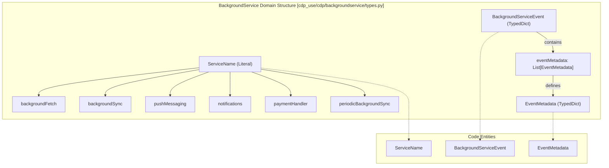
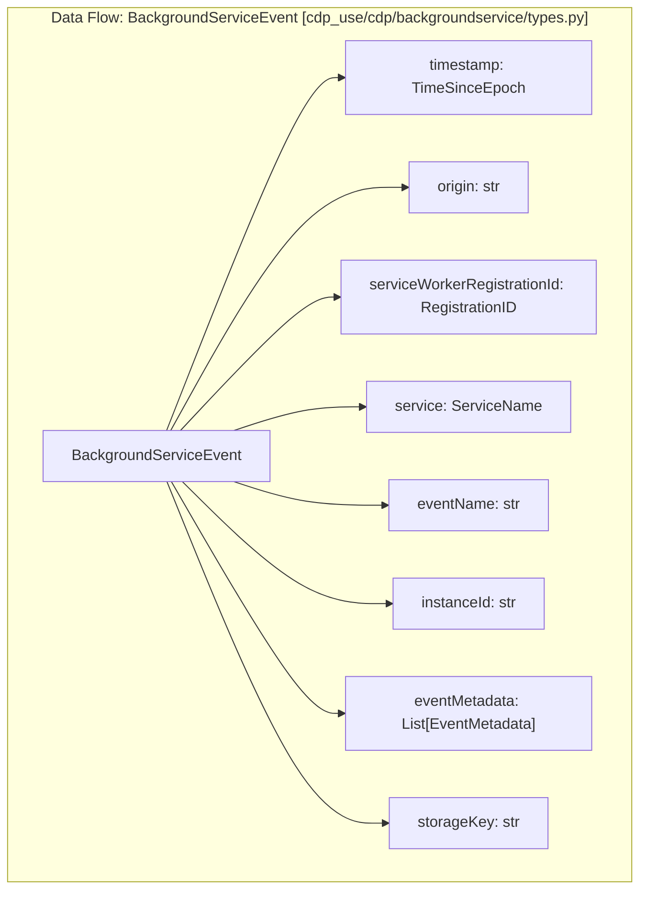
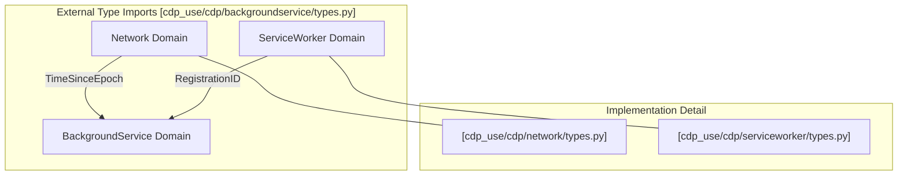

<!-- source: DeepWiki mcp.deepwiki.com · repo browser-use/cdp-use · page 6.7 Background Service Domain · fetched 2026-10-30 -->

# Background Service Domain

<details>
<summary>Relevant source files</summary>

The following files were used as context for generating this wiki page:

- [cdp_use/cdp/autofill/types.py](cdp_use/cdp/autofill/types.py)
- [cdp_use/cdp/backgroundservice/types.py](cdp_use/cdp/backgroundservice/types.py)
- [cdp_use/cdp/bluetoothemulation/types.py](cdp_use/cdp/bluetoothemulation/types.py)
- [cdp_use/cdp/deviceaccess/types.py](cdp_use/cdp/deviceaccess/types.py)

</details>


The `BackgroundService` domain provides monitoring and recording capabilities for asynchronous browser services, including background fetch, background sync, push messaging, notifications, payment handlers, and periodic background sync. This domain enables developers to observe, record, and manage background service events for debugging and analysis purposes.

This documentation covers the auto-generated `BackgroundService` domain implementation within the `cdp-use` library.

## Domain Structure

The `BackgroundService` domain follows the standard CDP domain architecture, utilizing `TypedDict` for type safety and `Literal` for enumerated service names.



Sources: [cdp_use/cdp/backgroundservice/types.py:17-54]()

## Service Types

### ServiceName Literal

The `ServiceName` is a `Literal` type that defines the specific background services that can be associated with commands and events. Every background service operates independently but shares the same API structure.

| Service | Value | Description |
|---------|-------|-------------|
| Background Fetch | `"backgroundFetch"` | High-reliability downloads/uploads |
| Background Sync | `"backgroundSync"` | Retrying network requests when online |
| Push Messaging | `"pushMessaging"` | Receiving push notifications from a server |
| Notifications | `"notifications"` | Displaying system notifications |
| Payment Handler | `"paymentHandler"` | Web-based payment request handling |
| Periodic Sync | `"periodicBackgroundSync"` | Scheduled background synchronization |

Sources: [cdp_use/cdp/backgroundservice/types.py:17-27]()

### BackgroundServiceEvent Structure

The `BackgroundServiceEvent` `TypedDict` represents the payload for events received when a background service performs an action.



| Field | Type | Description |
|-------|------|-------------|
| `timestamp` | `TimeSinceEpoch` | Timestamp of the event in seconds. |
| `origin` | `str` | The origin (URL) this event belongs to. |
| `serviceWorkerRegistrationId` | `RegistrationID` | The Service Worker ID that initiated the event. |
| `service` | `ServiceName` | The specific background service (e.g., `pushMessaging`). |
| `eventName` | `str` | A human-readable description of the event. |
| `instanceId` | `str` | An identifier that groups related events together. |
| `eventMetadata` | `List[EventMetadata]` | A list of key-value pairs for additional information. |
| `storageKey` | `str` | The storage key associated with this event. |

Sources: [cdp_use/cdp/backgroundservice/types.py:37-54]()

## Cross-Domain Type Dependencies

The `BackgroundService` domain relies on types defined in other CDP domains to ensure consistency across the protocol. These are imported using `TYPE_CHECKING` to avoid circular dependencies while maintaining static type safety.



- **Network Domain**: Provides `TimeSinceEpoch` (typically a `float`) used for precise event timing.
- **ServiceWorker Domain**: Provides `RegistrationID` (typically a `str`) used to link background events to the responsible Service Worker.

Sources: [cdp_use/cdp/backgroundservice/types.py:11-16](), [cdp_use/cdp/backgroundservice/types.py:38-43]()

## Event Metadata

The `EventMetadata` `TypedDict` is a simple key-value structure used within the `BackgroundServiceEvent` to provide service-specific context that does not fit into the standard event fields.

```python
class EventMetadata(TypedDict):
    """A key-value pair for additional event information to pass along."""
    key: "str"
    value: "str"
```

Sources: [cdp_use/cdp/backgroundservice/types.py:30-35]()

---

