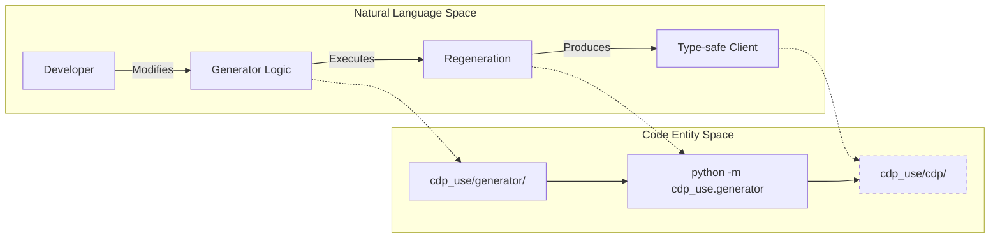
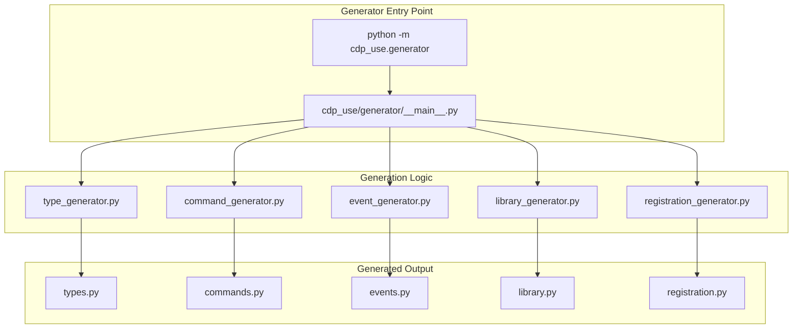

<!-- source: DeepWiki mcp.deepwiki.com · repo browser-use/cdp-use · page 7 Development · fetched 2026-10-30 -->

# Development

Relevant source files

The following files were used as context for generating this wiki page:

- [.github/workflows/lint.yml](.github/workflows/lint.yml)
- [LICENSE](LICENSE)
- [README.md](README.md)
- [Taskfile.yml](Taskfile.yml)
- [cdp_use/custom_protocols/browseruse.json](cdp_use/custom_protocols/browseruse.json)
- [pyproject.toml](pyproject.toml)

This page provides information for contributors and developers working on the `cdp-use` codebase. It covers the development workflow, code generation architecture, and contributing guidelines for maintaining and extending the CDP client generator.

For detailed information on specific development topics, see the following child pages:
- **[Project Configuration](#7.1)** — Build system, `pyproject.toml` settings, and `Taskfile.yml` automation.
- **[Development Environment](#7.2)** — Setup instructions, `uv` workflow, and GitHub Actions CI pipeline.
- **[License and Legal](#7.3)** — MIT license terms and copyright information.

## Development Workflow Overview

The `cdp-use` project follows a code generation workflow where developers modify generator components rather than the generated CDP client library directly. All code under `cdp_use/cdp/` is auto-generated and should never be manually edited [pyproject.toml:43]().

### Core Development Principle

The following diagram bridges the gap between developer actions and the resulting code entities:

**Core Development Flow**

Sources: [README.md:205-215](), [pyproject.toml:30-32]()

## Code Generation Architecture

The generator system transforms CDP protocol specifications into type-safe Python bindings through a multi-stage pipeline.

### Generator Components

**Generator Component Architecture**

Sources: [README.md:162-174](), [Taskfile.yml:4-7]()

## Development Setup

### Prerequisites

The project requires Python 3.11 or higher [pyproject.toml:7](). The use of `uv` is highly recommended for dependency management and reproducible builds [README.md:21]().

**Key Dependencies:**
- `httpx>=0.28.1`: Used by the generator to fetch protocol JSON [pyproject.toml:15]().
- `websockets>=15.0.1`: Core transport for the `CDPClient` [pyproject.toml:17]().
- `ruff>=0.12.2`: Used for linting and formatting generated code [pyproject.toml:28]().

### Automation with Task

The project uses a `Taskfile.yml` to simplify common development operations:

| Command | Action | Source |
|---------|--------|--------|
| `task generate` | Runs `python -m cdp_use.generator` to rebuild bindings | [Taskfile.yml:4-7]() |
| `task lint` | Runs `ruff check` on the codebase | [Taskfile.yml:19-22]() |
| `task format` | Formats code using `ruff format` | [Taskfile.yml:24-27]() |
| `task format-json` | Formats custom protocol JSON files in `cdp_use/custom_protocols/` | [Taskfile.yml:29-36]() |
| `task example` | Runs the `simple.py` verification script | [Taskfile.yml:38-41]() |

Sources: [Taskfile.yml:1-48](), [pyproject.toml:27-28]()

## Continuous Integration (CI)

The project employs GitHub Actions to ensure code quality through three primary jobs in the `lint` workflow:

1.  **`lint-syntax`**: Checks for critical Python syntax errors using `ruff check --select PLE` [.github/workflows/lint.yml:15-23]().
2.  **`lint-style`**: Enforces project-wide coding standards using the full `ruff` suite [.github/workflows/lint.yml:25-33]().
3.  **`import-check`**: A smoke test that verifies `CDPClient` can be imported without error in a fresh environment [.github/workflows/lint.yml:35-43]().

For more details on the CI pipeline and local setup, see [Development Environment](#7.2).

## File Modification Guidelines

To maintain the integrity of the project, follow these modification rules:

| Path | Category | Policy |
|------|----------|--------|
| `cdp_use/generator/` | Logic | **Editable**. This is where protocol-to-code mapping lives. |
| `cdp_use/client.py` | Runtime | **Editable**. Contains the base `CDPClient` and WebSocket logic. |
| `cdp_use/cdp/` | Generated | **DO NOT EDIT**. Files here are overwritten by the generator. |
| `cdp_use/custom_protocols/` | Data | **Editable**. Add new `.json` files here for non-standard CDP domains. |

Sources: [pyproject.toml:30-32](), [cdp_use/custom_protocols/browseruse.json:1-5]()

## Legal and Licensing

The `cdp-use` library is licensed under the **MIT License**.
- **Copyright**: (c) 2024 Browser Use [LICENSE:3]().
- **Permissions**: Includes the right to use, copy, modify, merge, publish, and distribute [LICENSE:5-9]().
- **Requirement**: The copyright notice and permission notice must be included in all copies [LICENSE:12-13]().

For the full license text, see [License and Legal](#7.3).

---

