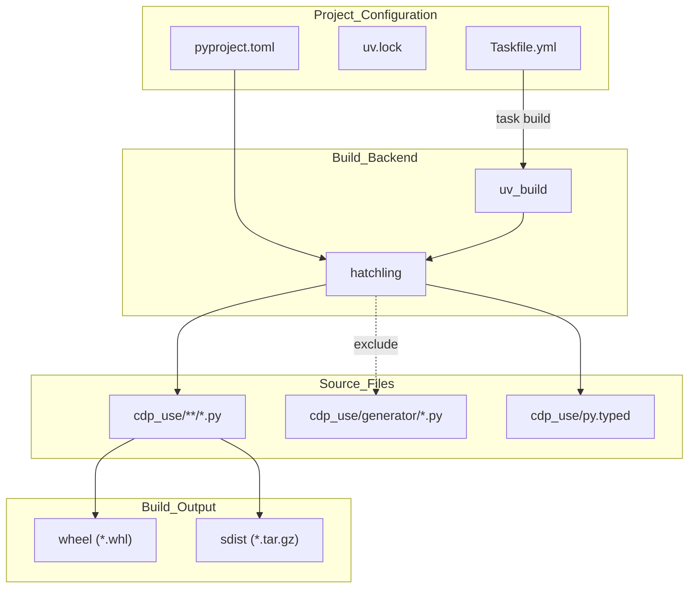
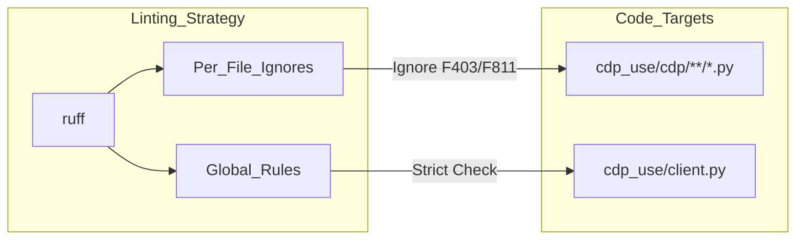

<!-- source: DeepWiki mcp.deepwiki.com · repo browser-use/cdp-use · page 7.1 Project Configuration · fetched 2026-10-30 -->

# Project Configuration

Relevant source files

The following files were used as context for generating this wiki page:

- [README.md](README.md)
- [Taskfile.yml](Taskfile.yml)
- [cdp_use/custom_protocols/browseruse.json](cdp_use/custom_protocols/browseruse.json)
- [pyproject.toml](pyproject.toml)
- [uv.lock](uv.lock)

This document covers the build system configuration, packaging, and dependency management for the `cdp-use` library. It explains how the project is structured for distribution, development, and maintenance using modern Python packaging standards.

For information about setting up a development environment, see [Development Environment](#7.2). For details about the actual code generation and library architecture, see [Code Generation System](#5).

## Build System Configuration

The `cdp-use` project uses a modern Python packaging configuration based on `pyproject.toml` with `hatchling` as the build backend [pyproject.toml:23-25](). This configuration defines project metadata, dependencies, and build behavior.

### Project Metadata

The core project configuration defines essential metadata for distribution:

| Field | Value | Purpose |
|-------|-------|---------|
| `name` | `cdp-use` | PyPI package name [pyproject.toml:2]() |
| `version` | `1.4.5` | Current release version [pyproject.toml:3]() |
| `description` | `Type safe generator/client library for CDP` | Package summary [pyproject.toml:4]() |
| `requires-python` | `>=3.11` | Minimum Python version [pyproject.toml:7]() |
| `license` | `MIT` | Software license [pyproject.toml:8]() |

**Build System Architecture**

Sources: [pyproject.toml:1-33](), [uv.lock:1-41](), [Taskfile.yml:9-12]()

### Build Backend Configuration

The build system uses `hatchling` with specific inclusion and exclusion rules defined in `tool.hatch.build` [pyproject.toml:30-33]().

The generator code at `cdp_use/generator/*.py` is explicitly excluded from the distributed package [pyproject.toml:32](). This is because the generator is a development-time tool used to produce the type-safe bindings; end users only require the resulting `cdp_use/cdp/` library and the `CDPClient` runtime [README.md:159-175]().

The package also includes a `py.typed` file [pyproject.toml:31]() to signal to type checkers like Mypy or Pyright that the package provides inline type annotations (PEP 561 compliance).

Sources: [pyproject.toml:30-33](), [README.md:162-175]()

## Linting and Code Quality

The project utilizes `ruff` for linting and formatting [pyproject.toml:34-44](). A critical aspect of the configuration is handling the massive amount of auto-generated code.

### Per-File Ignores

Because the CDP domains (over 50 total) are generated automatically, they often employ patterns that standard linters might flag, such as wildcard imports (`from .types import *`) used to aggregate domain entities.

The configuration at `tool.ruff.lint.per-file-ignores` specifically suppresses these warnings for the generated code:
- `F403`: `from module import *` used; unable to detect undefined names.
- `F811`: Redefinition of unused name.

Sources: [pyproject.toml:34-44](), [README.md:162-175]()

## Dependency Management

The project uses `uv` for dependency resolution and management, maintaining a `uv.lock` file for reproducible builds [uv.lock:1-61]().

### Runtime Dependencies

The core library requires three primary runtime dependencies [pyproject.toml:14-18]():
- `httpx`: Used by the generator to fetch remote protocol JSON [pyproject.toml:15]().
- `typing-extensions`: Provides backports for modern typing features like `TypedDict` [pyproject.toml:16]().
- `websockets`: The underlying transport for CDP communication [pyproject.toml:17]().

### Development Dependencies

Development tools are defined in the `dev` dependency group [pyproject.toml:27-28]():
- `build`: For creating distribution packages [pyproject.toml:28]().
- `ruff`: For code quality enforcement [pyproject.toml:28]().

Sources: [pyproject.toml:14-28](), [uv.lock:33-61]()

## Automation with Taskfile

The project uses `Taskfile.yml` to provide a consistent interface for common development operations.

| Command | Action | Implementation |
|---------|--------|----------------|
| `task generate` | Regenerates CDP types | `uv run python -m cdp_use.generator` [Taskfile.yml:4-7]() |
| `task build` | Creates distribution | `uv build` [Taskfile.yml:9-12]() |
| `task lint` | Checks code quality | `uv run ruff check cdp_use/` [Taskfile.yml:19-22]() |
| `task format` | Formats source code | `uv run ruff format cdp_use/` [Taskfile.yml:24-27]() |
| `task format-json` | Pretty-prints custom protocols | Shell loop using `json.tool` [Taskfile.yml:29-36]() |
| `task example` | Runs a simple test script | `uv run python simple.py` [Taskfile.yml:38-41]() |

### Custom Protocol Management

The `format-json` task is particularly important for maintaining `cdp_use/custom_protocols/`. It ensures that custom domain definitions, such as `browseruse.json`, remain human-readable and consistently formatted [Taskfile.yml:29-36](), [cdp_use/custom_protocols/browseruse.json:1-92]().

Sources: [Taskfile.yml:1-48](), [cdp_use/custom_protocols/browseruse.json:1-92]()

---

