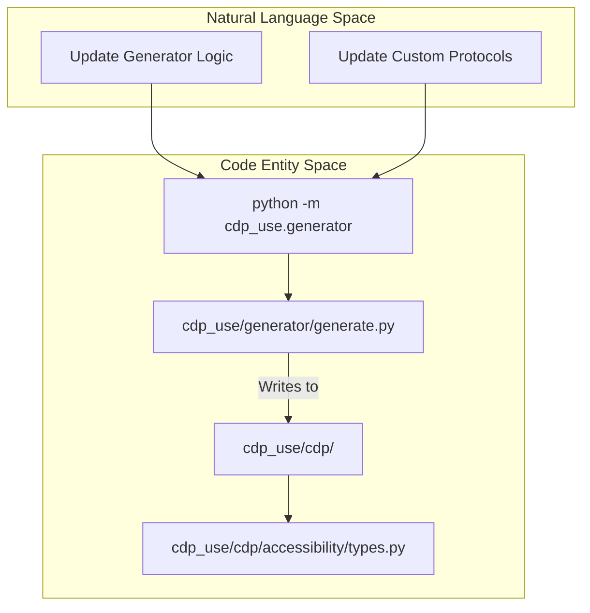
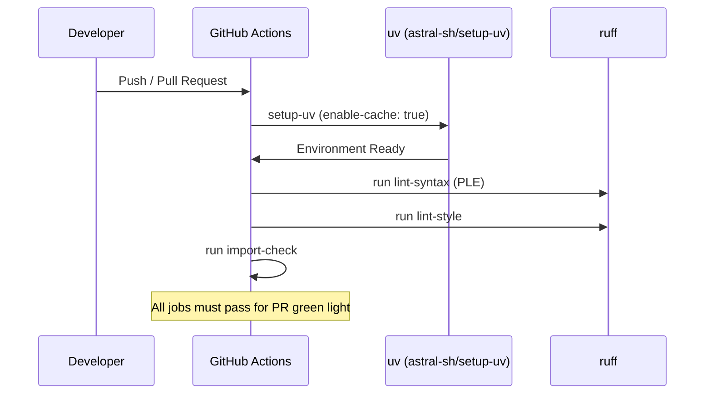

<!-- source: DeepWiki mcp.deepwiki.com · repo browser-use/cdp-use · page 7.2 Development Environment · fetched 2026-10-30 -->

# Development Environment

<details>
<summary>Relevant source files</summary>

The following files were used as context for generating this wiki page:

- [.github/workflows/lint.yml](.github/workflows/lint.yml)
- [.gitignore](.gitignore)
- [LICENSE](LICENSE)
- [pyproject.toml](pyproject.toml)
- [uv.lock](uv.lock)

</details>


This page covers setting up a development environment for contributing to the `cdp-use` library. It details the tools, dependencies, and automated workflows required to modify the core client, update the code generator, or regenerate the type-safe CDP bindings.

## Environment Prerequisites

The `cdp-use` project uses `uv` for dependency management and `ruff` for linting and formatting. It requires Python 3.11 or newer.

| Tool | Requirement | Purpose |
| :--- | :--- | :--- |
| **Python** | `>=3.11` | Runtime and development environment [pyproject.toml:7]() |
| **uv** | Latest | Fast package management and virtual environments [uv.lock:1]() |
| **ruff** | `>=0.12.2` | Linting and code style enforcement [pyproject.toml:28]() |
| **hatchling** | Included | Build backend for the project [pyproject.toml:25]() |

**Sources:** [pyproject.toml:7-28](), [uv.lock:1-4]()

## Setup and Installation

To set up a local development environment, clone the repository and use `uv` to install the project in editable mode with development dependencies.

### 1. Clone and Install
```bash
git clone https://github.com/browser-use/cdp-use
cd cdp-use
uv sync --dev
```

### 2. Editable Mode
Installing with `uv sync` uses the `uv.lock` file to ensure a reproducible environment. The package is installed as an editable dependency [uv.lock:36](), allowing changes to the source code in `cdp_use/` to be reflected immediately without re-installation.

### 3. Verification
Verify the installation by importing the core client:
```bash
uv run python -c "from cdp_use import CDPClient; print('OK')"
```

**Sources:** [uv.lock:34-47](), [.github/workflows/lint.yml:43]()

## Development Workflow

The development cycle involves modifying the generator or the runtime client, and ensuring that the generated bindings remain synchronized with the protocol specifications.

### Code Generation Pipeline
The core of `cdp-use` is its generated layer. If the CDP specification changes or the generator logic is updated, you must regenerate the bindings.



**Sources:** [pyproject.toml:30-32](), [uv.lock:34-41]()

### Linting and Formatting
The project enforces strict linting using `ruff`. Configuration is managed in `pyproject.toml`.

*   **Global Exclusions:** `.git`, `__pycache__`, `dist`, and `build` are ignored [pyproject.toml:35]().
*   **Generated Code Rules:** Since the generated CDP code in `cdp_use/cdp/` uses wildcard imports and complex redefinitions by design, specific linting rules (`F403`, `F811`) are ignored for those directories [pyproject.toml:41-43]().

**Sources:** [pyproject.toml:34-44]()

## Continuous Integration (CI)

The project uses GitHub Actions to maintain code quality. The `lint.yml` workflow runs on every push to `main` and on all pull requests.

### CI Jobs Breakdown

| Job Name | Command | Purpose |
| :--- | :--- | :--- |
| `lint-syntax` | `ruff check --select PLE` | Checks for critical Python syntax and logic errors [lint.yml:23]() |
| `lint-style` | `ruff check` | Enforces the project's coding style and linting rules [lint.yml:33]() |
| `import-check` | `python -c "from cdp_use import CDPClient"` | Ensures the package is installable and the main entry point works [lint.yml:43]() |



**Sources:** [.github/workflows/lint.yml:1-44]()

## Project Layout and Exclusions

The development environment is configured to keep the repository clean of build artifacts and temporary files.

### Git Ignore Logic
The `.gitignore` file prevents the following from being committed:
*   **Python Artifacts:** `__pycache__`, `.pyc`, and `.egg-info` [ .gitignore:1-7]().
*   **Build Outputs:** `build/`, `dist/`, and `wheels/` [ .gitignore:4-6]().
*   **Environment:** The `.venv` directory and `tmp` folders [ .gitignore:10-12]().
*   **IDE Config:** `.vscode` settings [ .gitignore:14]().

### Build System Configuration
The project uses `hatchling` as the build backend [pyproject.toml:25](). The build configuration explicitly includes the `py.typed` marker for PEP 561 compliance but excludes the `generator` source code from the final distribution package to keep the runtime lightweight [pyproject.toml:30-32]().

**Sources:** [.gitignore:1-14](), [pyproject.toml:23-33]()

---

