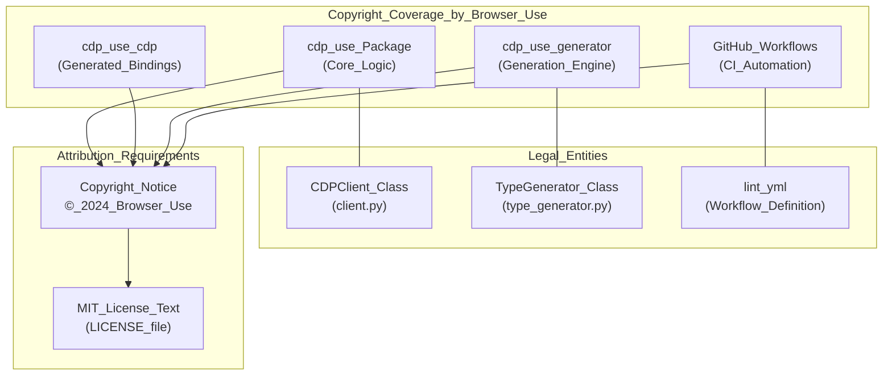
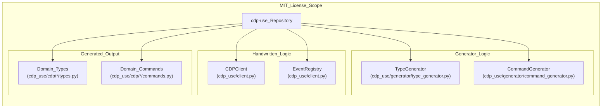

<!-- source: DeepWiki mcp.deepwiki.com · repo browser-use/cdp-use · page 7.3 License and Legal · fetched 2026-10-30 -->

# License and Legal

Relevant source files

The following files were used as context for generating this wiki page:

- [.github/workflows/lint.yml](.github/workflows/lint.yml)
- [LICENSE](LICENSE)

This document covers the licensing terms, copyright information, and legal considerations for the `cdp-use` library. It explains the rights and obligations for users, contributors, and distributors of the software.

For information about contributing to the project, see [Development Environment](). For project configuration and packaging details, see [Project Configuration]().

## License Overview

The `cdp-use` library is distributed under the MIT License, one of the most permissive open-source licenses available. This license grants broad permissions for commercial and non-commercial use while requiring minimal obligations from users.

**License Type:** MIT License  
**Copyright Holder:** Browser Use  
**Copyright Year:** 2024

Sources: [LICENSE:1-3]()

## MIT License Terms

The MIT License grants the following permissions without restriction:

| Permission | Description |
|------------|-------------|
| **Use** | Execute and run the software for any purpose |
| **Modify** | Make changes and improvements to the source code |
| **Distribute** | Share copies of the software with others |
| **Sublicense** | Include the software in projects under different licenses |
| **Sell** | Use the software in commercial products and services |
| **Private Use** | Use the software in private, proprietary projects |

### License Requirements

The MIT License requires only two obligations:

1. **Copyright Notice Inclusion**: The copyright notice must be included in all copies or substantial portions of the software. [LICENSE:12-13]()
2. **License Text Inclusion**: The full license text must be distributed with the software. [LICENSE:12-13]()

Sources: [LICENSE:5-13]()

## Copyright and Attribution

### Code Entity to Legal Coverage Mapping

The following diagram associates specific code entities and repository structures with the copyright coverage held by Browser Use.

The copyright covers all original work within the repository, including:
- Core library implementation (e.g., `CDPClient` in `cdp_use/client.py`).
- Code generation system in `cdp_use/generator/`.
- Generated CDP bindings in `cdp_use/cdp/`.
- CI/CD configurations like `.github/workflows/lint.yml`. [/.github/workflows/lint.yml:1-44]()

Sources: [LICENSE:3](), [/.github/workflows/lint.yml:1-44]()

## Usage Rights and Warranty Disclaimer

The MIT License provides software "AS IS" without any warranty. This includes:

### No Warranty Provision
The software is provided without warranty of any kind, including but not limited to:
- **MERCHANTABILITY**: No guarantee the software is fit for commercial use. [LICENSE:16]()
- **FITNESS FOR PURPOSE**: No guarantee the software meets specific requirements. [LICENSE:17]()
- **NON-INFRINGEMENT**: No guarantee the software doesn't infringe third-party rights. [LICENSE:17]()

### Liability Limitations
In no event shall the authors or copyright holders (Browser Use) be liable for any claim, damages, or other liability, whether in an action of contract, tort, or otherwise, arising from the software. [LICENSE:17-21]()

Sources: [LICENSE:15-21]()

## License Application Across Codebase Components

### Code Architecture and License Scope

This diagram bridges the functional code components to the license scope, showing how the MIT license applies to both handwritten and generated entities.

### Generated Code Licensing
All code generated by the `cdp_use.generator` system falls under the same MIT License as the core library. This includes:
- **Type Definitions**: All `TypedDict` classes generated from CDP specifications.
- **Command Bindings**: All command parameter and return type definitions.
- **Event Bindings**: All event payload type definitions.
- **Domain Libraries**: All generated client library interfaces.

Users can freely use, modify, and distribute applications that include this generated code under the MIT License terms. [LICENSE:5-9]()

Sources: [LICENSE:1-21]()

## Third-Party Dependencies and CI

The project utilizes several third-party tools and libraries. While the `cdp-use` code itself is MIT licensed, the environment setup and CI pipeline interact with other licensed software:

- **uv**: Used for dependency management and running CI jobs (e.g., `uv run ruff check`). [/.github/workflows/lint.yml:20-23]()
- **Ruff**: Used for linting and code style enforcement. [/.github/workflows/lint.yml:33]()
- **GitHub Actions**: Used for CI/CD automation. [/.github/workflows/lint.yml:1-13]()

### Dependency Compatibility
The core runtime dependencies (such as `websockets` and `httpx` mentioned in project documentation) are selected for license compatibility with the MIT license, typically falling under BSD or MIT-style permissive licenses.

Sources: [/.github/workflows/lint.yml:1-44](), [LICENSE:1-21]()

## Commercial Use and Distribution

The MIT License explicitly permits commercial use of `cdp-use` in any form.

### Permitted Commercial Activities
- **Product Integration**: Include `cdp-use` in commercial software products. [LICENSE:8-9]()
- **Service Offerings**: Use `cdp-use` to build commercial web scraping or automation services.
- **Modification and Resale**: Modify the library and distribute enhanced versions commercially. [LICENSE:6-9]()
- **Proprietary Applications**: Include `cdp-use` in closed-source, proprietary applications.

### Distribution Requirements
When distributing software that includes `cdp-use`:
1. Include the copyright notice: `Copyright (c) 2024 Browser Use`. [LICENSE:3]()
2. Include the full MIT License text. [LICENSE:12-13]()
3. These requirements apply to both source and binary distributions.

Sources: [LICENSE:1-21]()

---

