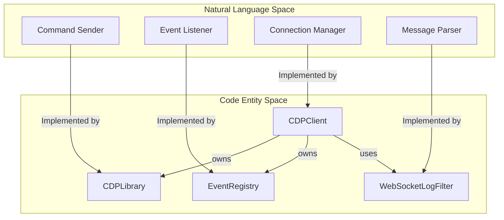
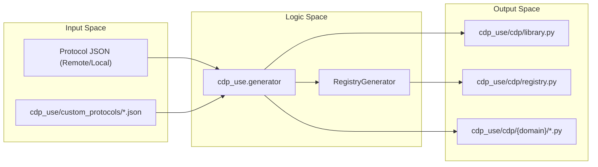

<!-- source: DeepWiki mcp.deepwiki.com · repo browser-use/cdp-use · page 8 Glossary · fetched 2026-10-30 -->

# Glossary

Relevant source files

The following files were used as context for generating this wiki page:

- [README.md](README.md)
- [Taskfile.yml](Taskfile.yml)
- [cdp_use/cdp/browseruse/types.py](cdp_use/cdp/browseruse/types.py)
- [cdp_use/cdp/library.py](cdp_use/cdp/library.py)
- [cdp_use/cdp/registry.py](cdp_use/cdp/registry.py)
- [cdp_use/client.py](cdp_use/client.py)
- [cdp_use/custom_protocols/browseruse.json](cdp_use/custom_protocols/browseruse.json)
- [cdp_use/generator/registry_generator.py](cdp_use/generator/registry_generator.py)
- [pyproject.toml](pyproject.toml)
- [uv.lock](uv.lock)

This glossary defines codebase-specific terms, jargon, and abbreviations used within the `cdp-use` library. It covers Chrome DevTools Protocol (CDP) concepts, library abstractions, and tooling terminology to assist onboarding engineers.

## CDP Core Concepts

| Term | Definition | Code Pointer |
|:---|:---|:---|
| **CDP** | Chrome DevTools Protocol. A protocol used to instrument, inspect, debug, and profile Chromium-based browsers. | [README.md:3-3]() |
| **Domain** | A logical grouping of CDP functionality (e.g., `Page`, `Network`, `DOM`). Each domain contains its own types, commands, and events. | [cdp_use/cdp/library.py:19-254]() |
| **Command** | A request sent to the browser to perform an action or retrieve data (e.g., `Page.navigate`). | [cdp_use/client.py:144-154]() |
| **Event** | An asynchronous notification sent by the browser to the client (e.g., `Page.loadEventFired`). | [cdp_use/cdp/registry.py:46-51]() |
| **Session ID** | A unique identifier used to route commands to specific targets (like a tab or an iframe) within a single WebSocket connection. | [cdp_use/cdp/registry.py:50-50]() |

**Sources:**
- [README.md:3-3]()
- [cdp_use/cdp/library.py:19-254]()
- [cdp_use/client.py:144-154]()
- [cdp_use/cdp/registry.py:46-51]()

---

## Library Abstractions

### CDPClient
The central entry point for the library. It manages the underlying WebSocket connection to the browser and orchestrates command execution and event dispatching.

*   **send**: An instance of `CDPLibrary` used to invoke CDP commands.
*   **register**: An instance of `CDPRegistrationLibrary` used to attach listeners to CDP events.

### CDPLibrary
A generated aggregator class that provides access to domain-specific clients (e.g., `client.send.Page`).

### EventRegistry
A central registry that maintains a mapping of CDP event names to user-defined callback functions. It handles the asynchronous execution of these callbacks when an event is received from the WebSocket.

### WebSocketLogFilter
A specialized logging utility that intercepts and formats raw WebSocket traffic into human-readable CDP interactions, including PING/PONG monitoring.

**System Architecture Mapping**

The following diagram illustrates the relationship between Natural Language concepts and the specific Code Entities that implement them.

"Client-Side Entity Mapping"

**Sources:**
- [cdp_use/client.py:20-25]()
- [cdp_use/cdp/library.py:13-17]()
- [cdp_use/cdp/registry.py:14-18]()
- [README.md:181-201]()

---

## Tooling & Generation Terminology

### Custom Protocols
JSON files located in `cdp_use/custom_protocols/` that define non-standard CDP domains or extensions used specifically by Browser Use (e.g., `BrowserUse` domain for captcha events).

### RegistryGenerator
The internal generator component responsible for producing the `cdp_use/cdp/registry.py` file, which enables type-safe event handling.

### Taskfile
A `Taskfile.yml` used for development automation, defining commands for code generation, linting, and formatting.

**Code Generation Data Flow**

This diagram shows how protocol definitions are transformed into the type-safe library structure.

"Generation Pipeline Flow"

**Sources:**
- [cdp_use/custom_protocols/browseruse.json:1-5]()
- [cdp_use/generator/registry_generator.py:10-13]()
- [Taskfile.yml:4-7]()
- [README.md:205-215]()

---

## Abbreviations

| Abbreviation | Full Term | Context |
|:---|:---|:---|
| **WS** | WebSocket | The communication layer for CDP. |
| **ID** | Message Identifier | Incremental integer used to correlate CDP requests and responses in `CDPClient`. |
| **TypedDict** | PEP 589 Typed Dictionary | Used to provide type safety for the JSON payloads sent to and from the browser. |
| **PEP 561** | Distributing Typed Packages | Refers to the inclusion of `py.typed` to signal type information to static analyzers. |

**Sources:**
- [pyproject.toml:17-17]()
- [pyproject.toml:31-31]()
- [cdp_use/client.py:131-132]()
- [README.md:7-7]()