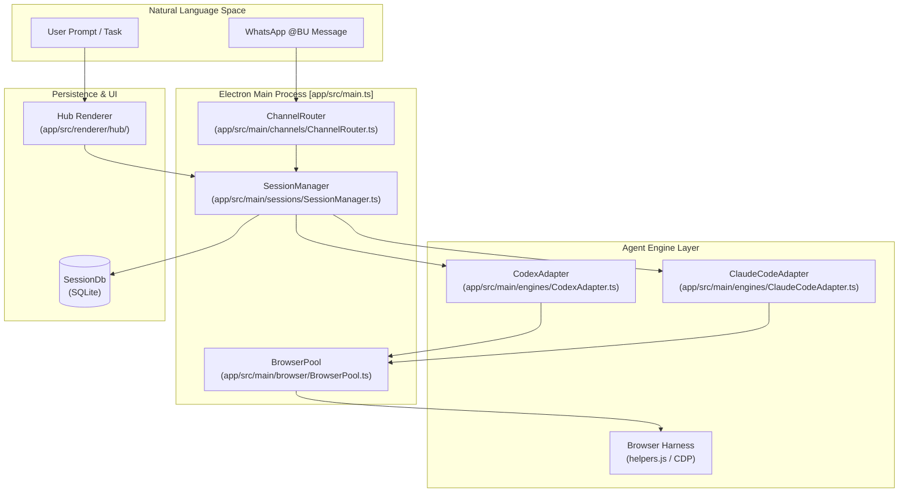
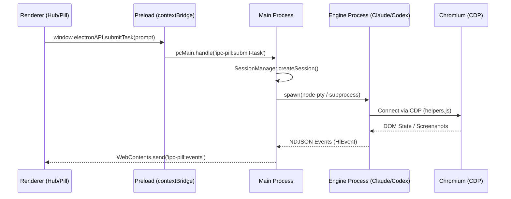

<!-- source: DeepWiki mcp.deepwiki.com · repo browser-use/desktop · page 1 Overview · fetched 2026-10-30 -->

# Overview

<details>
<summary>Relevant source files</summary>

The following files were used as context for generating this wiki page:

- [.gitignore](.gitignore)
- [CHANGELOG.md](CHANGELOG.md)
- [CONTRIBUTING.md](CONTRIBUTING.md)
- [README.md](README.md)
- [app/package.json](app/package.json)

</details>


This document provides a technical overview of the `browser-use/desktop` system, a cross-platform desktop application that enables AI agents to interact with websites. Unlike traditional browsers that attempt to embed agent logic, this application acts as the "agent half," porting user sessions into a fresh Chromium instance to automate tasks across the web [README.md:11-13]().

## Purpose and Scope

The `browser-use-desktop` application is a hub for AI browser agents [app/package.json:2-5](). It provides a desktop environment to run agents powered by providers like Anthropic (Claude Code) and Codex (OpenAI) [README.md:31-32](). The scope includes:
- **Session Porting**: Migrating cookies from the user's primary Chrome instance into the agent's automation environment [README.md:13]().
- **Multi-Agent Management**: Running and monitoring a "team" of browser agents [README.md:5]().
- **Omnipresent Access**: Spawning tasks from anywhere via global keyboard shortcuts [README.md:13]().
- **Inbound Channels**: Triggering agent sessions through external platforms like WhatsApp [README.md:34-38]().

## System Architecture

The application is built on an Electron multi-process architecture, orchestrating a high-performance automation harness [README.md:15]().

### High-Level Architecture

The system bridges Natural Language intents from the user into actionable code execution via the following entity relationships:



**Sources:** [README.md:11-15](), [README.md:34-38](), [app/package.json:2-5](), [CHANGELOG.md:11-25]()

### Code Entity Space: IPC and Process Flow

The application relies on structured IPC (Inter-Process Communication) to coordinate the UI and the underlying agent engines.



**Sources:** [CHANGELOG.md:17-21](), [app/package.json:120](), [README.md:13]()

## Key Features

### Provider & Channel Integration
The application supports multiple AI backends and entry points:

| Category | Entities | Implementation Detail |
| :--- | :--- | :--- |
| **Providers** | Anthropic, Codex | Handled via Engine Adapters [README.md:31-32]() |
| **Channels** | WhatsApp, Command Bar | `ChannelRouter` handles inbound triggers [README.md:34-38]() |
| **Auth** | Keytar, Claude Auth | Secure credential storage via `keytar` [app/package.json:118](), [CHANGELOG.md:77-87]() |

### Automation Infrastructure
- **Browser Harness**: Built on `browser-harness`, utilizing CDP for deep browser control [README.md:15]().
- **Session Persistence**: Uses `better-sqlite3` for local session history and state [app/package.json:114]().
- **Terminal Integration**: Uses `node-pty` and `xterm.js` to provide real-time agent terminal output in the UI [app/package.json:109-112, 120]().

## Technical Stack

The project utilizes a modern TypeScript/React stack within the Electron ecosystem:

- **Build Tooling**: Electron Forge with Vite for fast HMR and optimized bundling [app/package.json:61, 67, 95]().
- **UI Framework**: React 19 with TanStack Query for state management [app/package.json:100, 122]().
- **Testing**: Vitest for unit/integration tests and Playwright for E2E and visual QA [app/package.json:40, 96](), [CHANGELOG.md:46-65]().
- **Styling**: 8px grid system using Geist (UI) and Berkeley Mono (code) fonts [CHANGELOG.md:38-39]().

## Development and Build
The project uses `go-task` (Taskfile) to manage development workflows [README.md:42]().

```bash
task up              # Install dependencies and start development
task lint            # Run ESLint [CONTRIBUTING.md:24]
task typecheck       # Run TypeScript compiler checks [CONTRIBUTING.md:25]
task make            # Build platform-specific installers [CONTRIBUTING.md:27]
task linux:make:docker # Build Linux packages in a clean Docker environment [README.md:51]
```

**Sources:** [README.md:42-52](), [CONTRIBUTING.md:5-28](), [app/package.json:27-53]()

---

