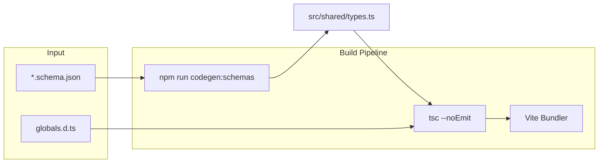

<!-- source: DeepWiki mcp.deepwiki.com · repo browser-use/desktop · page 10 Type Definitions · fetched 2026-10-30 -->

# Type Definitions

<details>
<summary>Relevant source files</summary>

The following files were used as context for generating this wiki page:

- [app/src/renderer/globals.d.ts](app/src/renderer/globals.d.ts)
- [shared/schemas/README.md](shared/schemas/README.md)
- [shared/schemas/agent_events.schema.json](shared/schemas/agent_events.schema.json)
- [shared/schemas/agent_task.schema.json](shared/schemas/agent_task.schema.json)
- [shared/schemas/onboarding.schema.json](shared/schemas/onboarding.schema.json)
- [shared/schemas/tab_state.schema.json](shared/schemas/tab_state.schema.json)

</details>


This document describes the custom TypeScript type definitions, shared session schemas, and the IPC/protocol specifications used in the `browser-use/desktop` application. These definitions ensure type safety across the multi-process Electron architecture and the Python-based agent engine.

## Purpose and Scope

The type system is designed to bridge the gap between several distinct environments:
1.  **Main Process (Node.js)**: Orchestrates the application, manages sessions, and spawns the Python daemon.
2.  **Renderer Process (Chromium)**: Handles the UI (Hub, Pill, Onboarding).
3.  **Python Daemon**: Executes the AI agent tasks.
4.  **Static Assets**: Handles non-code imports like SVGs and images in the frontend.

## IPC and Protocol Specification

The application uses a "Single Source of Truth" approach for cross-process communication. All messages between the Electron main process and the Python agent daemon are defined as JSON schemas in `shared/schemas`.

### Shared Schemas Architecture

```mermaid
graph TD
    subgraph "Source of Truth"
        [shared/schemas/*.schema.json]
    end

    subgraph "Code Generation"
        [npm_run_codegen:schemas] --> [src/shared/types.ts]
        [npm_run_codegen:schemas] --> [python/agent/schemas.py]
    end

    subgraph "Runtime Communication"
        MainProcess["Electron Main Process"]
        PythonDaemon["Python Agent Daemon"]
        Renderer["Renderer (UI)"]

        MainProcess -- "Unix Socket (NDJSON)" --> PythonDaemon
        MainProcess -- "Electron IPC" --> Renderer
    end

    [shared/schemas/*.schema.json] --> [npm_run_codegen:schemas]
    [src/shared/types.ts] -.-> MainProcess
    [src/shared/types.ts] -.-> Renderer
    [python/agent/schemas.py] -.-> PythonDaemon
```
**Sources**: [shared/schemas/README.md:8-13](), [shared/schemas/README.md:159-169]()

### Protocol Transport (Main ↔ Daemon)
Communication occurs over a **Unix domain socket** using **Newline-Delimited JSON (NDJSON)** [shared/schemas/README.md:9-10]().
- **Socket Path**: `${app.getPath('userData')}/daemon-${process.pid}.sock`. This ensures multi-instance safety [shared/schemas/README.md:18-24]().
- **Version Integrity**: Every message carries a `version: "1.0"` field [shared/schemas/README.md:49]().

### Message Types
| Schema File | Message Types | Direction |
|---|---|---|
| `agent_task.schema.json` | `agent_task`, `cancel_task`, `ping`, `shutdown` | Main → Daemon [shared/schemas/README.md:37]() |
| `agent_events.schema.json` | `task_started`, `step_start`, `step_result`, `task_done` | Daemon → Main [shared/schemas/README.md:39]() |
| `tab_state.schema.json` | `tab-opened`, `tab-closed`, `tab-updated` | Main → Renderer [shared/schemas/README.md:40]() |
| `onboarding.schema.json` | `onboarding-complete`, `oauth_start` | Renderer ↔ Main [shared/schemas/README.md:41]() |

## Frontend Type Definitions (`globals.d.ts`)

The `app/src/renderer/globals.d.ts` file defines the `window` object extensions and the interfaces for the APIs exposed via `contextBridge`.

### Electron API Interfaces
These interfaces define the contract between the UI and the Main process:

- **`ElectronSessionAPI`**: Manages the lifecycle of AI sessions (create, start, cancel, steer) [app/src/renderer/globals.d.ts:35-76]().
- **`ElectronChromeImportAPI`**: Handles profile detection and cookie importing from local Chrome installations [app/src/renderer/globals.d.ts:128-133]().
- **`ElectronOnAPI`**: Defines the event listeners available to the UI, such as `sessionUpdated` and `sessionOutput` [app/src/renderer/globals.d.ts:135-147]().

### Static Asset Modules
Vite resolves static assets at build time. Ambient declarations allow TypeScript to treat these imports as strings:
```typescript
declare module '*.svg' { const src: string; export default src; }
```
**Sources**: [app/src/renderer/globals.d.ts:1-33]()

## Shared Session Schemas

### Agent Events (`HlEvent`)
The `agent_events.schema.json` defines the structure of events emitted by the agent engine. Key events include:
- **`StepStartEvent`**: Contains the `task_id`, `step` number, and the agent's `plan` for that step [shared/schemas/agent_events.schema.json:48-70]().
- **`TaskFailedEvent`**: Includes a machine-readable `reason` such as `step_budget_exhausted` or `sandbox_violation` [shared/schemas/agent_events.schema.json:136-164]().

### Tab State
The `tab_state.schema.json` tracks the state of browser views managed by the application.
- **`TabInfo`**: Tracks `tab_id`, `url`, `title`, and navigation capabilities (`can_go_back`) [shared/schemas/tab_state.schema.json:15-51]().
- **`TabActivatedEvent`**: Notifies the UI when a tab becomes active, providing the `per_target_cdp_url` [shared/schemas/tab_state.schema.json:52-69]().

## Integration with TypeScript Compilation

The type definitions are integrated into the build process to ensure that changes in schemas are reflected in the code.



**Key Invariant**: The `per_target_cdp_url` is always used instead of browser-level endpoints to enforce security by limiting agent access to specific tabs [shared/schemas/README.md:74-75]().

**Sources**: [shared/schemas/README.md:141-156](), [app/src/renderer/globals.d.ts:135-147]()

---

