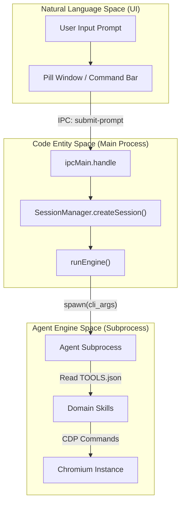
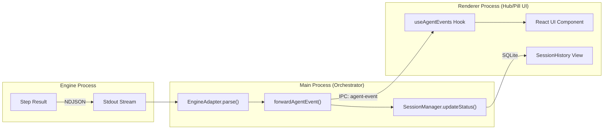

<!-- source: DeepWiki mcp.deepwiki.com · repo browser-use/desktop · page 11 Glossary · fetched 2026-10-30 -->

# Glossary

Relevant source files

The following files were used as context for generating this wiki page:

- [README.md](README.md)
- [app/package.json](app/package.json)
- [app/src/main/index.ts](app/src/main/index.ts)
- [app/src/main/updater.ts](app/src/main/updater.ts)
- [shared/schemas/agent_events.schema.json](shared/schemas/agent_events.schema.json)
- [shared/schemas/agent_task.schema.json](shared/schemas/agent_task.schema.json)

This page defines codebase-specific terms, jargon, and domain concepts used within the Browser Use Desktop repository. It serves as a technical reference for onboarding engineers to understand the mapping between abstract concepts and their concrete implementations.

## Core Concepts

### Agent Engine
The core execution logic that drives the browser. It is implemented as a pluggable subsystem where different "engines" (e.g., Claude Code, Codex) can be swapped.
*   **Implementation**: Engines are managed via the `runEngine` function and the `EngineId` type [app/src/main/index.ts:102-103]().
*   **Lifecycle**: Engines are spawned as subprocesses that communicate with the main process over NDJSON or Unix sockets.

### Browser Pool
A management layer that coordinates multiple Chromium instances or `BrowserView` objects to be used by agents.
*   **Class**: `BrowserPool` [app/src/main/index.ts:107]().
*   **Role**: Handles allocation, recycling, and CDP (Chrome DevTools Protocol) port management for active agent sessions.

### CDP (Chrome DevTools Protocol)
The protocol used by the Agent Engine to inspect and control the Chromium browser instances.
*   **Usage**: The app resolves a specific CDP port during startup [app/src/main/index.ts:156-158]() and passes `per_target_cdp_url` to the engine [shared/schemas/agent_task.schema.json:32-35]().

### Hub
The primary application window where users manage their agents, view history, and adjust settings.
*   **Function**: `createShellWindow` [app/src/main/index.ts:72]().
*   **Components**: Includes the Dashboard, Sidebar, and Terminal panes.

### Pill
A floating, minimalist command bar window that stays on top of other applications, used for quick prompt entry via global hotkeys.
*   **Implementation**: Managed by `createPillWindow` and functions like `togglePill` [app/src/main/index.ts:75]().
*   **States**: Has `PILL_HEIGHT_COLLAPSED` and `PILL_HEIGHT_EXPANDED` modes [app/src/main/index.ts:75]().

### Session
A single execution of an agent task, tracking the prompt, the browser state, and the sequence of events emitted by the engine.
*   **Manager**: `SessionManager` [app/src/main/index.ts:106]().
*   **Persistence**: Stored in a SQLite database (`SessionDb`).

---

## Technical Jargon & Abbreviations

| Term | Definition | Code Pointer |
| :--- | :--- | :--- |
| **HlEvent** | "High-Level Event": A structured event emitted by an engine (e.g., `step_start`, `task_done`). | [shared/schemas/agent_events.schema.json:4-6]() |
| **NDJSON** | Newline Delimited JSON: The streaming format used for engine-to-main process communication. | [shared/schemas/agent_events.schema.json:5-5]() |
| **Takeover** | An overlay mode where the agent yields control to the user or requests manual intervention. | [app/src/main/index.ts:77-77]() |
| **Task ID** | A unique identifier (usually UUID) for an agent execution session. | [shared/schemas/agent_task.schema.json:37-41]() |

---

## Data Flow Diagrams

### Natural Language to Code Entity Mapping: Task Dispatch
The following diagram illustrates how a user prompt moves from the UI (Natural Language Space) into the structured execution environment (Code Entity Space).

Title: Prompt Dispatch Flow

**Sources**: [app/src/main/index.ts:75-107](), [shared/schemas/agent_task.schema.json:19-46]()

### Event Loop: Engine to UI
This diagram shows how internal engine states are translated into visual updates for the user.

Title: Event Propagation Architecture

**Sources**: [app/src/main/index.ts:102-104](), [shared/schemas/agent_events.schema.json:1-208]()

---

## Domain Schemas

### Agent Task Schema
The `AgentTaskRequest` defines the contract for sending a new job to the engine. Key fields include:
*   `prompt`: The raw string from the user [shared/schemas/agent_task.schema.json:27-31]().
*   `per_target_cdp_url`: The WebSocket URL for the specific browser tab the agent should control [shared/schemas/agent_task.schema.json:32-36]().
*   `task_id`: The unique session identifier [shared/schemas/agent_task.schema.json:37-41]().

### Agent Event Schema
The engine communicates back using a variety of event types defined in `agent_events.schema.json`:
*   `task_started`: Confirmation the engine has initialized [shared/schemas/agent_events.schema.json:29-46]().
*   `step_start`: The agent is beginning a specific action (includes the "plan") [shared/schemas/agent_events.schema.json:48-69]().
*   `step_result`: The outcome of a specific browser interaction [shared/schemas/agent_events.schema.json:71-92]().
*   `task_done`: Final completion with result summary and token usage [shared/schemas/agent_events.schema.json:110-134]().

**Sources**:
- `shared/schemas/agent_task.schema.json`
- `shared/schemas/agent_events.schema.json`
- `app/src/main/index.ts`
- `app/package.json`