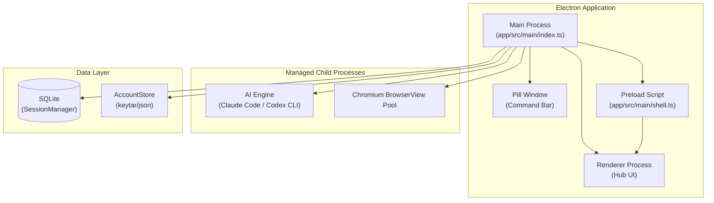
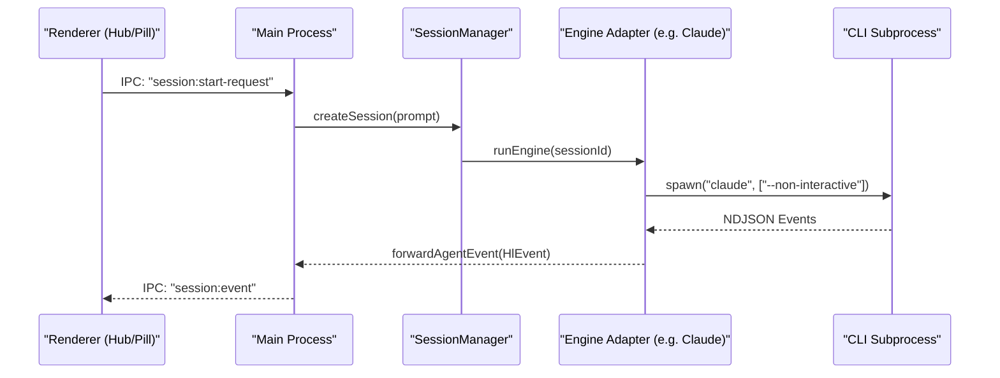

<!-- source: DeepWiki mcp.deepwiki.com · repo browser-use/desktop · page 2 Core Architecture · fetched 2026-10-30 -->

# Core Architecture

Relevant source files

The following files were used as context for generating this wiki page:

- [app/src/main/index.ts](app/src/main/index.ts)
- [app/src/main/window.ts](app/src/main/window.ts)

This document explains the multi-process Electron architecture that forms the foundation of the Browser Use desktop application. It covers how the main process orchestrates AI engine processes (Claude Code, Codex), manages embedded BrowserViews, and handles the overall application lifecycle.

For detailed implementation of individual subsystems, see [Main Process](#2.1), [Renderer Process](#2.2), [Preload Script](#2.3), and [Configuration System](#2.4).

## Overview

The Browser Use desktop application implements a multi-process architecture where the Electron Main process acts as a central controller. Unlike traditional browsers, this application is designed to host AI agents that drive web automation. It orchestrates local CLI engines and manages a pool of browser instances that the agents interact with via the Chrome DevTools Protocol (CDP).

## Multi-Process Architecture

The application consists of several Electron processes and managed child processes:

**Sources:** [app/src/main/index.ts:1-125](), [app/src/main/sessions/SessionManager.ts:1-50](), [app/src/main/hl/engines/index.ts:1-30]()

## Core Components

### Main Process Orchestration
The Main process is the entry point and system authority. It handles:
- **Process Lifecycle**: Managing `app.whenReady()`, single-instance locks, and clean shutdowns [app/src/main/index.ts:48-60]().
- **Window Management**: Creating the Hub (Shell), Pill (Command Bar), and Settings windows [app/src/main/window.ts:75-109](), [app/src/main/pill.ts:1-50]().
- **Engine Execution**: Spawning and piping I/O for AI engine CLI processes like Claude Code [app/src/main/hl/engines/claude-code.ts:1-100]().
- **Session Management**: Coordinating the `SessionManager` which tracks agent tasks and the `BrowserPool` which manages Chromium instances [app/src/main/sessions/SessionManager.ts:55-120]().

### The Hub and Pill
The UI is split into two primary surfaces:
1. **The Hub**: A full-featured dashboard for managing sessions, viewing logs, and configuring settings [app/src/main/window.ts:122-141]().
2. **The Pill**: A global, floating command bar triggered by hotkeys (e.g., `Cmd+Shift+L`) for quick agent dispatch [app/src/main/pill.ts:75-110]().

### AI Engine Layer
The "Natural Language Space" is bridged to the "Code Entity Space" through Engine Adapters. When a user submits a prompt, the `runEngine` function selects the appropriate adapter to spawn a CLI process.

**Sources:** [app/src/main/hl/engines/index.ts:10-40](), [app/src/main/pill.ts:104-105](), [app/src/main/sessions/SessionManager.ts:150-180]()

## Inter-Process Communication (IPC)

The application uses a strictly defined IPC layer via `contextBridge`. The `Preload Script` exposes specific APIs to the renderer while keeping `nodeIntegration` disabled for security.

### IPC Communication Bridge

| Entity | Code Identifier | Responsibility |
|--------|-----------------|----------------|
| **Bridge** | `contextBridge.exposeInMainWorld` | Securely exposing APIs to `window.electron` [app/src/main/shell.ts:1-50]() |
| **Handlers** | `ipcMain.handle` / `ipcMain.on` | Processing requests for session control, settings, and auth [app/src/main/index.ts:400-500]() |
| **Validators** | `assertString`, `assertAttachments` | Sanitizing IPC inputs before processing [app/src/main/ipc-validators.ts:1-30]() |

**Sources:** [app/src/main/shell.ts:1-100](), [app/src/main/ipc-validators.ts:1-50]()

## Security and Isolation

The architecture enforces several security boundaries:
- **Sandbox Mode**: Renderer processes run with `sandbox: true` [app/src/main/window.ts:107]().
- **Context Isolation**: Enabled to prevent the renderer from accessing Electron internals directly [app/src/main/window.ts:105]().
- **Isolated User Data**: The application supports an isolated `userData` directory, which can be overridden via CLI flags to keep agent profiles separate from user profiles [app/src/main/index.ts:148-151]().
- **Native Crash Reporting**: `crashReporter` is initialized early to capture native crashes in GPU or renderer processes [app/src/main/index.ts:36-42]().

**Sources:** [app/src/main/index.ts:36-51](), [app/src/main/window.ts:100-110]()

## Process Configuration and Startup

On startup, the Main process performs several critical environment checks:
1. **CDP Port Resolution**: Assigns a remote debugging port for the internal Chromium instances [app/src/main/index.ts:156-160]().
2. **Onboarding Gate**: If no account is found, it diverts the user to the `OnboardingWindow` before showing the main Hub [app/src/main/identity/onboardingHandlers.ts:1-50]().
3. **Vite Dev Integration**: In development, it handles retries for the Vite dev server to ensure the UI loads correctly even if the build server is slow [app/src/main/window.ts:143-151]().

**Sources:** [app/src/main/index.ts:156-166](), [app/src/main/window.ts:115-151]()

---

