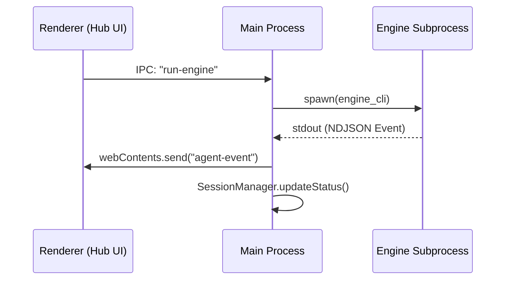

<!-- source: DeepWiki mcp.deepwiki.com · repo browser-use/desktop · page 2.1 Main Process · fetched 2026-10-30 -->

# Main Process

<details>
<summary>Relevant source files</summary>

The following files were used as context for generating this wiki page:

- [app/src/main/index.ts](app/src/main/index.ts)
- [app/src/main/window.ts](app/src/main/window.ts)

</details>


The Main Process serves as the central orchestrator for the Browser Use Desktop application. Implemented primarily in `app/src/main/index.ts`, it manages the Electron application lifecycle, coordinates the AI agent engines (Claude Code, Codex), handles process orchestration for the embedded browser, and implements the security-gating onboarding pattern.

## Application Lifecycle and Instance Management

The application enforces a single-instance lock to prevent data corruption in the SQLite session database and conflicts in the user data directory.

```mermaid
graph TD
    "app.requestSingleInstanceLock()" -- "Returns False" --> "app.quit()"
    "app.requestSingleInstanceLock()" -- "Returns True" --> "app.whenReady()"
    "app.on('second-instance')" -- "Triggered" --> "Restore/Focus existing window"
    
    subgraph "Initialization Sequence"
        "app.whenReady()" --> "resolveUserDataDir()"
        "resolveUserDataDir()" --> "bootstrapHarness()"
        "bootstrapHarness()" --> "AccountStore.load()"
        "AccountStore.load()" --> "Gate: Onboarding vs Shell"
    end
```

The lifecycle management includes native crash reporting via `crashReporter` and global exception handlers to capture main-process errors.

Sources: [app/src/main/index.ts:36-60](), [app/src/main/index.ts:129-141](), [app/src/main/index.ts:148-152]()

## Onboarding Gate Pattern

The application utilizes a gating pattern to ensure users are authenticated and configured before accessing the main Hub interface. The `AccountStore` determines whether to launch the `OnboardingWindow` or the `ShellWindow`.

| Entity | Role | File Reference |
| :--- | :--- | :--- |
| `AccountStore` | Persists user identity and provider selection. | [app/src/main/identity/AccountStore.ts]() |
| `createOnboardingWindow` | Creates a specialized window for the setup flow. | [app/src/main/identity/onboardingWindow.ts]() |
| `createShellWindow` | Creates the main Hub UI window. | [app/src/main/window.ts]() |
| `registerOnboardingHandlers` | IPC handlers that transition from onboarding to shell. | [app/src/main/identity/onboardingHandlers.ts]() |

Sources: [app/src/main/index.ts:83-85](), [app/src/main/index.ts:178-195]()

## Process Orchestration

The main process orchestrates several critical subsystems, including the browser automation harness and the AI engine subprocesses.

### Chrome and CDP Management
The application configures a dedicated remote debugging port for Chromium automation. This must be set via command-line switches before the app is ready.

```mermaid
graph TD
    "resolveCdpPort()" -- "Returns Port" --> "app.commandLine.appendSwitch('remote-debugging-port')"
    "app.whenReady()" --> "BrowserPool.initialize()"
    "BrowserPool" -- "Spawns" --> "Chromium Instance"
    "Chromium Instance" -- "Exposes" --> "CDP Endpoint"
```

Sources: [app/src/main/index.ts:156-162](), [app/src/main/index.ts:107-107]()

### Engine and Harness Execution
The main process manages the "Harness"—a specialized environment for the AI agent—and spawns engine subprocesses (like Claude Code) that drive the browser.

*   **Harness Bootstrap**: Prepares the local execution environment for the agent script. [app/src/main/index.ts:101-101]()
*   **Engine Execution**: The `runEngine` function handles the spawning of CLI-based AI agents, piping their NDJSON output back to the UI. [app/src/main/index.ts:102-102]()

## Window Management

The `createShellWindow` function in `app/src/main/window.ts` manages the primary UI. It implements:
1.  **Bounds Persistence**: Saves and restores window position/size to `window-bounds.json`. [app/src/main/window.ts:14-68]()
2.  **Vite Dev Integration**: In development, it handles retries for the Vite dev server and "stale heal" for 504 errors. [app/src/main/window.ts:115-172]()
3.  **Platform Styling**: Implements `titleBarStyle: 'hidden'` and Window Controls Overlay for Windows/macOS consistency. [app/src/main/window.ts:88-102]()

Sources: [app/src/main/window.ts:75-109](), [app/src/main/window.ts:129-151]()

## IPC and Communication Bridge

The main process acts as the hub for all IPC traffic, routing messages between the Renderer (Hub/Pill) and the background services.



Key IPC Registrations in `index.ts`:
*   `registerApiKeyHandlers`: Manages secure storage of provider keys. [app/src/main/index.ts:86-86]()
*   `registerChannelHandlers`: Handles external triggers (e.g., WhatsApp). [app/src/main/index.ts:113-113]()
*   `registerTelemetryHandlers`: Manages event tracking and consent. [app/src/main/index.ts:87-88]()

Sources: [app/src/main/index.ts:79-90](), [app/src/main/index.ts:113-113]()

## Error Handling and Telemetry

The main process implements a multi-layered crash handling strategy:
1.  **Native Crashes**: Managed by `crashReporter` to capture GPU or memory-level failures. [app/src/main/index.ts:36-42]()
2.  **JS Exceptions**: `uncaughtException` and `unhandledRejection` listeners log errors to the `mainLogger`. [app/src/main/index.ts:129-141]()
3.  **Process Monitoring**: `render-process-gone` and `preload-error` listeners monitor the health of the renderer windows. [app/src/main/window.ts:155-160]()

Sources: [app/src/main/index.ts:31-42](), [app/src/main/window.ts:155-160]()

---

