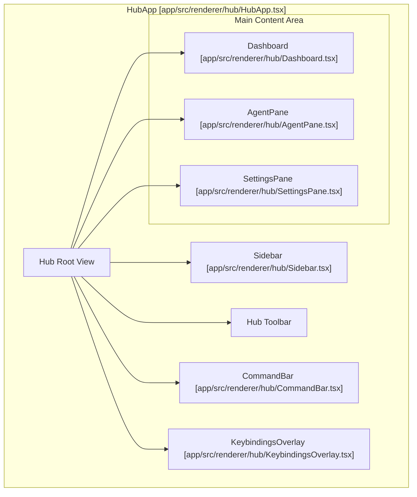
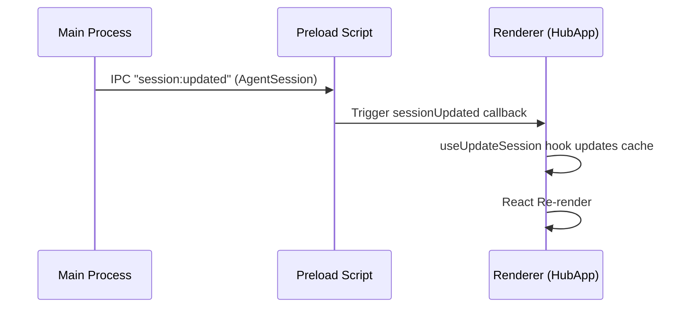

<!-- source: DeepWiki mcp.deepwiki.com · repo browser-use/desktop · page 2.2 Renderer Process · fetched 2026-10-30 -->

# Renderer Process

Relevant source files

The following files were used as context for generating this wiki page:

- [app/src/renderer/globals.d.ts](app/src/renderer/globals.d.ts)
- [app/src/renderer/hub/HubApp.tsx](app/src/renderer/hub/HubApp.tsx)
- [app/src/renderer/hub/hub.css](app/src/renderer/hub/hub.css)

## Purpose and Scope

The Renderer Process manages the user interface and user interactions for the browser-use/desktop application. It runs in Electron's renderer context (browser environment) and is responsible for displaying the Hub UI, handling session output, managing the embedded browser views, and facilitating communication with the main process through the `contextBridge`.

The Hub is built as a React application that provides a dashboard for AI agent sessions, terminal outputs, and system settings.

## Hub UI Architecture

The Hub UI follows a "Linear/Raycast" design language, characterized by deep dark backgrounds, subtle elevation, and a content-first layout [app/src/renderer/hub/hub.css:1-5]().

### Component Hierarchy

Sources: [app/src/renderer/hub/HubApp.tsx:2-10](), [app/src/renderer/hub/hub.css:11-61]()

### View Modes and Navigation
The Hub supports two primary view modes managed via state in `HubApp`:
*   **Dashboard**: A high-level overview of all sessions [app/src/renderer/hub/HubApp.tsx:26]().
*   **Grid/Agent View**: A focused view for interacting with specific agent sessions [app/src/renderer/hub/HubApp.tsx:26]().

Navigation is enhanced by `useVimKeys`, which maps keyboard actions (e.g., `nav.down`, `nav.up`, `nav.top`) to session focus and view switching [app/src/renderer/hub/HubApp.tsx:148-175]().

## IPC and Context Bridge

The renderer process does not have direct access to Node.js or the file system. It communicates with the Main Process via interfaces exposed on the `window.electronAPI` object, defined in the preload script.

### Bridge Interface Definition

The renderer expects several specialized APIs to be available globally:

| API Interface | Purpose | Key Functions |
| :--- | :--- | :--- |
| `sessions` | Agent session control | `create`, `start`, `stop`, `viewAttach`, `viewDetach` |
| `on` | Event listeners | `sessionUpdated`, `sessionOutput`, `sessionBrowserGone` |
| `settings` | App configuration | `getMasked`, `save`, `test`, `available` |
| `pill` | Floating bar control | `toggle`, `hide` |
| `logs` | Terminal/Log UI | `show`, `close`, `updateAnchor` |

Sources: [app/src/renderer/globals.d.ts:35-205]()

### Data Flow: Session Updates

The `useSessionsQuery` and `useUpdateSession` hooks manage the local state of sessions, ensuring the UI stays in sync with the agent engine running in the main process [app/src/renderer/hub/HubApp.tsx:8-9]().

## Session Rendering and Browser Views

One of the primary responsibilities of the Renderer is managing the visual real estate for agent sessions. While the UI is HTML, the actual browser automation happens in `BrowserViews` managed by the main process.

### View Attachment Logic
When a session is focused or displayed in the `AgentPane`, the renderer must tell the main process where to "stick" the native browser view.

1.  The renderer calculates the bounding box of a placeholder `div` in the DOM.
2.  It calls `window.electronAPI.sessions.viewAttach(id, bounds)` [app/src/renderer/globals.d.ts:66]().
3.  The main process moves the corresponding `BrowserView` to those coordinates.
4.  On window resize or layout change, `viewResize` is called to update the coordinates [app/src/renderer/globals.d.ts:68]().

Sources: [app/src/renderer/hub/HubApp.tsx:109-113](), [app/src/renderer/globals.d.ts:66-71]()

## Key UI Components

### AgentPane
The `AgentPane` is the primary workspace for a running agent. It handles:
*   Displaying the live browser view via attachment.
*   Showing the agent's thought process and action history.
*   Providing controls for "Steer" (sending manual instructions to the agent) [app/src/renderer/globals.d.ts:42]().

### CommandBar
The `CommandBar` is a Raycast-style interface for quick actions. It allows users to search sessions, trigger system commands, or create new agents [app/src/renderer/hub/HubApp.tsx:5]().

### MemoryIndicator
A specialized component that visualizes system resource usage, calling `window.electronAPI.sessions.memory()` to fetch real-time MB usage for each session and process [app/src/renderer/hub/HubApp.tsx:9](), [app/src/renderer/globals.d.ts:74]().

## Terminal and Log Handling

The renderer handles two types of output:
1.  **Structured Events (`HlEvent`)**: High-level agent actions (e.g., "Clicking button") received via `sessionOutput` [app/src/renderer/globals.d.ts:138]().
2.  **Raw Terminal Bytes**: Streamed output from the underlying Python/CLI process, received via `sessionOutputTerm` [app/src/renderer/globals.d.ts:139]().

The renderer provides a `getTermReplay` function to fetch historical terminal output for a session when the UI is re-opened [app/src/renderer/globals.d.ts:75]().

Sources: [app/src/renderer/globals.d.ts:135-147](), [app/src/renderer/hub/types.ts:1-20]() (implied by usage in HubApp)

---

