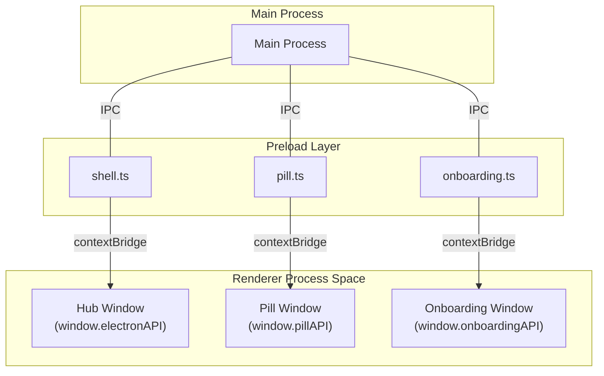
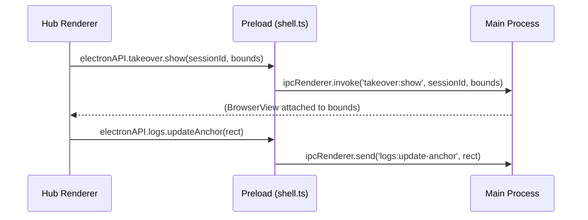
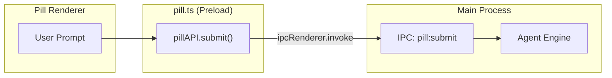

<!-- source: DeepWiki mcp.deepwiki.com · repo browser-use/desktop · page 2.3 Preload Script · fetched 2026-10-30 -->

# Preload Script

<details>
<summary>Relevant source files</summary>

The following files were used as context for generating this wiki page:

- [app/src/preload/onboarding.ts](app/src/preload/onboarding.ts)
- [app/src/preload/pill.ts](app/src/preload/pill.ts)
- [app/src/preload/shell.ts](app/src/preload/shell.ts)

</details>


The preload script serves as a secure bridge between the Electron main process and renderer processes (Hub, Pill, and Onboarding), exposing controlled APIs for session management, engine control (Claude Code/Codex), Chrome profile/cookie import, and settings management. This script implements Electron's security model by using `contextBridge` to selectively expose functionality without compromising the sandbox security of the renderer process.

## Security Bridge Architecture

The application utilizes multiple preload scripts tailored to specific windows, each exposing a unique namespace to the `window` object in the renderer.



**Sources:** [app/src/preload/shell.ts:11-12](), [app/src/preload/pill.ts:50](), [app/src/preload/onboarding.ts:184]()

## Shell API (Hub Window)

The `shell.ts` preload script exposes the `electronAPI` object, providing comprehensive management for agent sessions, window controls, and system settings.

### Session and Engine Control
The API facilitates deep interaction with the Agent Engine Layer, including session lifecycle and engine authentication status.

| API Path | IPC Channel | Purpose |
|----------|-------------|---------|
| `sessions.list()` | `sessions:list` | Retrieves all active and historical agent sessions [app/src/preload/shell.ts:241-243]() |
| `sessions.getEvents(id)` | `sessions:get-events` | Fetches `HlEvent` logs for a specific session [app/src/preload/shell.ts:251-255]() |
| `settings.claudeCode.login()` | `settings:claude-code:login` | Triggers OAuth/CLI login for Claude Code [app/src/preload/shell.ts:68-69]() |
| `settings.codex.status()` | `sessions:engine-status` | Checks installation and auth for Codex [app/src/preload/shell.ts:83-88]() |

### Window Management (Takeover & Logs)
The shell API manages the positioning of overlay windows like the `Takeover` (Live View) and `Logs` panes.



**Sources:** [app/src/preload/shell.ts:43-50](), [app/src/preload/shell.ts:39-41]()

## Pill API (Command Bar)

The `pill.ts` preload script provides a specialized interface for the floating command bar, focusing on task submission and real-time event streaming.

### Task Submission Flow
The Pill uses `pill:submit` to dispatch new natural language tasks to the `SessionManager`.



**Sources:** [app/src/preload/pill.ts:58-70]()

### Event Streaming
The Pill subscribes to `pill:event` to show live progress of the agent's actions (e.g., "Searching Google", "Clicking Button").
* **`onEvent(callback)`**: Listens for `AgentEvent` payloads and provides a cleanup function to remove the `ipcRenderer` listener [app/src/preload/pill.ts:137-158]().

## Onboarding API

The `onboarding.ts` script handles sensitive setup operations, including Chrome data migration and API key validation.

### Chrome Profile & Cookie Import
This API allows the app to "port" the user's identity from their local Chrome installation to the agent's browser pool.

| Function | IPC Channel | Description |
|----------|-------------|-------------|
| `detectChromeProfiles()` | `chrome-import:detect-profiles` | Finds local Chrome installations [app/src/preload/onboarding.ts:23-24]() |
| `importChromeProfileCookies(dir)` | `chrome-import:import-cookies` | Decrypts and imports cookies for agent use [app/src/preload/onboarding.ts:26-27]() |
| `getChromeProfileSyncs()` | `chrome-import:get-syncs` | Returns stats on previously imported profiles [app/src/preload/onboarding.ts:39-49]() |

### External Channels (WhatsApp)
The onboarding API manages the connection to the `WhatsAppAdapter` for remote agent control.
* **`whatsapp.connect()`**: Invokes `channels:whatsapp:connect` to initialize the headless WhatsApp instance [app/src/preload/onboarding.ts:163-164]().
* **`onWhatsappQr(cb)`**: Listens for the `whatsapp-qr` event to display the login QR code in the UI [app/src/preload/onboarding.ts:171-175]().

**Sources:** [app/src/preload/onboarding.ts:162-181]()

## Data Validation

To maintain security and type safety across the bridge, the preload scripts utilize shared schemas to validate data returning from the main process before it reaches the renderer.

```typescript
import {
  validateSession,
  validateHlEvent,
  validatePoolStats,
} from '../shared/session-schemas';

// Example usage in shell.ts
onSessionUpdated: (cb) => {
  const handler = (_event, session) => cb(validateSession(session));
  ipcRenderer.on('sessions:updated', handler);
  return () => ipcRenderer.removeListener('sessions:updated', handler);
}
```

**Sources:** [app/src/preload/shell.ts:2-9](), [app/src/preload/shell.ts:267-271]()

## Telemetry and Consent

Both `shell.ts` and `onboarding.ts` expose methods to handle user privacy and event tracking via the `telemetry` namespace.
* **`getConsent()`**: Retrieves the current telemetry status and version [app/src/preload/onboarding.ts:137-141]().
* **`capture(name, props)`**: Forwards UI events to the main process's PostHog/JSONL logger [app/src/preload/onboarding.ts:149-151]().

**Sources:** [app/src/preload/shell.ts:94-101](), [app/src/preload/onboarding.ts:143-151]()

---

