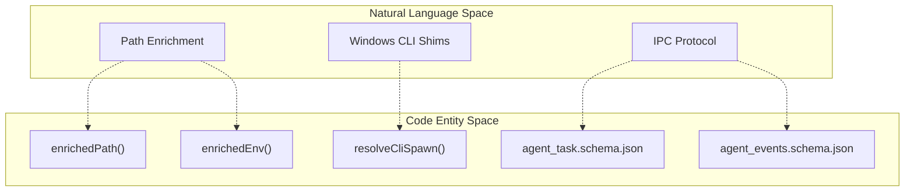
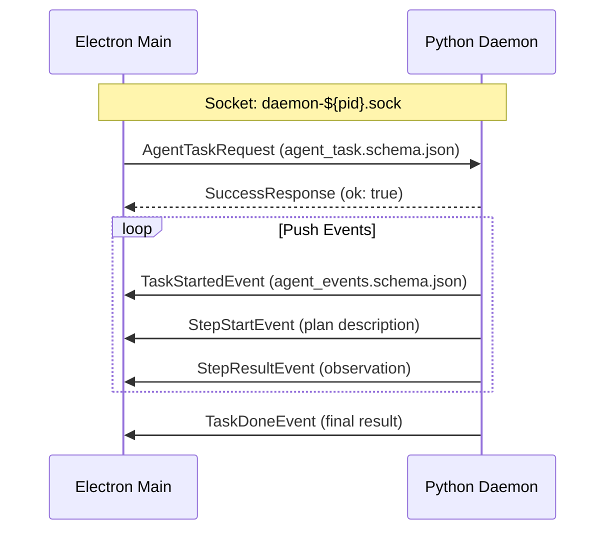

<!-- source: DeepWiki mcp.deepwiki.com · repo browser-use/desktop · page 2.4 Configuration System · fetched 2026-10-30 -->

# Configuration System

Relevant source files

The following files were used as context for generating this wiki page:

- [app/src/main/hl/engines/pathEnrich.ts](app/src/main/hl/engines/pathEnrich.ts)
- [shared/schemas/README.md](shared/schemas/README.md)
- [shared/schemas/agent_events.schema.json](shared/schemas/agent_events.schema.json)
- [shared/schemas/agent_task.schema.json](shared/schemas/agent_task.schema.json)
- [shared/schemas/onboarding.schema.json](shared/schemas/onboarding.schema.json)
- [shared/schemas/tab_state.schema.json](shared/schemas/tab_state.schema.json)

## Purpose and Scope

The Configuration System provides cross-platform management for external processes (AI Engines and Chrome) orchestrated by the Electron main process. It handles complex path resolution, environment variable enrichment for GUI-launched processes, and defines the shared JSON schemas that serve as IPC contracts between the TypeScript and Python layers.

## Architecture Overview

The configuration system bridges the gap between the high-level Electron environment and the low-level operating system requirements. It ensures that user-installed CLIs (like `claude` or `codex`) and browser executables are found regardless of how the application was launched.

### Configuration Entity Mapping

**Sources:** [app/src/main/hl/engines/pathEnrich.ts:1-9](), [shared/schemas/README.md:8-14]()

## Environment and Path Enrichment

Electron applications launched from a GUI (Dock/Finder/Start Menu) often inherit a minimal `PATH` that excludes user-installed tools. The `pathEnrich` module solves this by detecting the user's login shell and common binary directories.

### Path Enrichment Strategy

1.  **Shell Probing**: On POSIX systems, the system spawns the user's login shell (`$SHELL -ilc`) once to capture the full `PATH` including custom exports from `.zshrc` or `.bash_profile` [app/src/main/hl/engines/pathEnrich.ts:35-54]().
2.  **Hardcoded Safety Net**: If shell probing fails, the system appends common binary directories (Homebrew, Volta, NVM, Cargo, etc.) based on the platform [app/src/main/hl/engines/pathEnrich.ts:56-80]().
3.  **Deduplication**: Paths are split by the platform delimiter (`;` or `:`) and merged using a `Set` to prevent redundant entries [app/src/main/hl/engines/pathEnrich.ts:98-100]().

### Windows CLI Resolution

Windows `CreateProcess` cannot execute `.cmd`, `.bat`, or `.ps1` shims directly. The `resolveCliSpawn` function identifies these files and rewrites the execution to go through `cmd.exe /d /s /c` [app/src/main/hl/engines/pathEnrich.ts:135-145]().

**Sources:** [app/src/main/hl/engines/pathEnrich.ts:1-149]()

## Shared IPC Schemas

The application uses JSON Schema as the single source of truth for all cross-process communication. These schemas define the contracts for the Unix domain socket protocol used between Electron and the Python agent daemon.

### IPC Message Flow

**Sources:** [shared/schemas/README.md:18-41](), [shared/schemas/agent_task.schema.json:19-46](), [shared/schemas/agent_events.schema.json:110-135]()

### Schema Definitions

| Schema File | Purpose | Key Definitions |
| :--- | :--- | :--- |
| `agent_task.schema.json` | Requests from Main to Daemon | `AgentTaskRequest`, `CancelTaskRequest`, `ShutdownRequest` |
| `agent_events.schema.json` | Push events from Daemon to Main | `StepStartEvent`, `StepResultEvent`, `TaskDoneEvent`, `TaskFailedEvent` |
| `tab_state.schema.json` | UI state synchronization | `TabOpenedEvent`, `TabActivatedEvent`, `TabUpdatedEvent` |
| `onboarding.schema.json` | Onboarding flow management | `OnboardingCompleteEvent`, `OAuthStartRequest` |

**Sources:** [shared/schemas/agent_task.schema.json:1-157](), [shared/schemas/agent_events.schema.json:1-208](), [shared/schemas/tab_state.schema.json:1-157](), [shared/schemas/onboarding.schema.json:1-143]()

## Transport and Versioning

### Wire Format
- **Transport**: Unix Domain Socket (macOS/Linux) or Named Pipes (Windows) [shared/schemas/README.md:18-22]().
- **Format**: Newline-delimited JSON (NDJSON) [shared/schemas/README.md:10]().
- **Encoding**: UTF-8 with a maximum message size of 4 MB [shared/schemas/README.md:29-31]().

### Versioning Policy
Every message carries a `version` field (currently `"1.0"`) [shared/schemas/agent_task.schema.json:12-17]().
- **Breaking Changes**: Require a version bump and regeneration of types [shared/schemas/README.md:143-148]().
- **Codegen**: TypeScript interfaces and Python `TypedDict` definitions are generated from these schemas via `npm run codegen:schemas` [shared/schemas/README.md:158-168]().

**Sources:** [shared/schemas/README.md:1-194]()

---

