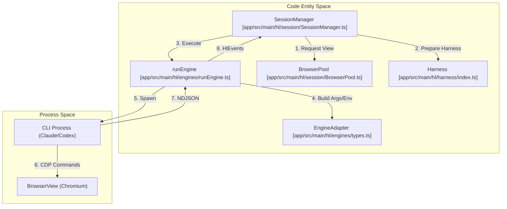
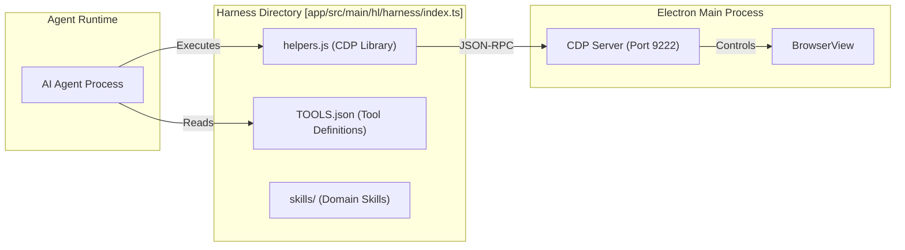

<!-- source: DeepWiki mcp.deepwiki.com · repo browser-use/desktop · page 3 Agent Engine Layer · fetched 2026-10-30 -->

# Agent Engine Layer

Relevant source files

The following files were used as context for generating this wiki page:

- [app/src/main/hl/engines/runEngine.ts](app/src/main/hl/engines/runEngine.ts)
- [app/src/main/hl/engines/types.ts](app/src/main/hl/engines/types.ts)

The Agent Engine Layer is the execution subsystem responsible for orchestrating AI agents, managing their lifecycles, and providing the automation harness they use to interact with the browser. It abstracts specific AI backends (like Claude Code or Codex) into a unified event stream, allowing the rest of the application to remain engine-agnostic.

### System Overview

The engine layer bridges the gap between high-level user prompts and low-level browser automation. When a task is dispatched, the system allocates a browser resource, prepares a local execution environment (the harness), and spawns an engine process via a specialized adapter.

#### Engine Execution Flow

The following diagram illustrates how a user prompt moves from the UI through the engine layer to drive the browser.

**Prompt Dispatch and Execution Flow**

Sources: [app/src/main/hl/engines/runEngine.ts:58-133](), [app/src/main/hl/engines/types.ts:77-114](), [app/src/main/hl/session/SessionManager.ts:1-50]()

---

### [Engine Adapters](#3.1)

The application uses an adapter pattern to support multiple AI backends. Each `EngineAdapter` is responsible for translating the application's internal state into the specific CLI arguments and environment variables required by a backend (e.g., `claude` or `codex`) [app/src/main/hl/engines/types.ts:77-114]().

Adapters handle:
*   **Probing**: Detecting if the CLI is installed and authenticated [app/src/main/hl/engines/types.ts:86-87]().
*   **Translation**: Parsing engine-specific NDJSON (Newline Delimited JSON) output into a standardized `HlEvent` stream [app/src/main/hl/engines/runEngine.ts:2-7]().
*   **Auth Injection**: Deciding whether to use a stored API key or the CLI's native subscription/OAuth session [app/src/main/hl/engines/runEngine.ts:129-143]().

For details, see [Engine Adapters](#3.1).

---

### [Session Management](#3.2)

The `SessionManager` acts as the central orchestrator for agent activity. It manages the lifecycle of a session through various states: `draft`, `running`, `stuck`, `idle`, and `stopped`.

Key components include:
*   **SessionDb**: A SQLite-backed persistence layer that stores session history, metadata, and the full event log [app/src/main/hl/session/SessionManager.ts:10-25]().
*   **BrowserPool**: A resource manager that maintains a pool of `BrowserView` instances, ensuring that agents have a dedicated, clean environment for execution [app/src/main/hl/session/BrowserPool.ts:1-30]().
*   **Steer Queue**: A mechanism for "steering" or providing mid-run feedback to an active agent.

For details, see [Session Management](#3.2).

---

### [Harness and Browser Automation](#3.3)

The "Harness" is the local file-system environment where the agent process runs. It provides the agent with the "tools" and "skills" necessary to control the browser.

**Harness Structure and CDP Integration**

Sources: [app/src/main/hl/engines/runEngine.ts:15-17](), [app/src/main/hl/engines/types.ts:15-22]()

The harness includes a specialized `helpers.js` library that translates high-level agent intents (like "click the login button") into low-level Chrome DevTools Protocol (CDP) commands. It also manages the porting of cookies from the user's primary Chrome installation to the agent's session.

For details, see [Harness and Browser Automation](#3.3).

---

### [Inbound Channels](#3.4)

While the primary interface for the Agent Engine is the local Desktop UI, the system supports inbound triggers via external platforms. The `WhatsAppAdapter` and `ChannelRouter` allow tasks to be dispatched to the engine from external messaging services.

These channels handle:
*   **Message Routing**: Mapping incoming platform IDs to internal session origins.
*   **Context Management**: Feeding external message history into the agent's prompt context.
*   **Notifications**: Relaying completion summaries or "stuck" alerts back to the originating platform.

For details, see [Inbound Channels](#3.4).

---

