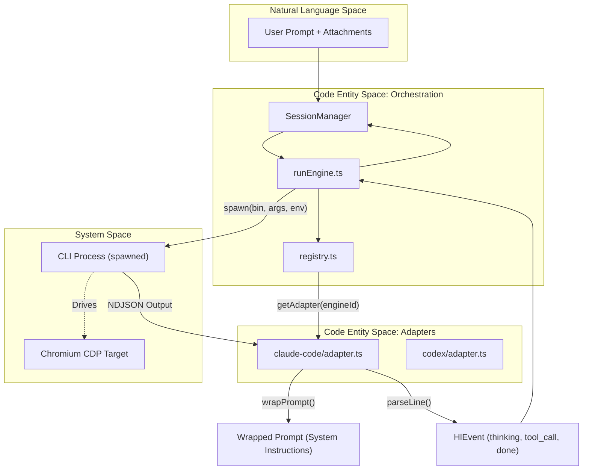
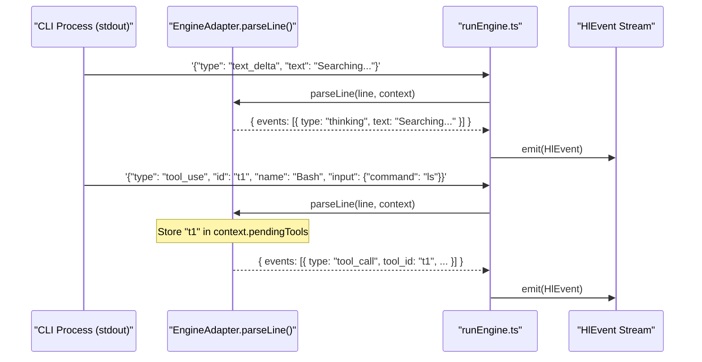

<!-- source: DeepWiki mcp.deepwiki.com · repo browser-use/desktop · page 3.1 Engine Adapters · fetched 2026-10-30 -->

# Engine Adapters

Relevant source files

The following files were used as context for generating this wiki page:

- [app/src/main/hl/engines/claude-code/adapter.ts](app/src/main/hl/engines/claude-code/adapter.ts)
- [app/src/main/hl/engines/codex/adapter.ts](app/src/main/hl/engines/codex/adapter.ts)
- [app/src/main/hl/engines/runEngine.ts](app/src/main/hl/engines/runEngine.ts)
- [app/src/main/hl/engines/types.ts](app/src/main/hl/engines/types.ts)

Engine Adapters provide a pluggable interface for CLI-based AI agents, such as **Claude Code** and **Codex**, to interact with the `browser-use/desktop` environment. They serve as the translation layer between the natural language intent of the user and the specific CLI commands, environment variables, and output formats required by different AI engines.

## Overview

The system uses an adapter pattern defined by the `EngineAdapter` interface [app/src/main/hl/engines/types.ts:77-114](). This allows the core `runEngine` logic to remain agnostic of the underlying AI provider. Each adapter is responsible for:
1.  **Probing**: Detecting if the CLI is installed and if the user is authenticated.
2.  **Prompt Wrapping**: Injecting system instructions, CDP target information, and attachment references into the user's prompt.
3.  **Spawning**: Constructing the exact CLI arguments and environment variables (e.g., `ANTHROPIC_API_KEY` or `OPENAI_API_KEY`).
4.  **Parsing**: Converting engine-specific NDJSON (Newline Delimited JSON) streams into a unified stream of `HlEvent` objects.

### Data Flow: Intent to Execution

The following diagram illustrates how a user prompt is transformed into a running process and back into UI events.

**Engine Execution Flow**

Sources: [app/src/main/hl/engines/runEngine.ts:58-63](), [app/src/main/hl/engines/types.ts:77-114](), [app/src/main/hl/engines/claude-code/adapter.ts:135-152]()

---

## The Adapter Interface

Every adapter must implement the `EngineAdapter` interface, which ensures consistency in how the main process manages external agents.

| Function | Purpose | Implementation Detail |
| :--- | :--- | :--- |
| `probeInstalled` | Checks if binary is on PATH. | Uses `runCli(['--version'])` [app/src/main/hl/engines/claude-code/adapter.ts:84-89](). |
| `probeAuthed` | Checks login status. | Claude uses `auth status`; Codex checks `~/.codex/auth.json` [app/src/main/hl/engines/codex/adapter.ts:105-116](). |
| `wrapPrompt` | Adds context. | Injects `BU_TARGET_ID`, `BU_CDP_PORT`, and instructions to read `helpers.js` [app/src/main/hl/engines/claude-code/adapter.ts:135-153](). |
| `buildSpawnArgs` | Generates CLI flags. | Claude uses `-p --output-format stream-json`; Codex uses `exec --json` [app/src/main/hl/engines/claude-code/adapter.ts:155-166](). |
| `parseLine` | Stream translation. | Converts engine-specific JSON into `HlEvent` shapes [app/src/main/hl/engines/types.ts:113-113](). |

Sources: [app/src/main/hl/engines/types.ts:77-114](), [app/src/main/hl/engines/claude-code/adapter.ts:79-115](), [app/src/main/hl/engines/codex/adapter.ts:93-116]()

---

## Engine Implementations

### Claude Code Adapter
The Claude Code adapter wraps the `claude` CLI in non-interactive mode. It focuses on the `--output-format stream-json` flag to receive structured feedback.

*   **Auth Logic**: It detects if the user is using an API key (via `ANTHROPIC_API_KEY`) or a subscription (via Keychain). If both are present, the API key takes precedence in `buildEnv` [app/src/main/hl/engines/runEngine.ts:129-143]().
*   **Tool Normalization**: Claude Code emits `assistant.content[]` with `tool_use`. The adapter normalizes these into `tool_call` events, specifically handling the `Bash` tool by extracting the `command` string [app/src/main/hl/engines/claude-code/adapter.ts:33-42]().

### Codex Adapter
The Codex adapter wraps `codex exec`. It has significant differences in session management and Windows compatibility.

*   **Stdin Payload**: To avoid Windows `cmd.exe` limitations where newlines in arguments truncate the command, the Codex adapter uses `getStdinPayload` to pipe the prompt through `stdin` instead of `argv` [app/src/main/hl/engines/codex/adapter.ts:158-175]().
*   **Event Mapping**: Codex uses different keys for tool execution across versions. The adapter normalizes these via `normalizeItemArgs`, mapping `command_execution` or `local_shell_call` to a unified `Bash` tool name [app/src/main/hl/engines/codex/adapter.ts:66-86]().

---

## Parsing and Event Emission

The `runEngine` function manages a `ParseContext` [app/src/main/hl/engines/types.ts:31-48]() which tracks the iteration count and pending tool calls. This allows the system to pair tool results with their original calls even if the engine emits them asynchronously.

**NDJSON Parsing Logic**

Sources: [app/src/main/hl/engines/runEngine.ts:203-220](), [app/src/main/hl/engines/types.ts:31-48](), [app/src/main/hl/engines/claude-code/adapter.ts:5-11]()

### Auth Resolution
Before spawning, `runEngine` resolves the authentication path. It logs a specific `session.auth.path` metric to track whether a session used an `apiKey`, `subscription`, or `both` [app/src/main/hl/engines/runEngine.ts:129-143](). This state is then captured in the `onAuthResolved` callback so the `SessionManager` can persist the auth mode used for that specific historical run [app/src/main/hl/engines/runEngine.ts:163-172]().

Sources: [app/src/main/hl/engines/runEngine.ts:107-172](), [app/src/main/hl/engines/types.ts:118-133]()

---

