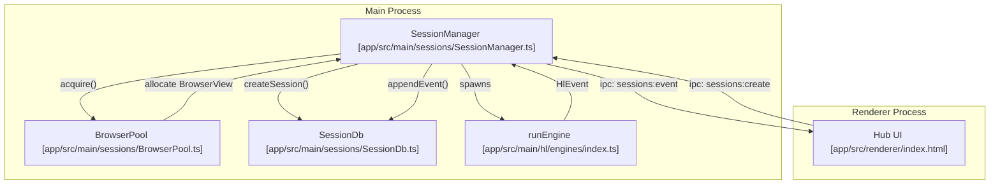
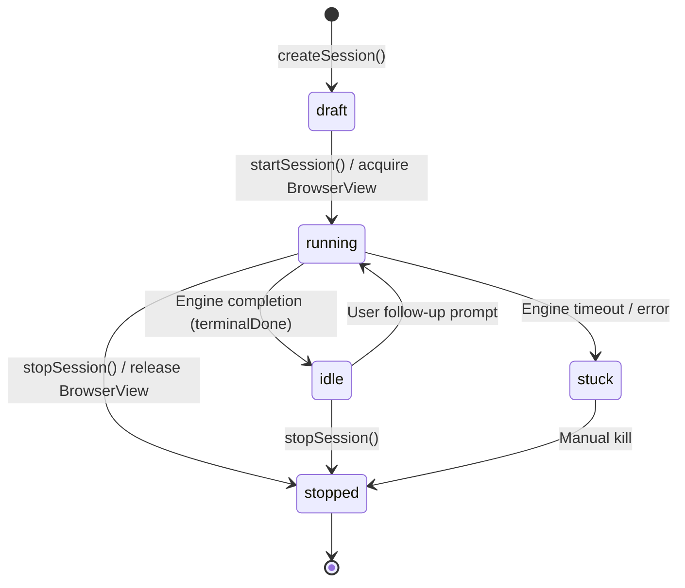
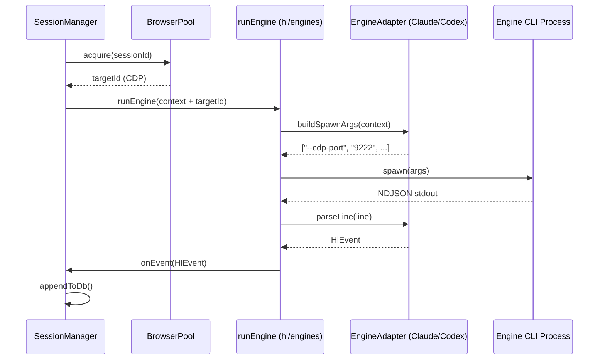

<!-- source: DeepWiki mcp.deepwiki.com · repo browser-use/desktop · page 3.2 Session Management · fetched 2026-10-30 -->

# Session Management

Relevant source files

The following files were used as context for generating this wiki page:

- [app/src/main/hl/engines/types.ts](app/src/main/hl/engines/types.ts)
- [app/src/main/index.ts](app/src/main/index.ts)

The Session Management layer coordinates the lifecycle of AI agent interactions, the persistence of session history, and the allocation of browser resources. It acts as the orchestrator between the user's intent (prompts), the Agent Engine processes, and the Chromium `BrowserView` instances where automation occurs.

## Overview

Session management is handled primarily by two singleton classes:
1.  **`SessionManager`**: Manages the high-level lifecycle, state transitions, and database persistence of agent sessions.
2.  **`BrowserPool`**: Manages a pool of Electron `BrowserView` instances, ensuring they are correctly attached to the UI and assigned to active agent sessions.

Persistence is handled via `SessionDb`, a SQLite-backed store that tracks session metadata, events, and status.

### System Architecture and Code Entities

The following diagram maps the conceptual session flow to the specific classes and files responsible for implementation.

**Session Management Entity Map**

**Sources:** [app/src/main/sessions/SessionManager.ts:1-50](), [app/src/main/sessions/BrowserPool.ts:1-30](), [app/src/main/sessions/SessionDb.ts:1-20]()

---

## Session Lifecycle and States

Every session moves through a defined set of states. These states determine whether an engine process is running, if a `BrowserView` is occupied, and how the UI should render the session.

| State | Description |
| :--- | :--- |
| `draft` | The session has been created in the DB but no engine has been spawned yet. No `BrowserView` is assigned. |
| `running` | The engine subprocess is active and driving the browser. |
| `stuck` | The engine has encountered a recoverable or unrecoverable stall (e.g., waiting for user input that isn't arriving). |
| `idle` | The engine has finished its task, but the session remains "open" so the user can see the final state or send a follow-up. |
| `stopped` | The session is finalized. The engine is killed, and the `BrowserView` is returned to the pool. |

### Lifecycle Flow

The lifecycle is managed by `SessionManager.updateStatus()`, which updates the `SessionDb` and notifies the renderer process via IPC.

**Session State Transitions**

**Sources:** [app/src/shared/session-schemas.ts:1-50](), [app/src/main/sessions/SessionManager.ts:250-300]()

---

## SessionManager Implementation

The `SessionManager` class is the central authority for session operations. It maintains an in-memory map of active sessions and coordinates with the `BrowserPool` to provide the execution environment for engines.

### Key Responsibilities
- **Session Creation**: Generates a unique UUID and initializes a record in `SessionDb` [app/src/main/sessions/SessionManager.ts:110-130]().
- **Engine Coordination**: Calls `runEngine()` with the appropriate `EngineId` and `SpawnContext` [app/src/main/sessions/SessionManager.ts:310-340]().
- **Event Handling**: Listens to `HlEvent` streams from the engine and routes them to the database and the UI [app/src/main/sessions/SessionManager.ts:400-420]().
- **Steer Queue**: Manages a queue of user "steer" (follow-up) messages that are injected into a running engine's stdin or used to restart an idle engine [app/src/main/sessions/SessionManager.ts:450-480]().

**Sources:** [app/src/main/sessions/SessionManager.ts:1-500]()

---

## BrowserPool and View Allocation

The `BrowserPool` manages a collection of Electron `BrowserView` instances. Instead of creating a new browser for every session, which is resource-intensive, the pool recycles views.

### Allocation Logic
When a session starts, it calls `BrowserPool.acquire(sessionId)`.
1.  **Recycling**: If a view was recently used for the same session (e.g., a restart), it is prioritized.
2.  **Fresh Allocation**: If no session-specific view exists, a new `BrowserView` is instantiated with a clean `partition` or a shared session context [app/src/main/sessions/BrowserPool.ts:80-110]().
3.  **UI Attachment**: The view is attached to the `ShellWindow` using `setBrowserView()` and its bounds are synchronized with the Hub UI layout [app/src/main/index.ts:350-380]().

### Browser Recycling
When a session is stopped or enters an `idle` state for a long duration, `BrowserPool.release(sessionId)` is called. The view is hidden and cleared, but the underlying process may be kept warm for subsequent tasks [app/src/main/sessions/BrowserPool.ts:150-180]().

**Sources:** [app/src/main/sessions/BrowserPool.ts:1-200](), [app/src/main/index.ts:340-400]()

---

## SQLite Persistence (SessionDb)

All session data is persisted in a SQLite database located in the user data directory. This ensures that session history, tool calls, and agent logs survive application restarts.

### Schema Overview
- **`sessions` table**: Stores metadata like `engine_id`, `status`, `prompt`, and timestamps [app/src/main/sessions/SessionDb.ts:50-70]().
- **`events` table**: Stores a serialized JSON blob of every `HlEvent` emitted by the engine. This allows the UI to "replay" the agent's thought process [app/src/main/sessions/SessionDb.ts:80-100]().

### Data Flow
1.  **Engine** emits an `HlEvent` (e.g., `call_tool`).
2.  **`SessionManager`** receives the event via the `onEvent` callback.
3.  **`SessionDb.appendEvent()`** is called to write the event to the SQLite WAL.
4.  **IPC** broadcast sends the event to the `Renderer` process for real-time UI updates.

**Sources:** [app/src/main/sessions/SessionDb.ts:1-150]()

---

## Interaction with Agent Engines

The `SessionManager` does not know how to talk to Claude or Codex directly. It uses the `EngineAdapter` interface to abstract the CLI specifics.

**Execution Context Data Flow**

**Sources:** [app/src/main/hl/engines/types.ts:12-48](), [app/src/main/hl/engines/index.ts:50-100](), [app/src/main/sessions/SessionManager.ts:300-350]()

---

