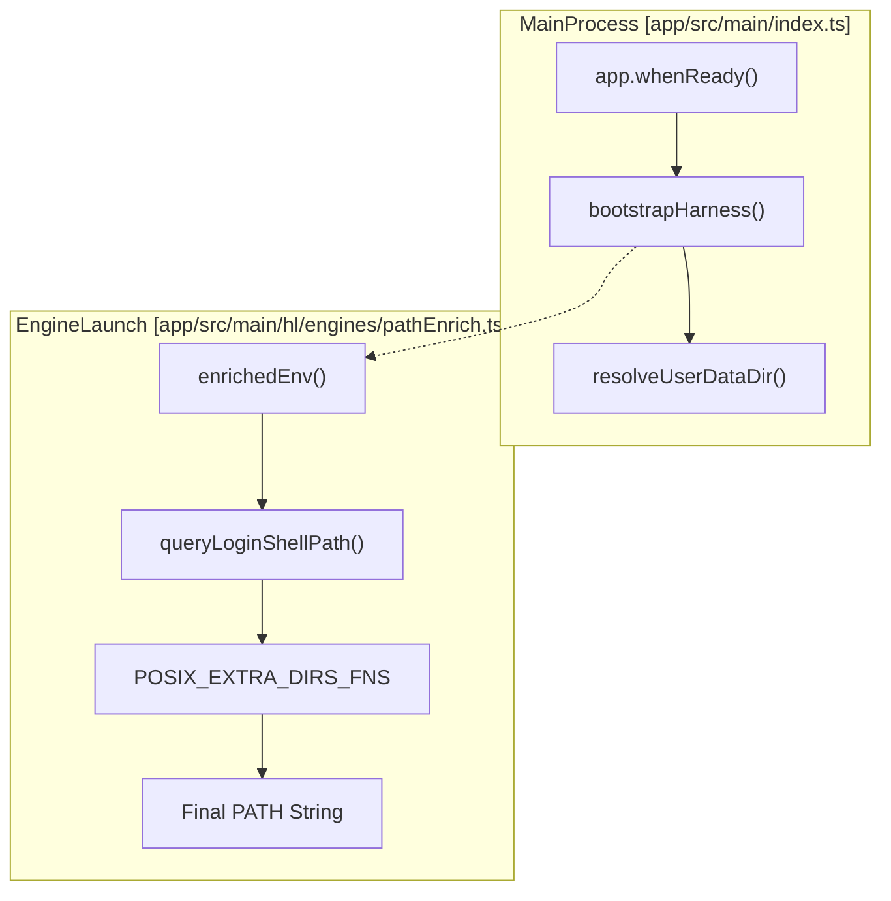
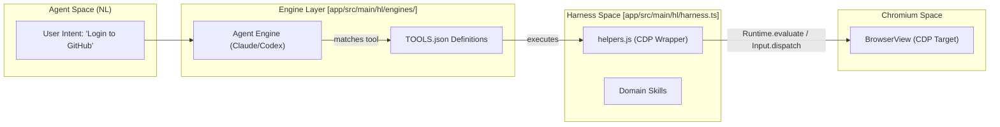

<!-- source: DeepWiki mcp.deepwiki.com · repo browser-use/desktop · page 3.3 Harness and Browser Automation · fetched 2026-10-30 -->

# Harness and Browser Automation

Relevant source files

The following files were used as context for generating this wiki page:

- [app/src/main/hl/engines/pathEnrich.ts](app/src/main/hl/engines/pathEnrich.ts)
- [app/src/main/index.ts](app/src/main/index.ts)

The Harness is the bridge between the AI agent's reasoning engine and the Chromium browser instance. It provides a sandboxed execution environment where the agent can perform actions (click, type, scroll), extract page metadata, and apply "domain skills" (specialized logic for specific sites). The automation layer leverages the Chrome DevTools Protocol (CDP) to drive the embedded `BrowserView` within the Electron application.

## Execution Environment

The agent drives the browser by executing a specialized harness script that abstracts low-level CDP commands into high-level tools. This harness is bootstrapped during the application startup.

### Harness Bootstrap
The harness directory is resolved relative to the application's resources or development path [app/src/main/hl/harness.ts:15-32](). The `bootstrapHarness` function ensures that the execution environment is ready for the agent to use [app/src/main/hl/harness.ts:34-45]().

### Path Enrichment
Because the agent often relies on external CLI tools (like `codex` or `claude`), the application performs "Path Enrichment." This process captures the user's login shell environment (e.g., from `.zshrc` or `.bash_profile`) to ensure that tools installed via Homebrew, NVM, or Volta are available to the agent subprocess [app/src/main/hl/engines/pathEnrich.ts:24-54]().

**Diagram: Environment Initialization**
Title: Agent Environment Preparation

Sources: [app/src/main/index.ts:174-200](), [app/src/main/hl/harness.ts:34-45](), [app/src/main/hl/engines/pathEnrich.ts:92-127]()

## CDP and Browser Driving

The application uses the Chrome DevTools Protocol (CDP) to interact with the Chromium instance. This allows for deeper control than standard WebDriver-based automation.

### Remote Debugging Port
The Electron main process is configured with a `--remote-debugging-port` switch [app/src/main/index.ts:156-158](). This port is used by the `BrowserPool` and the agent's harness to connect to the active browser views.

### BrowserPool and CDP Management
The `BrowserPool` manages the lifecycle of Chromium instances. It handles the mapping between agent sessions and specific CDP targets.

| Component | Responsibility |
| :--- | :--- |
| `resolveCdpPort` | Determines the port to use for remote debugging [app/src/main/startup/cli.ts:46-75](). |
| `BrowserPool` | Allocates and recycles `BrowserView` instances for agent sessions [app/src/main/sessions/BrowserPool.ts](). |
| `helpers.js` | A client-side library (within the harness) that translates agent intents into CDP commands. |

**Diagram: CDP Communication Flow**
Title: Natural Language to CDP Translation

Sources: [app/src/main/index.ts:99-107](), [app/src/main/hl/harness.ts:15-45](), [app/src/main/startup/cli.ts:46-75]()

## Domain Skills and Tools

The agent's capabilities are defined by a set of "Tools" and "Skills."

### TOOLS.json
The `TOOLS.json` file (located in the harness directory) serves as the schema definition for the agent. It defines the functions the agent can call, such as `click_element`, `type_text`, or `navigate_to_url`. Each tool entry includes:
- **Name**: The identifier used by the AI model.
- **Description**: Natural language description to help the model understand when to use the tool.
- **Parameters**: JSON Schema defining the required arguments.

### Cookie Porting from Chrome
To allow the agent to operate as the user without requiring manual login for every session, the application includes a mechanism to port cookies from the user's local Google Chrome installation.
- **IPC Handlers**: The `registerChromeImportHandlers` function sets up the bridge for the UI to trigger cookie imports [app/src/main/index.ts:90]().
- **Implementation**: The system locates the Chrome profile, decrypts the cookie store (using OS-level keychains), and injects them into the agent's Chromium profile.

## Session Execution Flow

When a session starts, the following sequence occurs:

1.  **Allocation**: The `SessionManager` requests a browser from the `BrowserPool`.
2.  **Connection**: The agent engine spawns a subprocess with an `enrichedEnv` [app/src/main/hl/engines/pathEnrich.ts:129-133]().
3.  **Harness Attachment**: The harness script connects to the `BrowserView` via the resolved CDP port [app/src/main/index.ts:156-158]().
4.  **Loop**: 
    -   The agent observes the page state (DOM tree, screenshot).
    -   The agent selects a tool from `TOOLS.json`.
    -   The harness executes the tool via `helpers.js` and CDP.
    -   Results are returned to the agent to determine the next step.

Sources: [app/src/main/index.ts:101-107](), [app/src/main/hl/engines/pathEnrich.ts:92-133](), [app/src/main/startup/cli.ts:46-75]()

---

