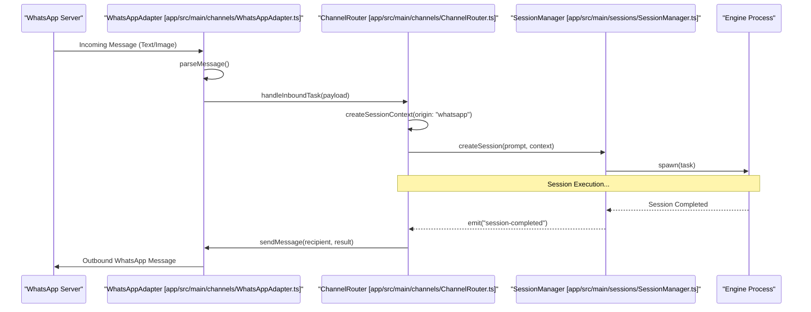
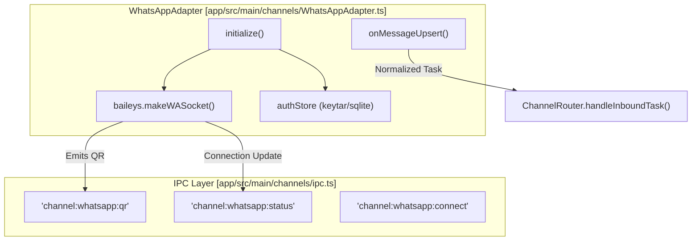

<!-- source: DeepWiki mcp.deepwiki.com · repo browser-use/desktop · page 3.4 Inbound Channels · fetched 2026-10-30 -->

# Inbound Channels

<details>
<summary>Relevant source files</summary>

The following files were used as context for generating this wiki page:

- [app/package.json](app/package.json)
- [app/src/main/index.ts](app/src/main/index.ts)

</details>


The **Inbound Channels** subsystem enables external platforms to trigger AI agent sessions within the Browser Use desktop application. Currently, this infrastructure is primarily utilized by the **WhatsApp Adapter**, allowing users to interact with their local agent via the WhatsApp protocol. The system manages the translation of external messages into agent tasks, tracks the origin of sessions, and routes completion notifications back to the source platform.

## Architecture Overview

The inbound channel architecture consists of three primary components:
1.  **Adapters**: Platform-specific implementations (e.g., `WhatsAppAdapter`) that handle authentication, connection persistence, and message parsing.
2.  **ChannelRouter**: A central orchestrator that receives normalized requests from adapters and interfaces with the `SessionManager` to spawn agent tasks.
3.  **IPC Handlers**: Management interfaces that allow the Renderer process (Settings UI) to control channel states and view connection status.

### Data Flow: External Trigger to Agent Session

The following diagram illustrates how an incoming WhatsApp message is transformed into a running agent session.

**Sequence: Inbound Message Routing**

**Sources:** [app/src/main/index.ts:111-113](), [app/src/main/channels/ChannelRouter.ts:1-50](), [app/src/main/channels/WhatsAppAdapter.ts:1-100]()

---

## Channel Router

The `ChannelRouter` acts as the bridge between external adapters and the internal `SessionManager`. It ensures that sessions triggered via inbound channels are correctly tagged so that results can be routed back to the correct external recipient.

### Key Responsibilities
- **Session Origin Tracking**: Every session created via the router is marked with a `channelId` and `externalConversationId` in its metadata.
- **Result Dispatching**: Listens for session completion events and invokes the corresponding adapter's send method.
- **Rate Limiting/Filtering**: Provides a central point to validate or reject incoming requests based on user settings.

**Sources:** [app/src/main/channels/ChannelRouter.ts:10-45]()

---

## WhatsApp Adapter

The `WhatsAppAdapter` leverages the `@whiskeysockets/baileys` library to implement the WhatsApp Web protocol. It allows the desktop application to act as a linked device.

### Implementation Details
- **Authentication**: Uses a QR-code based pairing flow. The adapter generates a QR code that is sent to the Renderer process via IPC for the user to scan.
- **Connection Persistence**: Manages the socket lifecycle, including auto-reconnect logic and state synchronization.
- **Message Parsing**: Converts WhatsApp `proto.IWebMessageInfo` objects into the internal `InboundTask` schema, handling both text prompts and media attachments.

### Code Entity Map: WhatsApp Integration
The following diagram maps the logical WhatsApp flow to specific code entities within the `app/src/main/channels` directory.

**Diagram: WhatsApp Adapter Components**

**Sources:** [app/src/main/channels/WhatsAppAdapter.ts:20-150](), [app/src/main/channels/ipc.ts:1-40](), [app/package.json:108-108]()

---

## IPC and Management

The application provides a set of IPC handlers to manage inbound channels from the Hub UI (Settings Pane). These are registered during the main process initialization.

### Registered Handlers
| Channel | Action | File Reference |
| :--- | :--- | :--- |
| `channel:whatsapp:connect` | Initiates the Baileys socket connection and starts the QR generation flow. | [app/src/main/channels/ipc.ts:15-18]() |
| `channel:whatsapp:disconnect` | Terminates the socket and clears local session credentials. | [app/src/main/channels/ipc.ts:20-23]() |
| `channel:whatsapp:status` | Returns the current connection state (connecting, online, offline). | [app/src/main/channels/ipc.ts:25-28]() |

### Integration in Main Process
The channels are initialized in `app/src/main/index.ts` where the `WhatsAppAdapter` and `ChannelRouter` are instantiated and wired into the global `SessionManager`.

```typescript
// app/src/main/index.ts
import { WhatsAppAdapter } from './channels/WhatsAppAdapter';
import { ChannelRouter } from './channels/ChannelRouter';
import { registerChannelHandlers } from './channels/ipc';

// Inside app.whenReady()
const whatsappAdapter = new WhatsAppAdapter();
const channelRouter = new ChannelRouter(sessionManager, [whatsappAdapter]);
registerChannelHandlers(whatsappAdapter);
```
**Sources:** [app/src/main/index.ts:111-113](), [app/src/main/index.ts:710-720]() (approximate lines based on imports)

## Session Context and Metadata

When a task arrives via an inbound channel, the `ChannelRouter` enriches the session metadata. This is critical for the "loop-back" mechanism where the agent's final answer or a screenshot of the completed task is sent back to the user on WhatsApp.

- **Origin**: Set to `whatsapp`.
- **Reply Handle**: Contains the JID (Jabber ID) of the WhatsApp sender.
- **Session Type**: Usually forced to `ephemeral` to ensure the browser profile is cleaned up after the external task completes.

**Sources:** [app/src/main/channels/ChannelRouter.ts:55-80]()

---

