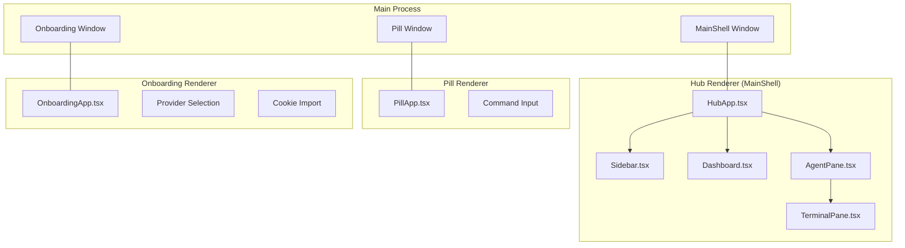
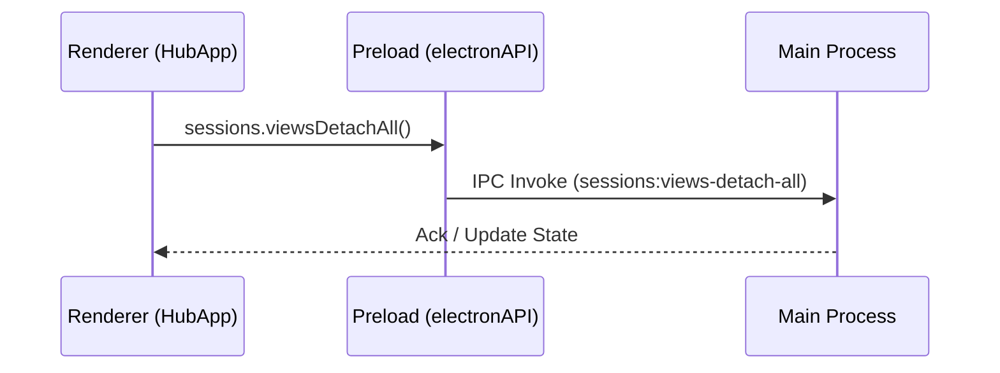

<!-- source: DeepWiki mcp.deepwiki.com · repo browser-use/desktop · page 4 User Interface · fetched 2026-10-30 -->

# User Interface

Relevant source files

The following files were used as context for generating this wiki page:

- [app/src/renderer/hub/HubApp.tsx](app/src/renderer/hub/HubApp.tsx)
- [app/src/renderer/hub/hub.css](app/src/renderer/hub/hub.css)

This page provides an overview of the user interface structure, styling, and interaction patterns of the browser-use desktop application. The UI is designed as a multi-window Electron application using React, TypeScript, and a custom design language inspired by Linear and Raycast.

The interface is divided into three primary surfaces: the **Hub**, the **Pill**, and the **Onboarding** flow.

## UI Architecture Overview

The UI architecture bridges the Electron main process and the React-based renderer processes. Each window (Hub, Pill, Onboarding) is a distinct renderer instance that communicates with the system via the `window.electronAPI` bridge.

**Sources:** [app/src/renderer/hub/HubApp.tsx:1-10](), [app/src/renderer/hub/hub.css:1-21]()

## Core UI Surfaces

### 1. Hub Window
The Hub is the primary workspace where users manage agent sessions, view logs, and configure global settings. It features a "Linear-style" deep dark theme with generous whitespace [app/src/renderer/hub/hub.css:1-5]().

*   **Dashboard**: A high-level view of all active and historical agent sessions [app/src/renderer/hub/Dashboard.tsx]().
*   **Agent Pane**: The focused view for a single session, displaying the agent's live browser output and a terminal for logs [app/src/renderer/hub/AgentPane.tsx]().
*   **Sidebar**: Navigation between sessions and access to settings [app/src/renderer/hub/Sidebar.tsx]().
*   **Command Bar**: A local `CommandBar` component within the Hub for quick actions and session switching [app/src/renderer/hub/CommandBar.tsx]().

For details, see **[Hub Window](#4.1)**.

### 2. Pill Command Bar
The Pill is a floating, global command bar that can be summoned anywhere in the OS via a hotkey. It is the primary entry point for starting new agent tasks.

*   **States**: It supports a collapsed "pill" state and an expanded state for typing prompts and attaching files.
*   **Communication**: It sends user prompts to the main process, which then initializes a session in the Hub.

For details, see **[Pill Command Bar](#4.2)**.

### 3. Onboarding Flow
The Onboarding window gates access to the main application until the user has configured necessary providers (e.g., Anthropic, OpenAI) and imported browser cookies.

*   **AccountStore**: Persists provider credentials and setup state.
*   **Cookie Import**: A specialized UI for porting local Chrome/Brave profiles into the agent's environment.

For details, see **[Onboarding Flow](#4.3)**.

## Design System and Interaction

The application uses a unified CSS variable-based design system defined in `hub.css`.

| Concept | Implementation |
| :--- | :--- |
| **Styling** | Content-first, deep dark theme using CSS variables (`--color-bg-sunken`, `--font-ui`) [app/src/renderer/hub/hub.css:11-21](). |
| **Navigation** | Supports standard mouse interaction and Vim-style keybindings (`j`/`k` for navigation) via `useVimKeys` [app/src/renderer/hub/useVimKeys.ts](). |
| **Layout** | Flexbox-based shell with a draggable toolbar area and responsive panes [app/src/renderer/hub/hub.css:27-55](). |
| **Feedback** | Real-time memory monitoring via the `MemoryIndicator` and session status badges [app/src/renderer/hub/MemoryIndicator.tsx](). |

### Global State & IPC
The UI components do not interact with the filesystem or processes directly. Instead, they use hooks like `useSessionsQuery` to fetch data from the `SessionManager` in the main process and `window.electronAPI` to trigger actions like `viewsDetachAll` [app/src/renderer/hub/HubApp.tsx:108-113]().

**Sources:** [app/src/renderer/hub/HubApp.tsx:108-113](), [app/src/renderer/hub/hub.css:80-98]()

---

## Child Pages
*   **[Hub Window](#4.1)**: Deep dive into the main dashboard, agent views, and terminal integration.
*   **[Pill Command Bar](#4.2)**: Technical details on the floating prompt bar and global hotkey handling.
*   **[Onboarding Flow](#4.3)**: Documentation of the setup wizard and provider configuration.

---

