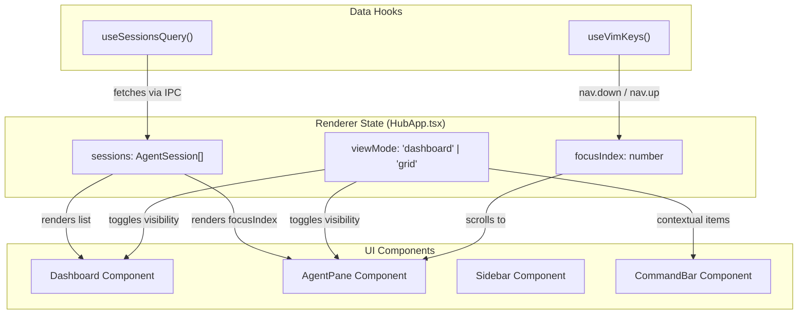
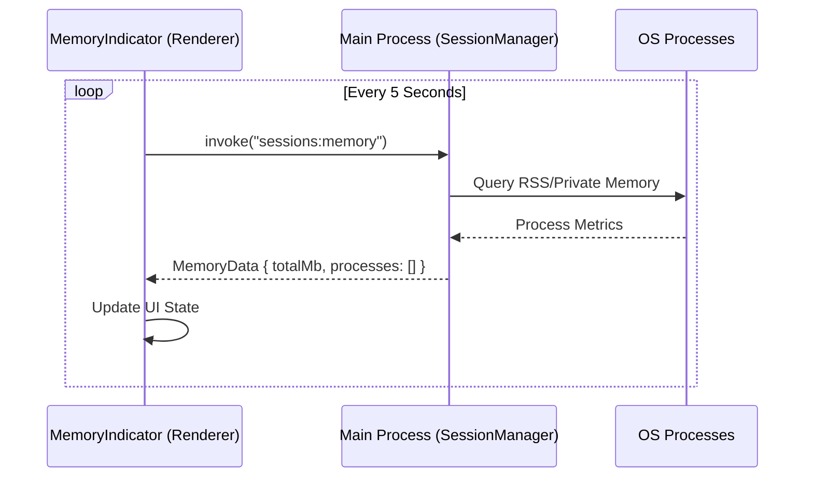

<!-- source: DeepWiki mcp.deepwiki.com · repo browser-use/desktop · page 4.1 Hub Window · fetched 2026-10-30 -->

# Hub Window

Relevant source files

The following files were used as context for generating this wiki page:

- [app/src/renderer/hub/CommandBar.tsx](app/src/renderer/hub/CommandBar.tsx)
- [app/src/renderer/hub/HubApp.tsx](app/src/renderer/hub/HubApp.tsx)
- [app/src/renderer/hub/KeybindingsOverlay.tsx](app/src/renderer/hub/KeybindingsOverlay.tsx)
- [app/src/renderer/hub/MemoryIndicator.tsx](app/src/renderer/hub/MemoryIndicator.tsx)
- [app/src/renderer/hub/SettingsPane.tsx](app/src/renderer/hub/SettingsPane.tsx)
- [app/src/renderer/hub/keybindings.ts](app/src/renderer/hub/keybindings.ts)
- [app/src/renderer/hub/useVimKeys.ts](app/src/renderer/hub/useVimKeys.ts)

The Hub Window is the primary interface of the **browser-use** desktop application. It serves as the central command center where users manage AI agent sessions, monitor system resources, and configure application settings. The UI is built using React and is optimized for both mouse interaction and Vim-style keyboard navigation.

### Component Architecture

The Hub UI is structured around the `HubApp` component, which orchestrates several specialized panes and utility components.

| Component | File Path | Responsibility |
| :--- | :--- | :--- |
| `HubApp` | [app/src/renderer/hub/HubApp.tsx:96-96]() | Main entry point; manages view state, session filtering, and global handlers. |
| `Sidebar` | [app/src/renderer/hub/Sidebar.tsx]() | Provides primary navigation between Dashboard, Grid View, and Settings. |
| `Dashboard` | [app/src/renderer/hub/Dashboard.tsx]() | High-level overview of active and recent sessions. |
| `AgentPane` | [app/src/renderer/hub/AgentPane.tsx]() | Detailed view of a single agent session, including the browser view and terminal output. |
| `SettingsPane` | [app/src/renderer/hub/SettingsPane.tsx:161-161]() | Manages application updates, telemetry, and connection configurations. |
| `CommandBar` | [app/src/renderer/hub/CommandBar.tsx:13-13]() | Context-aware footer displaying available keyboard shortcuts for the current screen. |
| `MemoryIndicator` | [app/src/renderer/hub/MemoryIndicator.tsx:41-41]() | Real-time resource monitor for active processes and sessions. |

### View Management and Data Flow

The Hub supports two primary view modes: `dashboard` and `grid` [app/src/renderer/hub/HubApp.tsx:115-119]().
*   **Dashboard**: Shows a categorized list of sessions (e.g., Running, Recent) [app/src/renderer/hub/HubApp.tsx:15-24]().
*   **Grid**: Focused view for interacting with specific agent sessions.

#### Code Entity to UI Mapping
The following diagram maps internal React state and IPC hooks to the visual elements of the Hub.

**Sources:** [app/src/renderer/hub/HubApp.tsx:96-166](), [app/src/renderer/hub/useSessionsQuery.ts](), [app/src/renderer/hub/CommandBar.tsx:13-17]()

---

### Keyboard Navigation (Vim Keys)

The application implements a robust keyboard navigation system via the `useVimKeys` hook [app/src/renderer/hub/useVimKeys.ts:25-25](). This hook captures raw keyboard events and translates them into `ActionId` commands.

*   **Chord Support**: Supports two-key sequences (e.g., `g g` for top of list) with a 1500ms timeout [app/src/renderer/hub/useVimKeys.ts:85-102]().
*   **Global Overrides**: The `action.createPane` action is dynamically bound to the global "Pill" accelerator fetched from the main process [app/src/renderer/hub/useVimKeys.ts:48-55]().
*   **Input Protection**: Hotkeys are automatically suppressed when the user is focused on an `INPUT`, `TEXTAREA`, or `contentEditable` element [app/src/renderer/hub/useVimKeys.ts:83-83]().

#### Keybindings Configuration
Default bindings are defined in `keybindings.ts` and categorized for the `KeybindingsOverlay` [app/src/renderer/hub/keybindings.ts:16-36]().

| Action ID | Default Key | Category |
| :--- | :--- | :--- |
| `nav.down` | `j` | Navigation |
| `nav.up` | `k` | Navigation |
| `nav.top` | `g g` | Navigation |
| `goto.settings` | `CmdOrCtrl+,` | Views |
| `search.open` | `/` | Actions |
| `action.cancel` | `Ctrl+c` | Actions |

**Sources:** [app/src/renderer/hub/useVimKeys.ts:69-114](), [app/src/renderer/hub/keybindings.ts:1-36]()

---

### Memory and Resource Monitoring

The `MemoryIndicator` component provides visibility into the application's multi-process footprint. It polls the `window.electronAPI.sessions.memory()` endpoint every 5 seconds [app/src/renderer/hub/MemoryIndicator.tsx:44-53]().

#### Data Visualization
*   **Total Usage**: Displays aggregate MB/GB usage in the status bar [app/src/renderer/hub/MemoryIndicator.tsx:79-79]().
*   **Process Breakdown**: A dropdown lists individual processes (System, Agent Sessions, Browser Views) [app/src/renderer/hub/MemoryIndicator.tsx:105-135]().
*   **Session Control**: Users can "Kill" a session directly from the memory dropdown via `api.sessions.cancel(p.sessionId)` [app/src/renderer/hub/MemoryIndicator.tsx:120-126]().

**Sources:** [app/src/renderer/hub/MemoryIndicator.tsx:4-16](), [app/src/renderer/hub/MemoryIndicator.tsx:44-53]()

---

### Settings and Updates

The `SettingsPane` manages application-level configuration and the auto-update lifecycle.

#### Application Updates
The update flow uses the `window.electronAPI.settings.app` bridge [app/src/renderer/hub/SettingsPane.tsx:55-55]().
1.  **Check**: `getInfo()` retrieves current version and update support status [app/src/renderer/hub/SettingsPane.tsx:14-23]().
2.  **Download**: `downloadLatest()` triggers the update fetch in the main process [app/src/renderer/hub/SettingsPane.tsx:124-140]().
3.  **Install**: `installUpdate()` restarts the application to apply the new version [app/src/renderer/hub/SettingsPane.tsx:142-156]().

#### Telemetry and Privacy
The `ElectronPrivacyAPI` allows users to toggle telemetry. Changes are persisted via `setTelemetry(optedIn)` [app/src/renderer/hub/SettingsPane.tsx:6-10]().

**Sources:** [app/src/renderer/hub/SettingsPane.tsx:1-48](), [app/src/renderer/hub/SettingsPane.tsx:96-122]()

---

