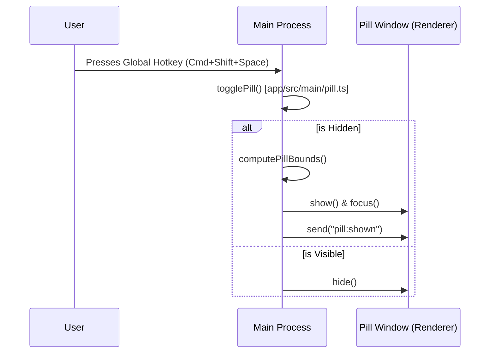
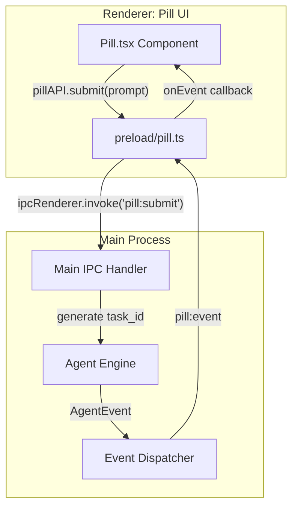

<!-- source: DeepWiki mcp.deepwiki.com · repo browser-use/desktop · page 4.2 Pill Command Bar · fetched 2026-10-30 -->

# Pill Command Bar

Relevant source files

The following files were used as context for generating this wiki page:

- [app/src/main/pill.ts](app/src/main/pill.ts)
- [app/src/preload/pill.ts](app/src/preload/pill.ts)
- [app/src/renderer/pill/Pill.tsx](app/src/renderer/pill/Pill.tsx)
- [app/src/shared/hotkeys.ts](app/src/shared/hotkeys.ts)

The Pill Command Bar is a floating, transparent overlay window designed for rapid task entry and session management via a global hotkey (defaulting to `Cmd+Shift+Space` or `Ctrl+Shift+Space`). It serves as the primary entry point for users to interact with the AI agent without leaving their current context.

## Overview and Lifecycle

The Pill window is created at application startup but remains hidden until triggered by the global hotkey [app/src/main/pill.ts:118-125](). It is designed to be lightweight, frameless, and positioned at the center-top of the active display [app/src/main/pill.ts:75-76]().

### Window States
The Pill supports two primary vertical dimensions:
| State | Height | Description |
| :--- | :--- | :--- |
| **Collapsed** | 110px | Default idle state with a single input row [app/src/main/pill.ts:38](). |
| **Expanded** | 520px | Shows recent sessions, command palette, or streaming logs [app/src/main/pill.ts:39](). |

### Hotkey Management
The application uses a global accelerator to toggle the Pill's visibility. The `shared/hotkeys.ts` module provides normalization logic to ensure consistent behavior across macOS, Windows, and Linux [app/src/shared/hotkeys.ts:18-23]().

Sources: [app/src/main/pill.ts:223-255](), [app/src/shared/hotkeys.ts:10-15]()

## Communication Architecture

The Pill operates in a dedicated renderer process with a specific preload script (`app/src/preload/pill.ts`) that exposes the `pillAPI` to the frontend [app/src/preload/pill.ts:50]().

### IPC Bridge (`pillAPI`)
The preload script facilitates communication between the React UI and the Main process:
*   **`submit`**: Sends a prompt and optional attachments to the agent [app/src/preload/pill.ts:58-70]().
*   **`setExpanded`**: Notifies the main process to resize the window [app/src/preload/pill.ts:128-131]().
*   **`onEvent`**: Listens for `AgentEvent` updates (e.g., status changes, tool calls) forwarded from the main process [app/src/preload/pill.ts:137-158]().

### Data Flow: Prompt Submission
When a user submits a prompt, the Pill window invokes `pill:submit`. The main process handles task ID generation and forwards the request to the agent engine.

Sources: [app/src/preload/pill.ts:58-70](), [app/src/renderer/pill/Pill.tsx:325-335](), [app/src/main/pill.ts:300-315]()

## Implementation Details

### UI Components
The Pill UI is built using React and maintains several internal states to handle user interaction:
*   **Prompt Input**: A `textarea` that handles multi-line input and attachment drops [app/src/renderer/pill/Pill.tsx:390-410]().
*   **Session List**: Displays recent sessions with status indicators (running, idle, stuck) and favicons of the primary sites being browsed [app/src/renderer/pill/Pill.tsx:50-57]().
*   **Attachment Handling**: Supports drag-and-drop for files, enforcing size limits and MIME type validation [app/src/renderer/pill/Pill.tsx:2-7]().

### Window Management Functions
The main process manages the physical window properties:
*   **`createPillWindow`**: Initializes the `BrowserWindow` with platform-specific vibrancy effects (macOS `hud` vs Windows opaque) [app/src/main/pill.ts:140-153]().
*   **`computePillBounds`**: Uses `screen.getCursorScreenPoint()` to ensure the Pill appears on the monitor currently being used by the user [app/src/main/pill.ts:61-76]().
*   **`setExpanded`**: Adjusts the window height dynamically based on the UI state [app/src/main/pill.ts:273-285]().

### Attachment Constraints
The Pill enforces strict limits on file attachments to ensure IPC performance and model context compatibility:
*   **`MAX_ATTACHMENTS_PER_MESSAGE`**: Limits the number of files [app/src/renderer/pill/Pill.tsx:4]().
*   **`MAX_TOTAL_ATTACHMENT_BYTES`**: Limits the total payload size [app/src/renderer/pill/Pill.tsx:5]().

Sources: [app/src/main/pill.ts:37-40](), [app/src/renderer/pill/Pill.tsx:1-23](), [app/src/preload/pill.ts:1-11]()

---

