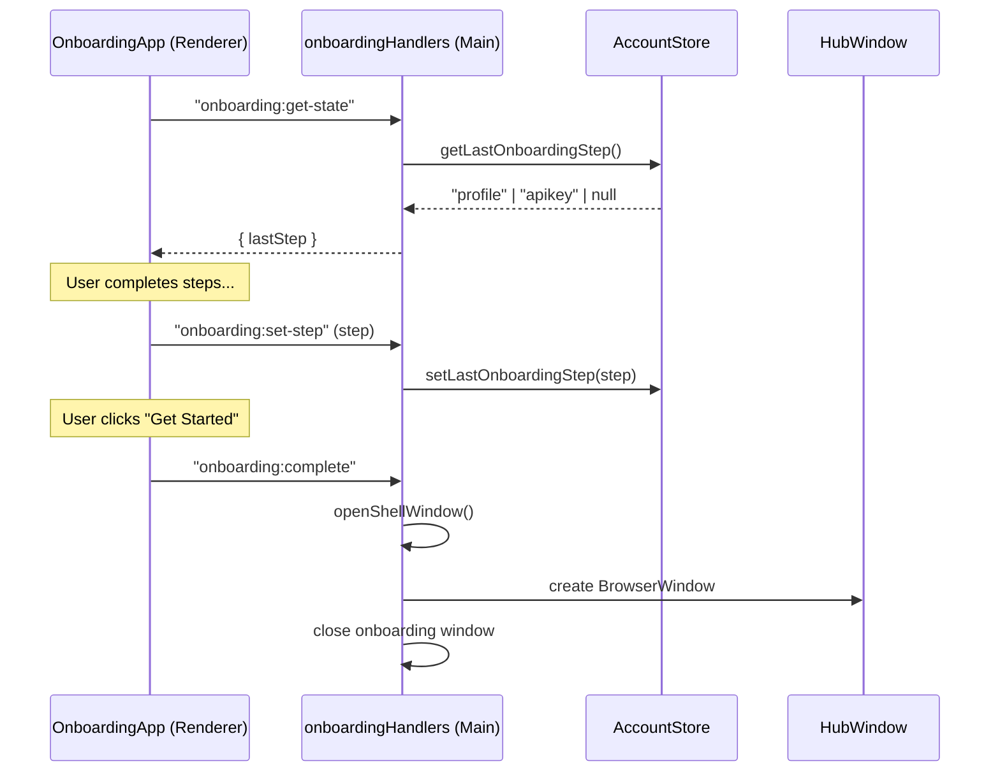
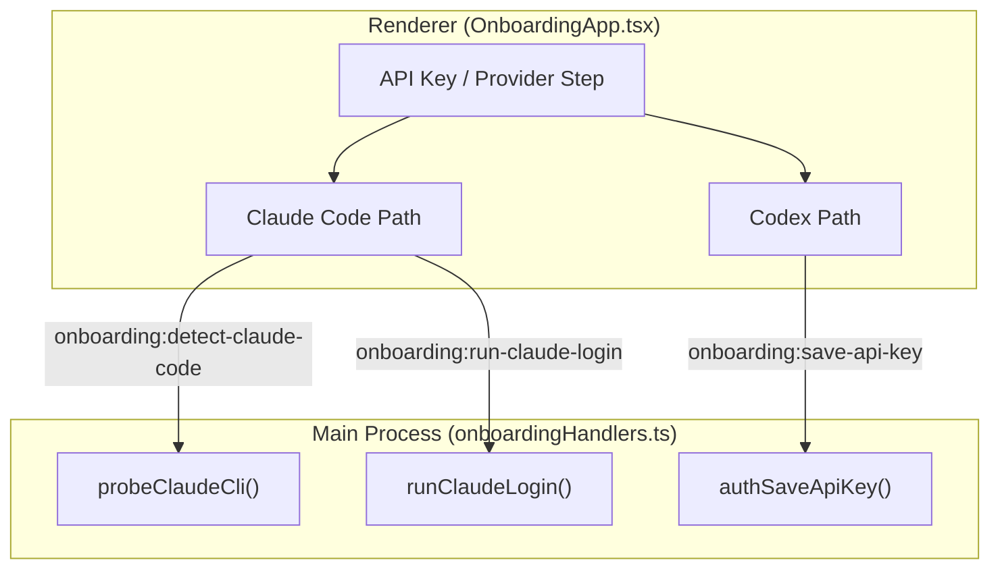

<!-- source: DeepWiki mcp.deepwiki.com · repo browser-use/desktop · page 4.3 Onboarding Flow · fetched 2026-10-30 -->

# Onboarding Flow

Relevant source files

The following files were used as context for generating this wiki page:

- [app/src/main/hotkeys.ts](app/src/main/hotkeys.ts)
- [app/src/main/identity/onboardingHandlers.ts](app/src/main/identity/onboardingHandlers.ts)
- [app/src/main/startup/chromiumFeatures.ts](app/src/main/startup/chromiumFeatures.ts)
- [app/src/preload/onboarding.ts](app/src/preload/onboarding.ts)
- [app/src/renderer/onboarding/OnboardingApp.tsx](app/src/renderer/onboarding/OnboardingApp.tsx)
- [app/src/renderer/onboarding/onboarding.css](app/src/renderer/onboarding/onboarding.css)

The onboarding flow is a dedicated window and multi-step process designed to configure the application before the main shell window is accessible. It serves as a gate to ensure necessary prerequisites—such as AI provider authentication, browser cookie import, and global hotkey registration—are satisfied.

## Overview

The onboarding process is managed by the `OnboardingApp` component in the renderer and orchestrated by `onboardingHandlers.ts` in the main process. The application state is persisted in the `AccountStore`, which tracks the user's progress through the flow. The main window is only opened once the `onboarding:complete` IPC signal is received.

### Data Flow and Gating

The following diagram illustrates the transition from the onboarding state to the main application shell.

**Onboarding to Shell Transition**

**Sources:** [app/src/main/identity/onboardingHandlers.ts:27-48](), [app/src/main/identity/onboardingHandlers.ts:153-155](), [app/src/renderer/onboarding/OnboardingApp.tsx:154-161]()

---

## Key Components

### OnboardingApp (Renderer)
The `OnboardingApp` is a React-based multi-step wizard. It defines the sequence of steps: `intro`, `profile`, `apikey`, `notifications`, and `shortcut` [app/src/renderer/onboarding/OnboardingApp.tsx:110-110]().

*   **Provider Selection**: Users choose between Claude Code and Codex.
*   **Cookie Import**: Lists available Chrome profiles and allows importing session cookies to the internal agent storage.
*   **Hotkeys**: Allows users to record a custom global accelerator for the Pill command bar.

### AccountStore (Persistence)
The `AccountStore` is responsible for persisting the onboarding state to disk, ensuring that if a user quits the app mid-flow, they resume at the correct step [app/src/main/identity/onboardingHandlers.ts:38-48]().

### IPC Handlers
The `registerOnboardingHandlers` function sets up the communication bridge. Key handlers include:
*   `onboarding:detect-claude-code`: Probes the system for the Claude CLI and its auth status [app/src/main/identity/onboardingHandlers.ts:69-84]().
*   `onboarding:run-claude-login`: Spawns a background process to handle OAuth for the Claude CLI [app/src/main/identity/onboardingHandlers.ts:102-129]().
*   `onboarding:save-api-key`: Persists API keys to the OS credential store [app/src/main/identity/onboardingHandlers.ts:50-63]().

**Sources:** [app/src/main/identity/onboardingHandlers.ts:19-28](), [app/src/renderer/onboarding/OnboardingApp.tsx:1-20]()

---

## Implementation Details

### Provider Authentication Flow
The app supports multiple AI backends. The onboarding flow detects if the necessary CLIs are installed and authenticated.

**CLI Detection and Auth Logic**

**Sources:** [app/src/main/identity/onboardingHandlers.ts:69-129](), [app/src/renderer/onboarding/OnboardingApp.tsx:61-82]()

### Chrome Cookie Import
The `OnboardingApp` utilizes the `chrome-import` IPC namespace to bridge the user's existing browser sessions into the agent's environment.

| Function | IPC Channel | Description |
| :--- | :--- | :--- |
| `detectChromeProfiles` | `chrome-import:detect-profiles` | Scans standard OS paths for Chrome/Brave/Edge profiles. |
| `importChromeProfileCookies` | `chrome-import:import-cookies` | Copies SQLite cookie databases from Chrome to the app's internal storage. |
| `listSessionCookies` | `chrome-import:list-cookies` | Returns a list of domains currently stored in the app. |

**Sources:** [app/src/preload/onboarding.ts:23-37](), [app/src/renderer/onboarding/OnboardingApp.tsx:35-45]()

### Global Hotkey Registration
During the `shortcut` step, the app captures keyboard events to set the global accelerator for the Pill window.

1.  The renderer captures a `KeyboardEvent`.
2.  It converts the event to a shortcut string using `keyboardEventToShortcut` [app/src/renderer/onboarding/OnboardingApp.tsx:113-113]().
3.  The string is sent to the main process via `onboarding:set-shortcut`.
4.  The main process calls `setGlobalCmdbarAccelerator` which interacts with Electron's `globalShortcut` module [app/src/main/hotkeys.ts:128-155]().

**Sources:** [app/src/main/hotkeys.ts:128-179](), [app/src/renderer/onboarding/OnboardingApp.tsx:112-116](), [app/src/preload/onboarding.ts:104-105]()

---

## Preload API Surface

The `onboarding` preload script exposes a restricted set of functions to the renderer via `contextBridge.exposeInMainWorld('onboardingAPI', ...)`. This ensures the onboarding UI can perform sensitive operations (like reading Chrome profiles or spawning CLI logins) without having full access to Node.js internals.

| API Method | Description |
| :--- | :--- |
| `complete(opts)` | Signals the main process to close onboarding and open the Hub [app/src/preload/onboarding.ts:153-154](). |
| `setStep(step)` | Updates the persistent onboarding progress [app/src/preload/onboarding.ts:159-160](). |
| `runClaudeLogin()` | Spawns `claude auth login --claudeai` as a subprocess [app/src/preload/onboarding.ts:67-68](). |
| `setTelemetryConsent(bool)` | Persists user choice regarding telemetry [app/src/preload/onboarding.ts:143-147](). |

**Sources:** [app/src/preload/onboarding.ts:20-184]()

---

