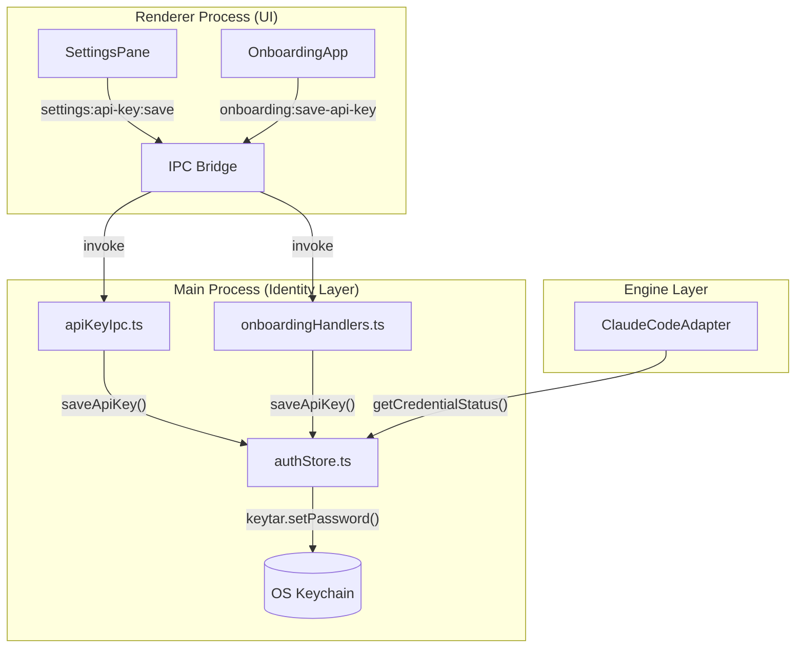
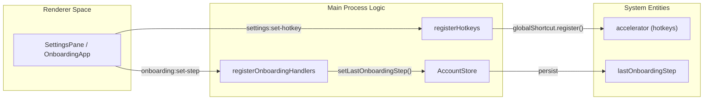

<!-- source: DeepWiki mcp.deepwiki.com · repo browser-use/desktop · page 5 Identity and Settings · fetched 2026-10-30 -->

# Identity and Settings

Relevant source files

The following files were used as context for generating this wiki page:

- [app/src/main/identity/onboardingHandlers.ts](app/src/main/identity/onboardingHandlers.ts)
- [app/src/main/settings/apiKeyIpc.ts](app/src/main/settings/apiKeyIpc.ts)

This section covers how the application manages user identity, secures credentials, and provides a unified interface for system-wide settings. The application supports multiple authentication providers (Anthropic, Claude Code, and OpenAI) and persists user preferences and onboarding states across sessions.

## Overview

The identity system is centered around the `AccountStore` and `authStore`. While `AccountStore` manages high-level application state like onboarding progress, `authStore` handles the secure storage of sensitive credentials using the OS-level keychain via `keytar`.

The settings infrastructure provides IPC handlers for managing these credentials and configuring global application behavior, such as hotkeys and engine preferences.

### Core Components

| Component | Responsibility | Key File |
| :--- | :--- | :--- |
| **AccountStore** | Manages non-sensitive user state and onboarding steps. | [app/src/main/identity/AccountStore.ts:1-10]() |
| **authStore** | Securely stores and retrieves API keys and tokens via `keytar`. | [app/src/main/identity/authStore.ts:1-20]() |
| **Onboarding Handlers** | Coordinates the initial setup flow and provider detection. | [app/src/main/identity/onboardingHandlers.ts:27-28]() |
| **API Key IPC** | Provides the bridge for the Settings UI to manage credentials. | [app/src/main/settings/apiKeyIpc.ts:1-6]() |

## Authentication Architecture

The application implements a "Provider" model for authentication. It distinguishes between direct API key usage and external CLI-based authentication (like Claude Code).

### Credential Flow

The following diagram illustrates how the system bridges user input in the "Natural Language Space" (UI) to secure storage in the "Code Entity Space".

**Identity and Credential Flow**

**Sources:** [app/src/main/settings/apiKeyIpc.ts:31-33](), [app/src/main/identity/onboardingHandlers.ts:50-63](), [app/src/main/identity/authStore.ts:7-19]()

## Provider Authentication

The application supports three primary authentication modes:
1.  **Anthropic API Key**: Stored directly in the OS keychain.
2.  **Claude Code (Subscription)**: Leverages the `claude` CLI's own authentication state. The app probes the CLI's keychain to verify login status.
3.  **OpenAI API Key**: Managed similarly to Anthropic keys for use with Codex-based engines.

For detailed implementation of the OAuth flows and CLI probing, see **[Provider Authentication](#5.1)**.

**Sources:** [app/src/main/settings/apiKeyIpc.ts:51-63](), [app/src/main/identity/claudeCodeAuth.ts:20-20]()

## Settings and Global Hotkeys

Settings are exposed to the user through a dedicated `SettingsWindow` and integrated into the Hub UI. This system handles:
*   **API Key Management**: Testing, saving, and deleting keys via `apiKeyIpc.ts`.
*   **Global Hotkeys**: Managing the "Pill" command bar accelerator (defaulting to `Cmd/Ctrl+Shift+P`) via `GlobalCmdbarAccelerator`.
*   **Onboarding State**: Tracking the user's progress through `AccountStore` to gate access to the main application.

For details on the settings UI and hotkey registration, see **[Settings and Hotkeys](#5.2)**.

### System Configuration Bridge

This diagram shows how user settings in the UI interact with the underlying system configurations.

**Settings and Configuration Mapping**

**Sources:** [app/src/main/identity/onboardingHandlers.ts:44-48](), [app/src/main/hotkeys.ts:11-11](), [app/src/main/identity/AccountStore.ts:39-41]()

## Key Files Summary

*   `app/src/main/identity/onboardingHandlers.ts`: Implements IPC handlers for the onboarding flow, including Claude CLI detection and login [app/src/main/identity/onboardingHandlers.ts:27-153]().
*   `app/src/main/settings/apiKeyIpc.ts`: Manages the lifecycle of API keys (test, save, delete) and Claude Code subscription status [app/src/main/settings/apiKeyIpc.ts:29-43]().
*   `app/src/main/identity/authStore.ts`: The low-level interface for `keytar` and credential persistence [app/src/main/identity/authStore.ts:7-19]().
*   `app/src/main/identity/AccountStore.ts`: Manages application-specific user data like the last completed onboarding step [app/src/main/identity/AccountStore.ts:4-4]().

**Sources:** [app/src/main/identity/onboardingHandlers.ts:1-153](), [app/src/main/settings/apiKeyIpc.ts:1-181](), [app/src/main/identity/authStore.ts:1-20](), [app/src/main/identity/AccountStore.ts:1-10]()

---

