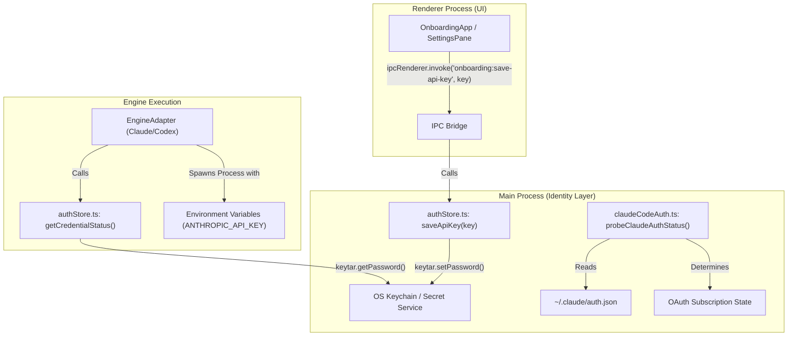
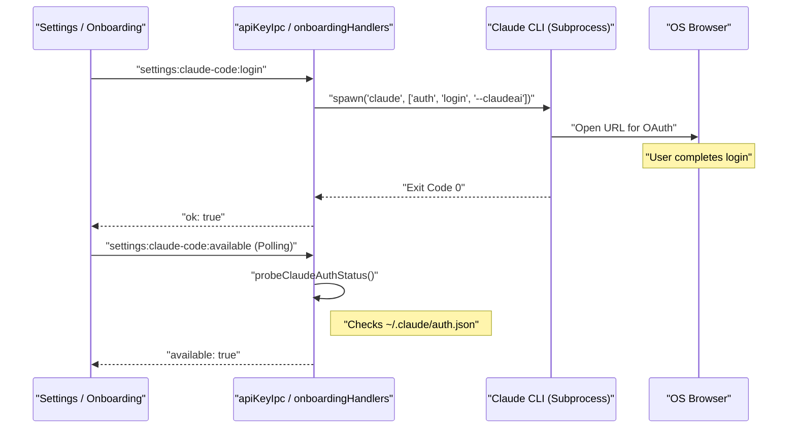

<!-- source: DeepWiki mcp.deepwiki.com · repo browser-use/desktop · page 5.1 Provider Authentication · fetched 2026-10-30 -->

# Provider Authentication

Relevant source files

The following files were used as context for generating this wiki page:

- [app/src/main/identity/onboardingHandlers.ts](app/src/main/identity/onboardingHandlers.ts)
- [app/src/main/settings/apiKeyIpc.ts](app/src/main/settings/apiKeyIpc.ts)

Provider Authentication manages the lifecycle of credentials for AI engines, supporting both API-key-based access and OAuth-based subscriptions via CLI integrations. The application utilizes the OS-level secure credential store (via `keytar`) to ensure sensitive tokens are never stored in plain text on the file system.

## Authentication Architecture

The system supports two primary providers: **Anthropic** (via Claude Code or direct API keys) and **OpenAI** (via Codex or direct API keys). Authentication state is managed in the main process and exposed to the renderer through dedicated IPC handlers.

### Data Flow: Credential Lifecycle

The following diagram illustrates how credentials flow from user input to secure storage and eventual consumption by engine processes.

**Credential Flow Diagram**

Sources: [app/src/main/identity/authStore.ts:1-20](), [app/src/main/identity/onboardingHandlers.ts:50-63](), [app/src/main/settings/apiKeyIpc.ts:1-19]()

---

## Secure Storage (`authStore`)

The `authStore.ts` module is the central authority for credential persistence. It abstracts `keytar` to provide a unified interface for managing Anthropic and OpenAI keys.

### Key Functions
- **`saveApiKey(key: string)`**: Validates and persists an Anthropic API key to the system keychain using the service name `com.browser-use.desktop.anthropic` [app/src/main/identity/authStore.ts:60-75]().
- **`getCredentialStatus()`**: Returns a summary of current authentication states, including masked versions of keys for UI display and the current `authMode` (API key vs. OAuth) [app/src/main/identity/authStore.ts:140-175]().
- **`clearAuth()`**: Removes all stored credentials and resets the authentication mode to `none` [app/src/main/identity/authStore.ts:125-138]().

### Security Invariants
- Raw keys are never logged to `mainLogger` [app/src/main/settings/apiKeyIpc.ts:5-6]().
- Credentials are stored under specific service IDs in the OS keychain to prevent collisions [app/src/main/identity/onboardingHandlers.ts:13-15]().

Sources: [app/src/main/identity/authStore.ts:1-175](), [app/src/main/settings/apiKeyIpc.ts:1-10]()

---

## Claude Code Authentication

The application integrates with the **Claude Code CLI** to support Anthropic subscriptions via OAuth. This avoids the need for users to manually manage API keys if they already have a Claude subscription.

### Detection and Probing
The system probes for the Claude CLI's internal state by checking for the existence and content of its configuration files (e.g., `~/.claude/auth.json`).
- **`probeClaudeAuthStatus()`**: Checks if the CLI is installed and if a valid OAuth session exists [app/src/main/identity/claudeCodeAuth.ts:20-20]().
- **`onboarding:detect-claude-code`**: An IPC handler that returns the CLI version, installation status, and whether the user is authenticated [app/src/main/identity/onboardingHandlers.ts:69-84]().

### Login Workflows
The application provides two ways to trigger the Claude OAuth flow:
1. **Background Spawn**: `onboarding:run-claude-login` spawns `claude auth login --claudeai` as a background process. The CLI opens the system browser for the user to complete the flow [app/src/main/identity/onboardingHandlers.ts:102-129]().
2. **Terminal Fallback (macOS)**: `onboarding:open-claude-login-terminal` uses AppleScript to open a visible Terminal window and execute the login command, providing more visibility if the background flow fails [app/src/main/identity/onboardingHandlers.ts:131-153]().

**Claude Auth Logic**

Sources: [app/src/main/identity/onboardingHandlers.ts:102-153](), [app/src/main/settings/apiKeyIpc.ts:138-179]()

---

## OpenAI / Codex Authentication

Authentication for OpenAI follows a similar pattern to Anthropic API keys but uses a distinct service identifier in the credential store.

### Key Management
- **`saveOpenAIKey(key: string)`**: Persists the OpenAI key via `authStore` [app/src/main/settings/apiKeyIpc.ts:37-37]().
- **`settings:openai-key:test`**: Validates the key by performing a lightweight request to `https://api.openai.com/v1/models` [app/src/main/settings/apiKeyIpc.ts:38-38]().

### Logout Flow
- **`settings:codex:logout`**: Specifically handles clearing Codex-related session data and credentials [app/src/main/settings/apiKeyIpc.ts:40-40]().

Sources: [app/src/main/settings/apiKeyIpc.ts:36-40](), [app/src/main/identity/authStore.ts:16-17]()

---

## IPC Interface Summary

The `apiKeyIpc.ts` and `onboardingHandlers.ts` files expose the following primary channels to the frontend:

| Channel | Purpose | Implementation |
| :--- | :--- | :--- |
| `onboarding:save-api-key` | Initial key setup during onboarding | `authSaveApiKey` [app/src/main/identity/onboardingHandlers.ts:50]() |
| `settings:api-key:get-status` | Retrieves masked keys and auth type | `handleGetStatus` [app/src/main/settings/apiKeyIpc.ts:51]() |
| `settings:api-key:test` | Validates Anthropic key via fetch | `handleTest` [app/src/main/settings/apiKeyIpc.ts:79]() |
| `settings:claude-code:use` | Switches auth mode to Claude CLI | `handleUseClaudeCode` [app/src/main/settings/apiKeyIpc.ts:181]() |
| `onboarding:detect-claude-code` | Probes for CLI installation | `probeClaudeCli` [app/src/main/identity/onboardingHandlers.ts:69]() |

Sources: [app/src/main/identity/onboardingHandlers.ts:38-153](), [app/src/main/settings/apiKeyIpc.ts:29-42]()

---

