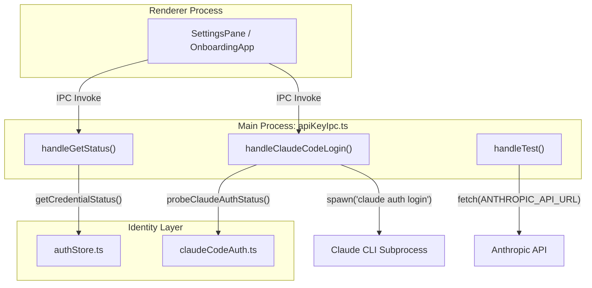
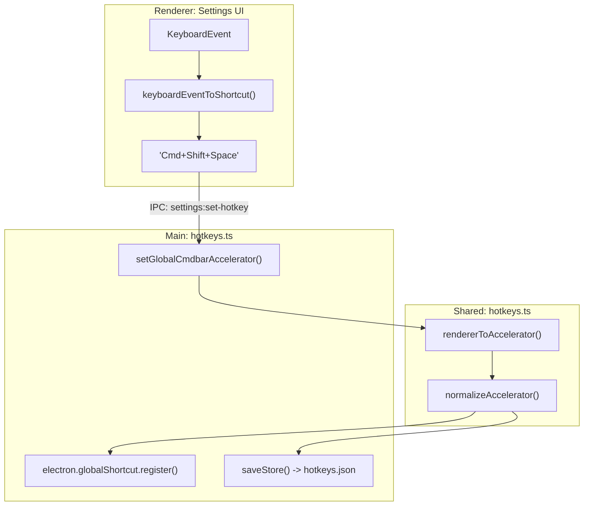

<!-- source: DeepWiki mcp.deepwiki.com · repo browser-use/desktop · page 5.2 Settings and Hotkeys · fetched 2026-10-30 -->

# Settings and Hotkeys

Relevant source files

The following files were used as context for generating this wiki page:

- [app/src/main/hotkeys.ts](app/src/main/hotkeys.ts)
- [app/src/main/settings/apiKeyIpc.ts](app/src/main/settings/apiKeyIpc.ts)
- [app/src/main/startup/chromiumFeatures.ts](app/src/main/startup/chromiumFeatures.ts)
- [app/src/renderer/onboarding/onboarding.css](app/src/renderer/onboarding/onboarding.css)
- [app/src/shared/hotkeys.ts](app/src/shared/hotkeys.ts)
- [app/tests/unit/shared/hotkeys.test.ts](app/tests/unit/shared/hotkeys.test.ts)

The Settings and Hotkeys system manages application-wide configuration, secure credential storage for AI providers, and the global keyboard shortcuts that trigger the command bar. This system spans the Main process (registration and persistence), the Renderer process (UI), and a shared utility layer for platform-specific shortcut normalization.

## API Key and Auth Management

The application manages credentials for Anthropic (Claude Code/API) and OpenAI. This is handled via `apiKeyIpc.ts`, which provides IPC handlers for saving, testing, and deleting keys, as well as managing OAuth flows for Claude Code.

### Credential Flow
The `apiKeyIpc` module interacts with `authStore` for persistence and `claudeCodeAuth` for probing the local Claude CLI keychain.

| Channel | Function | Description |
|:---|:---|:---|
| `settings:api-key:get-status` | `handleGetStatus` | Returns whether the user is using OAuth or an API key, including masked keys [app/src/main/settings/apiKeyIpc.ts:51-63](). |
| `settings:api-key:save` | `handleSave` | Persists a validated Anthropic API key [app/src/main/settings/apiKeyIpc.ts:72-77](). |
| `settings:api-key:test` | `handleTest` | Performs a live request to `https://api.anthropic.com/v1/messages` with `claude-haiku-4-5-20251001` to verify key validity [app/src/main/settings/apiKeyIpc.ts:79-118](). |
| `settings:claude-code:login` | `handleClaudeCodeLogin` | Spawns `claude auth login --claudeai` as a subprocess to trigger browser-based OAuth [app/src/main/settings/apiKeyIpc.ts:138-179](). |

### Identity Logic Entity Mapping
This diagram maps the natural language concepts of "Auth Management" to the specific code entities in the Main process.

**Sources:** [app/src/main/settings/apiKeyIpc.ts:1-182](), [app/src/main/identity/authStore.ts:12-21]()

## Global Hotkey System

The application uses a global shortcut (defaulting to `CommandOrControl+Shift+Space`) to toggle the command bar (Pill window). This is managed by the `hotkeys.ts` module in the main process.

### Persistence and Registration
Hotkeys are persisted in `hotkeys.json` within the user data directory [app/src/main/hotkeys.ts:12-23]().

- **`registerHotkeys(callback)`**: Loads the stored accelerator and registers it with Electron's `globalShortcut` module. If registration fails, it attempts to fall back to the system default [app/src/main/hotkeys.ts:91-126]().
- **`setGlobalCmdbarAccelerator(accel)`**: Updates the registered shortcut. It unregisters the old one, attempts to register the new one, and rolls back to the previous or default shortcut if the new one is invalid or already taken by another application [app/src/main/hotkeys.ts:128-179]().

**Sources:** [app/src/main/hotkeys.ts:12-186]()

## Shared Hotkeys Module

The `shared/hotkeys.ts` file provides a platform-agnostic logic layer used by both the Main process (for Electron accelerators) and the Renderer process (for UI display and keyboard event capturing).

### Platform Normalization
The system distinguishes between three formats:
1.  **Electron Accelerator**: Used for registration (e.g., `CommandOrControl+Shift+Space`) [app/src/shared/hotkeys.ts:10]().
2.  **Renderer Shortcut**: Used for logic in the UI (e.g., `Cmd+Shift+Space`) [app/src/shared/hotkeys.ts:58-67]().
3.  **Display Format**: Uses symbols/glyphs for macOS (e.g., `⌘+⇧+Space`) and text for Windows/Linux (e.g., `Ctrl+Shift+Space`) [app/src/shared/hotkeys.ts:69-74]().

### Key Functions
- **`normalizeAccelerator(accel, platform)`**: Ensures consistent ordering of modifiers (e.g., CommandOrControl first) and standardizes key names like "Space" [app/src/shared/hotkeys.ts:112-136]().
- **`keyboardEventToShortcut(e, platform)`**: Converts a browser `KeyboardEvent` into a renderer-compatible shortcut string for use in settings input fields [app/src/shared/hotkeys.ts:150-167]().

### Hotkey Logic and Data Flow
This diagram shows how a user's keyboard interaction in the Settings UI flows through normalization into the Main process for registration.

**Sources:** [app/src/shared/hotkeys.ts:1-167](), [app/src/main/hotkeys.ts:128-155]()

## Settings Implementation Details

### IPC Handler Summary
The `apiKeyIpc.ts` file implements several handlers that bridge the Hub UI to the underlying system.

| Function | IPC Channel | Role |
|:---|:---|:---|
| `handleClaudeCodeAvailable` | `settings:claude-code:available` | Checks if the Claude CLI is logged in [app/src/main/settings/apiKeyIpc.ts:125-129](). |
| `handleUseClaudeCode` | `settings:claude-code:use` | Switches the application to use Claude Code subscription instead of API keys [app/src/main/settings/apiKeyIpc.ts:181-185](). |
| `handleDelete` | `settings:api-key:delete` | Clears all stored Anthropic credentials [app/src/main/settings/apiKeyIpc.ts:120-123](). |

### Security Invariants
- **No Logging of Keys**: Raw API keys and OAuth tokens are explicitly excluded from logs [app/src/main/settings/apiKeyIpc.ts:5]().
- **Masking**: When returning status to the UI, keys are masked (e.g., `sk-ant...abcd`) to prevent exposure in the renderer [app/src/main/settings/apiKeyIpc.ts:60]().

**Sources:** [app/src/main/settings/apiKeyIpc.ts:1-185](), [app/src/shared/hotkeys.ts:1-168]()

---

