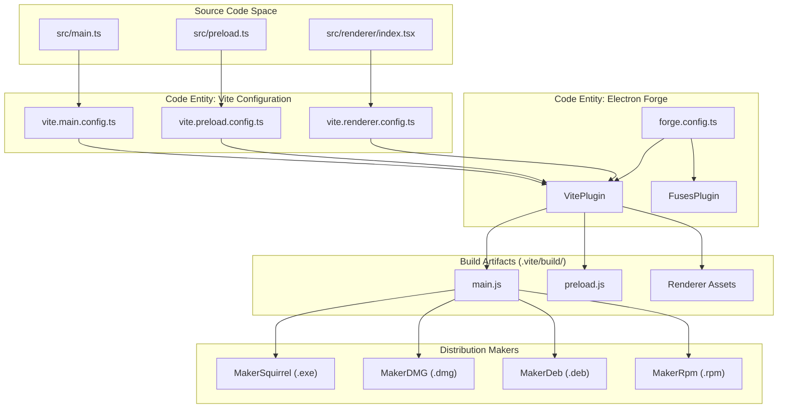

<!-- source: DeepWiki mcp.deepwiki.com · repo browser-use/desktop · page 6 Build System · fetched 2026-10-30 -->

# Build System

<details>
<summary>Relevant source files</summary>

The following files were used as context for generating this wiki page:

- [app/forge.config.ts](app/forge.config.ts)
- [app/package.json](app/package.json)

</details>


## Purpose and Scope

This document provides an overview of the build system used in the `browser-use/desktop` application. The build system is responsible for compiling TypeScript source code, bundling assets, and packaging the application for distribution across macOS, Windows, and Linux. The system uses **Electron Forge** as the primary orchestrator, with **Vite** handling the bundling and **TypeScript** managing type safety across the multi-process architecture.

For detailed information about specific build configurations, see [Electron Forge Configuration](#6.1), [Vite Build Configuration](#6.2), and [TypeScript Configuration](#6.3).

## Build Pipeline Overview

The build system follows a multi-stage pipeline that transforms source code into signed and notarized distributable binaries. It utilizes `@electron-forge/plugin-vite` to coordinate the compilation of the main, renderer, and preload processes.

### Build Pipeline Architecture



Sources: [app/forge.config.ts:5-11](), [app/package.json:14-14]()

## Electron Forge Configuration

Electron Forge acts as the top-level build manager. Its configuration in `forge.config.ts` defines how the application is packaged, how native modules are rebuilt, and how the final installers are generated. It also handles the complex logic for macOS signing and notarization using environment variables like `SIGNING_IDENTITY` and `APPLE_ID`.

Key responsibilities include:
*   **Packaging**: Using `packagerConfig` to exclude development files and include extra resources like `app-update.yml`.
*   **Native Modules**: Executing `packageAfterPrune` hooks to re-install production dependencies and run `@electron/rebuild` for native compatibility.
*   **Security**: Implementing `FusesPlugin` to harden the Electron binary.

For details, see [Electron Forge Configuration](#6.1).

Sources: [app/forge.config.ts:62-129](), [app/forge.config.ts:139-149]()

## Vite Build Configuration

Vite is used as the bundler for all three Electron processes. This setup provides a fast development experience with Hot Module Replacement (HMR) for the renderer process. The build system specifically handles "externals"—modules like `better-sqlite3`, `keytar`, and `node-pty` that must remain outside the bundle to function as native Node.js modules.

A critical part of the Vite setup is the `viteDepStaleHeal` workaround, which ensures that the development server correctly recovers when dependency locks change.

For details, see [Vite Build Configuration](#6.2).

Sources: [app/forge.config.ts:9-10](), [app/package.json:22-22]()

## TypeScript Configuration

The project uses TypeScript to maintain type safety across the IPC (Inter-Process Communication) boundary. The build system relies on `tsconfig.json` to define compilation rules that apply to the main process, preload scripts, and the React-based renderer.

The configuration ensures that:
*   Shared schemas in `src/shared/schemas` are accessible to all processes.
*   The renderer process has access to browser-specific types (DOM).
*   The main process has access to Node.js and Electron types.

For details, see [TypeScript Configuration](#6.3).

Sources: [app/package.json:36-36](), [app/package.json:94-94]()

## Build Scripts and Lifecycle

The `package.json` file defines the primary entry points for the build system.

| Script | Command | Purpose |
| :--- | :--- | :--- |
| `dev` | `electron-forge start` | Launches the app in development mode with HMR. |
| `package` | `electron-forge package` | Bundles the app into an executable folder. |
| `make` | `electron-forge make` | Runs makers to create installers (DMG, EXE, DEB). |
| `typecheck` | `tsc --noEmit` | Validates TypeScript types across the project. |
| `postinstall` | `node scripts/chmod-node-pty-helpers.mjs` | Fixes permissions for native terminal helpers. |

### Build Logic Flow

```mermaid
graph LR
    subgraph "Execution Logic"
        npm_install["npm install"]
        postinstall["postinstall hook"]
        forge_make["forge make"]
    end

    subgraph "File System / Code Entities"
        node_pty["node-pty helpers"]
        chmod_script["scripts/chmod-node-pty-helpers.mjs"]
        rebuild["@electron/rebuild"]
    end

    npm_install --> postinstall
    postinstall --> chmod_script
    chmod_script --> node_pty
    forge_make --> rebuild
    rebuild --> [".node native modules"]
```

Sources: [app/package.json:27-53](), [app/forge.config.ts:148-149]()

---

