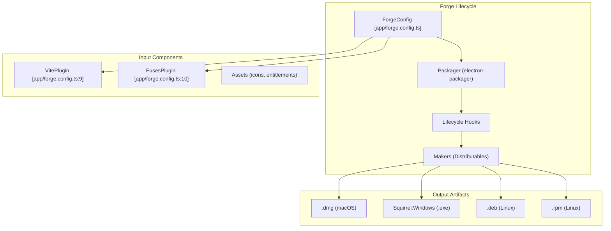
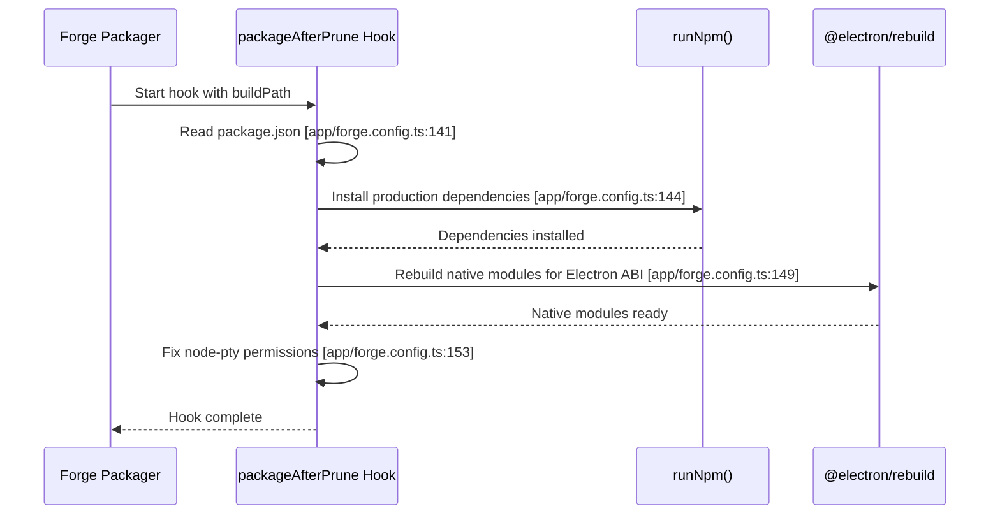

<!-- source: DeepWiki mcp.deepwiki.com · repo browser-use/desktop · page 6.1 Electron Forge Configuration · fetched 2026-10-30 -->

# Electron Forge Configuration

Relevant source files

The following files were used as context for generating this wiki page:

- [app/app-update.yml](app/app-update.yml)
- [app/forge.config.ts](app/forge.config.ts)

This document details the Electron Forge configuration for the `browser-use` desktop application. It manages the lifecycle of packaging, distribution, and security hardening through a structured pipeline involving makers, plugins, and lifecycle hooks.

## Configuration Overview

The Electron Forge setup is defined in `app/forge.config.ts`. It orchestrates the transformation of source code and assets into production-ready installers for macOS, Windows, and Linux.

**Sources: [app/forge.config.ts:4-11](), [app/forge.config.ts:62-230]()**

## Packaging and Resource Management

The `packagerConfig` handles the initial bundling of the application. It uses ASAR for archive bundling and defines strict exclusion rules to prevent development bloat.

### Key Metadata and Resources
- **App Identity**: The application is named `Browser Use` with an executable name of `browser-use-desktop` [app/forge.config.ts:68-69]().
- **ASAR Bundling**: Enabled by default to improve performance and security [app/forge.config.ts:64]().
- **Extra Resources**: The `app-update.yml` file is included as an extra resource, which is critical for the `electron-updater` logic to resolve the update feed URL [app/forge.config.ts:128]().

### File Exclusion (Ignore)
To minimize package size and prevent leaking sensitive development data, a comprehensive `ignore` list is maintained:
- **Source/Tests**: Excludes `/src`, `/tests`, and `/scripts` [app/forge.config.ts:76-78]().
- **Dev Configs**: Excludes `tsconfig.json`, `eslint.config.ts`, `vite.config.ts`, and `forge.config.ts` [app/forge.config.ts:87-90]().
- **Security**: Explicitly excludes `.env` files to ensure credentials never ship to users [app/forge.config.ts:93]().

**Sources: [app/forge.config.ts:63-129]()**

## Distribution Makers

Makers define the final packaging formats for different operating systems.

| Maker | Target Platform | Details |
|-------|-----------------|---------|
| `MakerSquirrel` | Windows | Configured with `WINDOWS_ICON_PATH` [app/forge.config.ts:211-214](). |
| `MakerDMG` | macOS | Uses a custom icon and handles disk image creation [app/forge.config.ts:217-220](). |
| `MakerDeb` | Linux (Debian) | Configured with Linux-specific icons [app/forge.config.ts:222-225](). |
| `MakerRpm` | Linux (RedHat) | Standard RPM packaging [app/forge.config.ts:227-229](). |

**Sources: [app/forge.config.ts:210-230]()**

## Lifecycle Hooks

The configuration utilizes the `packageAfterPrune` hook to resolve issues introduced by the Vite plugin's dependency management.

### Native Module Rebuilding
Since `VitePlugin` excludes `node_modules`, external dependencies like `better-sqlite3`, `keytar`, and `node-pty` must be re-installed into the packaged directory. The `packageAfterPrune` hook:
1. Re-installs production dependencies using `npm install --omit=dev` [app/forge.config.ts:144]().
2. Invokes `@electron/rebuild` to ensure native modules match the Electron runtime ABI rather than the host Node.js ABI [app/forge.config.ts:149]().
3. Restores executable permissions on `node-pty` helpers, which are often lost during the npm install process [app/forge.config.ts:153]().

**Sources: [app/forge.config.ts:133-154]()**

## Security Hardening (Electron Fuses)

The `FusesPlugin` hardens the Electron binary by disabling features that could be exploited by an attacker to gain unauthorized access or execute arbitrary code.

| Fuse | Value | Description |
|------|-------|-------------|
| `RunAsNode` | `false` | Prevents the application from being used as a general Node.js binary via the `ELECTRON_RUN_AS_NODE` environment variable [app/forge.config.ts:241](). |
| `EnableCookieEncryption` | `true` | Ensures Chromium's cookie storage is encrypted at rest [app/forge.config.ts:242](). |
| `EnableNodeOptionsEnvironmentVariable` | `false` | Disables the `NODE_OPTIONS` environment variable to prevent injection of malicious scripts [app/forge.config.ts:243](). |
| `EnableNodeCliInspectArguments` | `false` | Disables the `--inspect` flag in production [app/forge.config.ts:244](). |
| `EnableEmbeddedAsarIntegrityValidation` | `true` | Validates the ASAR archive integrity on macOS [app/forge.config.ts:245](). |
| `OnlyLoadAppFromAsar` | `true` | Forces the app to only load code from the packaged ASAR file [app/forge.config.ts:246](). |

**Sources: [app/forge.config.ts:236-248]()**

## Code Signing and Notarization

The configuration supports conditional signing and notarization based on environment variables.

- **macOS Signing**: Uses `osxSign` with a `Hardened Runtime` and specific `entitlements.plist` if `SHOULD_SIGN` is true [app/forge.config.ts:104-110]().
- **macOS Notarization**: Submits the app to Apple's notarization service using `APPLE_ID`, `APPLE_APP_SPECIFIC_PASSWORD`, and `APPLE_TEAM_ID` [app/forge.config.ts:114-120]().
- **Ad-hoc Signing**: For local development or builds where no credentials are provided, a `postPackage` hook applies an ad-hoc signature (`codesign -s -`) to the `.app` bundle [app/forge.config.ts:161-174]().

**Sources: [app/forge.config.ts:16-35](), [app/forge.config.ts:98-120](), [app/forge.config.ts:161-174]()**

---

