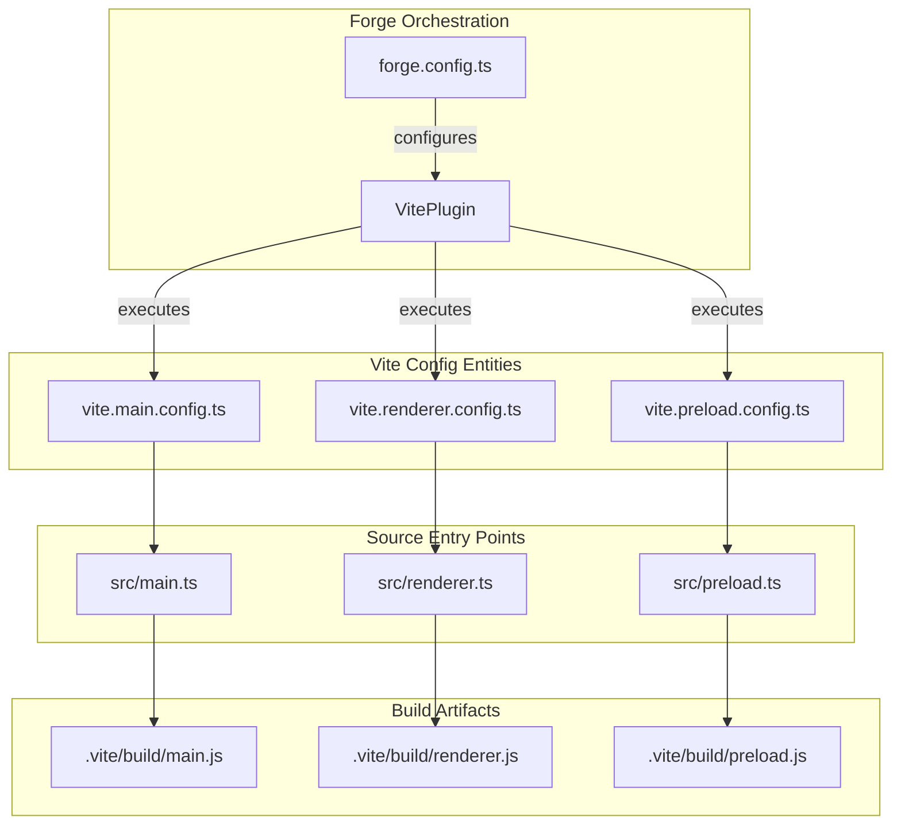
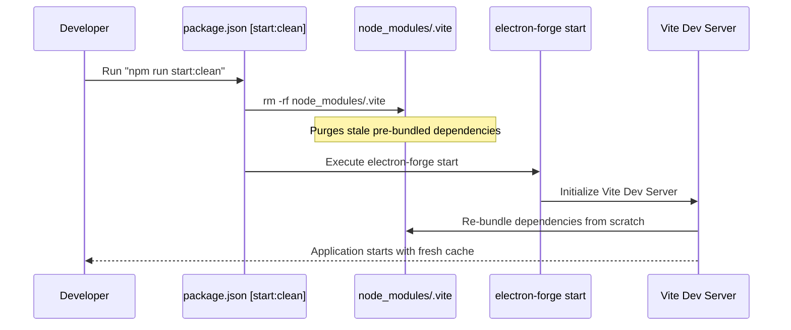

<!-- source: DeepWiki mcp.deepwiki.com · repo browser-use/desktop · page 6.2 Vite Build Configuration · fetched 2026-10-30 -->

# Vite Build Configuration

Relevant source files

The following files were used as context for generating this wiki page:

- [app/forge.config.ts](app/forge.config.ts)
- [app/package.json](app/package.json)

This document covers the Vite build configuration system used in the browser-use/desktop application. It explains how Vite is configured to build the three primary Electron processes: main, renderer, and preload scripts, and how it handles Hot Module Replacement (HMR) and dependency staleness.

## Configuration Architecture

The Vite build system uses a multi-configuration approach with separate configuration files for each Electron process. This separation allows for process-specific optimizations and ensures proper isolation between the main process, renderer process, and preload script contexts. The orchestration is managed by the `VitePlugin` within the Electron Forge configuration.

### Build Entity Mapping

The following diagram maps the build configuration entities to their respective source files and build outputs.

Title: Vite Build Pipeline Mapping

Sources: [app/package.json:14-14](), [app/forge.config.ts:9-9](), [app/package.json:67-67]()

## Process-Specific Configurations

The application uses three distinct Vite configuration files. Each file exports a `defineConfig` call that specifies the environment and plugin requirements for that specific process.

### Main Process Configuration
The main process configuration handles building the Electron main process, which orchestrates the application lifecycle and manages external processes like the AI engine. It is defined in `vite.main.config.ts`.

### Renderer Process Configuration
The renderer configuration handles the web-based UI components. It includes the `@vitejs/plugin-react` to support React components used in the Hub and Onboarding windows. It is defined in `vite.renderer.config.ts`.

### Preload Script Configuration
The preload configuration builds the security bridge between the main and renderer processes. It is defined in `vite.preload.config.ts`.

| Configuration Aspect | Main Process | Renderer Process | Preload Script |
|---------------------|--------------|------------------|----------------|
| **Entry Point** | `src/main.ts` | `src/renderer.ts` | `src/preload.ts` |
| **Output Path** | `.vite/build/main.js` | `.vite/build/renderer.js` | `.vite/build/preload.js` |
| **Target** | Node.js | Chromium | Isolated Context |
| **Key Plugins** | None | `@vitejs/plugin-react` | None |

Sources: [app/package.json:14-14](), [app/package.json:82-82]()

## HMR and Dependency Staleness (viteDepStaleHeal)

During development, Vite uses Hot Module Replacement (HMR) to provide fast updates. However, Electron development environments often encounter issues where the Vite dependency cache becomes stale, leading to module resolution errors or crashes upon restart.

### The `start:clean` Workaround
To address dependency staleness, the project includes a specific script to "heal" the Vite environment by purging the internal `.vite` cache before starting the Electron Forge development server.

Title: Vite Dependency Healing Flow

The `start:clean` script is defined as:
`"start:clean": "rm -rf node_modules/.vite && electron-forge start"`

Sources: [app/package.json:29-29]()

## Integration with Electron Forge

The Vite build is tightly integrated with Electron Forge via the `VitePlugin`. This plugin manages the lifecycle of the Vite dev servers during development and the bundling process during packaging.

### Native Dependency Handling
A critical part of the build configuration is handling native modules (e.g., `better-sqlite3`, `node-pty`, `keytar`). Since Vite bundles dependencies, native modules must be treated as externals to prevent them from being broken by the bundler.

1. **Externals Identification**: Dependencies like `better-sqlite3` and `keytar` are excluded from the Vite bundle.
2. **Re-installation Hook**: In `forge.config.ts`, the `packageAfterPrune` hook is used to re-install production dependencies into the packaged directory because `VitePlugin` excludes `node_modules` from the final bundle [app/forge.config.ts:139-144]().
3. **Native Rebuild**: The hook then triggers `@electron/rebuild` to ensure native modules are compiled against the Electron ABI rather than the host Node.js ABI [app/forge.config.ts:148-149]().

### Packager Exclusions
To keep the application bundle lean, the Forge configuration explicitly ignores source files and development configurations that are processed by Vite and are no longer needed in the final `.asar` archive.

| Ignored Pattern | Reason |
|-----------------|--------|
| `/^\/src($|\/)/` | TS source is compiled to `.vite/build` [app/forge.config.ts:76-76]() |
| `/^\/vite\..*\.(ts|mts)$/` | Dev-time vite configs [app/forge.config.ts:89-89]() |
| `/^\/tsconfig.*\.json$/` | TypeScript configs [app/forge.config.ts:87-87]() |
| `/^\/.+\.map$/` | Sourcemaps [app/forge.config.ts:95-95]() |

Sources: [app/forge.config.ts:75-96](), [app/forge.config.ts:139-153]()

---

