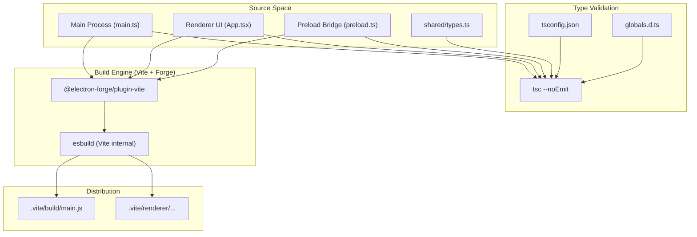
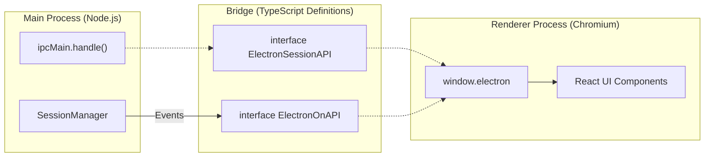

<!-- source: DeepWiki mcp.deepwiki.com · repo browser-use/desktop · page 6.3 TypeScript Configuration · fetched 2026-10-30 -->

# TypeScript Configuration

Relevant source files

The following files were used as context for generating this wiki page:

- [app/package.json](app/package.json)
- [app/src/renderer/globals.d.ts](app/src/renderer/globals.d.ts)

This document covers the TypeScript compilation settings and their integration with the build system in the `browser-use/desktop` application. The TypeScript configuration defines how the codebase is compiled, type-checked, and integrated with the Electron multi-process architecture, specifically managing the bridge between the Node.js main process and the Chromium renderer processes.

## Configuration Overview

The TypeScript configuration is primarily managed through the project root's configuration files. It is designed to support a hybrid environment where the main process uses Node.js APIs and the renderer process uses Web APIs, while both share common type definitions for Inter-Process Communication (IPC).

The project uses TypeScript version `~5.6.0` [app/package.json:94-94]().

## Compilation Settings

The application relies on `tsc` for type checking and Vite (via the Electron Forge Vite plugin) for the actual transpilation during the build process.

### Build and Type-Check Scripts
The `package.json` defines several key scripts for TypeScript operations:
- **Type Checking**: `npm run typecheck` executes `tsc --noEmit` [app/package.json:36-36]().
- **Parity Testing**: Uses `ts-node` to execute TypeScript files directly for baseline captures [app/package.json:41-43]().
- **QA Suite**: Combines linting, type-checking, and unit testing [app/package.json:48-48]().

### Ambient Type Definitions
The project utilizes ambient declarations to handle non-code assets and global Electron APIs. For example, `app/src/renderer/globals.d.ts` provides declarations for:
- **Static Assets**: Informs TypeScript that imports of `.svg`, `.png`, `.jpg`, etc., resolve to strings [app/src/renderer/globals.d.ts:5-33]().
- **Global API Bridges**: Defines the `window.electron` surface area exposed via `contextBridge`.

## Shared Type Definitions

A critical aspect of the TypeScript configuration is maintaining type safety across the IPC boundary. The `ElectronSessionAPI`, `ElectronChromeImportAPI`, and `ElectronOnAPI` interfaces define the contract between the Main and Renderer processes.

### IPC Interface Map

| Interface | Purpose | Key Methods/Properties |
|-----------|---------|------------------------|
| `ElectronSessionAPI` | Managing AI Agent sessions | `create`, `start`, `steer`, `listEngines` [app/src/renderer/globals.d.ts:35-76]() |
| `ElectronChromeImportAPI` | Browser profile/cookie migration | `detectProfiles`, `importCookies`, `listCookies` [app/src/renderer/globals.d.ts:128-133]() |
| `ElectronOnAPI` | Event listeners (Main to Renderer) | `sessionUpdated`, `sessionOutput`, `pillToggled` [app/src/renderer/globals.d.ts:135-147]() |
| `ElectronSettingsApiKeyAPI` | Secure credential management | `getMasked`, `save`, `test`, `delete` [app/src/renderer/globals.d.ts:191-202]() |

## Integration with Build System

### TypeScript Compilation Flow

The following diagram illustrates how TypeScript source files are processed by the build system, associating code entities with the compilation stages.

**Compilation Pipeline**

**Sources:** [app/package.json:28-36](), [app/src/renderer/globals.d.ts:1-4]()

### Multi-Process Type Safety

The application ensures that the `main` process and `renderer` process stay in sync through shared interfaces. This prevents runtime errors when the renderer calls an IPC method that the main process has renamed or modified.

**IPC Type Mapping**

**Sources:** [app/src/renderer/globals.d.ts:35-76](), [app/src/renderer/globals.d.ts:135-147]()

## Development Workflow Integration

### Strictness and Quality
The project enforces code quality through a combination of TypeScript and ESLint:
- **Linting**: Uses `@typescript-eslint/parser` and `@typescript-eslint/eslint-plugin` [app/package.json:80-81]().
- **Dependency Management**: Uses `resolutions` in `package.json` to ensure type-compatible versions of critical libraries like `vite` and `protobufjs` [app/package.json:16-23]().

### External Module Declarations
For complex dependencies like `better-sqlite3` or `react`, the project includes specific type packages (`@types/better-sqlite3`, `@types/react`) to ensure the compiler understands the native bindings and component structures [app/package.json:73-79]().

**Sources:** [app/package.json:1-130](), [app/src/renderer/globals.d.ts:1-206]()

---

