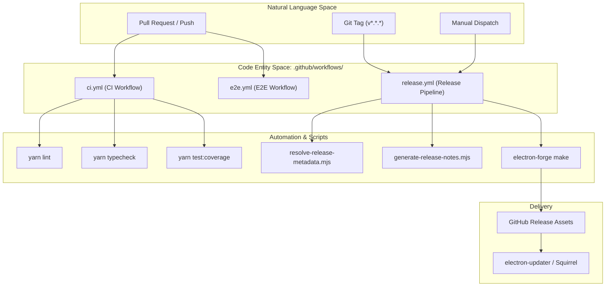
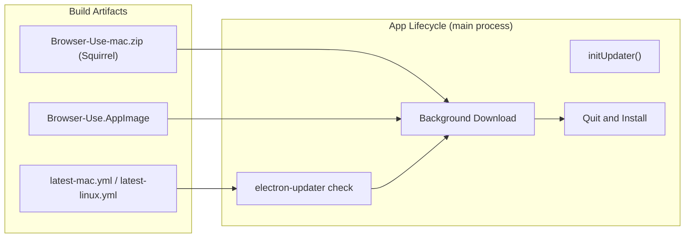

<!-- source: DeepWiki mcp.deepwiki.com · repo browser-use/desktop · page 7 Release and CI/CD Pipeline · fetched 2026-10-30 -->

# Release and CI/CD Pipeline

Relevant source files

The following files were used as context for generating this wiki page:

- [.github/scripts/generate-release-notes.mjs](.github/scripts/generate-release-notes.mjs)
- [.github/scripts/resolve-release-metadata.mjs](.github/scripts/resolve-release-metadata.mjs)
- [.github/workflows/ci.yml](.github/workflows/ci.yml)
- [.github/workflows/release.yml](.github/workflows/release.yml)
- [app/docs/CI.md](app/docs/CI.md)

The **browser-use/desktop** repository utilizes an automated pipeline for continuous integration and multi-platform distribution. This system ensures code quality through rigorous automated checks and delivers signed, notarized installers for macOS, Windows, and Linux. The pipeline is primarily driven by GitHub Actions and integrates with the application's internal auto-update mechanism.

### System Flow Overview

The following diagram illustrates the transition from developer commit to end-user update, mapping logical stages to the GitHub Actions workflows and scripts that implement them.

**CI/CD Workflow Topology**

Sources: [.github/workflows/ci.yml:1-13](), [.github/workflows/release.yml:1-22](), [app/docs/CI.md:1-13]()

---

## 7.1 Continuous Integration

The CI pipeline is designed for speed and reliability, executing on every pull request and push to the `main` branch. It utilizes a `frozen-lockfile` policy to ensure that dependencies in the CI environment exactly match the developer's local environment.

Key components of the CI pipeline include:
*   **Static Analysis**: ESLint and TypeScript type-checking (`tsc --noEmit`) are enforced as hard-fail gates [.github/workflows/ci.yml:46-73]().
*   **Unit Testing**: Vitest handles unit and integration tests, generating coverage reports uploaded as artifacts [.github/workflows/ci.yml:95-106]().
*   **Windows Smoke Test**: A specialized job verifies that multi-line prompts are correctly handled by `cmd.exe` shims, preventing regressions in engine process spawning [.github/workflows/ci.yml:115-142]().
*   **Network Handling**: Since CI runners lack SSH keys, the pipeline automatically rewrites `git+ssh` URLs to `https` to fetch transitive dependencies [.github/workflows/ci.yml:39-40]().

For details, see [Continuous Integration](#7.1).

Sources: [.github/workflows/ci.yml:25-143](), [app/docs/CI.md:10-21]()

---

## 7.2 Release Pipeline

The release pipeline is a tag-driven workflow that produces production-ready installers. It handles the complexities of code signing and notarization required for modern operating systems.

The pipeline follows a structured metadata resolution phase before building assets:
1.  **Metadata Resolution**: `resolve-release-metadata.mjs` determines the current version, identifies the previous stable tag, and flags if the release is a pre-release [.github/scripts/resolve-release-metadata.mjs:104-112]().
2.  **Platform Builds**: Parallel jobs for macOS (DMG/ZIP), Windows (Squirrel/Setup), and Linux (AppImage/deb/rpm) are triggered [.github/workflows/release.yml:88-100]().
3.  **Security**: macOS builds are signed and notarized via Apple's notary service to avoid "unidentified developer" warnings on macOS 15+ [.github/workflows/release.yml:152-155]().
4.  **Changelog Generation**: `generate-release-notes.mjs` creates deterministic release notes by comparing the current tag against the previous stable version via the GitHub API [.github/scripts/generate-release-notes.mjs:128-133]().

For details, see [Release Pipeline](#7.2).

Sources: [.github/workflows/release.yml:1-52](), [.github/scripts/resolve-release-metadata.mjs:62-95](), [app/docs/CI.md:37-59]()

---

## 7.3 Auto-Update System

The application features an integrated auto-update mechanism that consumes the output of the Release Pipeline. This ensures users are always running the latest version without manual intervention.

**Update Delivery Logic**

The system uses `electron-updater` for macOS and Linux (AppImage), while Windows utilizes `Squirrel.Windows`. The workflow automatically publishes the necessary `.yml` metadata files to GitHub Releases, which the running application polls to detect new versions [app/docs/CI.md:106-113]().

For details, see [Auto-Update System](#7.3).

Sources: [app/docs/CI.md:106-113]()

---

