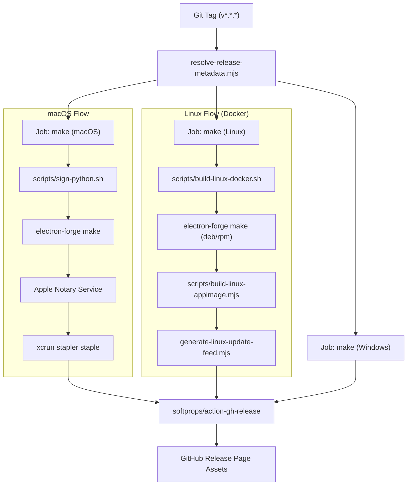
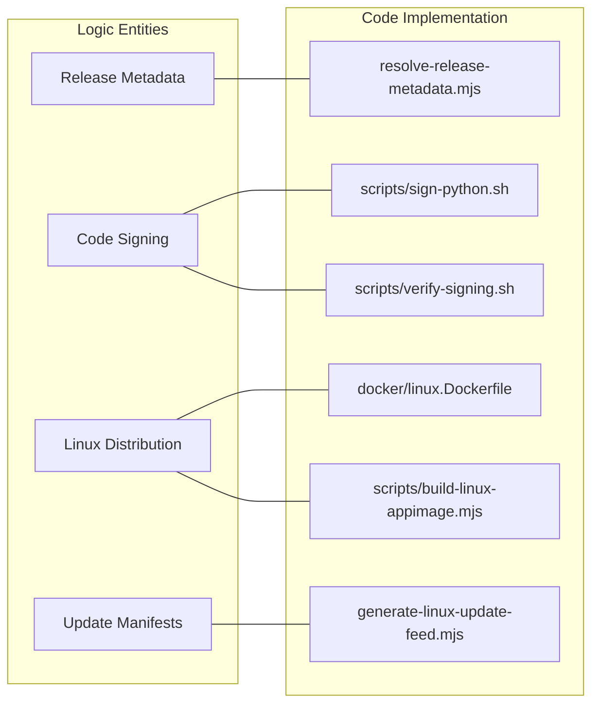

<!-- source: DeepWiki mcp.deepwiki.com · repo browser-use/desktop · page 7.2 Release Pipeline · fetched 2026-10-30 -->

# Release Pipeline

Relevant source files

The following files were used as context for generating this wiki page:

- [.github/workflows/release.yml](.github/workflows/release.yml)
- [SIGNING.md](SIGNING.md)
- [Taskfile.yml](Taskfile.yml)
- [docker/linux.Dockerfile](docker/linux.Dockerfile)
- [scripts/build-linux-appimage.mjs](scripts/build-linux-appimage.mjs)
- [scripts/build-linux-docker.sh](scripts/build-linux-docker.sh)
- [scripts/verify-linux-artifacts.mjs](scripts/verify-linux-artifacts.mjs)

The release pipeline is a tag-driven automation system that packages, signs, and distributes the Browser Use desktop application across macOS, Windows, and Linux. It leverages GitHub Actions to orchestrate platform-specific build environments, including macOS runners for notarization and Docker-based Linux builds for package consistency.

## Pipeline Entry Points

The release workflow is defined in [.github/workflows/release.yml:1-52](). It supports two primary triggers:

1.  **Tag Push**: Pushing a git tag matching `v*.*.*` (e.g., `v1.2.3`) triggers a full production release [.github/workflows/release.yml:25-27]().
2.  **Manual Dispatch**: A `workflow_dispatch` allows for dry-runs or tester builds. Users can select specific platforms (`mac`, `windows`, `linux`, or `all`) and a signing mode [.github/workflows/release.yml:28-51]().

### Release Metadata Resolution
Before building, the `release-metadata` job executes `resolve-release-metadata.mjs` to determine the current tag, the previous stable tag (for changelogs), and whether the build is a pre-release [.github/workflows/release.yml:61-84]().

**Sources:**
- [.github/workflows/release.yml:1-87]()

---

## Multi-Platform Build Strategy

The pipeline uses a matrix-like approach (though defined in separate jobs for concurrency control) to handle the unique requirements of each operating system.

### macOS: Signing and Notarization
The macOS job runs on `macos-latest` to access Apple's code-signing toolchain [.github/workflows/release.yml:95]().

*   **Signing Modes**: The pipeline supports three modes: `unsigned`, `signed` (Developer ID only), and `notarized` (signed + Apple Notary service) [.github/workflows/release.yml:127-138](). Production tags always default to `notarized` to satisfy macOS Gatekeeper requirements [.github/workflows/release.yml:152-155]().
*   **Certificate Injection**: The workflow imports a `Developer ID Application` certificate from a Base64-encoded GitHub secret into a temporary keychain [.github/workflows/release.yml:167-175]().
*   **Execution**: It runs `npm run make` which triggers Electron Forge to package the app, sign the binaries, and submit the DMG to Apple for notarization [SIGNING.md:131-135]().

### Windows: Squirrel Packaging
Windows builds produce a `Squirrel.Windows` installer. This format is required for the application's auto-update mechanism, which relies on the `RELEASES` manifest generated during the build.

### Linux: Docker-Based Builds
To ensure a consistent build environment regardless of the CI runner's host OS, Linux artifacts are built inside a Docker container.

*   **Container Environment**: The `docker/linux.Dockerfile` uses `node:22-bookworm` and installs dependencies like `fakeroot`, `rpm`, and `appimagetool` [docker/linux.Dockerfile:1-26]().
*   **Artifacts**: The build produces `.deb`, `.rpm`, and `.AppImage` packages [scripts/verify-linux-artifacts.mjs:23-26]().
*   **Update Feed**: A custom script `generate-linux-update-feed.mjs` creates a `latest-linux.yml` file, which the application uses to detect new AppImage releases [docker/linux.Dockerfile:46-50]().

**Sources:**
- [.github/workflows/release.yml:88-175]()
- [docker/linux.Dockerfile:1-52]()
- [SIGNING.md:127-135]()
- [scripts/build-linux-docker.sh:1-38]()

---

## Release Process Flow

The following diagram illustrates the data flow from a developer's tag push to the final publication of assets.

### Pipeline Execution Diagram

**Sources:**
- [.github/workflows/release.yml:1-110]()
- [docker/linux.Dockerfile:41-51]()
- [SIGNING.md:122-140]()
- [Taskfile.yml:168-176]()

---

## Build System Integration

The release pipeline relies on the `Taskfile.yml` and `package.json` scripts to abstract complex build commands.

| Task | Command | Purpose |
| :--- | :--- | :--- |
| `package` | `npm run package` | Builds an unpackaged app for inspection [Taskfile.yml:156-160](). |
| `make` | `npm run make` | Builds platform installers via Electron Forge [Taskfile.yml:162-166](). |
| `linux:make:docker` | `bash scripts/build-linux-docker.sh` | Orchestrates the Linux container build [Taskfile.yml:168-171](). |
| `release:full` | `npm run make` (with env) | Local command for a signed/notarized macOS DMG [Taskfile.yml:197-208](). |

### Artifact Verification
Post-build, the pipeline runs verification scripts to ensure artifact integrity. For Linux, `scripts/verify-linux-artifacts.mjs` checks that:
1. All expected package types (`.deb`, `.rpm`, `.AppImage`) exist [scripts/verify-linux-artifacts.mjs:28-35]().
2. Artifacts are non-empty [scripts/verify-linux-artifacts.mjs:37-42]().
3. The `latest-linux.yml` update feed correctly references the generated AppImage [scripts/verify-linux-artifacts.mjs:46-58]().

**Sources:**
- [Taskfile.yml:156-208]()
- [scripts/verify-linux-artifacts.mjs:1-59]()

---

## Post-Publish Verification

Once the `action-gh-release` step completes, the assets are attached to the GitHub Release. The application's auto-update system (detailed in Section 7.3) then utilizes these assets:

*   **macOS**: Uses the `.zip` or `.dmg` and the `electron-updater` logic.
*   **Windows**: Uses the `RELEASES` file and `.nupkg` files via `Squirrel.Windows`.
*   **Linux**: Uses `latest-linux.yml` to track the latest `.AppImage`.

### Release Entity Mapping

This diagram maps release concepts to the specific scripts and files that implement them.

**Sources:**
- [.github/workflows/release.yml:84]()
- [SIGNING.md:129-138]()
- [docker/linux.Dockerfile:43-49]()
- [scripts/verify-linux-artifacts.mjs:26]()

---

