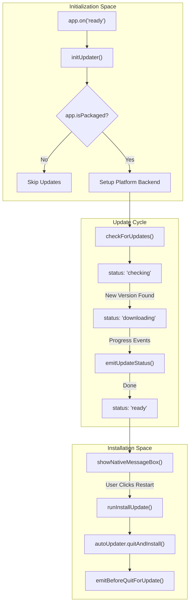
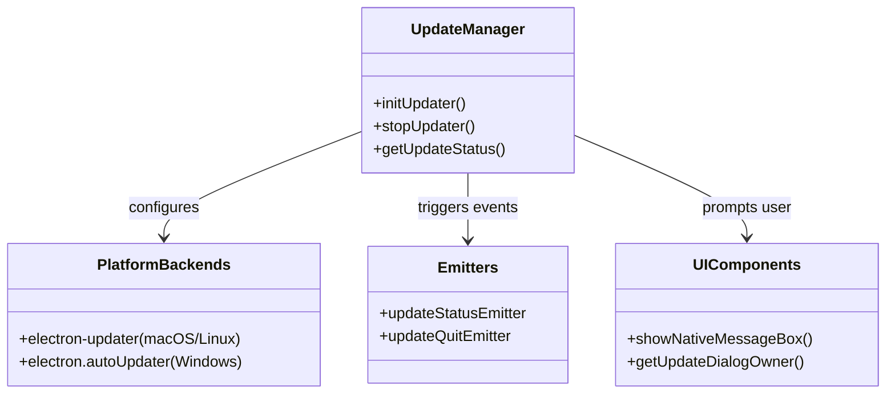
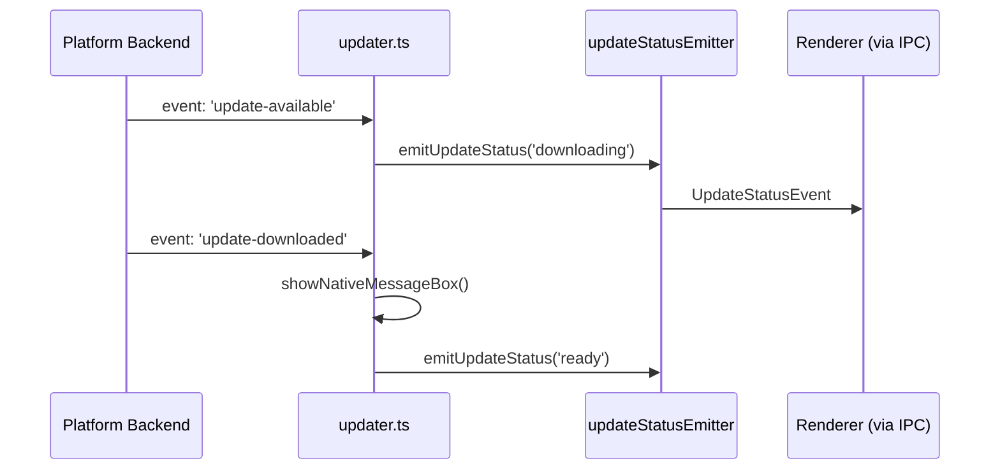

<!-- source: DeepWiki mcp.deepwiki.com · repo browser-use/desktop · page 7.3 Auto-Update System · fetched 2026-10-30 -->

# Auto-Update System

Relevant source files

The following files were used as context for generating this wiki page:

- [app/app-update.yml](app/app-update.yml)
- [app/src/main/updater.ts](app/src/main/updater.ts)
- [app/tests/unit/updater/updater.spec.ts](app/tests/unit/updater/updater.spec.ts)

The auto-update system provides an in-app mechanism for detecting, downloading, and installing application updates. It leverages different backends depending on the operating system to comply with platform-specific distribution requirements (e.g., Squirrel.Windows for Windows and `electron-updater` for macOS/Linux).

## Overview

The system is managed by a centralized lifecycle in the main process, coordinating background checks and user notifications.

| Feature | Implementation |
| :--- | :--- |
| **macOS Backend** | `electron-updater` using GitHub release-asset feed [app/src/main/updater.ts:4-7](). |
| **Windows Backend** | Native Electron `autoUpdater` (Squirrel.Windows) [app/src/main/updater.ts:9-11](). |
| **Linux Backend** | `electron-updater` (AppImage only) [app/src/main/updater.ts:13-15](). |
| **Check Interval** | Every 1 hour [app/src/main/updater.ts:40](). |
| **Feed URL** | `https://github.com/browser-use/desktop/releases/latest/download` [app/src/main/updater.ts:46](). |

**Sources:** [app/src/main/updater.ts:1-47]()

## Update Lifecycle and Data Flow

The update process moves through a series of states tracked by the `UpdateStatus` type. The transition is triggered by events from the underlying native updaters.

### Update Status States
The system tracks the following states via `UpdateStatusEvent` [app/src/main/updater.ts:83-94]():
*   `idle`: No update activity.
*   `checking`: Querying the update server.
*   `downloading`: Fetching update assets (includes progress metadata).
*   `ready`: Update downloaded and ready for restart.
*   `error`: A failure occurred during check or download.
*   `unavailable`: The app is already up to date.

### Logic Flow Diagram
The following diagram illustrates the transition from app initialization to the restart-to-install flow.

"Update System Logic Flow"

**Sources:** [app/src/main/updater.ts:17-32](), [app/src/main/updater.ts:75-94](), [app/src/main/updater.ts:112-116](), [app/src/main/updater.ts:129-136]()

## Platform Implementation Details

The system bifurcates logic based on `process.platform` to handle the different requirements of Squirrel.Windows and `electron-updater`.

### macOS and Linux (AppImage)
Uses the `electron-updater` library. It fetches `latest-mac.yml` or `latest-linux.yml` from the GitHub release assets [app/src/main/updater.ts:42-46]().
*   **Differential Downloads**: Disabled to ensure reliability [app/src/main/updater.ts:247]().
*   **Cache Management**: The system includes a `clearCachedUpdate` helper to resolve stuck updates by clearing the `downloadedUpdateHelper` cache [app/src/main/updater.ts:118-127]().

### Windows
Uses Electron's native `autoUpdater` which communicates with the Squirrel.Windows framework [app/src/main/updater.ts:9-11]().
*   **Asset Requirements**: Expects `RELEASES` and `.nupkg` files in the release directory [app/src/main/updater.ts:10]().
*   **Feed Configuration**: The feed URL is set directly on the `electronAutoUpdater` instance [app/src/main/updater.ts:269-271]().

**Sources:** [app/src/main/updater.ts:241-278](), [app/app-update.yml:1-4]()

## Code Entity Mapping

This section maps the natural language concepts to the specific code entities in `updater.ts`.

"Updater Code Entities"

"Update Event Mapping"

**Sources:** [app/src/main/updater.ts:96-98](), [app/src/main/updater.ts:112-116](), [app/src/main/updater.ts:154-162](), [app/src/main/updater.ts:168-176]()

## Key Functions

### `initUpdater()`
The entry point for the update system. It checks if the app is packaged and in production before initializing. It sets up the `updateCheckTimer` to run every hour [app/src/main/updater.ts:222-239]().

### `stopUpdater()`
Clears the `updateCheckTimer` to prevent memory leaks or background checks during application shutdown [app/src/main/updater.ts:285-289]().

### `getUpdateDialogOwner()`
Determines which `BrowserWindow` should own the update notification dialog. It filters out utility windows like the "Pill" or "Logs" windows to ensure the dialog appears over the main Hub UI [app/src/main/updater.ts:146-152]().

### `runInstallUpdate(action)`
A guard function that prevents multiple simultaneous installation attempts. It sets `installInProgress = true` before executing the `quitAndInstall` command [app/src/main/updater.ts:129-136]().

**Sources:** [app/src/main/updater.ts:129-152](), [app/src/main/updater.ts:222-289]()

## Testing
The system is verified via unit tests in `app/tests/unit/updater/updater.spec.ts`. These tests mock the `electron-updater` and native `autoUpdater` to verify:
*   Dev-mode short-circuiting (no-op when `app.isPackaged` is false) [app/tests/unit/updater/updater.spec.ts:207-211]().
*   Correct configuration of the GitHub feed URL [app/tests/unit/updater/updater.spec.ts:6-7]().
*   Timer lifecycle (start on init, stop on shutdown) [app/tests/unit/updater/updater.spec.ts:9-12]().

**Sources:** [app/tests/unit/updater/updater.spec.ts:1-12]()

---

