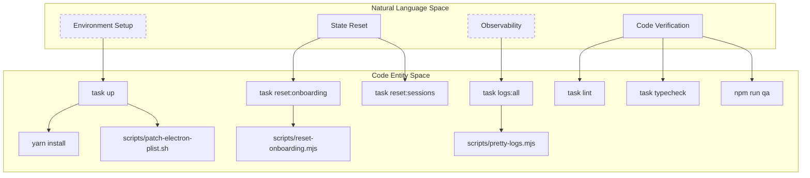
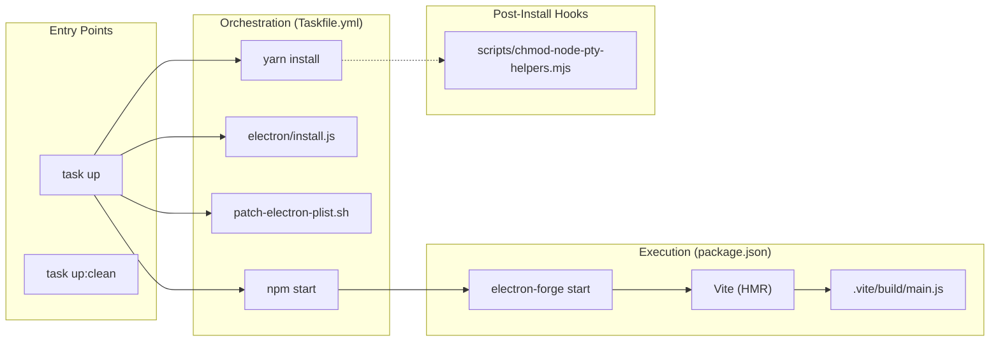

<!-- source: DeepWiki mcp.deepwiki.com · repo browser-use/desktop · page 8 Development Environment · fetched 2026-10-30 -->

# Development Environment

Relevant source files

The following files were used as context for generating this wiki page:

- [CHANGELOG.md](CHANGELOG.md)
- [CONTRIBUTING.md](CONTRIBUTING.md)
- [Taskfile.yml](Taskfile.yml)
- [app/package.json](app/package.json)

This document covers the setup and maintenance of the development environment for the `browser-use/desktop` application. It provides an overview of the required tools, environment configuration, and development workflow necessary to build and maintain the Electron-based desktop application.

For detailed information about dependency management and scripts, see [Package Management and Scripts](#8.1). For code quality tooling specifics, see [Code Quality Tools](#8.2). For testing framework details, see [Testing Infrastructure](#8.3).

## Development Stack Overview

The development environment is centered around **Taskfile** for high-level orchestration, **Yarn** for package management, and **Electron Forge** with **Vite** for the build pipeline.

### Natural Language to Code Entity Mapping

The following diagram bridges development concepts to the specific files and tasks that implement them.

**Sources:** [Taskfile.yml:13-21](), [Taskfile.yml:31-42](), [Taskfile.yml:55-66](), [app/package.json:27-53]()

## Environment Requirements

The development environment requires specific versions of Node.js and external utilities to ensure compatibility with the Electron and build toolchain.

| Tool | Version | Purpose |
|------|---------|---------|
| Node.js | 22 | JavaScript runtime [CONTRIBUTING.md:6]() |
| Yarn | (Latest) | Package manager [CONTRIBUTING.md:7]() |
| Task | (Latest) | Task runner (`go-task`) [CONTRIBUTING.md:5]() |
| Electron | 41.2.1 | Desktop application framework [app/package.json:84]() |
| TypeScript | ~5.6.0 | Type checking and compilation [app/package.json:94]() |
| Vite | ^6.4.2 | Build tool and development server [app/package.json:95]() |

**Sources:** [CONTRIBUTING.md:3-8](), [app/package.json:84-95]()

## Development Workflow

The development workflow integrates multiple processes through `Taskfile.yml` and `package.json` scripts.

**Sources:** [Taskfile.yml:13-30](), [app/package.json:28-31](), [app/package.json:52]()

## Core Development Tools

### Taskfile Task Runner
The project uses [Taskfile.yml]() to provide a unified interface for complex operations. This includes:
- **Application Lifecycle**: `task up` handles dependency installation, Electron patching, and starting the dev server [Taskfile.yml:13-21]().
- **State Management**: Tasks like `reset:onboarding` and `reset:sessions` allow developers to clear local SQLite databases and configuration files [Taskfile.yml:31-42]().
- **Log Streaming**: A comprehensive suite of `logs:*` tasks tails multi-process logs (main, renderer, browser, engine) and pipes them through `pretty-logs.mjs` for human-readable output [Taskfile.yml:55-112]().

### Package Management
The project uses **Yarn** for dependency management. A critical `postinstall` hook runs `chmod-node-pty-helpers.mjs` to ensure `node-pty` has the correct permissions to spawn terminal processes on macOS [app/package.json:52](). For details, see [Package Management and Scripts](#8.1).

### Code Quality and Testing
- **Linting**: ESLint is configured with TypeScript support [app/package.json:35]().
- **Typechecking**: The `task typecheck` command runs `tsc --noEmit` to verify type safety across the multi-process architecture [Taskfile.yml:49-53]().
- **Testing**: The project employs **Vitest** for unit tests and **Playwright** for E2E and visual regression testing [app/package.json:37-48](). For details, see [Code Quality Tools](#8.2) and [Testing Infrastructure](#8.3).

### Build and Packaging
**Electron Forge** manages the build pipeline, utilizing **Vite** for fast HMR during development and optimized bundling for production [app/package.json:28-34](). Packaging for Linux is performed within Docker containers to ensure environment consistency [Taskfile.yml:168-172]().

**Sources:** [Taskfile.yml:1-172](), [app/package.json:1-130](), [CONTRIBUTING.md:1-28]()

---

