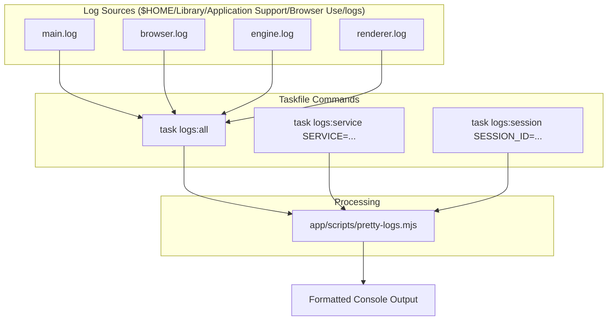

<!-- source: DeepWiki mcp.deepwiki.com · repo browser-use/desktop · page 8.1 Package Management and Scripts · fetched 2026-10-30 -->

# Package Management and Scripts

Relevant source files

The following files were used as context for generating this wiki page:

- [Taskfile.yml](Taskfile.yml)
- [app/package.json](app/package.json)

This page details the project dependencies, package management strategy, custom lifecycle hooks, and the Taskfile-based automation used for development and maintenance of the `browser-use/desktop` repository.

## Overview

The project utilizes `yarn` (via `app/package.json`) for dependency management and `Taskfile.yml` as a high-level task runner to orchestrate complex development workflows, such as log streaming and state resets. The architecture relies on Electron Forge for the build pipeline and Vite for asset bundling.

## Package Configuration

The `app/package.json` file serves as the manifest for the Electron application. It defines strict version resolutions to ensure stability across the complex dependency tree of Electron, Vite, and native modules.

### Dependency Categories

| Category | Key Packages | Role |
| :--- | :--- | :--- |
| **Runtime** | `electron`, `better-sqlite3`, `node-pty`, `keytar` | Core framework and native bindings for persistence, terminal emulation, and secure storage. [app/package.json:114-120]() |
| **Build/Dev** | `@electron-forge/cli`, `vite`, `typescript`, `vitest` | Orchestration of the build pipeline, HMR, and testing suite. [app/package.json:61-97]() |
| **Agent Layer** | `zod`, `ajv` | Schema validation for IPC and engine protocols. [app/package.json:113-128]() |
| **UI/UX** | `react`, `@tanstack/react-query`, `@xterm/xterm` | Frontend framework, state management, and terminal UI. [app/package.json:100-123]() |

### Version Resolutions and Overrides
To prevent dependency conflicts and ensure security, the project enforces specific versions for problematic transitive dependencies using the `resolutions` and `overrides` fields.
Sources: [app/package.json:16-26]()

## Lifecycle Hooks and Postinstall

The project requires specific environment preparation after package installation, particularly for native modules and Electron-specific security configurations.

### Native Module Permissions
The `postinstall` script executes `node scripts/chmod-node-pty-helpers.mjs`. This is critical for `node-pty`, which requires specific permissions on the `spawn-helper` binary to function correctly within the Electron environment.
Sources: [app/package.json:52-52]()

### Electron Patching
During development setup, the `up` task in `Taskfile.yml` ensures that the Electron application bundle is correctly prepared on macOS by running `bash scripts/patch-electron-plist.sh`. This script modifies the `Info.plist` of the downloaded Electron binary to match the project's requirements (e.g., renaming the app to "Browser Use").
Sources: [Taskfile.yml:18-19]()

## Taskfile Automation

The `Taskfile.yml` located in the project root provides a unified interface for common development tasks.

### Development Lifecycle
The primary entry point for developers is `task up`, which handles the entire bootstrap process:
1. Installs dependencies via `yarn install`.
2. Verifies or re-installs the Electron binary.
3. Patches the Electron `.plist` (macOS).
4. Starts the application via `npm start`.

Sources: [Taskfile.yml:13-20]()

### State Management
Tasks are provided to reset the application state without manual file deletion:
- `task reset:onboarding`: Deletes `account.json` to force the onboarding flow on next launch. [Taskfile.yml:31-35]()
- `task reset:sessions`: Deletes `sessions.db` to clear all local agent session history. [Taskfile.yml:37-41]()

### Log Streaming and Observability
The Taskfile includes a sophisticated logging subsystem that tails local log files and pipes them through `app/scripts/pretty-logs.mjs` for human-readable, colored output.

Sources: [Taskfile.yml:55-155](), [app/scripts/pretty-logs.mjs:1-10]()

## Script Reference

The `scripts` block in `app/package.json` contains the low-level commands invoked by the Taskfile or CI/CD pipelines.

| Script | Command | Purpose |
| :--- | :--- | :--- |
| `start:clean` | `rm -rf node_modules/.vite && electron-forge start` | Clears Vite's cache to resolve HMR or build artifacts issues. [app/package.json:29-29]() |
| `qa` | `npm run lint && npm run typecheck && npm run test` | Aggregate script for local quality assurance before pushing code. [app/package.json:48-48]() |
| `parity` | `ts-node ... tests/parity/run-parity.ts` | Runs engine parity tests to ensure consistent behavior across adapters. [app/package.json:41-41]() |
| `visual:qa` | `npm run visual:capture && npm run visual:diff` | Executes Playwright-based visual regression testing. [app/package.json:46-46]() |

## Build and Release Tasks

The Taskfile abstracts the Electron Forge commands for different release tiers:
- `task release:dev`: Unsigned ad-hoc build for local testing. [Taskfile.yml:178-183]()
- `task release:signed`: Signed build (requires `.env.signing`) but skips Apple notarization. [Taskfile.yml:184-196]()
- `task release:full`: Complete production build including signing and notarization. [Taskfile.yml:197-208]()

Sources: [Taskfile.yml:156-208](), [app/package.json:32-34]()

---

