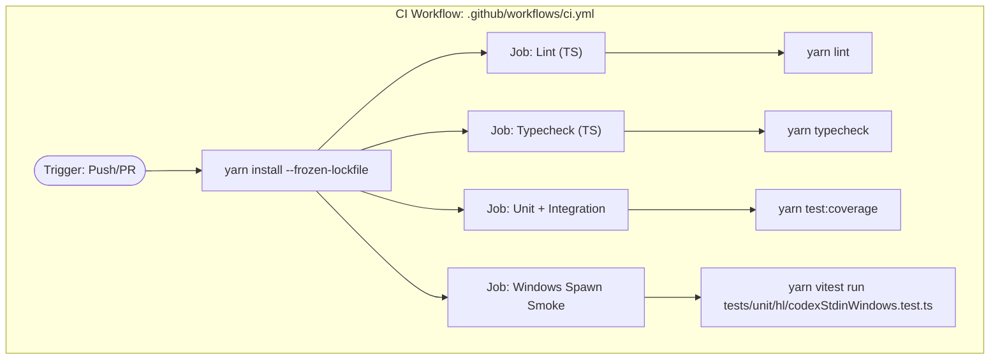
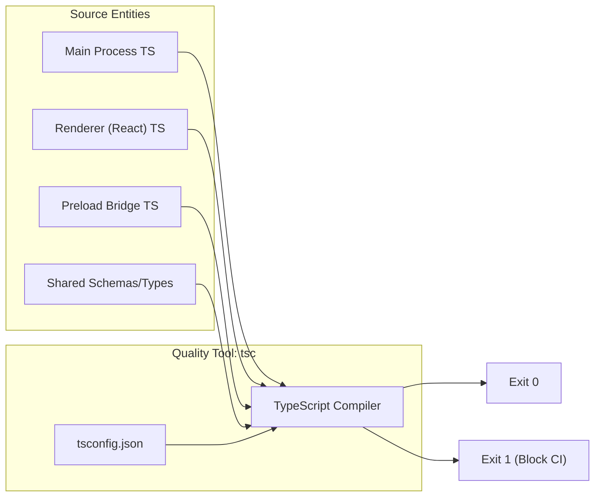

<!-- source: DeepWiki mcp.deepwiki.com · repo browser-use/desktop · page 8.2 Code Quality Tools · fetched 2026-10-30 -->

# Code Quality Tools

Relevant source files

The following files were used as context for generating this wiki page:

- [.github/workflows/ci.yml](.github/workflows/ci.yml)
- [app/package.json](app/package.json)

## Purpose and Scope

This document covers the code quality tools, linting configuration, and type-checking workflows used in the `browser-use/desktop` repository. The project enforces strict code quality standards to maintain the reliability of its multi-process Electron architecture. The primary tools include **ESLint** for static analysis and **TypeScript** for type safety, both of which are integrated into the local development scripts and the CI pipeline.

## Automated Quality Checks (CI)

The project uses GitHub Actions to enforce code quality on every push and pull request to the `main` branch. The CI workflow is defined in [.github/workflows/ci.yml:1-143]().

### CI Pipeline Structure

**Title: CI Quality Gate Flow**

- **Linting**: Runs `eslint` across the entire `app` directory [.github/workflows/ci.yml:46-48]().
- **Typechecking**: Executes `tsc --noEmit` to ensure type validity without generating build artifacts [.github/workflows/ci.yml:71-73]().
- **Windows Smoke Test**: A specialized job that runs on `windows-latest` to verify that multi-line prompts are correctly routed through `stdin` rather than `argv`, preventing shell mangling on Windows [.github/workflows/ci.yml:115-143]().

Sources: [.github/workflows/ci.yml:26-143](), [app/package.json:35-36]()

## ESLint Configuration

The project utilizes ESLint to maintain consistent style and catch common errors. The configuration is managed via dependencies in [app/package.json:71-88]().

### Supported Environments and Rule Sets

The linting setup is designed to handle the diverse runtime contexts of an Electron app (Node.js for the Main process and Browser for the Renderer).

| Tool/Plugin | Purpose |
|-------------|---------|
| `@eslint/js` | Core JavaScript rules [.app/package.json:71]() |
| `@typescript-eslint/parser` | Allows ESLint to parse TypeScript source files [.app/package.json:81]() |
| `@typescript-eslint/eslint-plugin` | Provides TypeScript-specific linting rules [.app/package.json:80]() |
| `eslint-plugin-react-hooks` | Enforces React Hook rules in the Renderer UI [.app/package.json:87]() |
| `eslint-plugin-import-x` | Validates module import/export syntax [.app/package.json:86]() |

Sources: [app/package.json:71-88]()

## TypeScript Configuration

TypeScript is the backbone of the project's type safety. The configuration ensures that types are shared correctly between the Main, Renderer, and Preload processes.

### Typecheck Workflow

The `typecheck` script in [app/package.json:36]() runs `tsc --noEmit`. This is a "hard-fail" check in the CI pipeline [.github/workflows/ci.yml:54]().

**Title: TypeScript Verification Process**

Sources: [app/package.json:36](), [.github/workflows/ci.yml:51-74]()

## Local Development Workflow

Developers are encouraged to run quality checks locally before pushing code. The `app/package.json` defines a aggregate command for this purpose.

### Quality Commands

| Command | Action |
|---------|--------|
| `yarn lint` | Runs ESLint on all files [.app/package.json:35]() |
| `yarn typecheck` | Runs TypeScript compiler in no-emit mode [.app/package.json:36]() |
| `yarn test` | Runs unit tests using Vitest [.app/package.json:37]() |
| `yarn qa` | Runs lint, typecheck, and tests in sequence [.app/package.json:48]() |

### File Exclusion Strategy

To maintain performance and prevent environment contamination, the project ignores specific files from quality checks and version control:
- **Build Artifacts**: `.vite/`, `out/`, and `.webpack/` are ignored [.app/package.json:14]().
- **Dependency Caches**: ESLint caches and TypeScript build info are excluded via `.gitignore` (as referenced in the standard Electron Forge/Vite workflow).
- **Native Modules**: The `postinstall` hook runs `scripts/chmod-node-pty-helpers.mjs` to ensure native dependencies like `node-pty` have correct permissions for the development environment [.app/package.json:52]().

Sources: [app/package.json:27-53](), [.github/workflows/ci.yml:39-44]()

---

