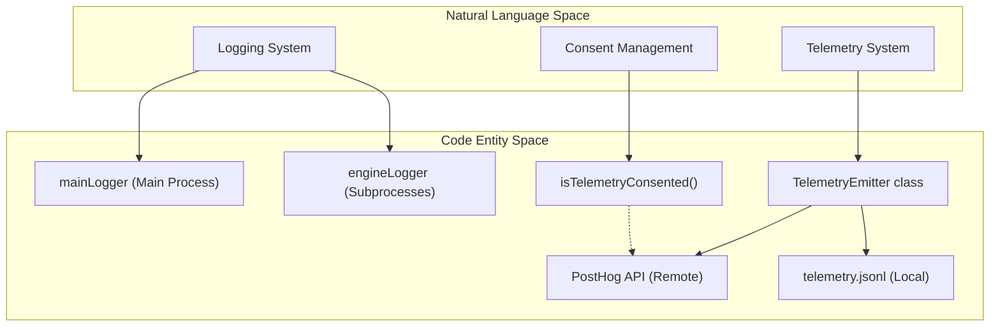
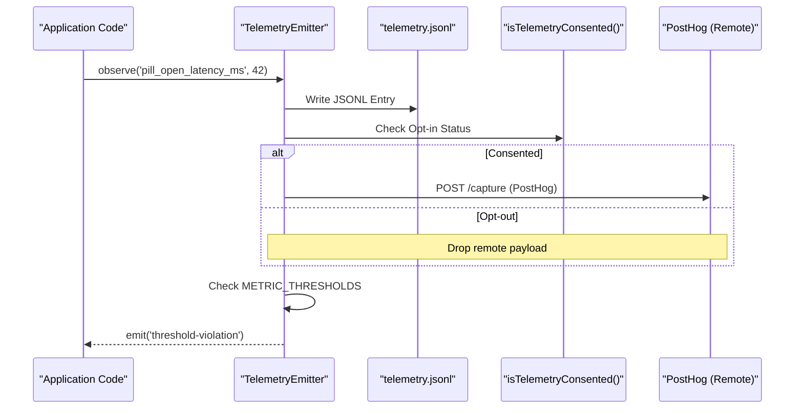

<!-- source: DeepWiki mcp.deepwiki.com · repo browser-use/desktop · page 9 Telemetry and Observability · fetched 2026-10-30 -->

# Telemetry and Observability

Relevant source files

The following files were used as context for generating this wiki page:

- [Taskfile.yml](Taskfile.yml)
- [app/src/main/telemetry.ts](app/src/main/telemetry.ts)
- [app/tests/unit/telemetry-remote.test.ts](app/tests/unit/telemetry-remote.test.ts)

The **Browser Use Desktop** application implements a multi-layered observability stack designed to provide deep visibility into the behavior of AI agents and the underlying Electron infrastructure. This system balances the need for high-fidelity technical debugging with user privacy through a robust consent mechanism and local-first data persistence.

## System Overview

The observability architecture is divided into two primary domains:
1.  **Structured Logging**: A multi-process file-based system that captures granular execution details across the Main, Renderer, Browser, and Engine processes.
2.  **Telemetry and Metrics**: A performance-focused system that tracks KPIs (e.g., latency, success rates) and crashes, with support for local JSONL storage and remote PostHog ingestion.

### Code-to-System Mapping

The following diagram illustrates how specific code entities map to observability functions:

**Sources:** [app/src/main/telemetry.ts:1-24](), [app/src/main/consent.ts:1-10]()

---

## Logging System

The logging architecture is designed to handle the complexity of a multi-process Electron application. Logs are partitioned by "service" to prevent high-volume engine output from drowning out critical application lifecycle events.

*   **Process Isolation**: Separate loggers exist for `main`, `browser`, `renderer`, and `engine` [Taskfile.yml:85-112]().
*   **Human-Readable Formatting**: The `pretty-logs.mjs` script transforms raw JSON logs into a colorized, human-readable format, supporting specialized modes for timing startup and navigation [Taskfile.yml:113-138]().
*   **Log Streaming**: Developers can tail specific log channels or filter logs by `SESSION_ID` using the `Taskfile` [Taskfile.yml:139-155]().

For details, see [Logging System](#9.1).

**Sources:** [Taskfile.yml:55-155]()

---

## Telemetry and Crash Reporting

The telemetry system provides a structured way to measure application health and agent performance. It uses a singleton `TelemetryEmitter` to record metrics through three primary methods: `observe` (histograms), `increment` (counters), and `gauge` (point-in-time values) [app/src/main/telemetry.ts:5-7]().

### Telemetry Architecture

**Sources:** [app/src/main/telemetry.ts:99-154](), [app/src/main/telemetry.ts:164-185]()

### Key Components
*   **PostHog Integration**: When users opt-in, metrics are sent to PostHog using a public project key [app/src/main/telemetry.ts:33-38]().
*   **Metric Thresholds**: The system defines performance budgets for critical paths, such as `pill_open_latency_ms` (p95: 150ms) and `agent_task_success_rate` (min: 80%) [app/src/main/telemetry.ts:51-62]().
*   **Crash Reporting**: Integrated with Electron's `crashReporter` to capture native process failures.
*   **Consent Mechanism**: All remote data transmission is gated by `isTelemetryConsented()`, ensuring privacy compliance [app/src/main/consent.ts:1-10]().

For details, see [Telemetry and Crash Reporting](#9.2).

**Sources:** [app/src/main/telemetry.ts:1-62](), [app/tests/unit/telemetry-remote.test.ts:33-51]()

---

