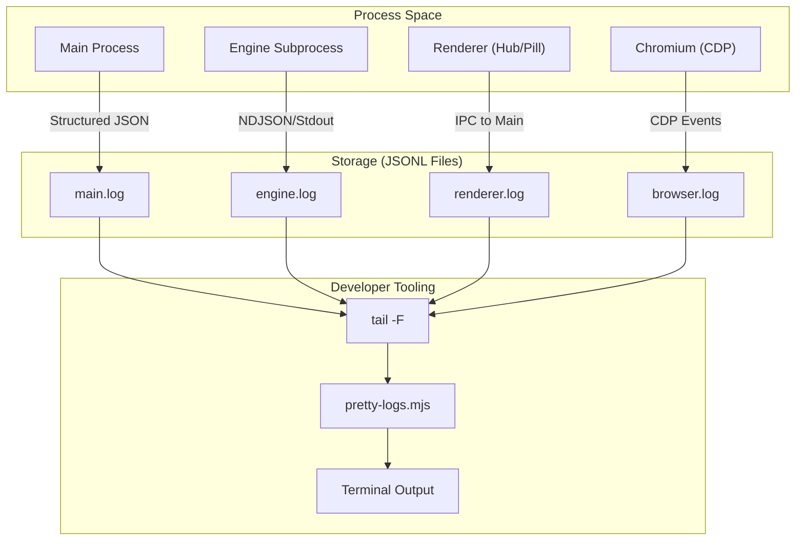

<!-- source: DeepWiki mcp.deepwiki.com · repo browser-use/desktop · page 9.1 Logging System · fetched 2026-10-30 -->

# Logging System

<details>
<summary>Relevant source files</summary>

The following files were used as context for generating this wiki page:

- [Taskfile.yml](Taskfile.yml)
- [app/src/main/telemetry.ts](app/src/main/telemetry.ts)
- [app/tests/unit/telemetry-remote.test.ts](app/tests/unit/telemetry-remote.test.ts)

</details>


The **Logging System** in the `browser-use/desktop` repository is a multi-process architecture designed to provide structured, searchable, and human-readable observability across the Electron main process, AI engine subprocesses, and the Chromium browser instances. It utilizes a JSONL (JSON Lines) format for persistence and a specialized formatter for real-time development debugging.

## Multi-Process Logging Architecture

The system segregates logs by their source process to prevent interleaved output and facilitate easier troubleshooting of specific subsystems. Logs are written to the user's application support directory.

### Log File Locations
Logs are stored in the following directory by default:
- **macOS**: `~/Library/Application Support/Browser Use/logs` [Taskfile.yml:60-60]()
- **Windows**: `%AppData%\Browser Use\logs`
- **Linux**: `~/.config/Browser Use/logs`

### Process Separation
The architecture distinguishes between several primary log "services":

| Service | Log File | Description |
| :--- | :--- | :--- |
| `main` | `main.log` | Electron main process lifecycle, IPC events, and window management. |
| `browser` | `browser.log` | Chromium `WebContents` events, navigation timing, and browser startup metrics. |
| `engine` | `engine.log` | Subprocess lifecycle for AI agents (Claude Code/Codex), including CLI spawns and NDJSON parsing. |
| `renderer` | `renderer.log` | Console output from the Hub UI and Pill command bar. |

### Data Flow Diagram: Log Aggregation
The following diagram illustrates how different processes emit logs and how they are consumed by the development tooling.


**Sources:** [Taskfile.yml:55-155]()

## Structured Logging & Formatting

Logs are written in a structured format (JSONL) to ensure they can be programmatically analyzed or ingested by telemetry systems.

### Pretty Logs Formatter
The `pretty-logs.mjs` script is a Node.js utility that transforms raw JSON lines into a color-coded, human-readable format during development. It supports different "modes" to highlight specific types of information:

*   **`--mode=all`**: Displays all log lines with process-specific color coding [Taskfile.yml:65-65]().
*   **`--mode=startup`**: Filters for browser startup timing logs to debug latency [Taskfile.yml:124-124]().
*   **`--mode=navigation`**: Focuses on URL navigation events and page load durations [Taskfile.yml:137-137]().
*   **`--session=<id>`**: Filters all log files for lines associated with a specific session ID [Taskfile.yml:154-154]().

### Telemetry Integration
The logging system is closely tied to the telemetry emitter. In development or when a user opts out of remote telemetry, metrics are flushed to a local JSONL log file named `telemetry.jsonl` [app/src/main/telemetry.ts:9-10]().

*   **Metric Entries**: Every `observe`, `increment`, or `gauge` call writes a entry containing a timestamp, metric name, kind, and value [app/src/main/telemetry.ts:182-182]().
*   **Threshold Violations**: If a metric (e.g., `pill_open_latency_ms`) exceeds its defined P95 or P99 threshold, a violation is logged to the structured logger [app/src/main/telemetry.ts:12-13]().

**Sources:** [app/src/main/telemetry.ts:29-62](), [app/src/main/telemetry.ts:143-144]()

## Taskfile Commands

The `Taskfile.yml` provides several convenience commands for streaming logs. These commands automatically locate the log directory and pipe the output through the `pretty-logs.mjs` formatter.

| Command | Description | Implementation Detail |
| :--- | :--- | :--- |
| `task logs:all` | Stream all logs simultaneously | `tail -F "$LOG_DIR"/*.log \| node pretty-logs.mjs` |
| `task logs:main` | Stream only main process logs | Targets `main.log` [Taskfile.yml:85-90]() |
| `task logs:browser` | Stream Chromium/CDP logs | Targets `browser.log` [Taskfile.yml:92-97]() |
| `task logs:engine` | Stream AI agent process logs | Targets `engine.log` [Taskfile.yml:106-111]() |
| `task logs:session SESSION_ID=xyz` | Filter logs for a specific session | Uses `--session` flag in formatter [Taskfile.yml:139-154]() |

## Implementation Entities

The following diagram maps the logging concepts to specific code entities within the repository.

```mermaid
classDiagram
    class TelemetryEmitter {
        +localLogPath: string
        +observe(metric, value)
        +increment(metric, delta)
        +_writeLocal(entry)
    }

    class Taskfile {
        <<YAML>>
        +logs:all
        +logs:service
        +logs:session
    }

    class PrettyLogsMjs {
        <<Script>>
        +formatLine(json)
        +filterBySession(id)
    }

    TelemetryEmitter --> "telemetry.jsonl" : writes
    Taskfile ..> PrettyLogsMjs : invokes via node
    PrettyLogsMjs <.. "main.log" : parses
    PrettyLogsMjs <.. "engine.log" : parses
```

**Sources:** [app/src/main/telemetry.ts:99-114](), [Taskfile.yml:55-155](), [app/tests/unit/telemetry-remote.test.ts:34-37]()

---

