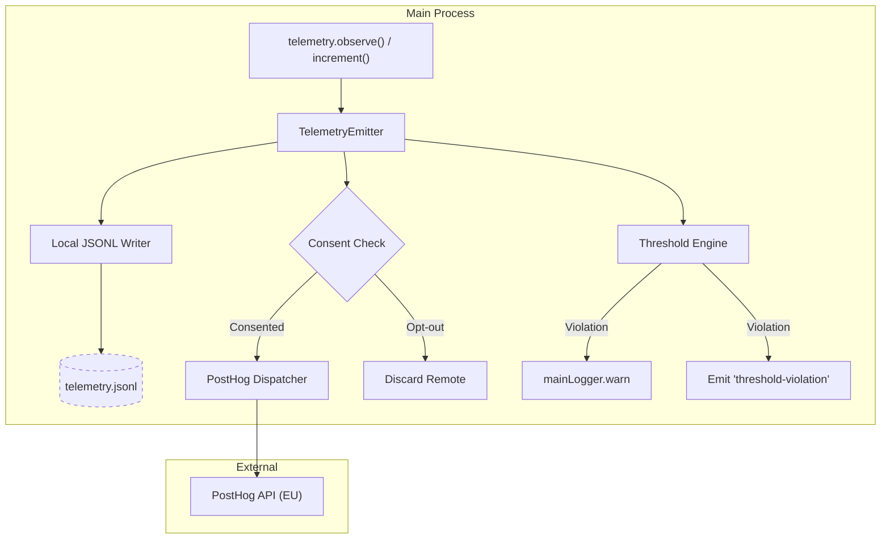
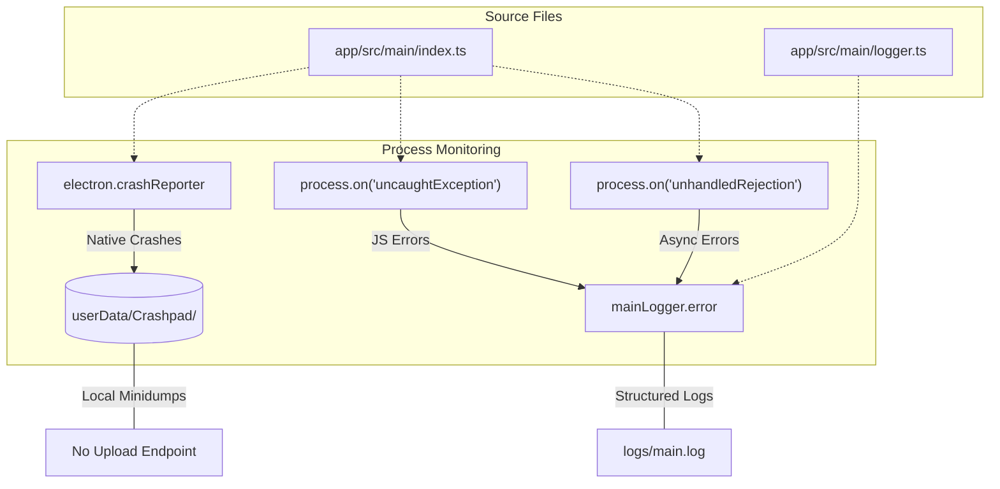

<!-- source: DeepWiki mcp.deepwiki.com · repo browser-use/desktop · page 9.2 Telemetry and Crash Reporting · fetched 2026-10-30 -->

# Telemetry and Crash Reporting

Relevant source files

The following files were used as context for generating this wiki page:

- [app/src/main/index.ts](app/src/main/index.ts)
- [app/src/main/telemetry.ts](app/src/main/telemetry.ts)
- [app/tests/unit/telemetry-remote.test.ts](app/tests/unit/telemetry-remote.test.ts)

The Browser Use Desktop application implements a multi-tiered observability stack designed to monitor performance, track feature usage, and capture system failures while respecting user privacy. The system combines local structured logging, opt-in remote telemetry via PostHog, and native crash reporting via Electron's `crashReporter`.

## Telemetry Architecture

The telemetry system is centered around the `TelemetryEmitter` class, which manages metric collection, threshold validation, and data dispatching. It supports three primary metric types: histograms (for latencies), counters (for event frequency), and gauges (for point-in-time values).

### Data Flow and Dual-Path Storage

Every metric emitted through the system follows a dual-path logic:
1.  **Local Fallback**: All metrics are immediately appended to a local JSONL file (`telemetry.jsonl`) in the user data directory [app/src/main/telemetry.ts:143-144](). This serves as a device-local debugging aid and is not gated by consent [app/src/main/telemetry.ts:141-142]().
2.  **Remote Dispatch**: If the user has provided consent, metrics are transformed into PostHog events and dispatched via HTTPS [app/src/main/telemetry.ts:246-250]().

### Telemetry System Flow
The following diagram illustrates the flow from a metric call to its final destinations.

Sources: [app/src/main/telemetry.ts:164-210](), [app/src/main/telemetry.ts:246-270](), [app/src/main/telemetry.ts:223-244]()

## Metric Types and API

The `TelemetryEmitter` provides a standardized API for instrumentation across the main process:

| Method | Metric Kind | Purpose | Example Usage |
| :--- | :--- | :--- | :--- |
| `observe(metric, value, tags)` | `histogram` | Latency and durations; tracks p95/p99. | `observe('pill_open_latency_ms', 120)` |
| `increment(metric, delta, tags)` | `counter` | Monotonic increments for event counts. | `increment('daemon_crash_count')` |
| `gauge(metric, value, tags)` | `gauge` | Current state values (e.g., success rates). | `gauge('session_restore_rate', 0.98)` |

Sources: [app/src/main/telemetry.ts:5-7](), [app/src/main/telemetry.ts:164-210]()

## Threshold Monitoring

The system includes a proactive monitoring layer that checks incoming observations against predefined `METRIC_THRESHOLDS` [app/src/main/telemetry.ts:51-62](). When a threshold is violated (e.g., p95 latency exceeds the limit), the system logs a warning and emits a internal event for potential UI feedback or developer alerts.

### Threshold Definitions
| Metric | Threshold Type | Limit |
| :--- | :--- | :--- |
| `pill_open_latency_ms` | p95 / p99 | 150ms / 300ms |
| `agent_first_step_latency_ms` | p95 | 3000ms |
| `daemon_crash_rate_per_session`| max | 0.01 |
| `session_restore_success_rate` | min | 0.99 |

Sources: [app/src/main/telemetry.ts:51-62](), [app/src/main/telemetry.ts:223-244]()

## PostHog Integration

Remote telemetry uses the PostHog Public Project Key [app/src/main/telemetry.ts:37](). Events are sent to `https://eu.i.posthog.com` [app/src/main/telemetry.ts:38]().

*   **Distinct ID**: Every event is tagged with a unique `installId` generated locally to allow for anonymous user-session correlation [app/tests/unit/telemetry-remote.test.ts:42-44]().
*   **Capture Function**: A high-level `captureEvent(name, properties)` function is used for product-level events (e.g., "unit_test_event") as opposed to raw metrics [app/src/main/telemetry.ts:89](), [app/tests/unit/telemetry-remote.test.ts:53-56]().

## Crash Reporting

The application handles crashes at three distinct levels:

### 1. Native CrashReporter
Electron's `crashReporter` is initialized at the very start of the main process. It captures native minidumps for GPU, renderer, and main process crashes [app/src/main/index.ts:31-35]().
*   **Storage**: Minidumps are stored in `userData/Crashpad/`.
*   **Upload**: Currently configured with `uploadToServer: false` [app/src/main/index.ts:40](). Users are expected to provide these logs manually for bug reports [app/src/main/index.ts:34-35]().

### 2. JS Uncaught Exceptions
The main process listens for `uncaughtException` and `unhandledRejection` to ensure that even if the app doesn't crash natively, logic errors are captured in the `mainLogger` [app/src/main/index.ts:129-141]().

### Crash and Exception Handling Entities
This diagram maps the code entities responsible for different failure modes.

Sources: [app/src/main/index.ts:36-42](), [app/src/main/index.ts:129-141](), [app/src/main/index.ts:91]()

## Consent Management

Telemetry and crash reporting (if uploaded) are strictly opt-in.
*   **Persistence**: Consent state is managed via `isTelemetryConsented()` [app/src/main/telemetry.ts:22]().
*   **IPC Handlers**: The `registerConsentHandlers` and `registerTelemetryHandlers` functions expose the ability for the UI (Settings or Onboarding) to toggle these states [app/src/main/index.ts:87-88]().
*   **Validation**: Before any remote fetch is attempted in `_maybeRemote`, the system verifies the consent bit [app/src/main/telemetry.ts:246-248]().

Sources: [app/src/main/telemetry.ts:22](), [app/src/main/index.ts:87-89](), [app/src/main/telemetry.ts:246-250]()

---

