# Page: Overview

# Overview

<details>
<summary>Relevant source files</summary>

The following files were used as context for generating this wiki page:

- [.gitignore](.gitignore)
- [CHANGELOG.md](CHANGELOG.md)
- [CONTRIBUTING.md](CONTRIBUTING.md)
- [README.md](README.md)
- [app/package.json](app/package.json)

</details>


This document provides a technical overview of the `browser-use/desktop` system, a cross-platform desktop application that enables AI agents to interact with websites. Unlike traditional browsers that attempt to embed agent logic, this application acts as the "agent half," porting user sessions into a fresh Chromium instance to automate tasks across the web [README.md:11-13]().

## Purpose and Scope

The `browser-use-desktop` application is a hub for AI browser agents [app/package.json:2-5](). It provides a desktop environment to run agents powered by providers like Anthropic (Claude Code) and Codex (OpenAI) [README.md:31-32](). The scope includes:
- **Session Porting**: Migrating cookies from the user's primary Chrome instance into the agent's automation environment [README.md:13]().
- **Multi-Agent Management**: Running and monitoring a "team" of browser agents [README.md:5]().
- **Omnipresent Access**: Spawning tasks from anywhere via global keyboard shortcuts [README.md:13]().
- **Inbound Channels**: Triggering agent sessions through external platforms like WhatsApp [README.md:34-38]().

## System Architecture

The application is built on an Electron multi-process architecture, orchestrating a high-performance automation harness [README.md:15]().

### High-Level Architecture

The system bridges Natural Language intents from the user into actionable code execution via the following entity relationships:

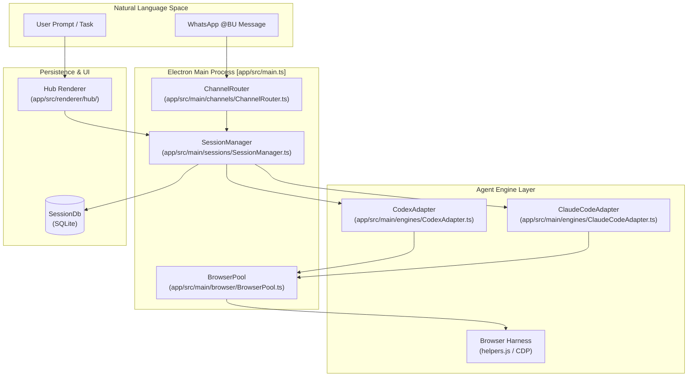

**Sources:** [README.md:11-15](), [README.md:34-38](), [app/package.json:2-5](), [CHANGELOG.md:11-25]()

### Code Entity Space: IPC and Process Flow

The application relies on structured IPC (Inter-Process Communication) to coordinate the UI and the underlying agent engines.

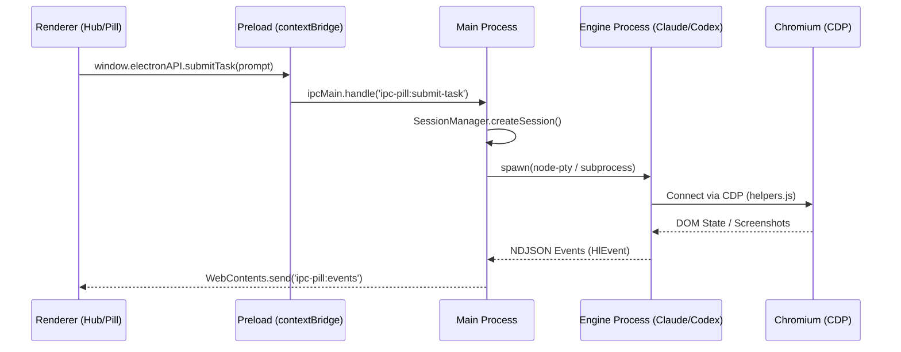

**Sources:** [CHANGELOG.md:17-21](), [app/package.json:120](), [README.md:13]()

## Key Features

### Provider & Channel Integration
The application supports multiple AI backends and entry points:

| Category | Entities | Implementation Detail |
| :--- | :--- | :--- |
| **Providers** | Anthropic, Codex | Handled via Engine Adapters [README.md:31-32]() |
| **Channels** | WhatsApp, Command Bar | `ChannelRouter` handles inbound triggers [README.md:34-38]() |
| **Auth** | Keytar, Claude Auth | Secure credential storage via `keytar` [app/package.json:118](), [CHANGELOG.md:77-87]() |

### Automation Infrastructure
- **Browser Harness**: Built on `browser-harness`, utilizing CDP for deep browser control [README.md:15]().
- **Session Persistence**: Uses `better-sqlite3` for local session history and state [app/package.json:114]().
- **Terminal Integration**: Uses `node-pty` and `xterm.js` to provide real-time agent terminal output in the UI [app/package.json:109-112, 120]().

## Technical Stack

The project utilizes a modern TypeScript/React stack within the Electron ecosystem:

- **Build Tooling**: Electron Forge with Vite for fast HMR and optimized bundling [app/package.json:61, 67, 95]().
- **UI Framework**: React 19 with TanStack Query for state management [app/package.json:100, 122]().
- **Testing**: Vitest for unit/integration tests and Playwright for E2E and visual QA [app/package.json:40, 96](), [CHANGELOG.md:46-65]().
- **Styling**: 8px grid system using Geist (UI) and Berkeley Mono (code) fonts [CHANGELOG.md:38-39]().

## Development and Build
The project uses `go-task` (Taskfile) to manage development workflows [README.md:42]().

```bash
task up              # Install dependencies and start development
task lint            # Run ESLint [CONTRIBUTING.md:24]
task typecheck       # Run TypeScript compiler checks [CONTRIBUTING.md:25]
task make            # Build platform-specific installers [CONTRIBUTING.md:27]
task linux:make:docker # Build Linux packages in a clean Docker environment [README.md:51]
```

**Sources:** [README.md:42-52](), [CONTRIBUTING.md:5-28](), [app/package.json:27-53]()

---

# Page: Core Architecture

# Core Architecture

<details>
<summary>Relevant source files</summary>

The following files were used as context for generating this wiki page:

- [app/src/main/index.ts](app/src/main/index.ts)
- [app/src/main/window.ts](app/src/main/window.ts)

</details>


This document explains the multi-process Electron architecture that forms the foundation of the Browser Use desktop application. It covers how the main process orchestrates AI engine processes (Claude Code, Codex), manages embedded BrowserViews, and handles the overall application lifecycle.

For detailed implementation of individual subsystems, see [Main Process](#2.1), [Renderer Process](#2.2), [Preload Script](#2.3), and [Configuration System](#2.4).

## Overview

The Browser Use desktop application implements a multi-process architecture where the Electron Main process acts as a central controller. Unlike traditional browsers, this application is designed to host AI agents that drive web automation. It orchestrates local CLI engines and manages a pool of browser instances that the agents interact with via the Chrome DevTools Protocol (CDP).

## Multi-Process Architecture

The application consists of several Electron processes and managed child processes:

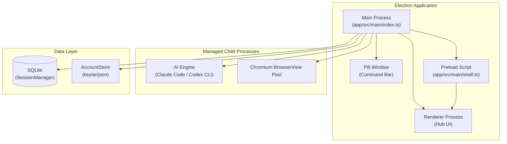

**Sources:** [app/src/main/index.ts:1-125](), [app/src/main/sessions/SessionManager.ts:1-50](), [app/src/main/hl/engines/index.ts:1-30]()

## Core Components

### Main Process Orchestration
The Main process is the entry point and system authority. It handles:
- **Process Lifecycle**: Managing `app.whenReady()`, single-instance locks, and clean shutdowns [app/src/main/index.ts:48-60]().
- **Window Management**: Creating the Hub (Shell), Pill (Command Bar), and Settings windows [app/src/main/window.ts:75-109](), [app/src/main/pill.ts:1-50]().
- **Engine Execution**: Spawning and piping I/O for AI engine CLI processes like Claude Code [app/src/main/hl/engines/claude-code.ts:1-100]().
- **Session Management**: Coordinating the `SessionManager` which tracks agent tasks and the `BrowserPool` which manages Chromium instances [app/src/main/sessions/SessionManager.ts:55-120]().

### The Hub and Pill
The UI is split into two primary surfaces:
1. **The Hub**: A full-featured dashboard for managing sessions, viewing logs, and configuring settings [app/src/main/window.ts:122-141]().
2. **The Pill**: A global, floating command bar triggered by hotkeys (e.g., `Cmd+Shift+L`) for quick agent dispatch [app/src/main/pill.ts:75-110]().

### AI Engine Layer
The "Natural Language Space" is bridged to the "Code Entity Space" through Engine Adapters. When a user submits a prompt, the `runEngine` function selects the appropriate adapter to spawn a CLI process.

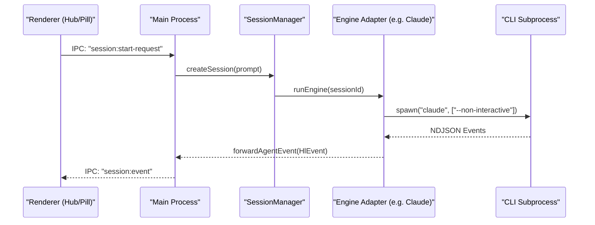

**Sources:** [app/src/main/hl/engines/index.ts:10-40](), [app/src/main/pill.ts:104-105](), [app/src/main/sessions/SessionManager.ts:150-180]()

## Inter-Process Communication (IPC)

The application uses a strictly defined IPC layer via `contextBridge`. The `Preload Script` exposes specific APIs to the renderer while keeping `nodeIntegration` disabled for security.

### IPC Communication Bridge

| Entity | Code Identifier | Responsibility |
|--------|-----------------|----------------|
| **Bridge** | `contextBridge.exposeInMainWorld` | Securely exposing APIs to `window.electron` [app/src/main/shell.ts:1-50]() |
| **Handlers** | `ipcMain.handle` / `ipcMain.on` | Processing requests for session control, settings, and auth [app/src/main/index.ts:400-500]() |
| **Validators** | `assertString`, `assertAttachments` | Sanitizing IPC inputs before processing [app/src/main/ipc-validators.ts:1-30]() |

**Sources:** [app/src/main/shell.ts:1-100](), [app/src/main/ipc-validators.ts:1-50]()

## Security and Isolation

The architecture enforces several security boundaries:
- **Sandbox Mode**: Renderer processes run with `sandbox: true` [app/src/main/window.ts:107]().
- **Context Isolation**: Enabled to prevent the renderer from accessing Electron internals directly [app/src/main/window.ts:105]().
- **Isolated User Data**: The application supports an isolated `userData` directory, which can be overridden via CLI flags to keep agent profiles separate from user profiles [app/src/main/index.ts:148-151]().
- **Native Crash Reporting**: `crashReporter` is initialized early to capture native crashes in GPU or renderer processes [app/src/main/index.ts:36-42]().

**Sources:** [app/src/main/index.ts:36-51](), [app/src/main/window.ts:100-110]()

## Process Configuration and Startup

On startup, the Main process performs several critical environment checks:
1. **CDP Port Resolution**: Assigns a remote debugging port for the internal Chromium instances [app/src/main/index.ts:156-160]().
2. **Onboarding Gate**: If no account is found, it diverts the user to the `OnboardingWindow` before showing the main Hub [app/src/main/identity/onboardingHandlers.ts:1-50]().
3. **Vite Dev Integration**: In development, it handles retries for the Vite dev server to ensure the UI loads correctly even if the build server is slow [app/src/main/window.ts:143-151]().

**Sources:** [app/src/main/index.ts:156-166](), [app/src/main/window.ts:115-151]()

---

# Page: Main Process

# Main Process

<details>
<summary>Relevant source files</summary>

The following files were used as context for generating this wiki page:

- [app/src/main/index.ts](app/src/main/index.ts)
- [app/src/main/window.ts](app/src/main/window.ts)

</details>


The Main Process serves as the central orchestrator for the Browser Use Desktop application. Implemented primarily in `app/src/main/index.ts`, it manages the Electron application lifecycle, coordinates the AI agent engines (Claude Code, Codex), handles process orchestration for the embedded browser, and implements the security-gating onboarding pattern.

## Application Lifecycle and Instance Management

The application enforces a single-instance lock to prevent data corruption in the SQLite session database and conflicts in the user data directory.

```mermaid
graph TD
    "app.requestSingleInstanceLock()" -- "Returns False" --> "app.quit()"
    "app.requestSingleInstanceLock()" -- "Returns True" --> "app.whenReady()"
    "app.on('second-instance')" -- "Triggered" --> "Restore/Focus existing window"
    
    subgraph "Initialization Sequence"
        "app.whenReady()" --> "resolveUserDataDir()"
        "resolveUserDataDir()" --> "bootstrapHarness()"
        "bootstrapHarness()" --> "AccountStore.load()"
        "AccountStore.load()" --> "Gate: Onboarding vs Shell"
    end
```

The lifecycle management includes native crash reporting via `crashReporter` and global exception handlers to capture main-process errors.

Sources: [app/src/main/index.ts:36-60](), [app/src/main/index.ts:129-141](), [app/src/main/index.ts:148-152]()

## Onboarding Gate Pattern

The application utilizes a gating pattern to ensure users are authenticated and configured before accessing the main Hub interface. The `AccountStore` determines whether to launch the `OnboardingWindow` or the `ShellWindow`.

| Entity | Role | File Reference |
| :--- | :--- | :--- |
| `AccountStore` | Persists user identity and provider selection. | [app/src/main/identity/AccountStore.ts]() |
| `createOnboardingWindow` | Creates a specialized window for the setup flow. | [app/src/main/identity/onboardingWindow.ts]() |
| `createShellWindow` | Creates the main Hub UI window. | [app/src/main/window.ts]() |
| `registerOnboardingHandlers` | IPC handlers that transition from onboarding to shell. | [app/src/main/identity/onboardingHandlers.ts]() |

Sources: [app/src/main/index.ts:83-85](), [app/src/main/index.ts:178-195]()

## Process Orchestration

The main process orchestrates several critical subsystems, including the browser automation harness and the AI engine subprocesses.

### Chrome and CDP Management
The application configures a dedicated remote debugging port for Chromium automation. This must be set via command-line switches before the app is ready.

```mermaid
graph TD
    "resolveCdpPort()" -- "Returns Port" --> "app.commandLine.appendSwitch('remote-debugging-port')"
    "app.whenReady()" --> "BrowserPool.initialize()"
    "BrowserPool" -- "Spawns" --> "Chromium Instance"
    "Chromium Instance" -- "Exposes" --> "CDP Endpoint"
```

Sources: [app/src/main/index.ts:156-162](), [app/src/main/index.ts:107-107]()

### Engine and Harness Execution
The main process manages the "Harness"—a specialized environment for the AI agent—and spawns engine subprocesses (like Claude Code) that drive the browser.

*   **Harness Bootstrap**: Prepares the local execution environment for the agent script. [app/src/main/index.ts:101-101]()
*   **Engine Execution**: The `runEngine` function handles the spawning of CLI-based AI agents, piping their NDJSON output back to the UI. [app/src/main/index.ts:102-102]()

## Window Management

The `createShellWindow` function in `app/src/main/window.ts` manages the primary UI. It implements:
1.  **Bounds Persistence**: Saves and restores window position/size to `window-bounds.json`. [app/src/main/window.ts:14-68]()
2.  **Vite Dev Integration**: In development, it handles retries for the Vite dev server and "stale heal" for 504 errors. [app/src/main/window.ts:115-172]()
3.  **Platform Styling**: Implements `titleBarStyle: 'hidden'` and Window Controls Overlay for Windows/macOS consistency. [app/src/main/window.ts:88-102]()

Sources: [app/src/main/window.ts:75-109](), [app/src/main/window.ts:129-151]()

## IPC and Communication Bridge

The main process acts as the hub for all IPC traffic, routing messages between the Renderer (Hub/Pill) and the background services.

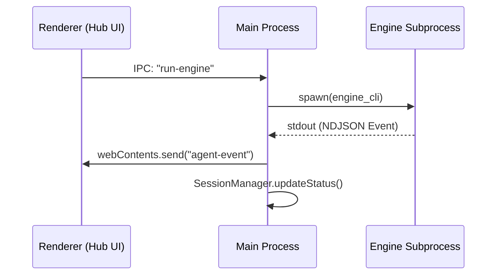

Key IPC Registrations in `index.ts`:
*   `registerApiKeyHandlers`: Manages secure storage of provider keys. [app/src/main/index.ts:86-86]()
*   `registerChannelHandlers`: Handles external triggers (e.g., WhatsApp). [app/src/main/index.ts:113-113]()
*   `registerTelemetryHandlers`: Manages event tracking and consent. [app/src/main/index.ts:87-88]()

Sources: [app/src/main/index.ts:79-90](), [app/src/main/index.ts:113-113]()

## Error Handling and Telemetry

The main process implements a multi-layered crash handling strategy:
1.  **Native Crashes**: Managed by `crashReporter` to capture GPU or memory-level failures. [app/src/main/index.ts:36-42]()
2.  **JS Exceptions**: `uncaughtException` and `unhandledRejection` listeners log errors to the `mainLogger`. [app/src/main/index.ts:129-141]()
3.  **Process Monitoring**: `render-process-gone` and `preload-error` listeners monitor the health of the renderer windows. [app/src/main/window.ts:155-160]()

Sources: [app/src/main/index.ts:31-42](), [app/src/main/window.ts:155-160]()

---

# Page: Renderer Process

# Renderer Process

<details>
<summary>Relevant source files</summary>

The following files were used as context for generating this wiki page:

- [app/src/renderer/globals.d.ts](app/src/renderer/globals.d.ts)
- [app/src/renderer/hub/HubApp.tsx](app/src/renderer/hub/HubApp.tsx)
- [app/src/renderer/hub/hub.css](app/src/renderer/hub/hub.css)

</details>


## Purpose and Scope

The Renderer Process manages the user interface and user interactions for the browser-use/desktop application. It runs in Electron's renderer context (browser environment) and is responsible for displaying the Hub UI, handling session output, managing the embedded browser views, and facilitating communication with the main process through the `contextBridge`.

The Hub is built as a React application that provides a dashboard for AI agent sessions, terminal outputs, and system settings.

## Hub UI Architecture

The Hub UI follows a "Linear/Raycast" design language, characterized by deep dark backgrounds, subtle elevation, and a content-first layout [app/src/renderer/hub/hub.css:1-5]().

### Component Hierarchy

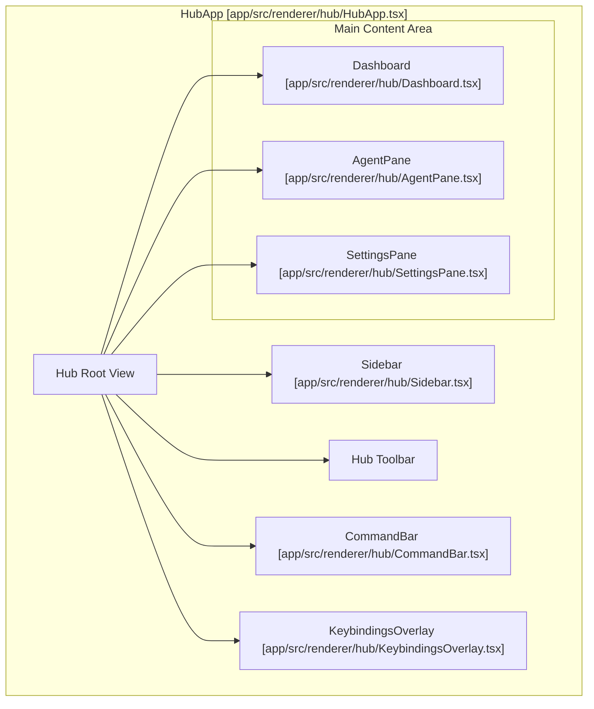

Sources: [app/src/renderer/hub/HubApp.tsx:2-10](), [app/src/renderer/hub/hub.css:11-61]()

### View Modes and Navigation
The Hub supports two primary view modes managed via state in `HubApp`:
*   **Dashboard**: A high-level overview of all sessions [app/src/renderer/hub/HubApp.tsx:26]().
*   **Grid/Agent View**: A focused view for interacting with specific agent sessions [app/src/renderer/hub/HubApp.tsx:26]().

Navigation is enhanced by `useVimKeys`, which maps keyboard actions (e.g., `nav.down`, `nav.up`, `nav.top`) to session focus and view switching [app/src/renderer/hub/HubApp.tsx:148-175]().

## IPC and Context Bridge

The renderer process does not have direct access to Node.js or the file system. It communicates with the Main Process via interfaces exposed on the `window.electronAPI` object, defined in the preload script.

### Bridge Interface Definition

The renderer expects several specialized APIs to be available globally:

| API Interface | Purpose | Key Functions |
| :--- | :--- | :--- |
| `sessions` | Agent session control | `create`, `start`, `stop`, `viewAttach`, `viewDetach` |
| `on` | Event listeners | `sessionUpdated`, `sessionOutput`, `sessionBrowserGone` |
| `settings` | App configuration | `getMasked`, `save`, `test`, `available` |
| `pill` | Floating bar control | `toggle`, `hide` |
| `logs` | Terminal/Log UI | `show`, `close`, `updateAnchor` |

Sources: [app/src/renderer/globals.d.ts:35-205]()

### Data Flow: Session Updates

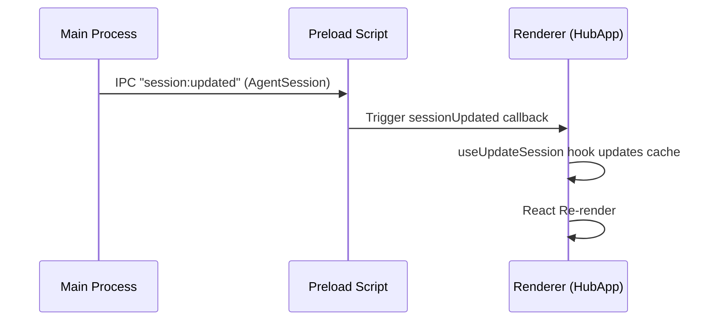

The `useSessionsQuery` and `useUpdateSession` hooks manage the local state of sessions, ensuring the UI stays in sync with the agent engine running in the main process [app/src/renderer/hub/HubApp.tsx:8-9]().

## Session Rendering and Browser Views

One of the primary responsibilities of the Renderer is managing the visual real estate for agent sessions. While the UI is HTML, the actual browser automation happens in `BrowserViews` managed by the main process.

### View Attachment Logic
When a session is focused or displayed in the `AgentPane`, the renderer must tell the main process where to "stick" the native browser view.

1.  The renderer calculates the bounding box of a placeholder `div` in the DOM.
2.  It calls `window.electronAPI.sessions.viewAttach(id, bounds)` [app/src/renderer/globals.d.ts:66]().
3.  The main process moves the corresponding `BrowserView` to those coordinates.
4.  On window resize or layout change, `viewResize` is called to update the coordinates [app/src/renderer/globals.d.ts:68]().

Sources: [app/src/renderer/hub/HubApp.tsx:109-113](), [app/src/renderer/globals.d.ts:66-71]()

## Key UI Components

### AgentPane
The `AgentPane` is the primary workspace for a running agent. It handles:
*   Displaying the live browser view via attachment.
*   Showing the agent's thought process and action history.
*   Providing controls for "Steer" (sending manual instructions to the agent) [app/src/renderer/globals.d.ts:42]().

### CommandBar
The `CommandBar` is a Raycast-style interface for quick actions. It allows users to search sessions, trigger system commands, or create new agents [app/src/renderer/hub/HubApp.tsx:5]().

### MemoryIndicator
A specialized component that visualizes system resource usage, calling `window.electronAPI.sessions.memory()` to fetch real-time MB usage for each session and process [app/src/renderer/hub/HubApp.tsx:9](), [app/src/renderer/globals.d.ts:74]().

## Terminal and Log Handling

The renderer handles two types of output:
1.  **Structured Events (`HlEvent`)**: High-level agent actions (e.g., "Clicking button") received via `sessionOutput` [app/src/renderer/globals.d.ts:138]().
2.  **Raw Terminal Bytes**: Streamed output from the underlying Python/CLI process, received via `sessionOutputTerm` [app/src/renderer/globals.d.ts:139]().

The renderer provides a `getTermReplay` function to fetch historical terminal output for a session when the UI is re-opened [app/src/renderer/globals.d.ts:75]().

Sources: [app/src/renderer/globals.d.ts:135-147](), [app/src/renderer/hub/types.ts:1-20]() (implied by usage in HubApp)

---

# Page: Preload Script

# Preload Script

<details>
<summary>Relevant source files</summary>

The following files were used as context for generating this wiki page:

- [app/src/preload/onboarding.ts](app/src/preload/onboarding.ts)
- [app/src/preload/pill.ts](app/src/preload/pill.ts)
- [app/src/preload/shell.ts](app/src/preload/shell.ts)

</details>


The preload script serves as a secure bridge between the Electron main process and renderer processes (Hub, Pill, and Onboarding), exposing controlled APIs for session management, engine control (Claude Code/Codex), Chrome profile/cookie import, and settings management. This script implements Electron's security model by using `contextBridge` to selectively expose functionality without compromising the sandbox security of the renderer process.

## Security Bridge Architecture

The application utilizes multiple preload scripts tailored to specific windows, each exposing a unique namespace to the `window` object in the renderer.

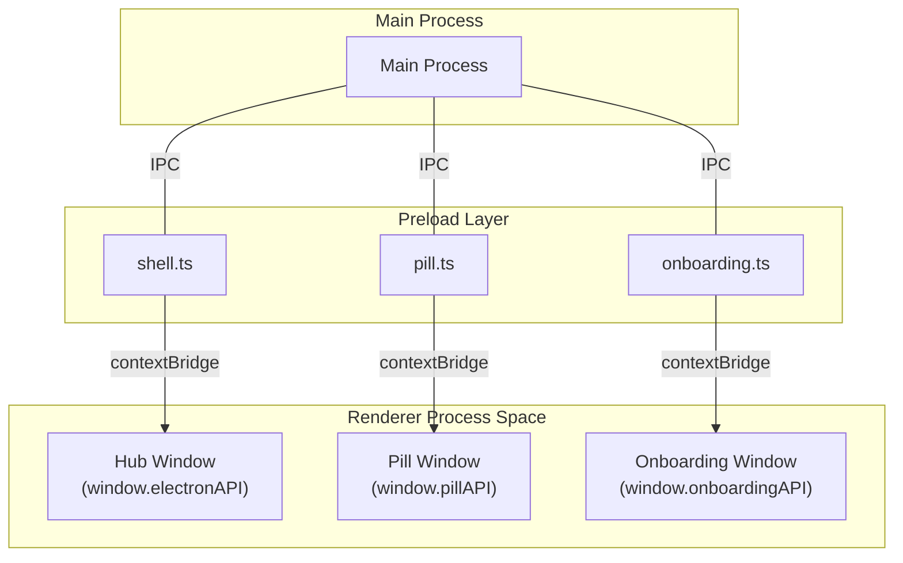

**Sources:** [app/src/preload/shell.ts:11-12](), [app/src/preload/pill.ts:50](), [app/src/preload/onboarding.ts:184]()

## Shell API (Hub Window)

The `shell.ts` preload script exposes the `electronAPI` object, providing comprehensive management for agent sessions, window controls, and system settings.

### Session and Engine Control
The API facilitates deep interaction with the Agent Engine Layer, including session lifecycle and engine authentication status.

| API Path | IPC Channel | Purpose |
|----------|-------------|---------|
| `sessions.list()` | `sessions:list` | Retrieves all active and historical agent sessions [app/src/preload/shell.ts:241-243]() |
| `sessions.getEvents(id)` | `sessions:get-events` | Fetches `HlEvent` logs for a specific session [app/src/preload/shell.ts:251-255]() |
| `settings.claudeCode.login()` | `settings:claude-code:login` | Triggers OAuth/CLI login for Claude Code [app/src/preload/shell.ts:68-69]() |
| `settings.codex.status()` | `sessions:engine-status` | Checks installation and auth for Codex [app/src/preload/shell.ts:83-88]() |

### Window Management (Takeover & Logs)
The shell API manages the positioning of overlay windows like the `Takeover` (Live View) and `Logs` panes.

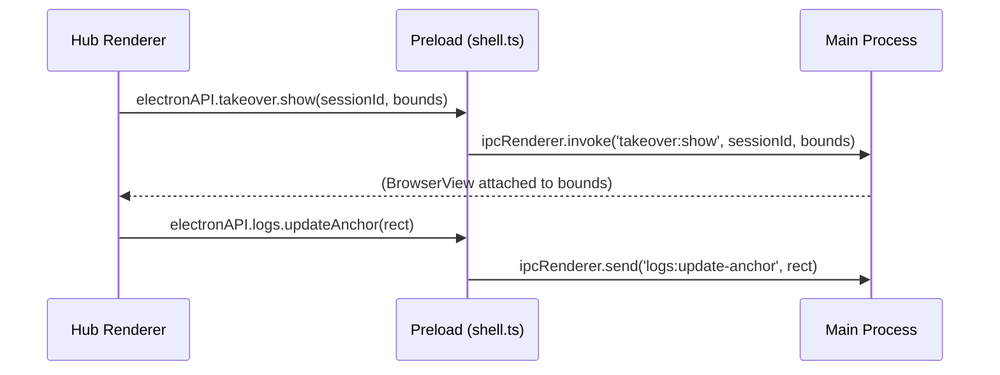

**Sources:** [app/src/preload/shell.ts:43-50](), [app/src/preload/shell.ts:39-41]()

## Pill API (Command Bar)

The `pill.ts` preload script provides a specialized interface for the floating command bar, focusing on task submission and real-time event streaming.

### Task Submission Flow
The Pill uses `pill:submit` to dispatch new natural language tasks to the `SessionManager`.

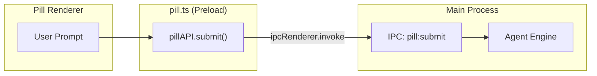

**Sources:** [app/src/preload/pill.ts:58-70]()

### Event Streaming
The Pill subscribes to `pill:event` to show live progress of the agent's actions (e.g., "Searching Google", "Clicking Button").
* **`onEvent(callback)`**: Listens for `AgentEvent` payloads and provides a cleanup function to remove the `ipcRenderer` listener [app/src/preload/pill.ts:137-158]().

## Onboarding API

The `onboarding.ts` script handles sensitive setup operations, including Chrome data migration and API key validation.

### Chrome Profile & Cookie Import
This API allows the app to "port" the user's identity from their local Chrome installation to the agent's browser pool.

| Function | IPC Channel | Description |
|----------|-------------|-------------|
| `detectChromeProfiles()` | `chrome-import:detect-profiles` | Finds local Chrome installations [app/src/preload/onboarding.ts:23-24]() |
| `importChromeProfileCookies(dir)` | `chrome-import:import-cookies` | Decrypts and imports cookies for agent use [app/src/preload/onboarding.ts:26-27]() |
| `getChromeProfileSyncs()` | `chrome-import:get-syncs` | Returns stats on previously imported profiles [app/src/preload/onboarding.ts:39-49]() |

### External Channels (WhatsApp)
The onboarding API manages the connection to the `WhatsAppAdapter` for remote agent control.
* **`whatsapp.connect()`**: Invokes `channels:whatsapp:connect` to initialize the headless WhatsApp instance [app/src/preload/onboarding.ts:163-164]().
* **`onWhatsappQr(cb)`**: Listens for the `whatsapp-qr` event to display the login QR code in the UI [app/src/preload/onboarding.ts:171-175]().

**Sources:** [app/src/preload/onboarding.ts:162-181]()

## Data Validation

To maintain security and type safety across the bridge, the preload scripts utilize shared schemas to validate data returning from the main process before it reaches the renderer.

```typescript
import {
  validateSession,
  validateHlEvent,
  validatePoolStats,
} from '../shared/session-schemas';

// Example usage in shell.ts
onSessionUpdated: (cb) => {
  const handler = (_event, session) => cb(validateSession(session));
  ipcRenderer.on('sessions:updated', handler);
  return () => ipcRenderer.removeListener('sessions:updated', handler);
}
```

**Sources:** [app/src/preload/shell.ts:2-9](), [app/src/preload/shell.ts:267-271]()

## Telemetry and Consent

Both `shell.ts` and `onboarding.ts` expose methods to handle user privacy and event tracking via the `telemetry` namespace.
* **`getConsent()`**: Retrieves the current telemetry status and version [app/src/preload/onboarding.ts:137-141]().
* **`capture(name, props)`**: Forwards UI events to the main process's PostHog/JSONL logger [app/src/preload/onboarding.ts:149-151]().

**Sources:** [app/src/preload/shell.ts:94-101](), [app/src/preload/onboarding.ts:143-151]()

---

# Page: Configuration System

# Configuration System

<details>
<summary>Relevant source files</summary>

The following files were used as context for generating this wiki page:

- [app/src/main/hl/engines/pathEnrich.ts](app/src/main/hl/engines/pathEnrich.ts)
- [shared/schemas/README.md](shared/schemas/README.md)
- [shared/schemas/agent_events.schema.json](shared/schemas/agent_events.schema.json)
- [shared/schemas/agent_task.schema.json](shared/schemas/agent_task.schema.json)
- [shared/schemas/onboarding.schema.json](shared/schemas/onboarding.schema.json)
- [shared/schemas/tab_state.schema.json](shared/schemas/tab_state.schema.json)

</details>


## Purpose and Scope

The Configuration System provides cross-platform management for external processes (AI Engines and Chrome) orchestrated by the Electron main process. It handles complex path resolution, environment variable enrichment for GUI-launched processes, and defines the shared JSON schemas that serve as IPC contracts between the TypeScript and Python layers.

## Architecture Overview

The configuration system bridges the gap between the high-level Electron environment and the low-level operating system requirements. It ensures that user-installed CLIs (like `claude` or `codex`) and browser executables are found regardless of how the application was launched.

### Configuration Entity Mapping

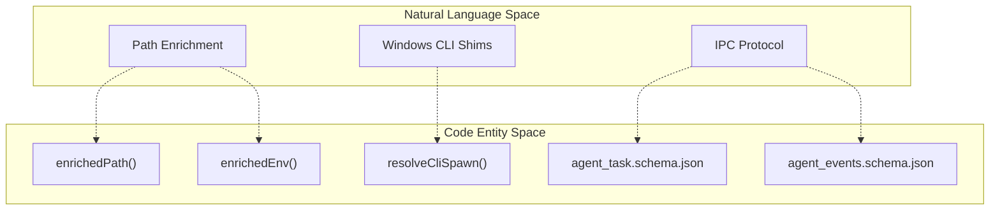

**Sources:** [app/src/main/hl/engines/pathEnrich.ts:1-9](), [shared/schemas/README.md:8-14]()

## Environment and Path Enrichment

Electron applications launched from a GUI (Dock/Finder/Start Menu) often inherit a minimal `PATH` that excludes user-installed tools. The `pathEnrich` module solves this by detecting the user's login shell and common binary directories.

### Path Enrichment Strategy

1.  **Shell Probing**: On POSIX systems, the system spawns the user's login shell (`$SHELL -ilc`) once to capture the full `PATH` including custom exports from `.zshrc` or `.bash_profile` [app/src/main/hl/engines/pathEnrich.ts:35-54]().
2.  **Hardcoded Safety Net**: If shell probing fails, the system appends common binary directories (Homebrew, Volta, NVM, Cargo, etc.) based on the platform [app/src/main/hl/engines/pathEnrich.ts:56-80]().
3.  **Deduplication**: Paths are split by the platform delimiter (`;` or `:`) and merged using a `Set` to prevent redundant entries [app/src/main/hl/engines/pathEnrich.ts:98-100]().

### Windows CLI Resolution

Windows `CreateProcess` cannot execute `.cmd`, `.bat`, or `.ps1` shims directly. The `resolveCliSpawn` function identifies these files and rewrites the execution to go through `cmd.exe /d /s /c` [app/src/main/hl/engines/pathEnrich.ts:135-145]().

**Sources:** [app/src/main/hl/engines/pathEnrich.ts:1-149]()

## Shared IPC Schemas

The application uses JSON Schema as the single source of truth for all cross-process communication. These schemas define the contracts for the Unix domain socket protocol used between Electron and the Python agent daemon.

### IPC Message Flow

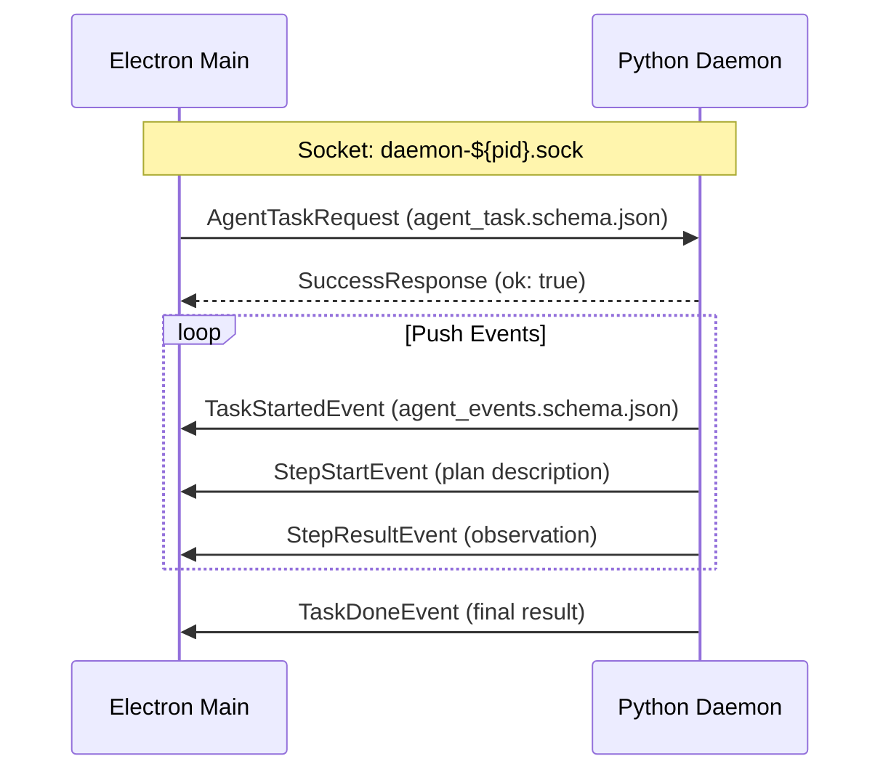

**Sources:** [shared/schemas/README.md:18-41](), [shared/schemas/agent_task.schema.json:19-46](), [shared/schemas/agent_events.schema.json:110-135]()

### Schema Definitions

| Schema File | Purpose | Key Definitions |
| :--- | :--- | :--- |
| `agent_task.schema.json` | Requests from Main to Daemon | `AgentTaskRequest`, `CancelTaskRequest`, `ShutdownRequest` |
| `agent_events.schema.json` | Push events from Daemon to Main | `StepStartEvent`, `StepResultEvent`, `TaskDoneEvent`, `TaskFailedEvent` |
| `tab_state.schema.json` | UI state synchronization | `TabOpenedEvent`, `TabActivatedEvent`, `TabUpdatedEvent` |
| `onboarding.schema.json` | Onboarding flow management | `OnboardingCompleteEvent`, `OAuthStartRequest` |

**Sources:** [shared/schemas/agent_task.schema.json:1-157](), [shared/schemas/agent_events.schema.json:1-208](), [shared/schemas/tab_state.schema.json:1-157](), [shared/schemas/onboarding.schema.json:1-143]()

## Transport and Versioning

### Wire Format
- **Transport**: Unix Domain Socket (macOS/Linux) or Named Pipes (Windows) [shared/schemas/README.md:18-22]().
- **Format**: Newline-delimited JSON (NDJSON) [shared/schemas/README.md:10]().
- **Encoding**: UTF-8 with a maximum message size of 4 MB [shared/schemas/README.md:29-31]().

### Versioning Policy
Every message carries a `version` field (currently `"1.0"`) [shared/schemas/agent_task.schema.json:12-17]().
- **Breaking Changes**: Require a version bump and regeneration of types [shared/schemas/README.md:143-148]().
- **Codegen**: TypeScript interfaces and Python `TypedDict` definitions are generated from these schemas via `npm run codegen:schemas` [shared/schemas/README.md:158-168]().

**Sources:** [shared/schemas/README.md:1-194]()

---

# Page: Agent Engine Layer

# Agent Engine Layer

<details>
<summary>Relevant source files</summary>

The following files were used as context for generating this wiki page:

- [app/src/main/hl/engines/runEngine.ts](app/src/main/hl/engines/runEngine.ts)
- [app/src/main/hl/engines/types.ts](app/src/main/hl/engines/types.ts)

</details>


The Agent Engine Layer is the execution subsystem responsible for orchestrating AI agents, managing their lifecycles, and providing the automation harness they use to interact with the browser. It abstracts specific AI backends (like Claude Code or Codex) into a unified event stream, allowing the rest of the application to remain engine-agnostic.

### System Overview

The engine layer bridges the gap between high-level user prompts and low-level browser automation. When a task is dispatched, the system allocates a browser resource, prepares a local execution environment (the harness), and spawns an engine process via a specialized adapter.

#### Engine Execution Flow

The following diagram illustrates how a user prompt moves from the UI through the engine layer to drive the browser.

**Prompt Dispatch and Execution Flow**
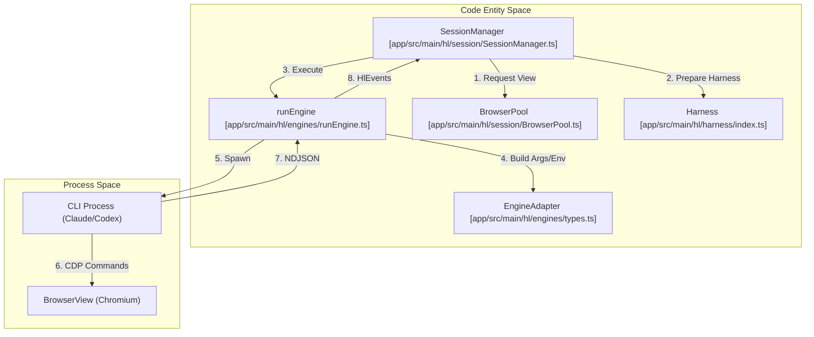
Sources: [app/src/main/hl/engines/runEngine.ts:58-133](), [app/src/main/hl/engines/types.ts:77-114](), [app/src/main/hl/session/SessionManager.ts:1-50]()

---

### [Engine Adapters](#3.1)

The application uses an adapter pattern to support multiple AI backends. Each `EngineAdapter` is responsible for translating the application's internal state into the specific CLI arguments and environment variables required by a backend (e.g., `claude` or `codex`) [app/src/main/hl/engines/types.ts:77-114]().

Adapters handle:
*   **Probing**: Detecting if the CLI is installed and authenticated [app/src/main/hl/engines/types.ts:86-87]().
*   **Translation**: Parsing engine-specific NDJSON (Newline Delimited JSON) output into a standardized `HlEvent` stream [app/src/main/hl/engines/runEngine.ts:2-7]().
*   **Auth Injection**: Deciding whether to use a stored API key or the CLI's native subscription/OAuth session [app/src/main/hl/engines/runEngine.ts:129-143]().

For details, see [Engine Adapters](#3.1).

---

### [Session Management](#3.2)

The `SessionManager` acts as the central orchestrator for agent activity. It manages the lifecycle of a session through various states: `draft`, `running`, `stuck`, `idle`, and `stopped`.

Key components include:
*   **SessionDb**: A SQLite-backed persistence layer that stores session history, metadata, and the full event log [app/src/main/hl/session/SessionManager.ts:10-25]().
*   **BrowserPool**: A resource manager that maintains a pool of `BrowserView` instances, ensuring that agents have a dedicated, clean environment for execution [app/src/main/hl/session/BrowserPool.ts:1-30]().
*   **Steer Queue**: A mechanism for "steering" or providing mid-run feedback to an active agent.

For details, see [Session Management](#3.2).

---

### [Harness and Browser Automation](#3.3)

The "Harness" is the local file-system environment where the agent process runs. It provides the agent with the "tools" and "skills" necessary to control the browser.

**Harness Structure and CDP Integration**
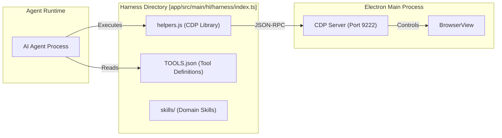
Sources: [app/src/main/hl/engines/runEngine.ts:15-17](), [app/src/main/hl/engines/types.ts:15-22]()

The harness includes a specialized `helpers.js` library that translates high-level agent intents (like "click the login button") into low-level Chrome DevTools Protocol (CDP) commands. It also manages the porting of cookies from the user's primary Chrome installation to the agent's session.

For details, see [Harness and Browser Automation](#3.3).

---

### [Inbound Channels](#3.4)

While the primary interface for the Agent Engine is the local Desktop UI, the system supports inbound triggers via external platforms. The `WhatsAppAdapter` and `ChannelRouter` allow tasks to be dispatched to the engine from external messaging services.

These channels handle:
*   **Message Routing**: Mapping incoming platform IDs to internal session origins.
*   **Context Management**: Feeding external message history into the agent's prompt context.
*   **Notifications**: Relaying completion summaries or "stuck" alerts back to the originating platform.

For details, see [Inbound Channels](#3.4).

---

# Page: Engine Adapters

# Engine Adapters

<details>
<summary>Relevant source files</summary>

The following files were used as context for generating this wiki page:

- [app/src/main/hl/engines/claude-code/adapter.ts](app/src/main/hl/engines/claude-code/adapter.ts)
- [app/src/main/hl/engines/codex/adapter.ts](app/src/main/hl/engines/codex/adapter.ts)
- [app/src/main/hl/engines/runEngine.ts](app/src/main/hl/engines/runEngine.ts)
- [app/src/main/hl/engines/types.ts](app/src/main/hl/engines/types.ts)

</details>


Engine Adapters provide a pluggable interface for CLI-based AI agents, such as **Claude Code** and **Codex**, to interact with the `browser-use/desktop` environment. They serve as the translation layer between the natural language intent of the user and the specific CLI commands, environment variables, and output formats required by different AI engines.

## Overview

The system uses an adapter pattern defined by the `EngineAdapter` interface [app/src/main/hl/engines/types.ts:77-114](). This allows the core `runEngine` logic to remain agnostic of the underlying AI provider. Each adapter is responsible for:
1.  **Probing**: Detecting if the CLI is installed and if the user is authenticated.
2.  **Prompt Wrapping**: Injecting system instructions, CDP target information, and attachment references into the user's prompt.
3.  **Spawning**: Constructing the exact CLI arguments and environment variables (e.g., `ANTHROPIC_API_KEY` or `OPENAI_API_KEY`).
4.  **Parsing**: Converting engine-specific NDJSON (Newline Delimited JSON) streams into a unified stream of `HlEvent` objects.

### Data Flow: Intent to Execution

The following diagram illustrates how a user prompt is transformed into a running process and back into UI events.

**Engine Execution Flow**
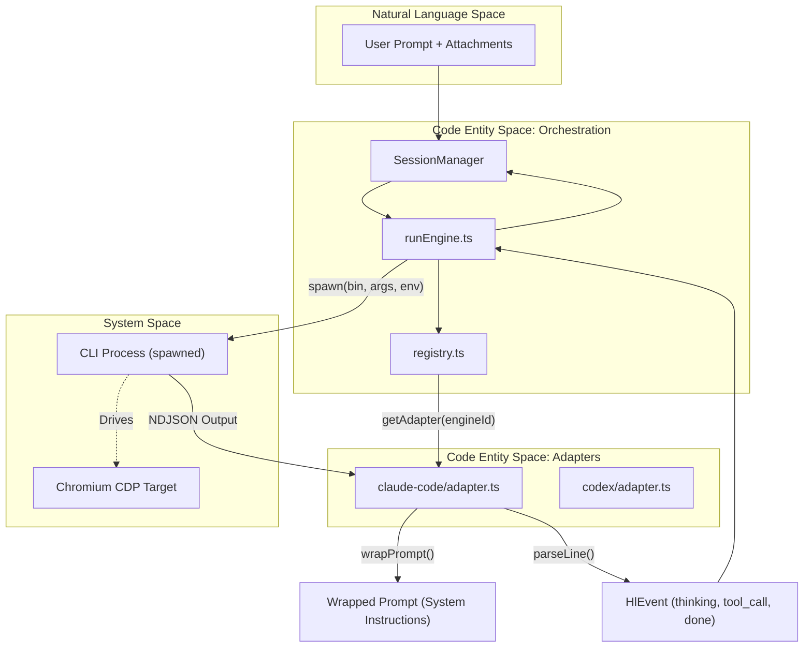
Sources: [app/src/main/hl/engines/runEngine.ts:58-63](), [app/src/main/hl/engines/types.ts:77-114](), [app/src/main/hl/engines/claude-code/adapter.ts:135-152]()

---

## The Adapter Interface

Every adapter must implement the `EngineAdapter` interface, which ensures consistency in how the main process manages external agents.

| Function | Purpose | Implementation Detail |
| :--- | :--- | :--- |
| `probeInstalled` | Checks if binary is on PATH. | Uses `runCli(['--version'])` [app/src/main/hl/engines/claude-code/adapter.ts:84-89](). |
| `probeAuthed` | Checks login status. | Claude uses `auth status`; Codex checks `~/.codex/auth.json` [app/src/main/hl/engines/codex/adapter.ts:105-116](). |
| `wrapPrompt` | Adds context. | Injects `BU_TARGET_ID`, `BU_CDP_PORT`, and instructions to read `helpers.js` [app/src/main/hl/engines/claude-code/adapter.ts:135-153](). |
| `buildSpawnArgs` | Generates CLI flags. | Claude uses `-p --output-format stream-json`; Codex uses `exec --json` [app/src/main/hl/engines/claude-code/adapter.ts:155-166](). |
| `parseLine` | Stream translation. | Converts engine-specific JSON into `HlEvent` shapes [app/src/main/hl/engines/types.ts:113-113](). |

Sources: [app/src/main/hl/engines/types.ts:77-114](), [app/src/main/hl/engines/claude-code/adapter.ts:79-115](), [app/src/main/hl/engines/codex/adapter.ts:93-116]()

---

## Engine Implementations

### Claude Code Adapter
The Claude Code adapter wraps the `claude` CLI in non-interactive mode. It focuses on the `--output-format stream-json` flag to receive structured feedback.

*   **Auth Logic**: It detects if the user is using an API key (via `ANTHROPIC_API_KEY`) or a subscription (via Keychain). If both are present, the API key takes precedence in `buildEnv` [app/src/main/hl/engines/runEngine.ts:129-143]().
*   **Tool Normalization**: Claude Code emits `assistant.content[]` with `tool_use`. The adapter normalizes these into `tool_call` events, specifically handling the `Bash` tool by extracting the `command` string [app/src/main/hl/engines/claude-code/adapter.ts:33-42]().

### Codex Adapter
The Codex adapter wraps `codex exec`. It has significant differences in session management and Windows compatibility.

*   **Stdin Payload**: To avoid Windows `cmd.exe` limitations where newlines in arguments truncate the command, the Codex adapter uses `getStdinPayload` to pipe the prompt through `stdin` instead of `argv` [app/src/main/hl/engines/codex/adapter.ts:158-175]().
*   **Event Mapping**: Codex uses different keys for tool execution across versions. The adapter normalizes these via `normalizeItemArgs`, mapping `command_execution` or `local_shell_call` to a unified `Bash` tool name [app/src/main/hl/engines/codex/adapter.ts:66-86]().

---

## Parsing and Event Emission

The `runEngine` function manages a `ParseContext` [app/src/main/hl/engines/types.ts:31-48]() which tracks the iteration count and pending tool calls. This allows the system to pair tool results with their original calls even if the engine emits them asynchronously.

**NDJSON Parsing Logic**
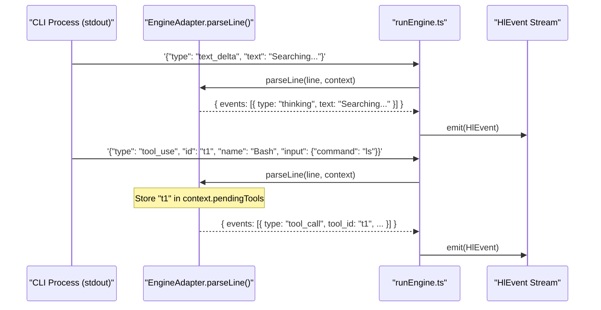
Sources: [app/src/main/hl/engines/runEngine.ts:203-220](), [app/src/main/hl/engines/types.ts:31-48](), [app/src/main/hl/engines/claude-code/adapter.ts:5-11]()

### Auth Resolution
Before spawning, `runEngine` resolves the authentication path. It logs a specific `session.auth.path` metric to track whether a session used an `apiKey`, `subscription`, or `both` [app/src/main/hl/engines/runEngine.ts:129-143](). This state is then captured in the `onAuthResolved` callback so the `SessionManager` can persist the auth mode used for that specific historical run [app/src/main/hl/engines/runEngine.ts:163-172]().

Sources: [app/src/main/hl/engines/runEngine.ts:107-172](), [app/src/main/hl/engines/types.ts:118-133]()

---

# Page: Session Management

# Session Management

<details>
<summary>Relevant source files</summary>

The following files were used as context for generating this wiki page:

- [app/src/main/hl/engines/types.ts](app/src/main/hl/engines/types.ts)
- [app/src/main/index.ts](app/src/main/index.ts)

</details>


The Session Management layer coordinates the lifecycle of AI agent interactions, the persistence of session history, and the allocation of browser resources. It acts as the orchestrator between the user's intent (prompts), the Agent Engine processes, and the Chromium `BrowserView` instances where automation occurs.

## Overview

Session management is handled primarily by two singleton classes:
1.  **`SessionManager`**: Manages the high-level lifecycle, state transitions, and database persistence of agent sessions.
2.  **`BrowserPool`**: Manages a pool of Electron `BrowserView` instances, ensuring they are correctly attached to the UI and assigned to active agent sessions.

Persistence is handled via `SessionDb`, a SQLite-backed store that tracks session metadata, events, and status.

### System Architecture and Code Entities

The following diagram maps the conceptual session flow to the specific classes and files responsible for implementation.

**Session Management Entity Map**
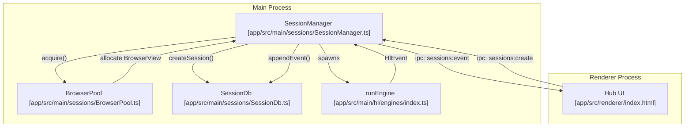
**Sources:** [app/src/main/sessions/SessionManager.ts:1-50](), [app/src/main/sessions/BrowserPool.ts:1-30](), [app/src/main/sessions/SessionDb.ts:1-20]()

---

## Session Lifecycle and States

Every session moves through a defined set of states. These states determine whether an engine process is running, if a `BrowserView` is occupied, and how the UI should render the session.

| State | Description |
| :--- | :--- |
| `draft` | The session has been created in the DB but no engine has been spawned yet. No `BrowserView` is assigned. |
| `running` | The engine subprocess is active and driving the browser. |
| `stuck` | The engine has encountered a recoverable or unrecoverable stall (e.g., waiting for user input that isn't arriving). |
| `idle` | The engine has finished its task, but the session remains "open" so the user can see the final state or send a follow-up. |
| `stopped` | The session is finalized. The engine is killed, and the `BrowserView` is returned to the pool. |

### Lifecycle Flow

The lifecycle is managed by `SessionManager.updateStatus()`, which updates the `SessionDb` and notifies the renderer process via IPC.

**Session State Transitions**
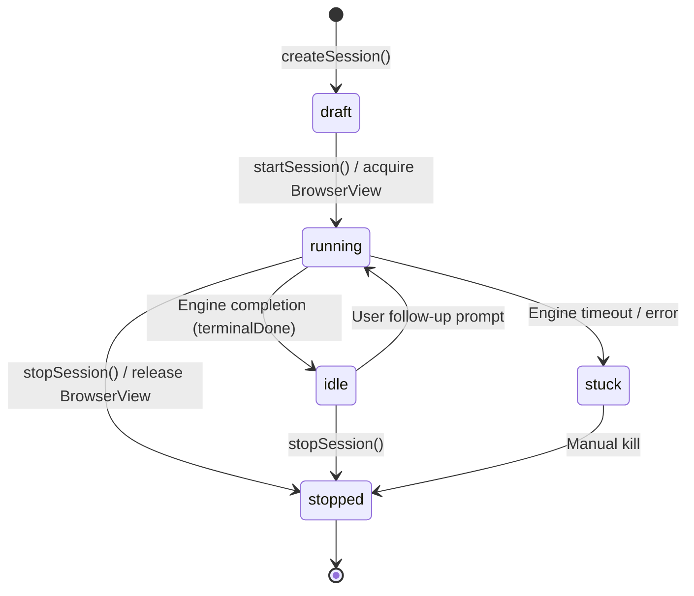
**Sources:** [app/src/shared/session-schemas.ts:1-50](), [app/src/main/sessions/SessionManager.ts:250-300]()

---

## SessionManager Implementation

The `SessionManager` class is the central authority for session operations. It maintains an in-memory map of active sessions and coordinates with the `BrowserPool` to provide the execution environment for engines.

### Key Responsibilities
- **Session Creation**: Generates a unique UUID and initializes a record in `SessionDb` [app/src/main/sessions/SessionManager.ts:110-130]().
- **Engine Coordination**: Calls `runEngine()` with the appropriate `EngineId` and `SpawnContext` [app/src/main/sessions/SessionManager.ts:310-340]().
- **Event Handling**: Listens to `HlEvent` streams from the engine and routes them to the database and the UI [app/src/main/sessions/SessionManager.ts:400-420]().
- **Steer Queue**: Manages a queue of user "steer" (follow-up) messages that are injected into a running engine's stdin or used to restart an idle engine [app/src/main/sessions/SessionManager.ts:450-480]().

**Sources:** [app/src/main/sessions/SessionManager.ts:1-500]()

---

## BrowserPool and View Allocation

The `BrowserPool` manages a collection of Electron `BrowserView` instances. Instead of creating a new browser for every session, which is resource-intensive, the pool recycles views.

### Allocation Logic
When a session starts, it calls `BrowserPool.acquire(sessionId)`.
1.  **Recycling**: If a view was recently used for the same session (e.g., a restart), it is prioritized.
2.  **Fresh Allocation**: If no session-specific view exists, a new `BrowserView` is instantiated with a clean `partition` or a shared session context [app/src/main/sessions/BrowserPool.ts:80-110]().
3.  **UI Attachment**: The view is attached to the `ShellWindow` using `setBrowserView()` and its bounds are synchronized with the Hub UI layout [app/src/main/index.ts:350-380]().

### Browser Recycling
When a session is stopped or enters an `idle` state for a long duration, `BrowserPool.release(sessionId)` is called. The view is hidden and cleared, but the underlying process may be kept warm for subsequent tasks [app/src/main/sessions/BrowserPool.ts:150-180]().

**Sources:** [app/src/main/sessions/BrowserPool.ts:1-200](), [app/src/main/index.ts:340-400]()

---

## SQLite Persistence (SessionDb)

All session data is persisted in a SQLite database located in the user data directory. This ensures that session history, tool calls, and agent logs survive application restarts.

### Schema Overview
- **`sessions` table**: Stores metadata like `engine_id`, `status`, `prompt`, and timestamps [app/src/main/sessions/SessionDb.ts:50-70]().
- **`events` table**: Stores a serialized JSON blob of every `HlEvent` emitted by the engine. This allows the UI to "replay" the agent's thought process [app/src/main/sessions/SessionDb.ts:80-100]().

### Data Flow
1.  **Engine** emits an `HlEvent` (e.g., `call_tool`).
2.  **`SessionManager`** receives the event via the `onEvent` callback.
3.  **`SessionDb.appendEvent()`** is called to write the event to the SQLite WAL.
4.  **IPC** broadcast sends the event to the `Renderer` process for real-time UI updates.

**Sources:** [app/src/main/sessions/SessionDb.ts:1-150]()

---

## Interaction with Agent Engines

The `SessionManager` does not know how to talk to Claude or Codex directly. It uses the `EngineAdapter` interface to abstract the CLI specifics.

**Execution Context Data Flow**
```mermaid
sequenceDiagram
    participant SM as SessionManager
    participant BP as BrowserPool
    participant RE as runEngine (hl/engines)
    participant EA as EngineAdapter (Claude/Codex)
    participant CLI as Engine CLI Process

    SM->>BP: acquire(sessionId)
    BP-->>SM: targetId (CDP)
    SM->>RE: runEngine(context + targetId)
    RE->>EA: buildSpawnArgs(context)
    EA-->>RE: ["--cdp-port", "9222", ...]
    RE->>CLI: spawn(args)
    CLI-->>RE: NDJSON stdout
    RE->>EA: parseLine(line)
    EA-->>RE: HlEvent
    RE->>SM: onEvent(HlEvent)
    SM->>SM: appendToDb()
```
**Sources:** [app/src/main/hl/engines/types.ts:12-48](), [app/src/main/hl/engines/index.ts:50-100](), [app/src/main/sessions/SessionManager.ts:300-350]()

---

# Page: Harness and Browser Automation

# Harness and Browser Automation

<details>
<summary>Relevant source files</summary>

The following files were used as context for generating this wiki page:

- [app/src/main/hl/engines/pathEnrich.ts](app/src/main/hl/engines/pathEnrich.ts)
- [app/src/main/index.ts](app/src/main/index.ts)

</details>


The Harness is the bridge between the AI agent's reasoning engine and the Chromium browser instance. It provides a sandboxed execution environment where the agent can perform actions (click, type, scroll), extract page metadata, and apply "domain skills" (specialized logic for specific sites). The automation layer leverages the Chrome DevTools Protocol (CDP) to drive the embedded `BrowserView` within the Electron application.

## Execution Environment

The agent drives the browser by executing a specialized harness script that abstracts low-level CDP commands into high-level tools. This harness is bootstrapped during the application startup.

### Harness Bootstrap
The harness directory is resolved relative to the application's resources or development path [app/src/main/hl/harness.ts:15-32](). The `bootstrapHarness` function ensures that the execution environment is ready for the agent to use [app/src/main/hl/harness.ts:34-45]().

### Path Enrichment
Because the agent often relies on external CLI tools (like `codex` or `claude`), the application performs "Path Enrichment." This process captures the user's login shell environment (e.g., from `.zshrc` or `.bash_profile`) to ensure that tools installed via Homebrew, NVM, or Volta are available to the agent subprocess [app/src/main/hl/engines/pathEnrich.ts:24-54]().

**Diagram: Environment Initialization**
Title: Agent Environment Preparation
```mermaid
graph TD
    subgraph "MainProcess [app/src/main/index.ts]"
        A["app.whenReady()"] --> B["bootstrapHarness()"]
        B --> C["resolveUserDataDir()"]
    end

    subgraph "EngineLaunch [app/src/main/hl/engines/pathEnrich.ts]"
        D["enrichedEnv()"] --> E["queryLoginShellPath()"]
        E --> F["POSIX_EXTRA_DIRS_FNS"]
        F --> G["Final PATH String"]
    end

    B -.-> D
```
Sources: [app/src/main/index.ts:174-200](), [app/src/main/hl/harness.ts:34-45](), [app/src/main/hl/engines/pathEnrich.ts:92-127]()

## CDP and Browser Driving

The application uses the Chrome DevTools Protocol (CDP) to interact with the Chromium instance. This allows for deeper control than standard WebDriver-based automation.

### Remote Debugging Port
The Electron main process is configured with a `--remote-debugging-port` switch [app/src/main/index.ts:156-158](). This port is used by the `BrowserPool` and the agent's harness to connect to the active browser views.

### BrowserPool and CDP Management
The `BrowserPool` manages the lifecycle of Chromium instances. It handles the mapping between agent sessions and specific CDP targets.

| Component | Responsibility |
| :--- | :--- |
| `resolveCdpPort` | Determines the port to use for remote debugging [app/src/main/startup/cli.ts:46-75](). |
| `BrowserPool` | Allocates and recycles `BrowserView` instances for agent sessions [app/src/main/sessions/BrowserPool.ts](). |
| `helpers.js` | A client-side library (within the harness) that translates agent intents into CDP commands. |

**Diagram: CDP Communication Flow**
Title: Natural Language to CDP Translation
```mermaid
graph LR
    subgraph "Agent Space (NL)"
        A["User Intent: 'Login to GitHub'"]
    end

    subgraph "Engine Layer [app/src/main/hl/engines/]"
        B["Agent Engine (Claude/Codex)"]
        C["TOOLS.json Definitions"]
    end

    subgraph "Harness Space [app/src/main/hl/harness.ts]"
        D["helpers.js (CDP Wrapper)"]
        E["Domain Skills"]
    end

    subgraph "Chromium Space"
        F["BrowserView (CDP Target)"]
    end

    A --> B
    B -- "matches tool" --> C
    C -- "executes" --> D
    D -- "Runtime.evaluate / Input.dispatch" --> F
```
Sources: [app/src/main/index.ts:99-107](), [app/src/main/hl/harness.ts:15-45](), [app/src/main/startup/cli.ts:46-75]()

## Domain Skills and Tools

The agent's capabilities are defined by a set of "Tools" and "Skills."

### TOOLS.json
The `TOOLS.json` file (located in the harness directory) serves as the schema definition for the agent. It defines the functions the agent can call, such as `click_element`, `type_text`, or `navigate_to_url`. Each tool entry includes:
- **Name**: The identifier used by the AI model.
- **Description**: Natural language description to help the model understand when to use the tool.
- **Parameters**: JSON Schema defining the required arguments.

### Cookie Porting from Chrome
To allow the agent to operate as the user without requiring manual login for every session, the application includes a mechanism to port cookies from the user's local Google Chrome installation.
- **IPC Handlers**: The `registerChromeImportHandlers` function sets up the bridge for the UI to trigger cookie imports [app/src/main/index.ts:90]().
- **Implementation**: The system locates the Chrome profile, decrypts the cookie store (using OS-level keychains), and injects them into the agent's Chromium profile.

## Session Execution Flow

When a session starts, the following sequence occurs:

1.  **Allocation**: The `SessionManager` requests a browser from the `BrowserPool`.
2.  **Connection**: The agent engine spawns a subprocess with an `enrichedEnv` [app/src/main/hl/engines/pathEnrich.ts:129-133]().
3.  **Harness Attachment**: The harness script connects to the `BrowserView` via the resolved CDP port [app/src/main/index.ts:156-158]().
4.  **Loop**: 
    -   The agent observes the page state (DOM tree, screenshot).
    -   The agent selects a tool from `TOOLS.json`.
    -   The harness executes the tool via `helpers.js` and CDP.
    -   Results are returned to the agent to determine the next step.

Sources: [app/src/main/index.ts:101-107](), [app/src/main/hl/engines/pathEnrich.ts:92-133](), [app/src/main/startup/cli.ts:46-75]()

---

# Page: Inbound Channels

# Inbound Channels

<details>
<summary>Relevant source files</summary>

The following files were used as context for generating this wiki page:

- [app/package.json](app/package.json)
- [app/src/main/index.ts](app/src/main/index.ts)

</details>


The **Inbound Channels** subsystem enables external platforms to trigger AI agent sessions within the Browser Use desktop application. Currently, this infrastructure is primarily utilized by the **WhatsApp Adapter**, allowing users to interact with their local agent via the WhatsApp protocol. The system manages the translation of external messages into agent tasks, tracks the origin of sessions, and routes completion notifications back to the source platform.

## Architecture Overview

The inbound channel architecture consists of three primary components:
1.  **Adapters**: Platform-specific implementations (e.g., `WhatsAppAdapter`) that handle authentication, connection persistence, and message parsing.
2.  **ChannelRouter**: A central orchestrator that receives normalized requests from adapters and interfaces with the `SessionManager` to spawn agent tasks.
3.  **IPC Handlers**: Management interfaces that allow the Renderer process (Settings UI) to control channel states and view connection status.

### Data Flow: External Trigger to Agent Session

The following diagram illustrates how an incoming WhatsApp message is transformed into a running agent session.

**Sequence: Inbound Message Routing**
```mermaid
sequenceDiagram
    participant WA as "WhatsApp Server"
    participant Adapter as "WhatsAppAdapter [app/src/main/channels/WhatsAppAdapter.ts]"
    participant Router as "ChannelRouter [app/src/main/channels/ChannelRouter.ts]"
    participant SM as "SessionManager [app/src/main/sessions/SessionManager.ts]"
    participant Engine as "Engine Process"

    WA->>Adapter: Incoming Message (Text/Image)
    Adapter->>Adapter: parseMessage()
    Adapter->>Router: handleInboundTask(payload)
    Router->>Router: createSessionContext(origin: "whatsapp")
    Router->>SM: createSession(prompt, context)
    SM->>Engine: spawn(task)
    
    Note over Engine, Router: Session Execution...
    
    Engine-->>SM: Session Completed
    SM-->>Router: emit("session-completed")
    Router->>Adapter: sendMessage(recipient, result)
    Adapter->>WA: Outbound WhatsApp Message
```
**Sources:** [app/src/main/index.ts:111-113](), [app/src/main/channels/ChannelRouter.ts:1-50](), [app/src/main/channels/WhatsAppAdapter.ts:1-100]()

---

## Channel Router

The `ChannelRouter` acts as the bridge between external adapters and the internal `SessionManager`. It ensures that sessions triggered via inbound channels are correctly tagged so that results can be routed back to the correct external recipient.

### Key Responsibilities
- **Session Origin Tracking**: Every session created via the router is marked with a `channelId` and `externalConversationId` in its metadata.
- **Result Dispatching**: Listens for session completion events and invokes the corresponding adapter's send method.
- **Rate Limiting/Filtering**: Provides a central point to validate or reject incoming requests based on user settings.

**Sources:** [app/src/main/channels/ChannelRouter.ts:10-45]()

---

## WhatsApp Adapter

The `WhatsAppAdapter` leverages the `@whiskeysockets/baileys` library to implement the WhatsApp Web protocol. It allows the desktop application to act as a linked device.

### Implementation Details
- **Authentication**: Uses a QR-code based pairing flow. The adapter generates a QR code that is sent to the Renderer process via IPC for the user to scan.
- **Connection Persistence**: Manages the socket lifecycle, including auto-reconnect logic and state synchronization.
- **Message Parsing**: Converts WhatsApp `proto.IWebMessageInfo` objects into the internal `InboundTask` schema, handling both text prompts and media attachments.

### Code Entity Map: WhatsApp Integration
The following diagram maps the logical WhatsApp flow to specific code entities within the `app/src/main/channels` directory.

**Diagram: WhatsApp Adapter Components**
```mermaid
graph TD
    subgraph "WhatsAppAdapter [app/src/main/channels/WhatsAppAdapter.ts]"
        WA_Init["initialize()"]
        WA_Socket["baileys.makeWASocket()"]
        WA_Creds["authStore (keytar/sqlite)"]
        WA_Handler["onMessageUpsert()"]
    end

    subgraph "IPC Layer [app/src/main/channels/ipc.ts]"
        IPC_QR["'channel:whatsapp:qr'"]
        IPC_Status["'channel:whatsapp:status'"]
        IPC_Connect["'channel:whatsapp:connect'"]
    end

    WA_Init --> WA_Creds
    WA_Init --> WA_Socket
    WA_Socket -- "Emits QR" --> IPC_QR
    WA_Socket -- "Connection Update" --> IPC_Status
    WA_Handler -- "Normalized Task" --> CR["ChannelRouter.handleInboundTask()"]
```
**Sources:** [app/src/main/channels/WhatsAppAdapter.ts:20-150](), [app/src/main/channels/ipc.ts:1-40](), [app/package.json:108-108]()

---

## IPC and Management

The application provides a set of IPC handlers to manage inbound channels from the Hub UI (Settings Pane). These are registered during the main process initialization.

### Registered Handlers
| Channel | Action | File Reference |
| :--- | :--- | :--- |
| `channel:whatsapp:connect` | Initiates the Baileys socket connection and starts the QR generation flow. | [app/src/main/channels/ipc.ts:15-18]() |
| `channel:whatsapp:disconnect` | Terminates the socket and clears local session credentials. | [app/src/main/channels/ipc.ts:20-23]() |
| `channel:whatsapp:status` | Returns the current connection state (connecting, online, offline). | [app/src/main/channels/ipc.ts:25-28]() |

### Integration in Main Process
The channels are initialized in `app/src/main/index.ts` where the `WhatsAppAdapter` and `ChannelRouter` are instantiated and wired into the global `SessionManager`.

```typescript
// app/src/main/index.ts
import { WhatsAppAdapter } from './channels/WhatsAppAdapter';
import { ChannelRouter } from './channels/ChannelRouter';
import { registerChannelHandlers } from './channels/ipc';

// Inside app.whenReady()
const whatsappAdapter = new WhatsAppAdapter();
const channelRouter = new ChannelRouter(sessionManager, [whatsappAdapter]);
registerChannelHandlers(whatsappAdapter);
```
**Sources:** [app/src/main/index.ts:111-113](), [app/src/main/index.ts:710-720]() (approximate lines based on imports)

## Session Context and Metadata

When a task arrives via an inbound channel, the `ChannelRouter` enriches the session metadata. This is critical for the "loop-back" mechanism where the agent's final answer or a screenshot of the completed task is sent back to the user on WhatsApp.

- **Origin**: Set to `whatsapp`.
- **Reply Handle**: Contains the JID (Jabber ID) of the WhatsApp sender.
- **Session Type**: Usually forced to `ephemeral` to ensure the browser profile is cleaned up after the external task completes.

**Sources:** [app/src/main/channels/ChannelRouter.ts:55-80]()

---

# Page: User Interface

# User Interface

<details>
<summary>Relevant source files</summary>

The following files were used as context for generating this wiki page:

- [app/src/renderer/hub/HubApp.tsx](app/src/renderer/hub/HubApp.tsx)
- [app/src/renderer/hub/hub.css](app/src/renderer/hub/hub.css)

</details>


This page provides an overview of the user interface structure, styling, and interaction patterns of the browser-use desktop application. The UI is designed as a multi-window Electron application using React, TypeScript, and a custom design language inspired by Linear and Raycast.

The interface is divided into three primary surfaces: the **Hub**, the **Pill**, and the **Onboarding** flow.

## UI Architecture Overview

The UI architecture bridges the Electron main process and the React-based renderer processes. Each window (Hub, Pill, Onboarding) is a distinct renderer instance that communicates with the system via the `window.electronAPI` bridge.

```mermaid
graph TD
    subgraph "Main Process"
        MainShell["MainShell Window"]
        PillWindow["Pill Window"]
        OnboardingWindow["Onboarding Window"]
    end

    subgraph "Hub Renderer (MainShell)"
        HubApp["HubApp.tsx"]
        Sidebar["Sidebar.tsx"]
        Dashboard["Dashboard.tsx"]
        AgentPane["AgentPane.tsx"]
        TerminalPane["TerminalPane.tsx"]
    end

    subgraph "Pill Renderer"
        PillApp["PillApp.tsx"]
        CommandInput["Command Input"]
    end

    subgraph "Onboarding Renderer"
        OnboardingApp["OnboardingApp.tsx"]
        StepProvider["Provider Selection"]
        StepCookies["Cookie Import"]
    end

    MainShell --- HubApp
    PillWindow --- PillApp
    OnboardingWindow --- OnboardingApp
    
    HubApp --> Sidebar
    HubApp --> Dashboard
    HubApp --> AgentPane
    AgentPane --> TerminalPane
```

**Sources:** [app/src/renderer/hub/HubApp.tsx:1-10](), [app/src/renderer/hub/hub.css:1-21]()

## Core UI Surfaces

### 1. Hub Window
The Hub is the primary workspace where users manage agent sessions, view logs, and configure global settings. It features a "Linear-style" deep dark theme with generous whitespace [app/src/renderer/hub/hub.css:1-5]().

*   **Dashboard**: A high-level view of all active and historical agent sessions [app/src/renderer/hub/Dashboard.tsx]().
*   **Agent Pane**: The focused view for a single session, displaying the agent's live browser output and a terminal for logs [app/src/renderer/hub/AgentPane.tsx]().
*   **Sidebar**: Navigation between sessions and access to settings [app/src/renderer/hub/Sidebar.tsx]().
*   **Command Bar**: A local `CommandBar` component within the Hub for quick actions and session switching [app/src/renderer/hub/CommandBar.tsx]().

For details, see **[Hub Window](#4.1)**.

### 2. Pill Command Bar
The Pill is a floating, global command bar that can be summoned anywhere in the OS via a hotkey. It is the primary entry point for starting new agent tasks.

*   **States**: It supports a collapsed "pill" state and an expanded state for typing prompts and attaching files.
*   **Communication**: It sends user prompts to the main process, which then initializes a session in the Hub.

For details, see **[Pill Command Bar](#4.2)**.

### 3. Onboarding Flow
The Onboarding window gates access to the main application until the user has configured necessary providers (e.g., Anthropic, OpenAI) and imported browser cookies.

*   **AccountStore**: Persists provider credentials and setup state.
*   **Cookie Import**: A specialized UI for porting local Chrome/Brave profiles into the agent's environment.

For details, see **[Onboarding Flow](#4.3)**.

## Design System and Interaction

The application uses a unified CSS variable-based design system defined in `hub.css`.

| Concept | Implementation |
| :--- | :--- |
| **Styling** | Content-first, deep dark theme using CSS variables (`--color-bg-sunken`, `--font-ui`) [app/src/renderer/hub/hub.css:11-21](). |
| **Navigation** | Supports standard mouse interaction and Vim-style keybindings (`j`/`k` for navigation) via `useVimKeys` [app/src/renderer/hub/useVimKeys.ts](). |
| **Layout** | Flexbox-based shell with a draggable toolbar area and responsive panes [app/src/renderer/hub/hub.css:27-55](). |
| **Feedback** | Real-time memory monitoring via the `MemoryIndicator` and session status badges [app/src/renderer/hub/MemoryIndicator.tsx](). |

### Global State & IPC
The UI components do not interact with the filesystem or processes directly. Instead, they use hooks like `useSessionsQuery` to fetch data from the `SessionManager` in the main process and `window.electronAPI` to trigger actions like `viewsDetachAll` [app/src/renderer/hub/HubApp.tsx:108-113]().

```mermaid
sequenceDiagram
    participant R as Renderer (HubApp)
    participant P as Preload (electronAPI)
    participant M as Main Process
    
    R->>P: sessions.viewsDetachAll()
    P->>M: IPC Invoke (sessions:views-detach-all)
    M-->>R: Ack / Update State
```

**Sources:** [app/src/renderer/hub/HubApp.tsx:108-113](), [app/src/renderer/hub/hub.css:80-98]()

---

## Child Pages
*   **[Hub Window](#4.1)**: Deep dive into the main dashboard, agent views, and terminal integration.
*   **[Pill Command Bar](#4.2)**: Technical details on the floating prompt bar and global hotkey handling.
*   **[Onboarding Flow](#4.3)**: Documentation of the setup wizard and provider configuration.

---

# Page: Hub Window

# Hub Window

<details>
<summary>Relevant source files</summary>

The following files were used as context for generating this wiki page:

- [app/src/renderer/hub/CommandBar.tsx](app/src/renderer/hub/CommandBar.tsx)
- [app/src/renderer/hub/HubApp.tsx](app/src/renderer/hub/HubApp.tsx)
- [app/src/renderer/hub/KeybindingsOverlay.tsx](app/src/renderer/hub/KeybindingsOverlay.tsx)
- [app/src/renderer/hub/MemoryIndicator.tsx](app/src/renderer/hub/MemoryIndicator.tsx)
- [app/src/renderer/hub/SettingsPane.tsx](app/src/renderer/hub/SettingsPane.tsx)
- [app/src/renderer/hub/keybindings.ts](app/src/renderer/hub/keybindings.ts)
- [app/src/renderer/hub/useVimKeys.ts](app/src/renderer/hub/useVimKeys.ts)

</details>


The Hub Window is the primary interface of the **browser-use** desktop application. It serves as the central command center where users manage AI agent sessions, monitor system resources, and configure application settings. The UI is built using React and is optimized for both mouse interaction and Vim-style keyboard navigation.

### Component Architecture

The Hub UI is structured around the `HubApp` component, which orchestrates several specialized panes and utility components.

| Component | File Path | Responsibility |
| :--- | :--- | :--- |
| `HubApp` | [app/src/renderer/hub/HubApp.tsx:96-96]() | Main entry point; manages view state, session filtering, and global handlers. |
| `Sidebar` | [app/src/renderer/hub/Sidebar.tsx]() | Provides primary navigation between Dashboard, Grid View, and Settings. |
| `Dashboard` | [app/src/renderer/hub/Dashboard.tsx]() | High-level overview of active and recent sessions. |
| `AgentPane` | [app/src/renderer/hub/AgentPane.tsx]() | Detailed view of a single agent session, including the browser view and terminal output. |
| `SettingsPane` | [app/src/renderer/hub/SettingsPane.tsx:161-161]() | Manages application updates, telemetry, and connection configurations. |
| `CommandBar` | [app/src/renderer/hub/CommandBar.tsx:13-13]() | Context-aware footer displaying available keyboard shortcuts for the current screen. |
| `MemoryIndicator` | [app/src/renderer/hub/MemoryIndicator.tsx:41-41]() | Real-time resource monitor for active processes and sessions. |

### View Management and Data Flow

The Hub supports two primary view modes: `dashboard` and `grid` [app/src/renderer/hub/HubApp.tsx:115-119]().
*   **Dashboard**: Shows a categorized list of sessions (e.g., Running, Recent) [app/src/renderer/hub/HubApp.tsx:15-24]().
*   **Grid**: Focused view for interacting with specific agent sessions.

#### Code Entity to UI Mapping
The following diagram maps internal React state and IPC hooks to the visual elements of the Hub.

```mermaid
graph TD
    subgraph "Renderer State (HubApp.tsx)"
        ViewMode["viewMode: 'dashboard' | 'grid'"]
        FocusIdx["focusIndex: number"]
        Sessions["sessions: AgentSession[]"]
    end

    subgraph "Data Hooks"
        UseSessions["useSessionsQuery()"]
        UseVim["useVimKeys()"]
    end

    subgraph "UI Components"
        DB["Dashboard Component"]
        AP["AgentPane Component"]
        SI["Sidebar Component"]
        CB["CommandBar Component"]
    end

    UseSessions -- "fetches via IPC" --> Sessions
    Sessions -- "renders list" --> DB
    Sessions -- "renders focusIndex" --> AP
    ViewMode -- "toggles visibility" --> DB
    ViewMode -- "toggles visibility" --> AP
    UseVim -- "nav.down / nav.up" --> FocusIdx
    FocusIdx -- "scrolls to" --> AP
    ViewMode -- "contextual items" --> CB
```
**Sources:** [app/src/renderer/hub/HubApp.tsx:96-166](), [app/src/renderer/hub/useSessionsQuery.ts](), [app/src/renderer/hub/CommandBar.tsx:13-17]()

---

### Keyboard Navigation (Vim Keys)

The application implements a robust keyboard navigation system via the `useVimKeys` hook [app/src/renderer/hub/useVimKeys.ts:25-25](). This hook captures raw keyboard events and translates them into `ActionId` commands.

*   **Chord Support**: Supports two-key sequences (e.g., `g g` for top of list) with a 1500ms timeout [app/src/renderer/hub/useVimKeys.ts:85-102]().
*   **Global Overrides**: The `action.createPane` action is dynamically bound to the global "Pill" accelerator fetched from the main process [app/src/renderer/hub/useVimKeys.ts:48-55]().
*   **Input Protection**: Hotkeys are automatically suppressed when the user is focused on an `INPUT`, `TEXTAREA`, or `contentEditable` element [app/src/renderer/hub/useVimKeys.ts:83-83]().

#### Keybindings Configuration
Default bindings are defined in `keybindings.ts` and categorized for the `KeybindingsOverlay` [app/src/renderer/hub/keybindings.ts:16-36]().

| Action ID | Default Key | Category |
| :--- | :--- | :--- |
| `nav.down` | `j` | Navigation |
| `nav.up` | `k` | Navigation |
| `nav.top` | `g g` | Navigation |
| `goto.settings` | `CmdOrCtrl+,` | Views |
| `search.open` | `/` | Actions |
| `action.cancel` | `Ctrl+c` | Actions |

**Sources:** [app/src/renderer/hub/useVimKeys.ts:69-114](), [app/src/renderer/hub/keybindings.ts:1-36]()

---

### Memory and Resource Monitoring

The `MemoryIndicator` component provides visibility into the application's multi-process footprint. It polls the `window.electronAPI.sessions.memory()` endpoint every 5 seconds [app/src/renderer/hub/MemoryIndicator.tsx:44-53]().

#### Data Visualization
*   **Total Usage**: Displays aggregate MB/GB usage in the status bar [app/src/renderer/hub/MemoryIndicator.tsx:79-79]().
*   **Process Breakdown**: A dropdown lists individual processes (System, Agent Sessions, Browser Views) [app/src/renderer/hub/MemoryIndicator.tsx:105-135]().
*   **Session Control**: Users can "Kill" a session directly from the memory dropdown via `api.sessions.cancel(p.sessionId)` [app/src/renderer/hub/MemoryIndicator.tsx:120-126]().

```mermaid
sequenceDiagram
    participant R as MemoryIndicator (Renderer)
    participant M as Main Process (SessionManager)
    participant P as OS Processes

    loop Every 5 Seconds
        R->>M: invoke("sessions:memory")
        M->>P: Query RSS/Private Memory
        P-->>M: Process Metrics
        M-->>R: MemoryData { totalMb, processes: [] }
        R->>R: Update UI State
    end
```
**Sources:** [app/src/renderer/hub/MemoryIndicator.tsx:4-16](), [app/src/renderer/hub/MemoryIndicator.tsx:44-53]()

---

### Settings and Updates

The `SettingsPane` manages application-level configuration and the auto-update lifecycle.

#### Application Updates
The update flow uses the `window.electronAPI.settings.app` bridge [app/src/renderer/hub/SettingsPane.tsx:55-55]().
1.  **Check**: `getInfo()` retrieves current version and update support status [app/src/renderer/hub/SettingsPane.tsx:14-23]().
2.  **Download**: `downloadLatest()` triggers the update fetch in the main process [app/src/renderer/hub/SettingsPane.tsx:124-140]().
3.  **Install**: `installUpdate()` restarts the application to apply the new version [app/src/renderer/hub/SettingsPane.tsx:142-156]().

#### Telemetry and Privacy
The `ElectronPrivacyAPI` allows users to toggle telemetry. Changes are persisted via `setTelemetry(optedIn)` [app/src/renderer/hub/SettingsPane.tsx:6-10]().

**Sources:** [app/src/renderer/hub/SettingsPane.tsx:1-48](), [app/src/renderer/hub/SettingsPane.tsx:96-122]()

---

# Page: Pill Command Bar

# Pill Command Bar

<details>
<summary>Relevant source files</summary>

The following files were used as context for generating this wiki page:

- [app/src/main/pill.ts](app/src/main/pill.ts)
- [app/src/preload/pill.ts](app/src/preload/pill.ts)
- [app/src/renderer/pill/Pill.tsx](app/src/renderer/pill/Pill.tsx)
- [app/src/shared/hotkeys.ts](app/src/shared/hotkeys.ts)

</details>


The Pill Command Bar is a floating, transparent overlay window designed for rapid task entry and session management via a global hotkey (defaulting to `Cmd+Shift+Space` or `Ctrl+Shift+Space`). It serves as the primary entry point for users to interact with the AI agent without leaving their current context.

## Overview and Lifecycle

The Pill window is created at application startup but remains hidden until triggered by the global hotkey [app/src/main/pill.ts:118-125](). It is designed to be lightweight, frameless, and positioned at the center-top of the active display [app/src/main/pill.ts:75-76]().

### Window States
The Pill supports two primary vertical dimensions:
| State | Height | Description |
| :--- | :--- | :--- |
| **Collapsed** | 110px | Default idle state with a single input row [app/src/main/pill.ts:38](). |
| **Expanded** | 520px | Shows recent sessions, command palette, or streaming logs [app/src/main/pill.ts:39](). |

### Hotkey Management
The application uses a global accelerator to toggle the Pill's visibility. The `shared/hotkeys.ts` module provides normalization logic to ensure consistent behavior across macOS, Windows, and Linux [app/src/shared/hotkeys.ts:18-23]().

```mermaid
sequenceDiagram
    participant U as User
    participant M as Main Process
    participant P as Pill Window (Renderer)

    U->>M: Presses Global Hotkey (Cmd+Shift+Space)
    M->>M: togglePill() [app/src/main/pill.ts]
    alt is Hidden
        M->>M: computePillBounds()
        M->>P: show() & focus()
        M->>P: send("pill:shown")
    else is Visible
        M->>P: hide()
    end
```
Sources: [app/src/main/pill.ts:223-255](), [app/src/shared/hotkeys.ts:10-15]()

## Communication Architecture

The Pill operates in a dedicated renderer process with a specific preload script (`app/src/preload/pill.ts`) that exposes the `pillAPI` to the frontend [app/src/preload/pill.ts:50]().

### IPC Bridge (`pillAPI`)
The preload script facilitates communication between the React UI and the Main process:
*   **`submit`**: Sends a prompt and optional attachments to the agent [app/src/preload/pill.ts:58-70]().
*   **`setExpanded`**: Notifies the main process to resize the window [app/src/preload/pill.ts:128-131]().
*   **`onEvent`**: Listens for `AgentEvent` updates (e.g., status changes, tool calls) forwarded from the main process [app/src/preload/pill.ts:137-158]().

### Data Flow: Prompt Submission
When a user submits a prompt, the Pill window invokes `pill:submit`. The main process handles task ID generation and forwards the request to the agent engine.

```mermaid
graph TD
    subgraph "Renderer: Pill UI"
        UI["Pill.tsx Component"] -- "pillAPI.submit(prompt)" --> Preload["preload/pill.ts"]
    end

    subgraph "Main Process"
        Preload -- "ipcRenderer.invoke('pill:submit')" --> Handler["Main IPC Handler"]
        Handler -- "generate task_id" --> Engine["Agent Engine"]
        Engine -- "AgentEvent" --> EventBus["Event Dispatcher"]
        EventBus -- "pill:event" --> Preload
    end

    Preload -- "onEvent callback" --> UI
```
Sources: [app/src/preload/pill.ts:58-70](), [app/src/renderer/pill/Pill.tsx:325-335](), [app/src/main/pill.ts:300-315]()

## Implementation Details

### UI Components
The Pill UI is built using React and maintains several internal states to handle user interaction:
*   **Prompt Input**: A `textarea` that handles multi-line input and attachment drops [app/src/renderer/pill/Pill.tsx:390-410]().
*   **Session List**: Displays recent sessions with status indicators (running, idle, stuck) and favicons of the primary sites being browsed [app/src/renderer/pill/Pill.tsx:50-57]().
*   **Attachment Handling**: Supports drag-and-drop for files, enforcing size limits and MIME type validation [app/src/renderer/pill/Pill.tsx:2-7]().

### Window Management Functions
The main process manages the physical window properties:
*   **`createPillWindow`**: Initializes the `BrowserWindow` with platform-specific vibrancy effects (macOS `hud` vs Windows opaque) [app/src/main/pill.ts:140-153]().
*   **`computePillBounds`**: Uses `screen.getCursorScreenPoint()` to ensure the Pill appears on the monitor currently being used by the user [app/src/main/pill.ts:61-76]().
*   **`setExpanded`**: Adjusts the window height dynamically based on the UI state [app/src/main/pill.ts:273-285]().

### Attachment Constraints
The Pill enforces strict limits on file attachments to ensure IPC performance and model context compatibility:
*   **`MAX_ATTACHMENTS_PER_MESSAGE`**: Limits the number of files [app/src/renderer/pill/Pill.tsx:4]().
*   **`MAX_TOTAL_ATTACHMENT_BYTES`**: Limits the total payload size [app/src/renderer/pill/Pill.tsx:5]().

Sources: [app/src/main/pill.ts:37-40](), [app/src/renderer/pill/Pill.tsx:1-23](), [app/src/preload/pill.ts:1-11]()

---

# Page: Onboarding Flow

# Onboarding Flow

<details>
<summary>Relevant source files</summary>

The following files were used as context for generating this wiki page:

- [app/src/main/hotkeys.ts](app/src/main/hotkeys.ts)
- [app/src/main/identity/onboardingHandlers.ts](app/src/main/identity/onboardingHandlers.ts)
- [app/src/main/startup/chromiumFeatures.ts](app/src/main/startup/chromiumFeatures.ts)
- [app/src/preload/onboarding.ts](app/src/preload/onboarding.ts)
- [app/src/renderer/onboarding/OnboardingApp.tsx](app/src/renderer/onboarding/OnboardingApp.tsx)
- [app/src/renderer/onboarding/onboarding.css](app/src/renderer/onboarding/onboarding.css)

</details>


The onboarding flow is a dedicated window and multi-step process designed to configure the application before the main shell window is accessible. It serves as a gate to ensure necessary prerequisites—such as AI provider authentication, browser cookie import, and global hotkey registration—are satisfied.

## Overview

The onboarding process is managed by the `OnboardingApp` component in the renderer and orchestrated by `onboardingHandlers.ts` in the main process. The application state is persisted in the `AccountStore`, which tracks the user's progress through the flow. The main window is only opened once the `onboarding:complete` IPC signal is received.

### Data Flow and Gating

The following diagram illustrates the transition from the onboarding state to the main application shell.

**Onboarding to Shell Transition**

```mermaid
sequenceDiagram
    participant R as OnboardingApp (Renderer)
    participant M as onboardingHandlers (Main)
    participant AS as AccountStore
    participant H as HubWindow

    R->>M: "onboarding:get-state"
    M->>AS: getLastOnboardingStep()
    AS-->>M: "profile" | "apikey" | null
    M-->>R: { lastStep }

    Note over R: User completes steps...

    R->>M: "onboarding:set-step" (step)
    M->>AS: setLastOnboardingStep(step)

    Note over R: User clicks "Get Started"

    R->>M: "onboarding:complete"
    M->>M: openShellWindow()
    M->>H: create BrowserWindow
    M->>M: close onboarding window
```

**Sources:** [app/src/main/identity/onboardingHandlers.ts:27-48](), [app/src/main/identity/onboardingHandlers.ts:153-155](), [app/src/renderer/onboarding/OnboardingApp.tsx:154-161]()

---

## Key Components

### OnboardingApp (Renderer)
The `OnboardingApp` is a React-based multi-step wizard. It defines the sequence of steps: `intro`, `profile`, `apikey`, `notifications`, and `shortcut` [app/src/renderer/onboarding/OnboardingApp.tsx:110-110]().

*   **Provider Selection**: Users choose between Claude Code and Codex.
*   **Cookie Import**: Lists available Chrome profiles and allows importing session cookies to the internal agent storage.
*   **Hotkeys**: Allows users to record a custom global accelerator for the Pill command bar.

### AccountStore (Persistence)
The `AccountStore` is responsible for persisting the onboarding state to disk, ensuring that if a user quits the app mid-flow, they resume at the correct step [app/src/main/identity/onboardingHandlers.ts:38-48]().

### IPC Handlers
The `registerOnboardingHandlers` function sets up the communication bridge. Key handlers include:
*   `onboarding:detect-claude-code`: Probes the system for the Claude CLI and its auth status [app/src/main/identity/onboardingHandlers.ts:69-84]().
*   `onboarding:run-claude-login`: Spawns a background process to handle OAuth for the Claude CLI [app/src/main/identity/onboardingHandlers.ts:102-129]().
*   `onboarding:save-api-key`: Persists API keys to the OS credential store [app/src/main/identity/onboardingHandlers.ts:50-63]().

**Sources:** [app/src/main/identity/onboardingHandlers.ts:19-28](), [app/src/renderer/onboarding/OnboardingApp.tsx:1-20]()

---

## Implementation Details

### Provider Authentication Flow
The app supports multiple AI backends. The onboarding flow detects if the necessary CLIs are installed and authenticated.

**CLI Detection and Auth Logic**

```mermaid
graph TD
    subgraph "Main Process (onboardingHandlers.ts)"
        PCC["probeClaudeCli()"]
        RCL["runClaudeLogin()"]
        SAK["authSaveApiKey()"]
    end

    subgraph "Renderer (OnboardingApp.tsx)"
        Step["API Key / Provider Step"]
        CC["Claude Code Path"]
        CX["Codex Path"]
    end

    Step --> CC
    Step --> CX

    CC -- "onboarding:detect-claude-code" --> PCC
    CC -- "onboarding:run-claude-login" --> RCL
    CX -- "onboarding:save-api-key" --> SAK
```

**Sources:** [app/src/main/identity/onboardingHandlers.ts:69-129](), [app/src/renderer/onboarding/OnboardingApp.tsx:61-82]()

### Chrome Cookie Import
The `OnboardingApp` utilizes the `chrome-import` IPC namespace to bridge the user's existing browser sessions into the agent's environment.

| Function | IPC Channel | Description |
| :--- | :--- | :--- |
| `detectChromeProfiles` | `chrome-import:detect-profiles` | Scans standard OS paths for Chrome/Brave/Edge profiles. |
| `importChromeProfileCookies` | `chrome-import:import-cookies` | Copies SQLite cookie databases from Chrome to the app's internal storage. |
| `listSessionCookies` | `chrome-import:list-cookies` | Returns a list of domains currently stored in the app. |

**Sources:** [app/src/preload/onboarding.ts:23-37](), [app/src/renderer/onboarding/OnboardingApp.tsx:35-45]()

### Global Hotkey Registration
During the `shortcut` step, the app captures keyboard events to set the global accelerator for the Pill window.

1.  The renderer captures a `KeyboardEvent`.
2.  It converts the event to a shortcut string using `keyboardEventToShortcut` [app/src/renderer/onboarding/OnboardingApp.tsx:113-113]().
3.  The string is sent to the main process via `onboarding:set-shortcut`.
4.  The main process calls `setGlobalCmdbarAccelerator` which interacts with Electron's `globalShortcut` module [app/src/main/hotkeys.ts:128-155]().

**Sources:** [app/src/main/hotkeys.ts:128-179](), [app/src/renderer/onboarding/OnboardingApp.tsx:112-116](), [app/src/preload/onboarding.ts:104-105]()

---

## Preload API Surface

The `onboarding` preload script exposes a restricted set of functions to the renderer via `contextBridge.exposeInMainWorld('onboardingAPI', ...)`. This ensures the onboarding UI can perform sensitive operations (like reading Chrome profiles or spawning CLI logins) without having full access to Node.js internals.

| API Method | Description |
| :--- | :--- |
| `complete(opts)` | Signals the main process to close onboarding and open the Hub [app/src/preload/onboarding.ts:153-154](). |
| `setStep(step)` | Updates the persistent onboarding progress [app/src/preload/onboarding.ts:159-160](). |
| `runClaudeLogin()` | Spawns `claude auth login --claudeai` as a subprocess [app/src/preload/onboarding.ts:67-68](). |
| `setTelemetryConsent(bool)` | Persists user choice regarding telemetry [app/src/preload/onboarding.ts:143-147](). |

**Sources:** [app/src/preload/onboarding.ts:20-184]()

---

# Page: Identity and Settings

# Identity and Settings

<details>
<summary>Relevant source files</summary>

The following files were used as context for generating this wiki page:

- [app/src/main/identity/onboardingHandlers.ts](app/src/main/identity/onboardingHandlers.ts)
- [app/src/main/settings/apiKeyIpc.ts](app/src/main/settings/apiKeyIpc.ts)

</details>


This section covers how the application manages user identity, secures credentials, and provides a unified interface for system-wide settings. The application supports multiple authentication providers (Anthropic, Claude Code, and OpenAI) and persists user preferences and onboarding states across sessions.

## Overview

The identity system is centered around the `AccountStore` and `authStore`. While `AccountStore` manages high-level application state like onboarding progress, `authStore` handles the secure storage of sensitive credentials using the OS-level keychain via `keytar`.

The settings infrastructure provides IPC handlers for managing these credentials and configuring global application behavior, such as hotkeys and engine preferences.

### Core Components

| Component | Responsibility | Key File |
| :--- | :--- | :--- |
| **AccountStore** | Manages non-sensitive user state and onboarding steps. | [app/src/main/identity/AccountStore.ts:1-10]() |
| **authStore** | Securely stores and retrieves API keys and tokens via `keytar`. | [app/src/main/identity/authStore.ts:1-20]() |
| **Onboarding Handlers** | Coordinates the initial setup flow and provider detection. | [app/src/main/identity/onboardingHandlers.ts:27-28]() |
| **API Key IPC** | Provides the bridge for the Settings UI to manage credentials. | [app/src/main/settings/apiKeyIpc.ts:1-6]() |

## Authentication Architecture

The application implements a "Provider" model for authentication. It distinguishes between direct API key usage and external CLI-based authentication (like Claude Code).

### Credential Flow

The following diagram illustrates how the system bridges user input in the "Natural Language Space" (UI) to secure storage in the "Code Entity Space".

**Identity and Credential Flow**
```mermaid
graph TD
    subgraph "Renderer Process (UI)"
        A["SettingsPane"] -- "settings:api-key:save" --> B["IPC Bridge"]
        C["OnboardingApp"] -- "onboarding:save-api-key" --> B
    end

    subgraph "Main Process (Identity Layer)"
        B -- "invoke" --> D["apiKeyIpc.ts"]
        B -- "invoke" --> E["onboardingHandlers.ts"]
        D -- "saveApiKey()" --> F["authStore.ts"]
        E -- "saveApiKey()" --> F
        F -- "keytar.setPassword()" --> G[("OS Keychain")]
    end

    subgraph "Engine Layer"
        H["ClaudeCodeAdapter"] -- "getCredentialStatus()" --> F
    end
```
**Sources:** [app/src/main/settings/apiKeyIpc.ts:31-33](), [app/src/main/identity/onboardingHandlers.ts:50-63](), [app/src/main/identity/authStore.ts:7-19]()

## Provider Authentication

The application supports three primary authentication modes:
1.  **Anthropic API Key**: Stored directly in the OS keychain.
2.  **Claude Code (Subscription)**: Leverages the `claude` CLI's own authentication state. The app probes the CLI's keychain to verify login status.
3.  **OpenAI API Key**: Managed similarly to Anthropic keys for use with Codex-based engines.

For detailed implementation of the OAuth flows and CLI probing, see **[Provider Authentication](#5.1)**.

**Sources:** [app/src/main/settings/apiKeyIpc.ts:51-63](), [app/src/main/identity/claudeCodeAuth.ts:20-20]()

## Settings and Global Hotkeys

Settings are exposed to the user through a dedicated `SettingsWindow` and integrated into the Hub UI. This system handles:
*   **API Key Management**: Testing, saving, and deleting keys via `apiKeyIpc.ts`.
*   **Global Hotkeys**: Managing the "Pill" command bar accelerator (defaulting to `Cmd/Ctrl+Shift+P`) via `GlobalCmdbarAccelerator`.
*   **Onboarding State**: Tracking the user's progress through `AccountStore` to gate access to the main application.

For details on the settings UI and hotkey registration, see **[Settings and Hotkeys](#5.2)**.

### System Configuration Bridge

This diagram shows how user settings in the UI interact with the underlying system configurations.

**Settings and Configuration Mapping**
```mermaid
graph LR
    subgraph "Renderer Space"
        UI["SettingsPane / OnboardingApp"]
    end

    subgraph "Main Process Logic"
        H["registerOnboardingHandlers"]
        K["registerHotkeys"]
        S["AccountStore"]
    end

    subgraph "System Entities"
        ACC["accelerator (hotkeys)"]
        STEP["lastOnboardingStep"]
    end

    UI -- "onboarding:set-step" --> H
    H -- "setLastOnboardingStep()" --> S
    S -- "persist" --> STEP
    UI -- "settings:set-hotkey" --> K
    K -- "globalShortcut.register()" --> ACC
```
**Sources:** [app/src/main/identity/onboardingHandlers.ts:44-48](), [app/src/main/hotkeys.ts:11-11](), [app/src/main/identity/AccountStore.ts:39-41]()

## Key Files Summary

*   `app/src/main/identity/onboardingHandlers.ts`: Implements IPC handlers for the onboarding flow, including Claude CLI detection and login [app/src/main/identity/onboardingHandlers.ts:27-153]().
*   `app/src/main/settings/apiKeyIpc.ts`: Manages the lifecycle of API keys (test, save, delete) and Claude Code subscription status [app/src/main/settings/apiKeyIpc.ts:29-43]().
*   `app/src/main/identity/authStore.ts`: The low-level interface for `keytar` and credential persistence [app/src/main/identity/authStore.ts:7-19]().
*   `app/src/main/identity/AccountStore.ts`: Manages application-specific user data like the last completed onboarding step [app/src/main/identity/AccountStore.ts:4-4]().

**Sources:** [app/src/main/identity/onboardingHandlers.ts:1-153](), [app/src/main/settings/apiKeyIpc.ts:1-181](), [app/src/main/identity/authStore.ts:1-20](), [app/src/main/identity/AccountStore.ts:1-10]()

---

# Page: Provider Authentication

# Provider Authentication

<details>
<summary>Relevant source files</summary>

The following files were used as context for generating this wiki page:

- [app/src/main/identity/onboardingHandlers.ts](app/src/main/identity/onboardingHandlers.ts)
- [app/src/main/settings/apiKeyIpc.ts](app/src/main/settings/apiKeyIpc.ts)

</details>


Provider Authentication manages the lifecycle of credentials for AI engines, supporting both API-key-based access and OAuth-based subscriptions via CLI integrations. The application utilizes the OS-level secure credential store (via `keytar`) to ensure sensitive tokens are never stored in plain text on the file system.

## Authentication Architecture

The system supports two primary providers: **Anthropic** (via Claude Code or direct API keys) and **OpenAI** (via Codex or direct API keys). Authentication state is managed in the main process and exposed to the renderer through dedicated IPC handlers.

### Data Flow: Credential Lifecycle

The following diagram illustrates how credentials flow from user input to secure storage and eventual consumption by engine processes.

**Credential Flow Diagram**
```mermaid
graph TD
    subgraph "Renderer Process (UI)"
        A["OnboardingApp / SettingsPane"] -- "ipcRenderer.invoke('onboarding:save-api-key', key)" --> B["IPC Bridge"]
    end

    subgraph "Main Process (Identity Layer)"
        B -- "Calls" --> C["authStore.ts: saveApiKey(key)"]
        C -- "keytar.setPassword()" --> D["OS Keychain / Secret Service"]
        
        E["claudeCodeAuth.ts: probeClaudeAuthStatus()"] -- "Reads" --> F["~/.claude/auth.json"]
        E -- "Determines" --> G["OAuth Subscription State"]
    end

    subgraph "Engine Execution"
        H["EngineAdapter (Claude/Codex)"] -- "Calls" --> I["authStore.ts: getCredentialStatus()"]
        I -- "keytar.getPassword()" --> D
        H -- "Spawns Process with" --> J["Environment Variables (ANTHROPIC_API_KEY)"]
    end
```
Sources: [app/src/main/identity/authStore.ts:1-20](), [app/src/main/identity/onboardingHandlers.ts:50-63](), [app/src/main/settings/apiKeyIpc.ts:1-19]()

---

## Secure Storage (`authStore`)

The `authStore.ts` module is the central authority for credential persistence. It abstracts `keytar` to provide a unified interface for managing Anthropic and OpenAI keys.

### Key Functions
- **`saveApiKey(key: string)`**: Validates and persists an Anthropic API key to the system keychain using the service name `com.browser-use.desktop.anthropic` [app/src/main/identity/authStore.ts:60-75]().
- **`getCredentialStatus()`**: Returns a summary of current authentication states, including masked versions of keys for UI display and the current `authMode` (API key vs. OAuth) [app/src/main/identity/authStore.ts:140-175]().
- **`clearAuth()`**: Removes all stored credentials and resets the authentication mode to `none` [app/src/main/identity/authStore.ts:125-138]().

### Security Invariants
- Raw keys are never logged to `mainLogger` [app/src/main/settings/apiKeyIpc.ts:5-6]().
- Credentials are stored under specific service IDs in the OS keychain to prevent collisions [app/src/main/identity/onboardingHandlers.ts:13-15]().

Sources: [app/src/main/identity/authStore.ts:1-175](), [app/src/main/settings/apiKeyIpc.ts:1-10]()

---

## Claude Code Authentication

The application integrates with the **Claude Code CLI** to support Anthropic subscriptions via OAuth. This avoids the need for users to manually manage API keys if they already have a Claude subscription.

### Detection and Probing
The system probes for the Claude CLI's internal state by checking for the existence and content of its configuration files (e.g., `~/.claude/auth.json`).
- **`probeClaudeAuthStatus()`**: Checks if the CLI is installed and if a valid OAuth session exists [app/src/main/identity/claudeCodeAuth.ts:20-20]().
- **`onboarding:detect-claude-code`**: An IPC handler that returns the CLI version, installation status, and whether the user is authenticated [app/src/main/identity/onboardingHandlers.ts:69-84]().

### Login Workflows
The application provides two ways to trigger the Claude OAuth flow:
1. **Background Spawn**: `onboarding:run-claude-login` spawns `claude auth login --claudeai` as a background process. The CLI opens the system browser for the user to complete the flow [app/src/main/identity/onboardingHandlers.ts:102-129]().
2. **Terminal Fallback (macOS)**: `onboarding:open-claude-login-terminal` uses AppleScript to open a visible Terminal window and execute the login command, providing more visibility if the background flow fails [app/src/main/identity/onboardingHandlers.ts:131-153]().

**Claude Auth Logic**
```mermaid
sequenceDiagram
    participant UI as "Settings / Onboarding"
    participant IPC as "apiKeyIpc / onboardingHandlers"
    participant CLI as "Claude CLI (Subprocess)"
    participant OS as "OS Browser"

    UI->>IPC: "settings:claude-code:login"
    IPC->>CLI: "spawn('claude', ['auth', 'login', '--claudeai'])"
    CLI->>OS: "Open URL for OAuth"
    Note over OS: "User completes login"
    CLI-->>IPC: "Exit Code 0"
    IPC-->>UI: "ok: true"
    UI->>IPC: "settings:claude-code:available (Polling)"
    IPC->>IPC: "probeClaudeAuthStatus()"
    Note right of IPC: "Checks ~/.claude/auth.json"
    IPC-->>UI: "available: true"
```
Sources: [app/src/main/identity/onboardingHandlers.ts:102-153](), [app/src/main/settings/apiKeyIpc.ts:138-179]()

---

## OpenAI / Codex Authentication

Authentication for OpenAI follows a similar pattern to Anthropic API keys but uses a distinct service identifier in the credential store.

### Key Management
- **`saveOpenAIKey(key: string)`**: Persists the OpenAI key via `authStore` [app/src/main/settings/apiKeyIpc.ts:37-37]().
- **`settings:openai-key:test`**: Validates the key by performing a lightweight request to `https://api.openai.com/v1/models` [app/src/main/settings/apiKeyIpc.ts:38-38]().

### Logout Flow
- **`settings:codex:logout`**: Specifically handles clearing Codex-related session data and credentials [app/src/main/settings/apiKeyIpc.ts:40-40]().

Sources: [app/src/main/settings/apiKeyIpc.ts:36-40](), [app/src/main/identity/authStore.ts:16-17]()

---

## IPC Interface Summary

The `apiKeyIpc.ts` and `onboardingHandlers.ts` files expose the following primary channels to the frontend:

| Channel | Purpose | Implementation |
| :--- | :--- | :--- |
| `onboarding:save-api-key` | Initial key setup during onboarding | `authSaveApiKey` [app/src/main/identity/onboardingHandlers.ts:50]() |
| `settings:api-key:get-status` | Retrieves masked keys and auth type | `handleGetStatus` [app/src/main/settings/apiKeyIpc.ts:51]() |
| `settings:api-key:test` | Validates Anthropic key via fetch | `handleTest` [app/src/main/settings/apiKeyIpc.ts:79]() |
| `settings:claude-code:use` | Switches auth mode to Claude CLI | `handleUseClaudeCode` [app/src/main/settings/apiKeyIpc.ts:181]() |
| `onboarding:detect-claude-code` | Probes for CLI installation | `probeClaudeCli` [app/src/main/identity/onboardingHandlers.ts:69]() |

Sources: [app/src/main/identity/onboardingHandlers.ts:38-153](), [app/src/main/settings/apiKeyIpc.ts:29-42]()

---

# Page: Settings and Hotkeys

# Settings and Hotkeys

<details>
<summary>Relevant source files</summary>

The following files were used as context for generating this wiki page:

- [app/src/main/hotkeys.ts](app/src/main/hotkeys.ts)
- [app/src/main/settings/apiKeyIpc.ts](app/src/main/settings/apiKeyIpc.ts)
- [app/src/main/startup/chromiumFeatures.ts](app/src/main/startup/chromiumFeatures.ts)
- [app/src/renderer/onboarding/onboarding.css](app/src/renderer/onboarding/onboarding.css)
- [app/src/shared/hotkeys.ts](app/src/shared/hotkeys.ts)
- [app/tests/unit/shared/hotkeys.test.ts](app/tests/unit/shared/hotkeys.test.ts)

</details>


The Settings and Hotkeys system manages application-wide configuration, secure credential storage for AI providers, and the global keyboard shortcuts that trigger the command bar. This system spans the Main process (registration and persistence), the Renderer process (UI), and a shared utility layer for platform-specific shortcut normalization.

## API Key and Auth Management

The application manages credentials for Anthropic (Claude Code/API) and OpenAI. This is handled via `apiKeyIpc.ts`, which provides IPC handlers for saving, testing, and deleting keys, as well as managing OAuth flows for Claude Code.

### Credential Flow
The `apiKeyIpc` module interacts with `authStore` for persistence and `claudeCodeAuth` for probing the local Claude CLI keychain.

| Channel | Function | Description |
|:---|:---|:---|
| `settings:api-key:get-status` | `handleGetStatus` | Returns whether the user is using OAuth or an API key, including masked keys [app/src/main/settings/apiKeyIpc.ts:51-63](). |
| `settings:api-key:save` | `handleSave` | Persists a validated Anthropic API key [app/src/main/settings/apiKeyIpc.ts:72-77](). |
| `settings:api-key:test` | `handleTest` | Performs a live request to `https://api.anthropic.com/v1/messages` with `claude-haiku-4-5-20251001` to verify key validity [app/src/main/settings/apiKeyIpc.ts:79-118](). |
| `settings:claude-code:login` | `handleClaudeCodeLogin` | Spawns `claude auth login --claudeai` as a subprocess to trigger browser-based OAuth [app/src/main/settings/apiKeyIpc.ts:138-179](). |

### Identity Logic Entity Mapping
This diagram maps the natural language concepts of "Auth Management" to the specific code entities in the Main process.

```mermaid
graph TD
    subgraph "Renderer Process"
        UI["SettingsPane / OnboardingApp"]
    end

    subgraph "Main Process: apiKeyIpc.ts"
        H_STATUS["handleGetStatus()"]
        H_LOGIN["handleClaudeCodeLogin()"]
        H_TEST["handleTest()"]
    end

    subgraph "Identity Layer"
        AS["authStore.ts"]
        CCA["claudeCodeAuth.ts"]
    end

    UI -- "IPC Invoke" --> H_STATUS
    UI -- "IPC Invoke" --> H_LOGIN
    H_STATUS -- "getCredentialStatus()" --> AS
    H_LOGIN -- "probeClaudeAuthStatus()" --> CCA
    H_LOGIN -- "spawn('claude auth login')" --> CLI["Claude CLI Subprocess"]
    H_TEST -- "fetch(ANTHROPIC_API_URL)" --> AnthropicAPI["Anthropic API"]
```
**Sources:** [app/src/main/settings/apiKeyIpc.ts:1-182](), [app/src/main/identity/authStore.ts:12-21]()

## Global Hotkey System

The application uses a global shortcut (defaulting to `CommandOrControl+Shift+Space`) to toggle the command bar (Pill window). This is managed by the `hotkeys.ts` module in the main process.

### Persistence and Registration
Hotkeys are persisted in `hotkeys.json` within the user data directory [app/src/main/hotkeys.ts:12-23]().

- **`registerHotkeys(callback)`**: Loads the stored accelerator and registers it with Electron's `globalShortcut` module. If registration fails, it attempts to fall back to the system default [app/src/main/hotkeys.ts:91-126]().
- **`setGlobalCmdbarAccelerator(accel)`**: Updates the registered shortcut. It unregisters the old one, attempts to register the new one, and rolls back to the previous or default shortcut if the new one is invalid or already taken by another application [app/src/main/hotkeys.ts:128-179]().

**Sources:** [app/src/main/hotkeys.ts:12-186]()

## Shared Hotkeys Module

The `shared/hotkeys.ts` file provides a platform-agnostic logic layer used by both the Main process (for Electron accelerators) and the Renderer process (for UI display and keyboard event capturing).

### Platform Normalization
The system distinguishes between three formats:
1.  **Electron Accelerator**: Used for registration (e.g., `CommandOrControl+Shift+Space`) [app/src/shared/hotkeys.ts:10]().
2.  **Renderer Shortcut**: Used for logic in the UI (e.g., `Cmd+Shift+Space`) [app/src/shared/hotkeys.ts:58-67]().
3.  **Display Format**: Uses symbols/glyphs for macOS (e.g., `⌘+⇧+Space`) and text for Windows/Linux (e.g., `Ctrl+Shift+Space`) [app/src/shared/hotkeys.ts:69-74]().

### Key Functions
- **`normalizeAccelerator(accel, platform)`**: Ensures consistent ordering of modifiers (e.g., CommandOrControl first) and standardizes key names like "Space" [app/src/shared/hotkeys.ts:112-136]().
- **`keyboardEventToShortcut(e, platform)`**: Converts a browser `KeyboardEvent` into a renderer-compatible shortcut string for use in settings input fields [app/src/shared/hotkeys.ts:150-167]().

### Hotkey Logic and Data Flow
This diagram shows how a user's keyboard interaction in the Settings UI flows through normalization into the Main process for registration.

```mermaid
graph TD
    subgraph "Renderer: Settings UI"
        K_EV["KeyboardEvent"]
        KE2S["keyboardEventToShortcut()"]
        S_STR["'Cmd+Shift+Space'"]
    end

    subgraph "Shared: hotkeys.ts"
        R2A["rendererToAccelerator()"]
        NORM["normalizeAccelerator()"]
    end

    subgraph "Main: hotkeys.ts"
        SET_ACCEL["setGlobalCmdbarAccelerator()"]
        G_SHORT["electron.globalShortcut.register()"]
        FS_SAVE["saveStore() -> hotkeys.json"]
    end

    K_EV --> KE2S
    KE2S --> S_STR
    S_STR -- "IPC: settings:set-hotkey" --> SET_ACCEL
    SET_ACCEL --> R2A
    R2A --> NORM
    NORM --> G_SHORT
    NORM --> FS_SAVE
```
**Sources:** [app/src/shared/hotkeys.ts:1-167](), [app/src/main/hotkeys.ts:128-155]()

## Settings Implementation Details

### IPC Handler Summary
The `apiKeyIpc.ts` file implements several handlers that bridge the Hub UI to the underlying system.

| Function | IPC Channel | Role |
|:---|:---|:---|
| `handleClaudeCodeAvailable` | `settings:claude-code:available` | Checks if the Claude CLI is logged in [app/src/main/settings/apiKeyIpc.ts:125-129](). |
| `handleUseClaudeCode` | `settings:claude-code:use` | Switches the application to use Claude Code subscription instead of API keys [app/src/main/settings/apiKeyIpc.ts:181-185](). |
| `handleDelete` | `settings:api-key:delete` | Clears all stored Anthropic credentials [app/src/main/settings/apiKeyIpc.ts:120-123](). |

### Security Invariants
- **No Logging of Keys**: Raw API keys and OAuth tokens are explicitly excluded from logs [app/src/main/settings/apiKeyIpc.ts:5]().
- **Masking**: When returning status to the UI, keys are masked (e.g., `sk-ant...abcd`) to prevent exposure in the renderer [app/src/main/settings/apiKeyIpc.ts:60]().

**Sources:** [app/src/main/settings/apiKeyIpc.ts:1-185](), [app/src/shared/hotkeys.ts:1-168]()

---

# Page: Build System

# Build System

<details>
<summary>Relevant source files</summary>

The following files were used as context for generating this wiki page:

- [app/forge.config.ts](app/forge.config.ts)
- [app/package.json](app/package.json)

</details>


## Purpose and Scope

This document provides an overview of the build system used in the `browser-use/desktop` application. The build system is responsible for compiling TypeScript source code, bundling assets, and packaging the application for distribution across macOS, Windows, and Linux. The system uses **Electron Forge** as the primary orchestrator, with **Vite** handling the bundling and **TypeScript** managing type safety across the multi-process architecture.

For detailed information about specific build configurations, see [Electron Forge Configuration](#6.1), [Vite Build Configuration](#6.2), and [TypeScript Configuration](#6.3).

## Build Pipeline Overview

The build system follows a multi-stage pipeline that transforms source code into signed and notarized distributable binaries. It utilizes `@electron-forge/plugin-vite` to coordinate the compilation of the main, renderer, and preload processes.

### Build Pipeline Architecture

```mermaid
graph TD
    subgraph "Source Code Space"
        main_ts["src/main.ts"]
        preload_ts["src/preload.ts"]
        renderer_ts["src/renderer/index.tsx"]
    end
    
    subgraph "Code Entity: Vite Configuration"
        vite_main["vite.main.config.ts"]
        vite_preload["vite.preload.config.ts"]
        vite_renderer["vite.renderer.config.ts"]
    end
    
    subgraph "Code Entity: Electron Forge"
        forge_config["forge.config.ts"]
        VitePlugin["VitePlugin"]
        FusesPlugin["FusesPlugin"]
    end
    
    subgraph "Build Artifacts (.vite/build/)"
        main_js["main.js"]
        preload_js["preload.js"]
        renderer_bundle["Renderer Assets"]
    end
    
    subgraph "Distribution Makers"
        MakerSquirrel["MakerSquirrel (.exe)"]
        MakerDMG["MakerDMG (.dmg)"]
        MakerDeb["MakerDeb (.deb)"]
        MakerRpm["MakerRpm (.rpm)"]
    end
    
    main_ts --> vite_main
    preload_ts --> vite_preload
    renderer_ts --> vite_renderer
    
    vite_main --> VitePlugin
    vite_preload --> VitePlugin
    vite_renderer --> VitePlugin
    
    VitePlugin --> main_js
    VitePlugin --> preload_js
    VitePlugin --> renderer_bundle
    
    forge_config --> VitePlugin
    forge_config --> FusesPlugin
    
    main_js --> MakerSquirrel
    main_js --> MakerDMG
    main_js --> MakerDeb
    main_js --> MakerRpm
```

Sources: [app/forge.config.ts:5-11](), [app/package.json:14-14]()

## Electron Forge Configuration

Electron Forge acts as the top-level build manager. Its configuration in `forge.config.ts` defines how the application is packaged, how native modules are rebuilt, and how the final installers are generated. It also handles the complex logic for macOS signing and notarization using environment variables like `SIGNING_IDENTITY` and `APPLE_ID`.

Key responsibilities include:
*   **Packaging**: Using `packagerConfig` to exclude development files and include extra resources like `app-update.yml`.
*   **Native Modules**: Executing `packageAfterPrune` hooks to re-install production dependencies and run `@electron/rebuild` for native compatibility.
*   **Security**: Implementing `FusesPlugin` to harden the Electron binary.

For details, see [Electron Forge Configuration](#6.1).

Sources: [app/forge.config.ts:62-129](), [app/forge.config.ts:139-149]()

## Vite Build Configuration

Vite is used as the bundler for all three Electron processes. This setup provides a fast development experience with Hot Module Replacement (HMR) for the renderer process. The build system specifically handles "externals"—modules like `better-sqlite3`, `keytar`, and `node-pty` that must remain outside the bundle to function as native Node.js modules.

A critical part of the Vite setup is the `viteDepStaleHeal` workaround, which ensures that the development server correctly recovers when dependency locks change.

For details, see [Vite Build Configuration](#6.2).

Sources: [app/forge.config.ts:9-10](), [app/package.json:22-22]()

## TypeScript Configuration

The project uses TypeScript to maintain type safety across the IPC (Inter-Process Communication) boundary. The build system relies on `tsconfig.json` to define compilation rules that apply to the main process, preload scripts, and the React-based renderer.

The configuration ensures that:
*   Shared schemas in `src/shared/schemas` are accessible to all processes.
*   The renderer process has access to browser-specific types (DOM).
*   The main process has access to Node.js and Electron types.

For details, see [TypeScript Configuration](#6.3).

Sources: [app/package.json:36-36](), [app/package.json:94-94]()

## Build Scripts and Lifecycle

The `package.json` file defines the primary entry points for the build system.

| Script | Command | Purpose |
| :--- | :--- | :--- |
| `dev` | `electron-forge start` | Launches the app in development mode with HMR. |
| `package` | `electron-forge package` | Bundles the app into an executable folder. |
| `make` | `electron-forge make` | Runs makers to create installers (DMG, EXE, DEB). |
| `typecheck` | `tsc --noEmit` | Validates TypeScript types across the project. |
| `postinstall` | `node scripts/chmod-node-pty-helpers.mjs` | Fixes permissions for native terminal helpers. |

### Build Logic Flow

```mermaid
graph LR
    subgraph "Execution Logic"
        npm_install["npm install"]
        postinstall["postinstall hook"]
        forge_make["forge make"]
    end

    subgraph "File System / Code Entities"
        node_pty["node-pty helpers"]
        chmod_script["scripts/chmod-node-pty-helpers.mjs"]
        rebuild["@electron/rebuild"]
    end

    npm_install --> postinstall
    postinstall --> chmod_script
    chmod_script --> node_pty
    forge_make --> rebuild
    rebuild --> [".node native modules"]
```

Sources: [app/package.json:27-53](), [app/forge.config.ts:148-149]()

---

# Page: Electron Forge Configuration

# Electron Forge Configuration

<details>
<summary>Relevant source files</summary>

The following files were used as context for generating this wiki page:

- [app/app-update.yml](app/app-update.yml)
- [app/forge.config.ts](app/forge.config.ts)

</details>


This document details the Electron Forge configuration for the `browser-use` desktop application. It manages the lifecycle of packaging, distribution, and security hardening through a structured pipeline involving makers, plugins, and lifecycle hooks.

## Configuration Overview

The Electron Forge setup is defined in `app/forge.config.ts`. It orchestrates the transformation of source code and assets into production-ready installers for macOS, Windows, and Linux.

```mermaid
graph TD
    subgraph "Forge Lifecycle"
        Config["ForgeConfig [app/forge.config.ts]"]
        Packager["Packager (electron-packager)"]
        Hooks["Lifecycle Hooks"]
        Makers["Makers (Distributables)"]
    end

    subgraph "Input Components"
        VitePlugin["VitePlugin [app/forge.config.ts:9]"]
        FusesPlugin["FusesPlugin [app/forge.config.ts:10]"]
        Assets["Assets (icons, entitlements)"]
    end

    Config --> VitePlugin
    Config --> FusesPlugin
    Config --> Packager
    Packager --> Hooks
    Hooks --> Makers

    subgraph "Output Artifacts"
        DMG[".dmg (macOS)"]
        EXE["Squirrel.Windows (.exe)"]
        DEB[".deb (Linux)"]
        RPM[".rpm (Linux)"]
    end

    Makers --> DMG
    Makers --> EXE
    Makers --> DEB
    Makers --> RPM
```

**Sources: [app/forge.config.ts:4-11](), [app/forge.config.ts:62-230]()**

## Packaging and Resource Management

The `packagerConfig` handles the initial bundling of the application. It uses ASAR for archive bundling and defines strict exclusion rules to prevent development bloat.

### Key Metadata and Resources
- **App Identity**: The application is named `Browser Use` with an executable name of `browser-use-desktop` [app/forge.config.ts:68-69]().
- **ASAR Bundling**: Enabled by default to improve performance and security [app/forge.config.ts:64]().
- **Extra Resources**: The `app-update.yml` file is included as an extra resource, which is critical for the `electron-updater` logic to resolve the update feed URL [app/forge.config.ts:128]().

### File Exclusion (Ignore)
To minimize package size and prevent leaking sensitive development data, a comprehensive `ignore` list is maintained:
- **Source/Tests**: Excludes `/src`, `/tests`, and `/scripts` [app/forge.config.ts:76-78]().
- **Dev Configs**: Excludes `tsconfig.json`, `eslint.config.ts`, `vite.config.ts`, and `forge.config.ts` [app/forge.config.ts:87-90]().
- **Security**: Explicitly excludes `.env` files to ensure credentials never ship to users [app/forge.config.ts:93]().

**Sources: [app/forge.config.ts:63-129]()**

## Distribution Makers

Makers define the final packaging formats for different operating systems.

| Maker | Target Platform | Details |
|-------|-----------------|---------|
| `MakerSquirrel` | Windows | Configured with `WINDOWS_ICON_PATH` [app/forge.config.ts:211-214](). |
| `MakerDMG` | macOS | Uses a custom icon and handles disk image creation [app/forge.config.ts:217-220](). |
| `MakerDeb` | Linux (Debian) | Configured with Linux-specific icons [app/forge.config.ts:222-225](). |
| `MakerRpm` | Linux (RedHat) | Standard RPM packaging [app/forge.config.ts:227-229](). |

**Sources: [app/forge.config.ts:210-230]()**

## Lifecycle Hooks

The configuration utilizes the `packageAfterPrune` hook to resolve issues introduced by the Vite plugin's dependency management.

```mermaid
sequenceDiagram
    participant Forge as Forge Packager
    participant Hook as packageAfterPrune Hook
    participant NPM as runNpm()
    participant Rebuild as @electron/rebuild

    Forge->>Hook: Start hook with buildPath
    Hook->>Hook: Read package.json [app/forge.config.ts:141]
    Hook->>NPM: Install production dependencies [app/forge.config.ts:144]
    NPM-->>Hook: Dependencies installed
    Hook->>Rebuild: Rebuild native modules for Electron ABI [app/forge.config.ts:149]
    Rebuild-->>Hook: Native modules ready
    Hook->>Hook: Fix node-pty permissions [app/forge.config.ts:153]
    Hook-->>Forge: Hook complete
```

### Native Module Rebuilding
Since `VitePlugin` excludes `node_modules`, external dependencies like `better-sqlite3`, `keytar`, and `node-pty` must be re-installed into the packaged directory. The `packageAfterPrune` hook:
1. Re-installs production dependencies using `npm install --omit=dev` [app/forge.config.ts:144]().
2. Invokes `@electron/rebuild` to ensure native modules match the Electron runtime ABI rather than the host Node.js ABI [app/forge.config.ts:149]().
3. Restores executable permissions on `node-pty` helpers, which are often lost during the npm install process [app/forge.config.ts:153]().

**Sources: [app/forge.config.ts:133-154]()**

## Security Hardening (Electron Fuses)

The `FusesPlugin` hardens the Electron binary by disabling features that could be exploited by an attacker to gain unauthorized access or execute arbitrary code.

| Fuse | Value | Description |
|------|-------|-------------|
| `RunAsNode` | `false` | Prevents the application from being used as a general Node.js binary via the `ELECTRON_RUN_AS_NODE` environment variable [app/forge.config.ts:241](). |
| `EnableCookieEncryption` | `true` | Ensures Chromium's cookie storage is encrypted at rest [app/forge.config.ts:242](). |
| `EnableNodeOptionsEnvironmentVariable` | `false` | Disables the `NODE_OPTIONS` environment variable to prevent injection of malicious scripts [app/forge.config.ts:243](). |
| `EnableNodeCliInspectArguments` | `false` | Disables the `--inspect` flag in production [app/forge.config.ts:244](). |
| `EnableEmbeddedAsarIntegrityValidation` | `true` | Validates the ASAR archive integrity on macOS [app/forge.config.ts:245](). |
| `OnlyLoadAppFromAsar` | `true` | Forces the app to only load code from the packaged ASAR file [app/forge.config.ts:246](). |

**Sources: [app/forge.config.ts:236-248]()**

## Code Signing and Notarization

The configuration supports conditional signing and notarization based on environment variables.

- **macOS Signing**: Uses `osxSign` with a `Hardened Runtime` and specific `entitlements.plist` if `SHOULD_SIGN` is true [app/forge.config.ts:104-110]().
- **macOS Notarization**: Submits the app to Apple's notarization service using `APPLE_ID`, `APPLE_APP_SPECIFIC_PASSWORD`, and `APPLE_TEAM_ID` [app/forge.config.ts:114-120]().
- **Ad-hoc Signing**: For local development or builds where no credentials are provided, a `postPackage` hook applies an ad-hoc signature (`codesign -s -`) to the `.app` bundle [app/forge.config.ts:161-174]().

**Sources: [app/forge.config.ts:16-35](), [app/forge.config.ts:98-120](), [app/forge.config.ts:161-174]()**

---

# Page: Vite Build Configuration

# Vite Build Configuration

<details>
<summary>Relevant source files</summary>

The following files were used as context for generating this wiki page:

- [app/forge.config.ts](app/forge.config.ts)
- [app/package.json](app/package.json)

</details>


This document covers the Vite build configuration system used in the browser-use/desktop application. It explains how Vite is configured to build the three primary Electron processes: main, renderer, and preload scripts, and how it handles Hot Module Replacement (HMR) and dependency staleness.

## Configuration Architecture

The Vite build system uses a multi-configuration approach with separate configuration files for each Electron process. This separation allows for process-specific optimizations and ensures proper isolation between the main process, renderer process, and preload script contexts. The orchestration is managed by the `VitePlugin` within the Electron Forge configuration.

### Build Entity Mapping

The following diagram maps the build configuration entities to their respective source files and build outputs.

Title: Vite Build Pipeline Mapping
```mermaid
graph TB
    subgraph "Vite Config Entities"
        ViteMain["vite.main.config.ts"]
        ViteRenderer["vite.renderer.config.ts"]  
        VitePreload["vite.preload.config.ts"]
    end
    
    subgraph "Source Entry Points"
        MainTS["src/main.ts"]
        RendererTS["src/renderer.ts"]
        PreloadTS["src/preload.ts"]
    end
    
    subgraph "Build Artifacts"
        MainJS[".vite/build/main.js"]
        RendererJS[".vite/build/renderer.js"]
        PreloadJS[".vite/build/preload.js"]
    end
    
    ViteMain --> MainTS
    ViteRenderer --> RendererTS
    VitePreload --> PreloadTS
    
    MainTS --> MainJS
    RendererTS --> RendererJS
    PreloadTS --> PreloadJS

    subgraph "Forge Orchestration"
        ForgeConfig["forge.config.ts"]
        VitePluginEntity["VitePlugin"]
    end

    ForgeConfig -- "configures" --> VitePluginEntity
    VitePluginEntity -- "executes" --> ViteMain
    VitePluginEntity -- "executes" --> ViteRenderer
    VitePluginEntity -- "executes" --> VitePreload
```

Sources: [app/package.json:14-14](), [app/forge.config.ts:9-9](), [app/package.json:67-67]()

## Process-Specific Configurations

The application uses three distinct Vite configuration files. Each file exports a `defineConfig` call that specifies the environment and plugin requirements for that specific process.

### Main Process Configuration
The main process configuration handles building the Electron main process, which orchestrates the application lifecycle and manages external processes like the AI engine. It is defined in `vite.main.config.ts`.

### Renderer Process Configuration
The renderer configuration handles the web-based UI components. It includes the `@vitejs/plugin-react` to support React components used in the Hub and Onboarding windows. It is defined in `vite.renderer.config.ts`.

### Preload Script Configuration
The preload configuration builds the security bridge between the main and renderer processes. It is defined in `vite.preload.config.ts`.

| Configuration Aspect | Main Process | Renderer Process | Preload Script |
|---------------------|--------------|------------------|----------------|
| **Entry Point** | `src/main.ts` | `src/renderer.ts` | `src/preload.ts` |
| **Output Path** | `.vite/build/main.js` | `.vite/build/renderer.js` | `.vite/build/preload.js` |
| **Target** | Node.js | Chromium | Isolated Context |
| **Key Plugins** | None | `@vitejs/plugin-react` | None |

Sources: [app/package.json:14-14](), [app/package.json:82-82]()

## HMR and Dependency Staleness (viteDepStaleHeal)

During development, Vite uses Hot Module Replacement (HMR) to provide fast updates. However, Electron development environments often encounter issues where the Vite dependency cache becomes stale, leading to module resolution errors or crashes upon restart.

### The `start:clean` Workaround
To address dependency staleness, the project includes a specific script to "heal" the Vite environment by purging the internal `.vite` cache before starting the Electron Forge development server.

Title: Vite Dependency Healing Flow
```mermaid
sequenceDiagram
    participant Dev as Developer
    participant Script as package.json [start:clean]
    participant Cache as node_modules/.vite
    participant Forge as electron-forge start
    participant Vite as Vite Dev Server

    Dev->>Script: Run "npm run start:clean"
    Script->>Cache: rm -rf node_modules/.vite
    Note over Cache: Purges stale pre-bundled dependencies
    Script->>Forge: Execute electron-forge start
    Forge->>Vite: Initialize Vite Dev Server
    Vite->>Cache: Re-bundle dependencies from scratch
    Vite-->>Dev: Application starts with fresh cache
```

The `start:clean` script is defined as:
`"start:clean": "rm -rf node_modules/.vite && electron-forge start"`

Sources: [app/package.json:29-29]()

## Integration with Electron Forge

The Vite build is tightly integrated with Electron Forge via the `VitePlugin`. This plugin manages the lifecycle of the Vite dev servers during development and the bundling process during packaging.

### Native Dependency Handling
A critical part of the build configuration is handling native modules (e.g., `better-sqlite3`, `node-pty`, `keytar`). Since Vite bundles dependencies, native modules must be treated as externals to prevent them from being broken by the bundler.

1. **Externals Identification**: Dependencies like `better-sqlite3` and `keytar` are excluded from the Vite bundle.
2. **Re-installation Hook**: In `forge.config.ts`, the `packageAfterPrune` hook is used to re-install production dependencies into the packaged directory because `VitePlugin` excludes `node_modules` from the final bundle [app/forge.config.ts:139-144]().
3. **Native Rebuild**: The hook then triggers `@electron/rebuild` to ensure native modules are compiled against the Electron ABI rather than the host Node.js ABI [app/forge.config.ts:148-149]().

### Packager Exclusions
To keep the application bundle lean, the Forge configuration explicitly ignores source files and development configurations that are processed by Vite and are no longer needed in the final `.asar` archive.

| Ignored Pattern | Reason |
|-----------------|--------|
| `/^\/src($|\/)/` | TS source is compiled to `.vite/build` [app/forge.config.ts:76-76]() |
| `/^\/vite\..*\.(ts|mts)$/` | Dev-time vite configs [app/forge.config.ts:89-89]() |
| `/^\/tsconfig.*\.json$/` | TypeScript configs [app/forge.config.ts:87-87]() |
| `/^\/.+\.map$/` | Sourcemaps [app/forge.config.ts:95-95]() |

Sources: [app/forge.config.ts:75-96](), [app/forge.config.ts:139-153]()

---

# Page: TypeScript Configuration

# TypeScript Configuration

<details>
<summary>Relevant source files</summary>

The following files were used as context for generating this wiki page:

- [app/package.json](app/package.json)
- [app/src/renderer/globals.d.ts](app/src/renderer/globals.d.ts)

</details>


This document covers the TypeScript compilation settings and their integration with the build system in the `browser-use/desktop` application. The TypeScript configuration defines how the codebase is compiled, type-checked, and integrated with the Electron multi-process architecture, specifically managing the bridge between the Node.js main process and the Chromium renderer processes.

## Configuration Overview

The TypeScript configuration is primarily managed through the project root's configuration files. It is designed to support a hybrid environment where the main process uses Node.js APIs and the renderer process uses Web APIs, while both share common type definitions for Inter-Process Communication (IPC).

The project uses TypeScript version `~5.6.0` [app/package.json:94-94]().

## Compilation Settings

The application relies on `tsc` for type checking and Vite (via the Electron Forge Vite plugin) for the actual transpilation during the build process.

### Build and Type-Check Scripts
The `package.json` defines several key scripts for TypeScript operations:
- **Type Checking**: `npm run typecheck` executes `tsc --noEmit` [app/package.json:36-36]().
- **Parity Testing**: Uses `ts-node` to execute TypeScript files directly for baseline captures [app/package.json:41-43]().
- **QA Suite**: Combines linting, type-checking, and unit testing [app/package.json:48-48]().

### Ambient Type Definitions
The project utilizes ambient declarations to handle non-code assets and global Electron APIs. For example, `app/src/renderer/globals.d.ts` provides declarations for:
- **Static Assets**: Informs TypeScript that imports of `.svg`, `.png`, `.jpg`, etc., resolve to strings [app/src/renderer/globals.d.ts:5-33]().
- **Global API Bridges**: Defines the `window.electron` surface area exposed via `contextBridge`.

## Shared Type Definitions

A critical aspect of the TypeScript configuration is maintaining type safety across the IPC boundary. The `ElectronSessionAPI`, `ElectronChromeImportAPI`, and `ElectronOnAPI` interfaces define the contract between the Main and Renderer processes.

### IPC Interface Map

| Interface | Purpose | Key Methods/Properties |
|-----------|---------|------------------------|
| `ElectronSessionAPI` | Managing AI Agent sessions | `create`, `start`, `steer`, `listEngines` [app/src/renderer/globals.d.ts:35-76]() |
| `ElectronChromeImportAPI` | Browser profile/cookie migration | `detectProfiles`, `importCookies`, `listCookies` [app/src/renderer/globals.d.ts:128-133]() |
| `ElectronOnAPI` | Event listeners (Main to Renderer) | `sessionUpdated`, `sessionOutput`, `pillToggled` [app/src/renderer/globals.d.ts:135-147]() |
| `ElectronSettingsApiKeyAPI` | Secure credential management | `getMasked`, `save`, `test`, `delete` [app/src/renderer/globals.d.ts:191-202]() |

## Integration with Build System

### TypeScript Compilation Flow

The following diagram illustrates how TypeScript source files are processed by the build system, associating code entities with the compilation stages.

**Compilation Pipeline**
```mermaid
graph TB
    subgraph "Source Space"
        MainSrc["Main Process (main.ts)"]
        RendererSrc["Renderer UI (App.tsx)"]
        PreloadSrc["Preload Bridge (preload.ts)"]
        SharedTypes["shared/types.ts"]
    end
    
    subgraph "Type Validation"
        TSConfig["tsconfig.json"]
        GlobalsDTS["globals.d.ts"]
        TscCheck["tsc --noEmit"]
    end
    
    subgraph "Build Engine (Vite + Forge)"
        VitePlugin["@electron-forge/plugin-vite"]
        Esbuild["esbuild (Vite internal)"]
    end
    
    subgraph "Distribution"
        ViteBuild[".vite/build/main.js"]
        RendererBuild[".vite/renderer/..."]
    end
    
    MainSrc --> TscCheck
    RendererSrc --> TscCheck
    PreloadSrc --> TscCheck
    SharedTypes --> TscCheck
    
    TSConfig --> TscCheck
    GlobalsDTS --> TscCheck
    
    MainSrc --> VitePlugin
    RendererSrc --> VitePlugin
    PreloadSrc --> VitePlugin
    
    VitePlugin --> Esbuild
    Esbuild --> ViteBuild
    Esbuild --> RendererBuild
```
**Sources:** [app/package.json:28-36](), [app/src/renderer/globals.d.ts:1-4]()

### Multi-Process Type Safety

The application ensures that the `main` process and `renderer` process stay in sync through shared interfaces. This prevents runtime errors when the renderer calls an IPC method that the main process has renamed or modified.

**IPC Type Mapping**
```mermaid
graph LR
    subgraph "Main Process (Node.js)"
        IpcMain["ipcMain.handle()"]
        SessionManager["SessionManager"]
    end

    subgraph "Bridge (TypeScript Definitions)"
        SessAPI["interface ElectronSessionAPI"]
        OnAPI["interface ElectronOnAPI"]
    end

    subgraph "Renderer Process (Chromium)"
        ContextBridge["window.electron"]
        ReactComponents["React UI Components"]
    end

    IpcMain -.-> SessAPI
    SessAPI -.-> ContextBridge
    ContextBridge --> ReactComponents
    
    SessionManager -- "Events" --> OnAPI
    OnAPI -.-> ContextBridge
```
**Sources:** [app/src/renderer/globals.d.ts:35-76](), [app/src/renderer/globals.d.ts:135-147]()

## Development Workflow Integration

### Strictness and Quality
The project enforces code quality through a combination of TypeScript and ESLint:
- **Linting**: Uses `@typescript-eslint/parser` and `@typescript-eslint/eslint-plugin` [app/package.json:80-81]().
- **Dependency Management**: Uses `resolutions` in `package.json` to ensure type-compatible versions of critical libraries like `vite` and `protobufjs` [app/package.json:16-23]().

### External Module Declarations
For complex dependencies like `better-sqlite3` or `react`, the project includes specific type packages (`@types/better-sqlite3`, `@types/react`) to ensure the compiler understands the native bindings and component structures [app/package.json:73-79]().

**Sources:** [app/package.json:1-130](), [app/src/renderer/globals.d.ts:1-206]()

---

# Page: Release and CI/CD Pipeline

# Release and CI/CD Pipeline

<details>
<summary>Relevant source files</summary>

The following files were used as context for generating this wiki page:

- [.github/scripts/generate-release-notes.mjs](.github/scripts/generate-release-notes.mjs)
- [.github/scripts/resolve-release-metadata.mjs](.github/scripts/resolve-release-metadata.mjs)
- [.github/workflows/ci.yml](.github/workflows/ci.yml)
- [.github/workflows/release.yml](.github/workflows/release.yml)
- [app/docs/CI.md](app/docs/CI.md)

</details>


The **browser-use/desktop** repository utilizes an automated pipeline for continuous integration and multi-platform distribution. This system ensures code quality through rigorous automated checks and delivers signed, notarized installers for macOS, Windows, and Linux. The pipeline is primarily driven by GitHub Actions and integrates with the application's internal auto-update mechanism.

### System Flow Overview

The following diagram illustrates the transition from developer commit to end-user update, mapping logical stages to the GitHub Actions workflows and scripts that implement them.

**CI/CD Workflow Topology**

```mermaid
graph TD
    subgraph "Natural Language Space"
        A["Pull Request / Push"]
        B["Git Tag (v*.*.*)"]
        C["Manual Dispatch"]
    end

    subgraph "Code Entity Space: .github/workflows/"
        A --> CI_WORKFLOW["ci.yml (CI Workflow)"]
        A --> E2E_WORKFLOW["e2e.yml (E2E Workflow)"]
        B --> RELEASE_WORKFLOW["release.yml (Release Pipeline)"]
        C --> RELEASE_WORKFLOW
    end

    subgraph "Automation & Scripts"
        CI_WORKFLOW --> LINT["yarn lint"]
        CI_WORKFLOW --> TYPE["yarn typecheck"]
        CI_WORKFLOW --> UNIT["yarn test:coverage"]
        
        RELEASE_WORKFLOW --> METADATA["resolve-release-metadata.mjs"]
        RELEASE_WORKFLOW --> NOTES["generate-release-notes.mjs"]
        RELEASE_WORKFLOW --> FORGE["electron-forge make"]
    end

    subgraph "Delivery"
        FORGE --> GITHUB_RELEASES["GitHub Release Assets"]
        GITHUB_RELEASES --> UPDATER["electron-updater / Squirrel"]
    end
```

Sources: [.github/workflows/ci.yml:1-13](), [.github/workflows/release.yml:1-22](), [app/docs/CI.md:1-13]()

---

## 7.1 Continuous Integration

The CI pipeline is designed for speed and reliability, executing on every pull request and push to the `main` branch. It utilizes a `frozen-lockfile` policy to ensure that dependencies in the CI environment exactly match the developer's local environment.

Key components of the CI pipeline include:
*   **Static Analysis**: ESLint and TypeScript type-checking (`tsc --noEmit`) are enforced as hard-fail gates [.github/workflows/ci.yml:46-73]().
*   **Unit Testing**: Vitest handles unit and integration tests, generating coverage reports uploaded as artifacts [.github/workflows/ci.yml:95-106]().
*   **Windows Smoke Test**: A specialized job verifies that multi-line prompts are correctly handled by `cmd.exe` shims, preventing regressions in engine process spawning [.github/workflows/ci.yml:115-142]().
*   **Network Handling**: Since CI runners lack SSH keys, the pipeline automatically rewrites `git+ssh` URLs to `https` to fetch transitive dependencies [.github/workflows/ci.yml:39-40]().

For details, see [Continuous Integration](#7.1).

Sources: [.github/workflows/ci.yml:25-143](), [app/docs/CI.md:10-21]()

---

## 7.2 Release Pipeline

The release pipeline is a tag-driven workflow that produces production-ready installers. It handles the complexities of code signing and notarization required for modern operating systems.

The pipeline follows a structured metadata resolution phase before building assets:
1.  **Metadata Resolution**: `resolve-release-metadata.mjs` determines the current version, identifies the previous stable tag, and flags if the release is a pre-release [.github/scripts/resolve-release-metadata.mjs:104-112]().
2.  **Platform Builds**: Parallel jobs for macOS (DMG/ZIP), Windows (Squirrel/Setup), and Linux (AppImage/deb/rpm) are triggered [.github/workflows/release.yml:88-100]().
3.  **Security**: macOS builds are signed and notarized via Apple's notary service to avoid "unidentified developer" warnings on macOS 15+ [.github/workflows/release.yml:152-155]().
4.  **Changelog Generation**: `generate-release-notes.mjs` creates deterministic release notes by comparing the current tag against the previous stable version via the GitHub API [.github/scripts/generate-release-notes.mjs:128-133]().

For details, see [Release Pipeline](#7.2).

Sources: [.github/workflows/release.yml:1-52](), [.github/scripts/resolve-release-metadata.mjs:62-95](), [app/docs/CI.md:37-59]()

---

## 7.3 Auto-Update System

The application features an integrated auto-update mechanism that consumes the output of the Release Pipeline. This ensures users are always running the latest version without manual intervention.

**Update Delivery Logic**

```mermaid
graph LR
    subgraph "Build Artifacts"
        YAML["latest-mac.yml / latest-linux.yml"]
        ZIP["Browser-Use-mac.zip (Squirrel)"]
        APPIMAGE["Browser-Use.AppImage"]
    end

    subgraph "App Lifecycle (main process)"
        INIT["initUpdater()"]
        CHECK["electron-updater check"]
        DOWNLOAD["Background Download"]
        RESTART["Quit and Install"]
    end

    YAML --> CHECK
    ZIP --> DOWNLOAD
    APPIMAGE --> DOWNLOAD
    CHECK --> DOWNLOAD
    DOWNLOAD --> RESTART
```

The system uses `electron-updater` for macOS and Linux (AppImage), while Windows utilizes `Squirrel.Windows`. The workflow automatically publishes the necessary `.yml` metadata files to GitHub Releases, which the running application polls to detect new versions [app/docs/CI.md:106-113]().

For details, see [Auto-Update System](#7.3).

Sources: [app/docs/CI.md:106-113]()

---

# Page: Continuous Integration

# Continuous Integration

<details>
<summary>Relevant source files</summary>

The following files were used as context for generating this wiki page:

- [.github/CODEOWNERS](.github/CODEOWNERS)
- [.github/dependabot.yml](.github/dependabot.yml)
- [.github/pull_request_template.md](.github/pull_request_template.md)
- [.github/scripts/generate-release-notes.mjs](.github/scripts/generate-release-notes.mjs)
- [.github/scripts/resolve-release-metadata.mjs](.github/scripts/resolve-release-metadata.mjs)
- [.github/workflows/ci.yml](.github/workflows/ci.yml)
- [app/docs/CI.md](app/docs/CI.md)

</details>


The **Continuous Integration (CI)** pipeline for Browser Use Desktop is designed to ensure code quality, type safety, and cross-platform stability across the Electron main process, React renderer, and Python-based agent engines. The pipeline is primarily driven by GitHub Actions and enforces a "hard-fail" policy for linting, typechecking, and unit testing.

## CI Workflow Architecture

The CI environment is orchestrated through `.github/workflows/ci.yml` [.github/workflows/ci.yml:1-143](). It utilizes a parallelized job structure to minimize feedback latency for developers.

### Core Environment Configuration
- **Node.js Version**: Pinned to `22` [.github/workflows/ci.yml:15-15]().
- **Package Manager**: `yarn` is the source of truth for the Electron application [.github/workflows/ci.yml:20-23]().
- **Lockfile Policy**: CI strictly enforces `--frozen-lockfile` to prevent accidental dependency drift [.github/workflows/ci.yml:44-44]().
- **SSH-to-HTTPS Rewrite**: To handle transitive dependencies that use `ssh://git@github.com`, the CI environment globally rewrites these URLs to `https://github.com/` to avoid SSH key requirement hurdles in the runner [.github/workflows/ci.yml:39-40]().

### CI Job Matrix

| Job Name | Runner | Command | Purpose |
| :--- | :--- | :--- | :--- |
| **Lint (TS)** | `ubuntu-latest` | `yarn lint` | Executes ESLint across `src/`, `tests/`, and config files [.github/workflows/ci.yml:46-48](). |
| **Typecheck (TS)** | `ubuntu-latest` | `yarn typecheck` | Runs `tsc --noEmit`. Hard-fails on any TypeScript errors [.github/workflows/ci.yml:71-73](). |
| **Unit (Vitest)** | `ubuntu-latest` | `yarn test:coverage` | Runs unit and integration tests with coverage reporting [.github/workflows/ci.yml:95-97](). |
| **Windows Spawn** | `windows-latest` | `yarn vitest ...` | Smoke test for Windows-specific `cmd.exe` argument mangling [.github/workflows/ci.yml:115-143](). |

### CI Process Flow
The following diagram illustrates the data flow from a developer push to the completion of the CI suite.

**CI Pipeline Execution Flow**
```mermaid
graph TD
    "Push/PR"["Push / Pull Request"] --> "Checkout"["actions/checkout@v6"]
    "Checkout" --> "SetupNode"["actions/setup-node@v6"]
    "SetupNode" --> "RewriteGit"["Rewrite git+ssh to https"]
    "RewriteGit" --> "YarnInstall"["yarn install --frozen-lockfile"]
    
    subgraph "Parallel Checks"
        "YarnInstall" --> "Lint"["yarn lint (ESLint)"]
        "YarnInstall" --> "Typecheck"["yarn typecheck (tsc)"]
        "YarnInstall" --> "Vitest"["yarn test:coverage"]
    end

    "Vitest" --> "Artifacts"["Upload Coverage & Results"]
    
    subgraph "Platform Specific"
        "YarnInstall" --> "WinSmoke"["Windows Spawn Smoke Test"]
    end
```
**Sources:** [.github/workflows/ci.yml:1-143](), [app/docs/CI.md:10-22]()

---

## Key CI Jobs & Implementations

### Typechecking (Hard-Fail Policy)
The project maintains a strict no-error policy for TypeScript. The `typecheck` job executes `tsc --noEmit` [.github/workflows/ci.yml:71-73](). Historically, this was a soft-fail job, but it has been transitioned to hard-fail after resolving over 100 legacy errors related to Vite/Forge config drift and React 19 typings [app/docs/CI.md:152-158]().

### Windows Spawn Smoke Test
This specialized job on `windows-latest` guards against a regression where `cmd.exe` and `.cmd` shims mangle multi-line prompts passed via `argv` [.github/workflows/ci.yml:119-123](). 
- **The Issue**: The `codex` engine previously saw the second word of a multi-line prompt as an unexpected positional argument due to Windows shell escaping.
- **The Fix**: The application now routes prompts through `stdin`.
- **The Test**: `tests/unit/hl/codexStdinWindows.test.ts` verifies the round-trip on a real Windows environment [.github/workflows/ci.yml:142-142]().

### Dependency Management
Dependabot is configured to provide weekly updates for the `npm` ecosystem within the `/app` directory [.github/dependabot.yml:4-9]().
- **Grouped Updates**: Dependencies are grouped into `electron`, `react`, `testing`, and `eslint` to reduce PR noise [.github/dependabot.yml:12-32]().
- **Pinned Dependencies**: `typescript` is pinned to version 4.5 and ignored by Dependabot to manage the upgrade as a scoped project [.github/dependabot.yml:33-35]().

**Sources:** [.github/workflows/ci.yml:115-143](), [.github/dependabot.yml:1-43](), [app/docs/CI.md:150-160]()

---

## Local Development & Verification

Before submitting a Pull Request, developers are expected to run the same suite of checks locally as defined in the `pull_request_template.md` [.github/pull_request_template.md:9-13]().

### Local Commands (TypeScript)
All commands are executed from the `app/` directory:
- **Lint**: `npm run lint`
- **Typecheck**: `npm run typecheck`
- **Tests**: `npm run test` (Vitest)
- **Coverage**: `npm run test:coverage` (Generates reports in `tests/results/coverage/`)
- **Combined**: `npm run qa` (Runs lint, typecheck, and tests)

### Local Commands (Python)
For changes involving the agent engines (located in `app/python/`):
- **Linting**: `ruff check agent tests`
- **Formatting**: `ruff format --check agent tests`
- **Typecheck**: `mypy agent`
- **Tests**: `pytest --cov=agent`

**Sources:** [app/docs/CI.md:123-148](), [.github/pull_request_template.md:1-24]()

---

## Release Metadata Resolution

The CI pipeline uses custom scripts to handle versioning and release note generation.

### Metadata Resolution Logic
The script `.github/scripts/resolve-release-metadata.mjs` determines the release context:
1. **Tag Resolution**: Extracts the version from `GITHUB_REF` or defaults to a `v0.0.0-dev-<run_id>` format [.github/scripts/resolve-release-metadata.mjs:62-74]().
2. **Previous Stable Tag**: Searches the git history for the most recent stable semver tag (e.g., `v1.2.3`) that is an ancestor of the current commit [.github/scripts/resolve-release-metadata.mjs:76-95]().
3. **Prerelease Detection**: Flags the release as a prerelease if the tag contains suffixes like `-rc`, `-beta`, or `-alpha` [.github/scripts/resolve-release-metadata.mjs:106-106]().

### Release Note Generation
The script `.github/scripts/generate-release-notes.mjs` attempts to generate notes via the GitHub API. If no PR-linked changes are found, it falls back to a deterministic commit-based comparison between the current and previous tags [.github/scripts/generate-release-notes.mjs:128-131]().

**Entity Association Diagram**
```mermaid
graph LR
    subgraph "CI Scripts (.github/scripts/)"
        "MetadataJS"["resolve-release-metadata.mjs"]
        "NotesJS"["generate-release-notes.mjs"]
    end

    subgraph "GitHub Actions Context"
        "GITHUB_REF" --> "MetadataJS"
        "GITHUB_SHA" --> "MetadataJS"
    end

    subgraph "Output Entities"
        "MetadataJS" -- "tag_name" --> "ReleaseObject"["GitHub Release"]
        "NotesJS" -- "release-notes.md" --> "ReleaseObject"
    end

    "MetadataJS" -- "previous_tag" --> "NotesJS"
```
**Sources:** [.github/scripts/resolve-release-metadata.mjs:1-118](), [.github/scripts/generate-release-notes.mjs:1-135]()

---

# Page: Release Pipeline

# Release Pipeline

<details>
<summary>Relevant source files</summary>

The following files were used as context for generating this wiki page:

- [.github/workflows/release.yml](.github/workflows/release.yml)
- [SIGNING.md](SIGNING.md)
- [Taskfile.yml](Taskfile.yml)
- [docker/linux.Dockerfile](docker/linux.Dockerfile)
- [scripts/build-linux-appimage.mjs](scripts/build-linux-appimage.mjs)
- [scripts/build-linux-docker.sh](scripts/build-linux-docker.sh)
- [scripts/verify-linux-artifacts.mjs](scripts/verify-linux-artifacts.mjs)

</details>


The release pipeline is a tag-driven automation system that packages, signs, and distributes the Browser Use desktop application across macOS, Windows, and Linux. It leverages GitHub Actions to orchestrate platform-specific build environments, including macOS runners for notarization and Docker-based Linux builds for package consistency.

## Pipeline Entry Points

The release workflow is defined in [.github/workflows/release.yml:1-52](). It supports two primary triggers:

1.  **Tag Push**: Pushing a git tag matching `v*.*.*` (e.g., `v1.2.3`) triggers a full production release [.github/workflows/release.yml:25-27]().
2.  **Manual Dispatch**: A `workflow_dispatch` allows for dry-runs or tester builds. Users can select specific platforms (`mac`, `windows`, `linux`, or `all`) and a signing mode [.github/workflows/release.yml:28-51]().

### Release Metadata Resolution
Before building, the `release-metadata` job executes `resolve-release-metadata.mjs` to determine the current tag, the previous stable tag (for changelogs), and whether the build is a pre-release [.github/workflows/release.yml:61-84]().

**Sources:**
- [.github/workflows/release.yml:1-87]()

---

## Multi-Platform Build Strategy

The pipeline uses a matrix-like approach (though defined in separate jobs for concurrency control) to handle the unique requirements of each operating system.

### macOS: Signing and Notarization
The macOS job runs on `macos-latest` to access Apple's code-signing toolchain [.github/workflows/release.yml:95]().

*   **Signing Modes**: The pipeline supports three modes: `unsigned`, `signed` (Developer ID only), and `notarized` (signed + Apple Notary service) [.github/workflows/release.yml:127-138](). Production tags always default to `notarized` to satisfy macOS Gatekeeper requirements [.github/workflows/release.yml:152-155]().
*   **Certificate Injection**: The workflow imports a `Developer ID Application` certificate from a Base64-encoded GitHub secret into a temporary keychain [.github/workflows/release.yml:167-175]().
*   **Execution**: It runs `npm run make` which triggers Electron Forge to package the app, sign the binaries, and submit the DMG to Apple for notarization [SIGNING.md:131-135]().

### Windows: Squirrel Packaging
Windows builds produce a `Squirrel.Windows` installer. This format is required for the application's auto-update mechanism, which relies on the `RELEASES` manifest generated during the build.

### Linux: Docker-Based Builds
To ensure a consistent build environment regardless of the CI runner's host OS, Linux artifacts are built inside a Docker container.

*   **Container Environment**: The `docker/linux.Dockerfile` uses `node:22-bookworm` and installs dependencies like `fakeroot`, `rpm`, and `appimagetool` [docker/linux.Dockerfile:1-26]().
*   **Artifacts**: The build produces `.deb`, `.rpm`, and `.AppImage` packages [scripts/verify-linux-artifacts.mjs:23-26]().
*   **Update Feed**: A custom script `generate-linux-update-feed.mjs` creates a `latest-linux.yml` file, which the application uses to detect new AppImage releases [docker/linux.Dockerfile:46-50]().

**Sources:**
- [.github/workflows/release.yml:88-175]()
- [docker/linux.Dockerfile:1-52]()
- [SIGNING.md:127-135]()
- [scripts/build-linux-docker.sh:1-38]()

---

## Release Process Flow

The following diagram illustrates the data flow from a developer's tag push to the final publication of assets.

### Pipeline Execution Diagram

```mermaid
graph TD
    Tag["Git Tag (v*.*.*)"] --> Meta["resolve-release-metadata.mjs"]
    Meta --> MacJob["Job: make (macOS)"]
    Meta --> WinJob["Job: make (Windows)"]
    Meta --> LinJob["Job: make (Linux)"]

    subgraph "macOS Flow"
        MacJob --> SignPy["scripts/sign-python.sh"]
        SignPy --> ForgeMac["electron-forge make"]
        ForgeMac --> Notary["Apple Notary Service"]
        Notary --> Staple["xcrun stapler staple"]
    end

    subgraph "Linux Flow (Docker)"
        LinJob --> Docker["scripts/build-linux-docker.sh"]
        Docker --> ForgeLin["electron-forge make (deb/rpm)"]
        ForgeLin --> AppImg["scripts/build-linux-appimage.mjs"]
        AppImg --> GenFeed["generate-linux-update-feed.mjs"]
    end

    Staple --> Publish["softprops/action-gh-release"]
    GenFeed --> Publish
    WinJob --> Publish
    
    Publish --> GitHubRelease["GitHub Release Page Assets"]
```

**Sources:**
- [.github/workflows/release.yml:1-110]()
- [docker/linux.Dockerfile:41-51]()
- [SIGNING.md:122-140]()
- [Taskfile.yml:168-176]()

---

## Build System Integration

The release pipeline relies on the `Taskfile.yml` and `package.json` scripts to abstract complex build commands.

| Task | Command | Purpose |
| :--- | :--- | :--- |
| `package` | `npm run package` | Builds an unpackaged app for inspection [Taskfile.yml:156-160](). |
| `make` | `npm run make` | Builds platform installers via Electron Forge [Taskfile.yml:162-166](). |
| `linux:make:docker` | `bash scripts/build-linux-docker.sh` | Orchestrates the Linux container build [Taskfile.yml:168-171](). |
| `release:full` | `npm run make` (with env) | Local command for a signed/notarized macOS DMG [Taskfile.yml:197-208](). |

### Artifact Verification
Post-build, the pipeline runs verification scripts to ensure artifact integrity. For Linux, `scripts/verify-linux-artifacts.mjs` checks that:
1. All expected package types (`.deb`, `.rpm`, `.AppImage`) exist [scripts/verify-linux-artifacts.mjs:28-35]().
2. Artifacts are non-empty [scripts/verify-linux-artifacts.mjs:37-42]().
3. The `latest-linux.yml` update feed correctly references the generated AppImage [scripts/verify-linux-artifacts.mjs:46-58]().

**Sources:**
- [Taskfile.yml:156-208]()
- [scripts/verify-linux-artifacts.mjs:1-59]()

---

## Post-Publish Verification

Once the `action-gh-release` step completes, the assets are attached to the GitHub Release. The application's auto-update system (detailed in Section 7.3) then utilizes these assets:

*   **macOS**: Uses the `.zip` or `.dmg` and the `electron-updater` logic.
*   **Windows**: Uses the `RELEASES` file and `.nupkg` files via `Squirrel.Windows`.
*   **Linux**: Uses `latest-linux.yml` to track the latest `.AppImage`.

### Release Entity Mapping

This diagram maps release concepts to the specific scripts and files that implement them.

```mermaid
graph LR
    subgraph "Logic Entities"
        Metadata["Release Metadata"]
        Signing["Code Signing"]
        LinuxDist["Linux Distribution"]
        UpdateFeed["Update Manifests"]
    end

    subgraph "Code Implementation"
        Metadata --- RRM["resolve-release-metadata.mjs"]
        Signing --- SPS["scripts/sign-python.sh"]
        Signing --- VS["scripts/verify-signing.sh"]
        LinuxDist --- LDF["docker/linux.Dockerfile"]
        LinuxDist --- BLA["scripts/build-linux-appimage.mjs"]
        UpdateFeed --- GLU["generate-linux-update-feed.mjs"]
    end
```

**Sources:**
- [.github/workflows/release.yml:84]()
- [SIGNING.md:129-138]()
- [docker/linux.Dockerfile:43-49]()
- [scripts/verify-linux-artifacts.mjs:26]()

---

# Page: Auto-Update System

# Auto-Update System

<details>
<summary>Relevant source files</summary>

The following files were used as context for generating this wiki page:

- [app/app-update.yml](app/app-update.yml)
- [app/src/main/updater.ts](app/src/main/updater.ts)
- [app/tests/unit/updater/updater.spec.ts](app/tests/unit/updater/updater.spec.ts)

</details>


The auto-update system provides an in-app mechanism for detecting, downloading, and installing application updates. It leverages different backends depending on the operating system to comply with platform-specific distribution requirements (e.g., Squirrel.Windows for Windows and `electron-updater` for macOS/Linux).

## Overview

The system is managed by a centralized lifecycle in the main process, coordinating background checks and user notifications.

| Feature | Implementation |
| :--- | :--- |
| **macOS Backend** | `electron-updater` using GitHub release-asset feed [app/src/main/updater.ts:4-7](). |
| **Windows Backend** | Native Electron `autoUpdater` (Squirrel.Windows) [app/src/main/updater.ts:9-11](). |
| **Linux Backend** | `electron-updater` (AppImage only) [app/src/main/updater.ts:13-15](). |
| **Check Interval** | Every 1 hour [app/src/main/updater.ts:40](). |
| **Feed URL** | `https://github.com/browser-use/desktop/releases/latest/download` [app/src/main/updater.ts:46](). |

**Sources:** [app/src/main/updater.ts:1-47]()

## Update Lifecycle and Data Flow

The update process moves through a series of states tracked by the `UpdateStatus` type. The transition is triggered by events from the underlying native updaters.

### Update Status States
The system tracks the following states via `UpdateStatusEvent` [app/src/main/updater.ts:83-94]():
*   `idle`: No update activity.
*   `checking`: Querying the update server.
*   `downloading`: Fetching update assets (includes progress metadata).
*   `ready`: Update downloaded and ready for restart.
*   `error`: A failure occurred during check or download.
*   `unavailable`: The app is already up to date.

### Logic Flow Diagram
The following diagram illustrates the transition from app initialization to the restart-to-install flow.

"Update System Logic Flow"
```mermaid
graph TD
    subgraph "Initialization Space"
        A["app.on('ready')"] --> B["initUpdater()"]
        B --> C{"app.isPackaged?"}
        C -- "No" --> D["Skip Updates"]
        C -- "Yes" --> E["Setup Platform Backend"]
    end

    subgraph "Update Cycle"
        E --> F["checkForUpdates()"]
        F --> G["status: 'checking'"]
        G -- "New Version Found" --> H["status: 'downloading'"]
        H -- "Progress Events" --> I["emitUpdateStatus()"]
        I -- "Done" --> J["status: 'ready'"]
    end

    subgraph "Installation Space"
        J --> K["showNativeMessageBox()"]
        K -- "User Clicks Restart" --> L["runInstallUpdate()"]
        L --> M["autoUpdater.quitAndInstall()"]
        M --> N["emitBeforeQuitForUpdate()"]
    end
```
**Sources:** [app/src/main/updater.ts:17-32](), [app/src/main/updater.ts:75-94](), [app/src/main/updater.ts:112-116](), [app/src/main/updater.ts:129-136]()

## Platform Implementation Details

The system bifurcates logic based on `process.platform` to handle the different requirements of Squirrel.Windows and `electron-updater`.

### macOS and Linux (AppImage)
Uses the `electron-updater` library. It fetches `latest-mac.yml` or `latest-linux.yml` from the GitHub release assets [app/src/main/updater.ts:42-46]().
*   **Differential Downloads**: Disabled to ensure reliability [app/src/main/updater.ts:247]().
*   **Cache Management**: The system includes a `clearCachedUpdate` helper to resolve stuck updates by clearing the `downloadedUpdateHelper` cache [app/src/main/updater.ts:118-127]().

### Windows
Uses Electron's native `autoUpdater` which communicates with the Squirrel.Windows framework [app/src/main/updater.ts:9-11]().
*   **Asset Requirements**: Expects `RELEASES` and `.nupkg` files in the release directory [app/src/main/updater.ts:10]().
*   **Feed Configuration**: The feed URL is set directly on the `electronAutoUpdater` instance [app/src/main/updater.ts:269-271]().

**Sources:** [app/src/main/updater.ts:241-278](), [app/app-update.yml:1-4]()

## Code Entity Mapping

This section maps the natural language concepts to the specific code entities in `updater.ts`.

"Updater Code Entities"
```mermaid
classDiagram
    class UpdateManager {
        +initUpdater()
        +stopUpdater()
        +getUpdateStatus()
    }
    class PlatformBackends {
        +electron-updater (macOS/Linux)
        +electron.autoUpdater (Windows)
    }
    class Emitters {
        +updateStatusEmitter
        +updateQuitEmitter
    }
    class UIComponents {
        +showNativeMessageBox()
        +getUpdateDialogOwner()
    }

    UpdateManager --> PlatformBackends : configures
    UpdateManager --> Emitters : triggers events
    UpdateManager --> UIComponents : prompts user
```

"Update Event Mapping"
```mermaid
sequenceDiagram
    participant P as Platform Backend
    participant U as updater.ts
    participant E as updateStatusEmitter
    participant R as Renderer (via IPC)

    P->>U: event: 'update-available'
    U->>E: emitUpdateStatus('downloading')
    E->>R: UpdateStatusEvent
    P->>U: event: 'update-downloaded'
    U->>U: showNativeMessageBox()
    U->>E: emitUpdateStatus('ready')
```
**Sources:** [app/src/main/updater.ts:96-98](), [app/src/main/updater.ts:112-116](), [app/src/main/updater.ts:154-162](), [app/src/main/updater.ts:168-176]()

## Key Functions

### `initUpdater()`
The entry point for the update system. It checks if the app is packaged and in production before initializing. It sets up the `updateCheckTimer` to run every hour [app/src/main/updater.ts:222-239]().

### `stopUpdater()`
Clears the `updateCheckTimer` to prevent memory leaks or background checks during application shutdown [app/src/main/updater.ts:285-289]().

### `getUpdateDialogOwner()`
Determines which `BrowserWindow` should own the update notification dialog. It filters out utility windows like the "Pill" or "Logs" windows to ensure the dialog appears over the main Hub UI [app/src/main/updater.ts:146-152]().

### `runInstallUpdate(action)`
A guard function that prevents multiple simultaneous installation attempts. It sets `installInProgress = true` before executing the `quitAndInstall` command [app/src/main/updater.ts:129-136]().

**Sources:** [app/src/main/updater.ts:129-152](), [app/src/main/updater.ts:222-289]()

## Testing
The system is verified via unit tests in `app/tests/unit/updater/updater.spec.ts`. These tests mock the `electron-updater` and native `autoUpdater` to verify:
*   Dev-mode short-circuiting (no-op when `app.isPackaged` is false) [app/tests/unit/updater/updater.spec.ts:207-211]().
*   Correct configuration of the GitHub feed URL [app/tests/unit/updater/updater.spec.ts:6-7]().
*   Timer lifecycle (start on init, stop on shutdown) [app/tests/unit/updater/updater.spec.ts:9-12]().

**Sources:** [app/tests/unit/updater/updater.spec.ts:1-12]()

---

# Page: Development Environment

# Development Environment

<details>
<summary>Relevant source files</summary>

The following files were used as context for generating this wiki page:

- [CHANGELOG.md](CHANGELOG.md)
- [CONTRIBUTING.md](CONTRIBUTING.md)
- [Taskfile.yml](Taskfile.yml)
- [app/package.json](app/package.json)

</details>


This document covers the setup and maintenance of the development environment for the `browser-use/desktop` application. It provides an overview of the required tools, environment configuration, and development workflow necessary to build and maintain the Electron-based desktop application.

For detailed information about dependency management and scripts, see [Package Management and Scripts](#8.1). For code quality tooling specifics, see [Code Quality Tools](#8.2). For testing framework details, see [Testing Infrastructure](#8.3).

## Development Stack Overview

The development environment is centered around **Taskfile** for high-level orchestration, **Yarn** for package management, and **Electron Forge** with **Vite** for the build pipeline.

### Natural Language to Code Entity Mapping

The following diagram bridges development concepts to the specific files and tasks that implement them.

```mermaid
graph TD
    subgraph "Natural Language Space"
        Setup["Environment Setup"]
        Cleanup["State Reset"]
        Observe["Observability"]
        Verify["Code Verification"]
    end

    subgraph "Code Entity Space"
        Setup --> TaskUp["task up"]
        TaskUp --> YarnInstall["yarn install"]
        TaskUp --> PatchScript["scripts/patch-electron-plist.sh"]
        
        Cleanup --> ResetOnb["task reset:onboarding"]
        Cleanup --> ResetSess["task reset:sessions"]
        ResetOnb --> NodeReset["scripts/reset-onboarding.mjs"]
        
        Observe --> TaskLogs["task logs:all"]
        TaskLogs --> PrettyLogs["scripts/pretty-logs.mjs"]
        
        Verify --> TaskLint["task lint"]
        Verify --> TaskType["task typecheck"]
        Verify --> TaskQA["npm run qa"]
    end

    style Setup stroke-dasharray: 5 5
    style Observe stroke-dasharray: 5 5
```

**Sources:** [Taskfile.yml:13-21](), [Taskfile.yml:31-42](), [Taskfile.yml:55-66](), [app/package.json:27-53]()

## Environment Requirements

The development environment requires specific versions of Node.js and external utilities to ensure compatibility with the Electron and build toolchain.

| Tool | Version | Purpose |
|------|---------|---------|
| Node.js | 22 | JavaScript runtime [CONTRIBUTING.md:6]() |
| Yarn | (Latest) | Package manager [CONTRIBUTING.md:7]() |
| Task | (Latest) | Task runner (`go-task`) [CONTRIBUTING.md:5]() |
| Electron | 41.2.1 | Desktop application framework [app/package.json:84]() |
| TypeScript | ~5.6.0 | Type checking and compilation [app/package.json:94]() |
| Vite | ^6.4.2 | Build tool and development server [app/package.json:95]() |

**Sources:** [CONTRIBUTING.md:3-8](), [app/package.json:84-95]()

## Development Workflow

The development workflow integrates multiple processes through `Taskfile.yml` and `package.json` scripts.

```mermaid
graph LR
    subgraph "Entry Points"
        TaskUp["task up"]
        TaskClean["task up:clean"]
    end
    
    subgraph "Orchestration (Taskfile.yml)"
        TaskUp --> Yarn["yarn install"]
        TaskUp --> ElectronInst["electron/install.js"]
        TaskUp --> Patch["patch-electron-plist.sh"]
        TaskUp --> Start["npm start"]
    end
    
    subgraph "Execution (package.json)"
        Start --> Forge["electron-forge start"]
        Forge --> Vite["Vite (HMR)"]
        Vite --> Main[".vite/build/main.js"]
    end

    subgraph "Post-Install Hooks"
        Yarn -.-> Chmod["scripts/chmod-node-pty-helpers.mjs"]
    end
```

**Sources:** [Taskfile.yml:13-30](), [app/package.json:28-31](), [app/package.json:52]()

## Core Development Tools

### Taskfile Task Runner
The project uses [Taskfile.yml]() to provide a unified interface for complex operations. This includes:
- **Application Lifecycle**: `task up` handles dependency installation, Electron patching, and starting the dev server [Taskfile.yml:13-21]().
- **State Management**: Tasks like `reset:onboarding` and `reset:sessions` allow developers to clear local SQLite databases and configuration files [Taskfile.yml:31-42]().
- **Log Streaming**: A comprehensive suite of `logs:*` tasks tails multi-process logs (main, renderer, browser, engine) and pipes them through `pretty-logs.mjs` for human-readable output [Taskfile.yml:55-112]().

### Package Management
The project uses **Yarn** for dependency management. A critical `postinstall` hook runs `chmod-node-pty-helpers.mjs` to ensure `node-pty` has the correct permissions to spawn terminal processes on macOS [app/package.json:52](). For details, see [Package Management and Scripts](#8.1).

### Code Quality and Testing
- **Linting**: ESLint is configured with TypeScript support [app/package.json:35]().
- **Typechecking**: The `task typecheck` command runs `tsc --noEmit` to verify type safety across the multi-process architecture [Taskfile.yml:49-53]().
- **Testing**: The project employs **Vitest** for unit tests and **Playwright** for E2E and visual regression testing [app/package.json:37-48](). For details, see [Code Quality Tools](#8.2) and [Testing Infrastructure](#8.3).

### Build and Packaging
**Electron Forge** manages the build pipeline, utilizing **Vite** for fast HMR during development and optimized bundling for production [app/package.json:28-34](). Packaging for Linux is performed within Docker containers to ensure environment consistency [Taskfile.yml:168-172]().

**Sources:** [Taskfile.yml:1-172](), [app/package.json:1-130](), [CONTRIBUTING.md:1-28]()

---

# Page: Package Management and Scripts

# Package Management and Scripts

<details>
<summary>Relevant source files</summary>

The following files were used as context for generating this wiki page:

- [Taskfile.yml](Taskfile.yml)
- [app/package.json](app/package.json)

</details>


This page details the project dependencies, package management strategy, custom lifecycle hooks, and the Taskfile-based automation used for development and maintenance of the `browser-use/desktop` repository.

## Overview

The project utilizes `yarn` (via `app/package.json`) for dependency management and `Taskfile.yml` as a high-level task runner to orchestrate complex development workflows, such as log streaming and state resets. The architecture relies on Electron Forge for the build pipeline and Vite for asset bundling.

## Package Configuration

The `app/package.json` file serves as the manifest for the Electron application. It defines strict version resolutions to ensure stability across the complex dependency tree of Electron, Vite, and native modules.

### Dependency Categories

| Category | Key Packages | Role |
| :--- | :--- | :--- |
| **Runtime** | `electron`, `better-sqlite3`, `node-pty`, `keytar` | Core framework and native bindings for persistence, terminal emulation, and secure storage. [app/package.json:114-120]() |
| **Build/Dev** | `@electron-forge/cli`, `vite`, `typescript`, `vitest` | Orchestration of the build pipeline, HMR, and testing suite. [app/package.json:61-97]() |
| **Agent Layer** | `zod`, `ajv` | Schema validation for IPC and engine protocols. [app/package.json:113-128]() |
| **UI/UX** | `react`, `@tanstack/react-query`, `@xterm/xterm` | Frontend framework, state management, and terminal UI. [app/package.json:100-123]() |

### Version Resolutions and Overrides
To prevent dependency conflicts and ensure security, the project enforces specific versions for problematic transitive dependencies using the `resolutions` and `overrides` fields.
Sources: [app/package.json:16-26]()

## Lifecycle Hooks and Postinstall

The project requires specific environment preparation after package installation, particularly for native modules and Electron-specific security configurations.

### Native Module Permissions
The `postinstall` script executes `node scripts/chmod-node-pty-helpers.mjs`. This is critical for `node-pty`, which requires specific permissions on the `spawn-helper` binary to function correctly within the Electron environment.
Sources: [app/package.json:52-52]()

### Electron Patching
During development setup, the `up` task in `Taskfile.yml` ensures that the Electron application bundle is correctly prepared on macOS by running `bash scripts/patch-electron-plist.sh`. This script modifies the `Info.plist` of the downloaded Electron binary to match the project's requirements (e.g., renaming the app to "Browser Use").
Sources: [Taskfile.yml:18-19]()

## Taskfile Automation

The `Taskfile.yml` located in the project root provides a unified interface for common development tasks.

### Development Lifecycle
The primary entry point for developers is `task up`, which handles the entire bootstrap process:
1. Installs dependencies via `yarn install`.
2. Verifies or re-installs the Electron binary.
3. Patches the Electron `.plist` (macOS).
4. Starts the application via `npm start`.

Sources: [Taskfile.yml:13-20]()

### State Management
Tasks are provided to reset the application state without manual file deletion:
- `task reset:onboarding`: Deletes `account.json` to force the onboarding flow on next launch. [Taskfile.yml:31-35]()
- `task reset:sessions`: Deletes `sessions.db` to clear all local agent session history. [Taskfile.yml:37-41]()

### Log Streaming and Observability
The Taskfile includes a sophisticated logging subsystem that tails local log files and pipes them through `app/scripts/pretty-logs.mjs` for human-readable, colored output.

```mermaid
graph TD
    subgraph "Log Sources ($HOME/Library/Application Support/Browser Use/logs)"
        MainLog["main.log"]
        BrowserLog["browser.log"]
        EngineLog["engine.log"]
        RendererLog["renderer.log"]
    end

    subgraph "Taskfile Commands"
        TaskAll["task logs:all"]
        TaskService["task logs:service SERVICE=..."]
        TaskSession["task logs:session SESSION_ID=..."]
    end

    subgraph "Processing"
        PrettyLogs["app/scripts/pretty-logs.mjs"]
    end

    MainLog & BrowserLog & EngineLog & RendererLog --> TaskAll
    TaskAll & TaskService & TaskSession --> PrettyLogs
    PrettyLogs --> Console["Formatted Console Output"]
```
Sources: [Taskfile.yml:55-155](), [app/scripts/pretty-logs.mjs:1-10]()

## Script Reference

The `scripts` block in `app/package.json` contains the low-level commands invoked by the Taskfile or CI/CD pipelines.

| Script | Command | Purpose |
| :--- | :--- | :--- |
| `start:clean` | `rm -rf node_modules/.vite && electron-forge start` | Clears Vite's cache to resolve HMR or build artifacts issues. [app/package.json:29-29]() |
| `qa` | `npm run lint && npm run typecheck && npm run test` | Aggregate script for local quality assurance before pushing code. [app/package.json:48-48]() |
| `parity` | `ts-node ... tests/parity/run-parity.ts` | Runs engine parity tests to ensure consistent behavior across adapters. [app/package.json:41-41]() |
| `visual:qa` | `npm run visual:capture && npm run visual:diff` | Executes Playwright-based visual regression testing. [app/package.json:46-46]() |

## Build and Release Tasks

The Taskfile abstracts the Electron Forge commands for different release tiers:
- `task release:dev`: Unsigned ad-hoc build for local testing. [Taskfile.yml:178-183]()
- `task release:signed`: Signed build (requires `.env.signing`) but skips Apple notarization. [Taskfile.yml:184-196]()
- `task release:full`: Complete production build including signing and notarization. [Taskfile.yml:197-208]()

Sources: [Taskfile.yml:156-208](), [app/package.json:32-34]()

---

# Page: Code Quality Tools

# Code Quality Tools

<details>
<summary>Relevant source files</summary>

The following files were used as context for generating this wiki page:

- [.github/workflows/ci.yml](.github/workflows/ci.yml)
- [app/package.json](app/package.json)

</details>


## Purpose and Scope

This document covers the code quality tools, linting configuration, and type-checking workflows used in the `browser-use/desktop` repository. The project enforces strict code quality standards to maintain the reliability of its multi-process Electron architecture. The primary tools include **ESLint** for static analysis and **TypeScript** for type safety, both of which are integrated into the local development scripts and the CI pipeline.

## Automated Quality Checks (CI)

The project uses GitHub Actions to enforce code quality on every push and pull request to the `main` branch. The CI workflow is defined in [.github/workflows/ci.yml:1-143]().

### CI Pipeline Structure

```mermaid
graph TD
    subgraph "CI Workflow: .github/workflows/ci.yml"
        Start(["Trigger: Push/PR"]) --> Install["yarn install --frozen-lockfile"]
        
        Install --> LintJob["Job: Lint (TS)"]
        Install --> TypecheckJob["Job: Typecheck (TS)"]
        Install --> UnitJob["Job: Unit + Integration"]
        Install --> WindowsJob["Job: Windows Spawn Smoke"]

        LintJob --> LintCmd["yarn lint"]
        TypecheckJob --> TCCmd["yarn typecheck"]
        UnitJob --> VitestCmd["yarn test:coverage"]
        WindowsJob --> WinCmd["yarn vitest run tests/unit/hl/codexStdinWindows.test.ts"]
    end
```
**Title: CI Quality Gate Flow**

- **Linting**: Runs `eslint` across the entire `app` directory [.github/workflows/ci.yml:46-48]().
- **Typechecking**: Executes `tsc --noEmit` to ensure type validity without generating build artifacts [.github/workflows/ci.yml:71-73]().
- **Windows Smoke Test**: A specialized job that runs on `windows-latest` to verify that multi-line prompts are correctly routed through `stdin` rather than `argv`, preventing shell mangling on Windows [.github/workflows/ci.yml:115-143]().

Sources: [.github/workflows/ci.yml:26-143](), [app/package.json:35-36]()

## ESLint Configuration

The project utilizes ESLint to maintain consistent style and catch common errors. The configuration is managed via dependencies in [app/package.json:71-88]().

### Supported Environments and Rule Sets

The linting setup is designed to handle the diverse runtime contexts of an Electron app (Node.js for the Main process and Browser for the Renderer).

| Tool/Plugin | Purpose |
|-------------|---------|
| `@eslint/js` | Core JavaScript rules [.app/package.json:71]() |
| `@typescript-eslint/parser` | Allows ESLint to parse TypeScript source files [.app/package.json:81]() |
| `@typescript-eslint/eslint-plugin` | Provides TypeScript-specific linting rules [.app/package.json:80]() |
| `eslint-plugin-react-hooks` | Enforces React Hook rules in the Renderer UI [.app/package.json:87]() |
| `eslint-plugin-import-x` | Validates module import/export syntax [.app/package.json:86]() |

Sources: [app/package.json:71-88]()

## TypeScript Configuration

TypeScript is the backbone of the project's type safety. The configuration ensures that types are shared correctly between the Main, Renderer, and Preload processes.

### Typecheck Workflow

The `typecheck` script in [app/package.json:36]() runs `tsc --noEmit`. This is a "hard-fail" check in the CI pipeline [.github/workflows/ci.yml:54]().

```mermaid
graph LR
    subgraph "Source Entities"
        Main["Main Process TS"]
        Renderer["Renderer (React) TS"]
        Preload["Preload Bridge TS"]
        Shared["Shared Schemas/Types"]
    end

    subgraph "Quality Tool: tsc"
        TSConfig["tsconfig.json"]
        Compiler["TypeScript Compiler"]
    end

    Main --> Compiler
    Renderer --> Compiler
    Preload --> Compiler
    Shared --> Compiler
    TSConfig --> Compiler
    
    Compiler --> Success["Exit 0"]
    Compiler --> Failure["Exit 1 (Block CI)"]
```
**Title: TypeScript Verification Process**

Sources: [app/package.json:36](), [.github/workflows/ci.yml:51-74]()

## Local Development Workflow

Developers are encouraged to run quality checks locally before pushing code. The `app/package.json` defines a aggregate command for this purpose.

### Quality Commands

| Command | Action |
|---------|--------|
| `yarn lint` | Runs ESLint on all files [.app/package.json:35]() |
| `yarn typecheck` | Runs TypeScript compiler in no-emit mode [.app/package.json:36]() |
| `yarn test` | Runs unit tests using Vitest [.app/package.json:37]() |
| `yarn qa` | Runs lint, typecheck, and tests in sequence [.app/package.json:48]() |

### File Exclusion Strategy

To maintain performance and prevent environment contamination, the project ignores specific files from quality checks and version control:
- **Build Artifacts**: `.vite/`, `out/`, and `.webpack/` are ignored [.app/package.json:14]().
- **Dependency Caches**: ESLint caches and TypeScript build info are excluded via `.gitignore` (as referenced in the standard Electron Forge/Vite workflow).
- **Native Modules**: The `postinstall` hook runs `scripts/chmod-node-pty-helpers.mjs` to ensure native dependencies like `node-pty` have correct permissions for the development environment [.app/package.json:52]().

Sources: [app/package.json:27-53](), [.github/workflows/ci.yml:39-44]()

---

# Page: Testing Infrastructure

# Testing Infrastructure

<details>
<summary>Relevant source files</summary>

The following files were used as context for generating this wiki page:

- [.github/workflows/ci.yml](.github/workflows/ci.yml)
- [app/tests/fixtures/electron-mock.ts](app/tests/fixtures/electron-mock.ts)
- [app/tests/unit/hl/codexStdinWindows.test.ts](app/tests/unit/hl/codexStdinWindows.test.ts)
- [app/tests/unit/hub/SettingsPane.spec.tsx](app/tests/unit/hub/SettingsPane.spec.tsx)
- [app/tests/unit/hub/useVimKeys.spec.tsx](app/tests/unit/hub/useVimKeys.spec.tsx)
- [app/tests/unit/identity/onboardingHandlers.test.ts](app/tests/unit/identity/onboardingHandlers.test.ts)
- [app/tests/unit/updater/updater.spec.ts](app/tests/unit/updater/updater.spec.ts)

</details>


The Browser Use Desktop testing infrastructure provides a multi-layered verification stack ranging from low-level unit tests to end-to-end (E2E) integration tests. The suite ensures reliability across the multi-process Electron architecture, including specific platform-dependent behaviors like Windows command-line argument handling and auto-updater lifecycle management.

## Testing Stack Overview

The repository utilizes several specialized testing tools to cover different aspects of the application:

| Test Type | Tooling | Target |
| :--- | :--- | :--- |
| **Unit / Integration** | [Vitest](https://vitest.dev/) | Business logic, state management, and utility functions. |
| **UI Component** | Vitest + [JSDOM](https://github.com/jsdom/jsdom) | React components in the Renderer process. |
| **Smoke Tests** | Node.js `spawn` + Vitest | Cross-platform process execution (e.g., Windows `.cmd` shims). |
| **Mocking** | `electron-mock.ts` | Simulation of Electron APIs in Node.js environments. |

### Data Flow: Test Execution
This diagram shows how tests interact with mocks and the system under test (SUT).

Title: Test Execution and Mocking Flow
```mermaid
graph TD
    subgraph "Natural Language Space"
        A["Developer runs 'yarn test'"]
        B["CI Pipeline (GitHub Actions)"]
    end

    subgraph "Code Entity Space"
        direction TB
        C["Vitest Runner"]
        D["app/tests/unit/"]
        E["app/tests/fixtures/electron-mock.ts"]
        F["System Under Test (SUT)"]
        G["jsdom (Renderer Tests)"]

        C --> D
        D --> F
        D -.->|"imports"| E
        F -.->|"calls"| E
        D --> G
    end

    A --> C
    B --> C
```
Sources: [.github/workflows/ci.yml:75-98](), [app/tests/fixtures/electron-mock.ts:1-9]()

---

## Unit and Integration Testing (Vitest)

The primary testing framework is Vitest, configured to run in the `app` directory. It handles standard TypeScript logic and React component testing using the `jsdom` environment [app/tests/unit/hub/SettingsPane.spec.tsx:1-6]().

### Key Test Suites
*   **Updater Logic**: Verifies the `initUpdater` and `stopUpdater` lifecycle, ensuring updates are skipped in development and correctly configured in production [app/tests/unit/updater/updater.spec.ts:1-12]().
*   **UI Components**: Tests like `SettingsPane.spec.tsx` verify that user interactions (e.g., recording a global shortcut) correctly trigger IPC calls [app/tests/unit/hub/SettingsPane.spec.tsx:86-111]().
*   **Vim Keybindings**: Validates that the `useVimKeys` hook correctly intercepts keyboard events even when input fields are focused [app/tests/unit/hub/useVimKeys.spec.tsx:55-80]().
*   **Onboarding Flow**: Ensures that the `onboardingHandlers` correctly manage the transition from the onboarding window to the main shell, including API key persistence [app/tests/unit/identity/onboardingHandlers.test.ts:1-10]().

Sources: [app/tests/unit/updater/updater.spec.ts:1-12](), [app/tests/unit/hub/SettingsPane.spec.tsx:1-6](), [app/tests/unit/hub/useVimKeys.spec.tsx:29-33](), [app/tests/unit/identity/onboardingHandlers.test.ts:1-10]()

---

## The Electron Mock Fixture

Since unit tests run in a standard Node.js environment rather than inside an Electron runtime, the `electron-mock.ts` fixture provides a comprehensive stub of the Electron API.

### Mocked Entities
The fixture simulates the following modules to prevent `require('electron')` from throwing errors:
*   **`app`**: Provides fake paths for `userData` and `logs` using `os.tmpdir()` [app/tests/fixtures/electron-mock.ts:14-22]().
*   **`ipcMain`**: Stubbed handlers for IPC communication [app/tests/fixtures/electron-mock.ts:34-40]().
*   **`safeStorage`**: Implements a deterministic XOR-style encryption (`sstmock:`) to allow tests to verify that data is being processed without requiring actual system keychains [app/tests/fixtures/electron-mock.ts:101-113]().
*   **`session`**: A massive stub covering `webRequest` interception, cookie management, and extension loading [app/tests/fixtures/electron-mock.ts:139-182]().

Title: Entity Mapping: Electron Mocks
```mermaid
graph LR
    subgraph "Natural Language Space"
        M1["File System Access"]
        M2["Secure Storage"]
        M3["Browser Session"]
    end

    subgraph "Code Entity Space"
        E1["app.getPath()"]
        E2["safeStorage.encryptString()"]
        E3["session.fromPartition()"]
        
        M1 --- E1
        M2 --- E2
        M3 --- E3
        
        E1 -.->|"mocked in"| F["app/tests/fixtures/electron-mock.ts"]
        E2 -.->|"mocked in"| F
        E3 -.->|"mocked in"| F
    end
```
Sources: [app/tests/fixtures/electron-mock.ts:14-22](), [app/tests/fixtures/electron-mock.ts:101-113](), [app/tests/fixtures/electron-mock.ts:139-182]()

---

## Specialized Smoke Tests

### Windows Spawn Verification
A critical part of the infrastructure is the `codexStdinWindows.test.ts` suite. This job runs on a `windows-latest` GitHub runner to guard against regressions where `cmd.exe` or `.cmd` shims mangle multi-line strings passed via command-line arguments [.github/workflows/ci.yml:115-123]().

The test performs a real-world "round-trip":
1.  Creates a temporary `.cmd` shim [app/tests/unit/hl/codexStdinWindows.test.ts:32-42]().
2.  Spawns the process using `resolveCliSpawn` [app/tests/unit/hl/codexStdinWindows.test.ts:45]().
3.  Writes a multi-line prompt to `stdin` [app/tests/unit/hl/codexStdinWindows.test.ts:56]().
4.  Verifies the shim captured the input exactly as sent, ensuring no word-splitting occurred [app/tests/unit/hl/codexStdinWindows.test.ts:69-71]().

Sources: [.github/workflows/ci.yml:115-123](), [app/tests/unit/hl/codexStdinWindows.test.ts:18-72]()

---

## Continuous Integration (CI)

The CI pipeline is defined in `.github/workflows/ci.yml` and enforces strict quality gates.

| Job | Description | Command |
| :--- | :--- | :--- |
| **Lint** | Runs ESLint to check for code style and syntax errors [.github/workflows/ci.yml:46-48](). | `yarn lint` |
| **Typecheck** | Runs `tsc --noEmit` to ensure TypeScript type safety [.github/workflows/ci.yml:71-73](). | `yarn typecheck` |
| **Unit** | Executes Vitest and generates coverage reports [.github/workflows/ci.yml:95-97](). | `yarn test:coverage` |
| **Windows Spawn** | Specialized smoke test for Windows CLI argument handling [.github/workflows/ci.yml:140-142](). | `yarn vitest run tests/unit/hl/codexStdinWindows.test.ts` |

### CI Environment Configuration
*   **Node Version**: 22 [.github/workflows/ci.yml:15]().
*   **Dependency Management**: Uses `yarn install --frozen-lockfile` [.github/workflows/ci.yml:44]().
*   **Git Rewrite**: Rewrites `git+ssh` to `https` to allow transitive dependency installation in environments without SSH keys [.github/workflows/ci.yml:39-40]().

Sources: [.github/workflows/ci.yml:15-142]()

---

# Page: Telemetry and Observability

# Telemetry and Observability

<details>
<summary>Relevant source files</summary>

The following files were used as context for generating this wiki page:

- [Taskfile.yml](Taskfile.yml)
- [app/src/main/telemetry.ts](app/src/main/telemetry.ts)
- [app/tests/unit/telemetry-remote.test.ts](app/tests/unit/telemetry-remote.test.ts)

</details>


The **Browser Use Desktop** application implements a multi-layered observability stack designed to provide deep visibility into the behavior of AI agents and the underlying Electron infrastructure. This system balances the need for high-fidelity technical debugging with user privacy through a robust consent mechanism and local-first data persistence.

## System Overview

The observability architecture is divided into two primary domains:
1.  **Structured Logging**: A multi-process file-based system that captures granular execution details across the Main, Renderer, Browser, and Engine processes.
2.  **Telemetry and Metrics**: A performance-focused system that tracks KPIs (e.g., latency, success rates) and crashes, with support for local JSONL storage and remote PostHog ingestion.

### Code-to-System Mapping

The following diagram illustrates how specific code entities map to observability functions:

```mermaid
graph TD
    subgraph "Natural Language Space"
        L[Logging System]
        T[Telemetry System]
        C[Consent Management]
    end

    subgraph "Code Entity Space"
        ML["mainLogger (Main Process)"]
        EL["engineLogger (Subprocesses)"]
        TE["TelemetryEmitter class"]
        PH["PostHog API (Remote)"]
        JL["telemetry.jsonl (Local)"]
        ITC["isTelemetryConsented()"]
    end

    L --> ML
    L --> EL
    T --> TE
    TE --> PH
    TE --> JL
    C --> ITC
    ITC -.-> PH
```
**Sources:** [app/src/main/telemetry.ts:1-24](), [app/src/main/consent.ts:1-10]()

---

## Logging System

The logging architecture is designed to handle the complexity of a multi-process Electron application. Logs are partitioned by "service" to prevent high-volume engine output from drowning out critical application lifecycle events.

*   **Process Isolation**: Separate loggers exist for `main`, `browser`, `renderer`, and `engine` [Taskfile.yml:85-112]().
*   **Human-Readable Formatting**: The `pretty-logs.mjs` script transforms raw JSON logs into a colorized, human-readable format, supporting specialized modes for timing startup and navigation [Taskfile.yml:113-138]().
*   **Log Streaming**: Developers can tail specific log channels or filter logs by `SESSION_ID` using the `Taskfile` [Taskfile.yml:139-155]().

For details, see [Logging System](#9.1).

**Sources:** [Taskfile.yml:55-155]()

---

## Telemetry and Crash Reporting

The telemetry system provides a structured way to measure application health and agent performance. It uses a singleton `TelemetryEmitter` to record metrics through three primary methods: `observe` (histograms), `increment` (counters), and `gauge` (point-in-time values) [app/src/main/telemetry.ts:5-7]().

### Telemetry Architecture

```mermaid
sequenceDiagram
    participant App as "Application Code"
    participant TE as "TelemetryEmitter"
    participant Local as "telemetry.jsonl"
    participant Consent as "isTelemetryConsented()"
    participant Remote as "PostHog (Remote)"

    App->>TE: observe('pill_open_latency_ms', 42)
    TE->>Local: Write JSONL Entry
    TE->>Consent: Check Opt-in Status
    alt Consented
        TE->>Remote: POST /capture (PostHog)
    else Opt-out
        Note over TE, Remote: Drop remote payload
    end
    TE->>TE: Check METRIC_THRESHOLDS
    TE-->>App: emit('threshold-violation')
```
**Sources:** [app/src/main/telemetry.ts:99-154](), [app/src/main/telemetry.ts:164-185]()

### Key Components
*   **PostHog Integration**: When users opt-in, metrics are sent to PostHog using a public project key [app/src/main/telemetry.ts:33-38]().
*   **Metric Thresholds**: The system defines performance budgets for critical paths, such as `pill_open_latency_ms` (p95: 150ms) and `agent_task_success_rate` (min: 80%) [app/src/main/telemetry.ts:51-62]().
*   **Crash Reporting**: Integrated with Electron's `crashReporter` to capture native process failures.
*   **Consent Mechanism**: All remote data transmission is gated by `isTelemetryConsented()`, ensuring privacy compliance [app/src/main/consent.ts:1-10]().

For details, see [Telemetry and Crash Reporting](#9.2).

**Sources:** [app/src/main/telemetry.ts:1-62](), [app/tests/unit/telemetry-remote.test.ts:33-51]()

---

# Page: Logging System

# Logging System

<details>
<summary>Relevant source files</summary>

The following files were used as context for generating this wiki page:

- [Taskfile.yml](Taskfile.yml)
- [app/src/main/telemetry.ts](app/src/main/telemetry.ts)
- [app/tests/unit/telemetry-remote.test.ts](app/tests/unit/telemetry-remote.test.ts)

</details>


The **Logging System** in the `browser-use/desktop` repository is a multi-process architecture designed to provide structured, searchable, and human-readable observability across the Electron main process, AI engine subprocesses, and the Chromium browser instances. It utilizes a JSONL (JSON Lines) format for persistence and a specialized formatter for real-time development debugging.

## Multi-Process Logging Architecture

The system segregates logs by their source process to prevent interleaved output and facilitate easier troubleshooting of specific subsystems. Logs are written to the user's application support directory.

### Log File Locations
Logs are stored in the following directory by default:
- **macOS**: `~/Library/Application Support/Browser Use/logs` [Taskfile.yml:60-60]()
- **Windows**: `%AppData%\Browser Use\logs`
- **Linux**: `~/.config/Browser Use/logs`

### Process Separation
The architecture distinguishes between several primary log "services":

| Service | Log File | Description |
| :--- | :--- | :--- |
| `main` | `main.log` | Electron main process lifecycle, IPC events, and window management. |
| `browser` | `browser.log` | Chromium `WebContents` events, navigation timing, and browser startup metrics. |
| `engine` | `engine.log` | Subprocess lifecycle for AI agents (Claude Code/Codex), including CLI spawns and NDJSON parsing. |
| `renderer` | `renderer.log` | Console output from the Hub UI and Pill command bar. |

### Data Flow Diagram: Log Aggregation
The following diagram illustrates how different processes emit logs and how they are consumed by the development tooling.

```mermaid
graph TD
    subgraph "Process Space"
        MainProc["Main Process"]
        EngineProc["Engine Subprocess"]
        RendererProc["Renderer (Hub/Pill)"]
        BrowserProc["Chromium (CDP)"]
    end

    subgraph "Storage (JSONL Files)"
        MainLog["main.log"]
        EngineLog["engine.log"]
        RenderLog["renderer.log"]
        BrowserLog["browser.log"]
    end

    subgraph "Developer Tooling"
        Tail["tail -F"]
        PrettyLogs["pretty-logs.mjs"]
        Terminal["Terminal Output"]
    end

    MainProc -->|"Structured JSON"| MainLog
    EngineProc -->|"NDJSON/Stdout"| EngineLog
    RendererProc -->|"IPC to Main"| RenderLog
    BrowserProc -->|"CDP Events"| BrowserLog

    MainLog & EngineLog & RenderLog & BrowserLog --> Tail
    Tail --> PrettyLogs
    PrettyLogs --> Terminal
```
**Sources:** [Taskfile.yml:55-155]()

## Structured Logging & Formatting

Logs are written in a structured format (JSONL) to ensure they can be programmatically analyzed or ingested by telemetry systems.

### Pretty Logs Formatter
The `pretty-logs.mjs` script is a Node.js utility that transforms raw JSON lines into a color-coded, human-readable format during development. It supports different "modes" to highlight specific types of information:

*   **`--mode=all`**: Displays all log lines with process-specific color coding [Taskfile.yml:65-65]().
*   **`--mode=startup`**: Filters for browser startup timing logs to debug latency [Taskfile.yml:124-124]().
*   **`--mode=navigation`**: Focuses on URL navigation events and page load durations [Taskfile.yml:137-137]().
*   **`--session=<id>`**: Filters all log files for lines associated with a specific session ID [Taskfile.yml:154-154]().

### Telemetry Integration
The logging system is closely tied to the telemetry emitter. In development or when a user opts out of remote telemetry, metrics are flushed to a local JSONL log file named `telemetry.jsonl` [app/src/main/telemetry.ts:9-10]().

*   **Metric Entries**: Every `observe`, `increment`, or `gauge` call writes a entry containing a timestamp, metric name, kind, and value [app/src/main/telemetry.ts:182-182]().
*   **Threshold Violations**: If a metric (e.g., `pill_open_latency_ms`) exceeds its defined P95 or P99 threshold, a violation is logged to the structured logger [app/src/main/telemetry.ts:12-13]().

**Sources:** [app/src/main/telemetry.ts:29-62](), [app/src/main/telemetry.ts:143-144]()

## Taskfile Commands

The `Taskfile.yml` provides several convenience commands for streaming logs. These commands automatically locate the log directory and pipe the output through the `pretty-logs.mjs` formatter.

| Command | Description | Implementation Detail |
| :--- | :--- | :--- |
| `task logs:all` | Stream all logs simultaneously | `tail -F "$LOG_DIR"/*.log \| node pretty-logs.mjs` |
| `task logs:main` | Stream only main process logs | Targets `main.log` [Taskfile.yml:85-90]() |
| `task logs:browser` | Stream Chromium/CDP logs | Targets `browser.log` [Taskfile.yml:92-97]() |
| `task logs:engine` | Stream AI agent process logs | Targets `engine.log` [Taskfile.yml:106-111]() |
| `task logs:session SESSION_ID=xyz` | Filter logs for a specific session | Uses `--session` flag in formatter [Taskfile.yml:139-154]() |

## Implementation Entities

The following diagram maps the logging concepts to specific code entities within the repository.

```mermaid
classDiagram
    class TelemetryEmitter {
        +localLogPath: string
        +observe(metric, value)
        +increment(metric, delta)
        +_writeLocal(entry)
    }

    class Taskfile {
        <<YAML>>
        +logs:all
        +logs:service
        +logs:session
    }

    class PrettyLogsMjs {
        <<Script>>
        +formatLine(json)
        +filterBySession(id)
    }

    TelemetryEmitter --> "telemetry.jsonl" : writes
    Taskfile ..> PrettyLogsMjs : invokes via node
    PrettyLogsMjs <.. "main.log" : parses
    PrettyLogsMjs <.. "engine.log" : parses
```

**Sources:** [app/src/main/telemetry.ts:99-114](), [Taskfile.yml:55-155](), [app/tests/unit/telemetry-remote.test.ts:34-37]()

---

# Page: Telemetry and Crash Reporting

# Telemetry and Crash Reporting

<details>
<summary>Relevant source files</summary>

The following files were used as context for generating this wiki page:

- [app/src/main/index.ts](app/src/main/index.ts)
- [app/src/main/telemetry.ts](app/src/main/telemetry.ts)
- [app/tests/unit/telemetry-remote.test.ts](app/tests/unit/telemetry-remote.test.ts)

</details>


The Browser Use Desktop application implements a multi-tiered observability stack designed to monitor performance, track feature usage, and capture system failures while respecting user privacy. The system combines local structured logging, opt-in remote telemetry via PostHog, and native crash reporting via Electron's `crashReporter`.

## Telemetry Architecture

The telemetry system is centered around the `TelemetryEmitter` class, which manages metric collection, threshold validation, and data dispatching. It supports three primary metric types: histograms (for latencies), counters (for event frequency), and gauges (for point-in-time values).

### Data Flow and Dual-Path Storage

Every metric emitted through the system follows a dual-path logic:
1.  **Local Fallback**: All metrics are immediately appended to a local JSONL file (`telemetry.jsonl`) in the user data directory [app/src/main/telemetry.ts:143-144](). This serves as a device-local debugging aid and is not gated by consent [app/src/main/telemetry.ts:141-142]().
2.  **Remote Dispatch**: If the user has provided consent, metrics are transformed into PostHog events and dispatched via HTTPS [app/src/main/telemetry.ts:246-250]().

### Telemetry System Flow
The following diagram illustrates the flow from a metric call to its final destinations.

```mermaid
graph TD
    subgraph "Main Process"
        A["telemetry.observe() / increment()"] --> B["TelemetryEmitter"]
        B --> C{"Consent Check"}
        B --> D["Local JSONL Writer"]
        D --> E[("telemetry.jsonl")]
        
        C -- "Consented" --> F["PostHog Dispatcher"]
        C -- "Opt-out" --> G["Discard Remote"]
        
        B --> H["Threshold Engine"]
        H -- "Violation" --> I["mainLogger.warn"]
        H -- "Violation" --> J["Emit 'threshold-violation'"]
    end
    
    subgraph "External"
        F --> K["PostHog API (EU)"]
    end

    style E stroke-dasharray: 5 5
```
Sources: [app/src/main/telemetry.ts:164-210](), [app/src/main/telemetry.ts:246-270](), [app/src/main/telemetry.ts:223-244]()

## Metric Types and API

The `TelemetryEmitter` provides a standardized API for instrumentation across the main process:

| Method | Metric Kind | Purpose | Example Usage |
| :--- | :--- | :--- | :--- |
| `observe(metric, value, tags)` | `histogram` | Latency and durations; tracks p95/p99. | `observe('pill_open_latency_ms', 120)` |
| `increment(metric, delta, tags)` | `counter` | Monotonic increments for event counts. | `increment('daemon_crash_count')` |
| `gauge(metric, value, tags)` | `gauge` | Current state values (e.g., success rates). | `gauge('session_restore_rate', 0.98)` |

Sources: [app/src/main/telemetry.ts:5-7](), [app/src/main/telemetry.ts:164-210]()

## Threshold Monitoring

The system includes a proactive monitoring layer that checks incoming observations against predefined `METRIC_THRESHOLDS` [app/src/main/telemetry.ts:51-62](). When a threshold is violated (e.g., p95 latency exceeds the limit), the system logs a warning and emits a internal event for potential UI feedback or developer alerts.

### Threshold Definitions
| Metric | Threshold Type | Limit |
| :--- | :--- | :--- |
| `pill_open_latency_ms` | p95 / p99 | 150ms / 300ms |
| `agent_first_step_latency_ms` | p95 | 3000ms |
| `daemon_crash_rate_per_session`| max | 0.01 |
| `session_restore_success_rate` | min | 0.99 |

Sources: [app/src/main/telemetry.ts:51-62](), [app/src/main/telemetry.ts:223-244]()

## PostHog Integration

Remote telemetry uses the PostHog Public Project Key [app/src/main/telemetry.ts:37](). Events are sent to `https://eu.i.posthog.com` [app/src/main/telemetry.ts:38]().

*   **Distinct ID**: Every event is tagged with a unique `installId` generated locally to allow for anonymous user-session correlation [app/tests/unit/telemetry-remote.test.ts:42-44]().
*   **Capture Function**: A high-level `captureEvent(name, properties)` function is used for product-level events (e.g., "unit_test_event") as opposed to raw metrics [app/src/main/telemetry.ts:89](), [app/tests/unit/telemetry-remote.test.ts:53-56]().

## Crash Reporting

The application handles crashes at three distinct levels:

### 1. Native CrashReporter
Electron's `crashReporter` is initialized at the very start of the main process. It captures native minidumps for GPU, renderer, and main process crashes [app/src/main/index.ts:31-35]().
*   **Storage**: Minidumps are stored in `userData/Crashpad/`.
*   **Upload**: Currently configured with `uploadToServer: false` [app/src/main/index.ts:40](). Users are expected to provide these logs manually for bug reports [app/src/main/index.ts:34-35]().

### 2. JS Uncaught Exceptions
The main process listens for `uncaughtException` and `unhandledRejection` to ensure that even if the app doesn't crash natively, logic errors are captured in the `mainLogger` [app/src/main/index.ts:129-141]().

### Crash and Exception Handling Entities
This diagram maps the code entities responsible for different failure modes.

```mermaid
graph TD
    subgraph "Process Monitoring"
        CR["electron.crashReporter"] -- "Native Crashes" --> CP[("userData/Crashpad/")]
        PE["process.on('uncaughtException')"] -- "JS Errors" --> ML["mainLogger.error"]
        PR["process.on('unhandledRejection')"] -- "Async Errors" --> ML
    end

    subgraph "Source Files"
        S1["app/src/main/index.ts"] -.-> CR
        S1 -.-> PE
        S1 -.-> PR
        S2["app/src/main/logger.ts"] -.-> ML
    end

    CP --- |"Local Minidumps"| L1["No Upload Endpoint"]
    ML --- |"Structured Logs"| L2["logs/main.log"]
```
Sources: [app/src/main/index.ts:36-42](), [app/src/main/index.ts:129-141](), [app/src/main/index.ts:91]()

## Consent Management

Telemetry and crash reporting (if uploaded) are strictly opt-in.
*   **Persistence**: Consent state is managed via `isTelemetryConsented()` [app/src/main/telemetry.ts:22]().
*   **IPC Handlers**: The `registerConsentHandlers` and `registerTelemetryHandlers` functions expose the ability for the UI (Settings or Onboarding) to toggle these states [app/src/main/index.ts:87-88]().
*   **Validation**: Before any remote fetch is attempted in `_maybeRemote`, the system verifies the consent bit [app/src/main/telemetry.ts:246-248]().

Sources: [app/src/main/telemetry.ts:22](), [app/src/main/index.ts:87-89](), [app/src/main/telemetry.ts:246-250]()

---

# Page: Type Definitions

# Type Definitions

<details>
<summary>Relevant source files</summary>

The following files were used as context for generating this wiki page:

- [app/src/renderer/globals.d.ts](app/src/renderer/globals.d.ts)
- [shared/schemas/README.md](shared/schemas/README.md)
- [shared/schemas/agent_events.schema.json](shared/schemas/agent_events.schema.json)
- [shared/schemas/agent_task.schema.json](shared/schemas/agent_task.schema.json)
- [shared/schemas/onboarding.schema.json](shared/schemas/onboarding.schema.json)
- [shared/schemas/tab_state.schema.json](shared/schemas/tab_state.schema.json)

</details>


This document describes the custom TypeScript type definitions, shared session schemas, and the IPC/protocol specifications used in the `browser-use/desktop` application. These definitions ensure type safety across the multi-process Electron architecture and the Python-based agent engine.

## Purpose and Scope

The type system is designed to bridge the gap between several distinct environments:
1.  **Main Process (Node.js)**: Orchestrates the application, manages sessions, and spawns the Python daemon.
2.  **Renderer Process (Chromium)**: Handles the UI (Hub, Pill, Onboarding).
3.  **Python Daemon**: Executes the AI agent tasks.
4.  **Static Assets**: Handles non-code imports like SVGs and images in the frontend.

## IPC and Protocol Specification

The application uses a "Single Source of Truth" approach for cross-process communication. All messages between the Electron main process and the Python agent daemon are defined as JSON schemas in `shared/schemas`.

### Shared Schemas Architecture

```mermaid
graph TD
    subgraph "Source of Truth"
        [shared/schemas/*.schema.json]
    end

    subgraph "Code Generation"
        [npm_run_codegen:schemas] --> [src/shared/types.ts]
        [npm_run_codegen:schemas] --> [python/agent/schemas.py]
    end

    subgraph "Runtime Communication"
        MainProcess["Electron Main Process"]
        PythonDaemon["Python Agent Daemon"]
        Renderer["Renderer (UI)"]

        MainProcess -- "Unix Socket (NDJSON)" --> PythonDaemon
        MainProcess -- "Electron IPC" --> Renderer
    end

    [shared/schemas/*.schema.json] --> [npm_run_codegen:schemas]
    [src/shared/types.ts] -.-> MainProcess
    [src/shared/types.ts] -.-> Renderer
    [python/agent/schemas.py] -.-> PythonDaemon
```
**Sources**: [shared/schemas/README.md:8-13](), [shared/schemas/README.md:159-169]()

### Protocol Transport (Main ↔ Daemon)
Communication occurs over a **Unix domain socket** using **Newline-Delimited JSON (NDJSON)** [shared/schemas/README.md:9-10]().
- **Socket Path**: `${app.getPath('userData')}/daemon-${process.pid}.sock`. This ensures multi-instance safety [shared/schemas/README.md:18-24]().
- **Version Integrity**: Every message carries a `version: "1.0"` field [shared/schemas/README.md:49]().

### Message Types
| Schema File | Message Types | Direction |
|---|---|---|
| `agent_task.schema.json` | `agent_task`, `cancel_task`, `ping`, `shutdown` | Main → Daemon [shared/schemas/README.md:37]() |
| `agent_events.schema.json` | `task_started`, `step_start`, `step_result`, `task_done` | Daemon → Main [shared/schemas/README.md:39]() |
| `tab_state.schema.json` | `tab-opened`, `tab-closed`, `tab-updated` | Main → Renderer [shared/schemas/README.md:40]() |
| `onboarding.schema.json` | `onboarding-complete`, `oauth_start` | Renderer ↔ Main [shared/schemas/README.md:41]() |

## Frontend Type Definitions (`globals.d.ts`)

The `app/src/renderer/globals.d.ts` file defines the `window` object extensions and the interfaces for the APIs exposed via `contextBridge`.

### Electron API Interfaces
These interfaces define the contract between the UI and the Main process:

- **`ElectronSessionAPI`**: Manages the lifecycle of AI sessions (create, start, cancel, steer) [app/src/renderer/globals.d.ts:35-76]().
- **`ElectronChromeImportAPI`**: Handles profile detection and cookie importing from local Chrome installations [app/src/renderer/globals.d.ts:128-133]().
- **`ElectronOnAPI`**: Defines the event listeners available to the UI, such as `sessionUpdated` and `sessionOutput` [app/src/renderer/globals.d.ts:135-147]().

### Static Asset Modules
Vite resolves static assets at build time. Ambient declarations allow TypeScript to treat these imports as strings:
```typescript
declare module '*.svg' { const src: string; export default src; }
```
**Sources**: [app/src/renderer/globals.d.ts:1-33]()

## Shared Session Schemas

### Agent Events (`HlEvent`)
The `agent_events.schema.json` defines the structure of events emitted by the agent engine. Key events include:
- **`StepStartEvent`**: Contains the `task_id`, `step` number, and the agent's `plan` for that step [shared/schemas/agent_events.schema.json:48-70]().
- **`TaskFailedEvent`**: Includes a machine-readable `reason` such as `step_budget_exhausted` or `sandbox_violation` [shared/schemas/agent_events.schema.json:136-164]().

### Tab State
The `tab_state.schema.json` tracks the state of browser views managed by the application.
- **`TabInfo`**: Tracks `tab_id`, `url`, `title`, and navigation capabilities (`can_go_back`) [shared/schemas/tab_state.schema.json:15-51]().
- **`TabActivatedEvent`**: Notifies the UI when a tab becomes active, providing the `per_target_cdp_url` [shared/schemas/tab_state.schema.json:52-69]().

## Integration with TypeScript Compilation

The type definitions are integrated into the build process to ensure that changes in schemas are reflected in the code.

```mermaid
graph LR
    subgraph "Build Pipeline"
        Codegen["npm run codegen:schemas"]
        TSCheck["tsc --noEmit"]
        Vite["Vite Bundler"]
    end

    subgraph "Input"
        JsonSchemas["*.schema.json"]
        GlobalsDts["globals.d.ts"]
    end

    JsonSchemas --> Codegen
    Codegen --> SharedTypes["src/shared/types.ts"]
    SharedTypes --> TSCheck
    GlobalsDts --> TSCheck
    TSCheck --> Vite
```

**Key Invariant**: The `per_target_cdp_url` is always used instead of browser-level endpoints to enforce security by limiting agent access to specific tabs [shared/schemas/README.md:74-75]().

**Sources**: [shared/schemas/README.md:141-156](), [app/src/renderer/globals.d.ts:135-147]()

---

# Page: Glossary

# Glossary

<details>
<summary>Relevant source files</summary>

The following files were used as context for generating this wiki page:

- [README.md](README.md)
- [app/package.json](app/package.json)
- [app/src/main/index.ts](app/src/main/index.ts)
- [app/src/main/updater.ts](app/src/main/updater.ts)
- [shared/schemas/agent_events.schema.json](shared/schemas/agent_events.schema.json)
- [shared/schemas/agent_task.schema.json](shared/schemas/agent_task.schema.json)

</details>


This page defines codebase-specific terms, jargon, and domain concepts used within the Browser Use Desktop repository. It serves as a technical reference for onboarding engineers to understand the mapping between abstract concepts and their concrete implementations.

## Core Concepts

### Agent Engine
The core execution logic that drives the browser. It is implemented as a pluggable subsystem where different "engines" (e.g., Claude Code, Codex) can be swapped.
*   **Implementation**: Engines are managed via the `runEngine` function and the `EngineId` type [app/src/main/index.ts:102-103]().
*   **Lifecycle**: Engines are spawned as subprocesses that communicate with the main process over NDJSON or Unix sockets.

### Browser Pool
A management layer that coordinates multiple Chromium instances or `BrowserView` objects to be used by agents.
*   **Class**: `BrowserPool` [app/src/main/index.ts:107]().
*   **Role**: Handles allocation, recycling, and CDP (Chrome DevTools Protocol) port management for active agent sessions.

### CDP (Chrome DevTools Protocol)
The protocol used by the Agent Engine to inspect and control the Chromium browser instances.
*   **Usage**: The app resolves a specific CDP port during startup [app/src/main/index.ts:156-158]() and passes `per_target_cdp_url` to the engine [shared/schemas/agent_task.schema.json:32-35]().

### Hub
The primary application window where users manage their agents, view history, and adjust settings.
*   **Function**: `createShellWindow` [app/src/main/index.ts:72]().
*   **Components**: Includes the Dashboard, Sidebar, and Terminal panes.

### Pill
A floating, minimalist command bar window that stays on top of other applications, used for quick prompt entry via global hotkeys.
*   **Implementation**: Managed by `createPillWindow` and functions like `togglePill` [app/src/main/index.ts:75]().
*   **States**: Has `PILL_HEIGHT_COLLAPSED` and `PILL_HEIGHT_EXPANDED` modes [app/src/main/index.ts:75]().

### Session
A single execution of an agent task, tracking the prompt, the browser state, and the sequence of events emitted by the engine.
*   **Manager**: `SessionManager` [app/src/main/index.ts:106]().
*   **Persistence**: Stored in a SQLite database (`SessionDb`).

---

## Technical Jargon & Abbreviations

| Term | Definition | Code Pointer |
| :--- | :--- | :--- |
| **HlEvent** | "High-Level Event": A structured event emitted by an engine (e.g., `step_start`, `task_done`). | [shared/schemas/agent_events.schema.json:4-6]() |
| **NDJSON** | Newline Delimited JSON: The streaming format used for engine-to-main process communication. | [shared/schemas/agent_events.schema.json:5-5]() |
| **Takeover** | An overlay mode where the agent yields control to the user or requests manual intervention. | [app/src/main/index.ts:77-77]() |
| **Task ID** | A unique identifier (usually UUID) for an agent execution session. | [shared/schemas/agent_task.schema.json:37-41]() |

---

## Data Flow Diagrams

### Natural Language to Code Entity Mapping: Task Dispatch
The following diagram illustrates how a user prompt moves from the UI (Natural Language Space) into the structured execution environment (Code Entity Space).

Title: Prompt Dispatch Flow
```mermaid
graph TD
    subgraph "Natural Language Space (UI)"
        A["User Input Prompt"] --> B["Pill Window / Command Bar"]
    end

    subgraph "Code Entity Space (Main Process)"
        B -- "IPC: submit-prompt" --> C["ipcMain.handle"]
        C --> D["SessionManager.createSession()"]
        D --> E["runEngine()"]
    end

    subgraph "Agent Engine Space (Subprocess)"
        E -- "spawn(cli_args)" --> F["Agent Subprocess"]
        F -- "Read TOOLS.json" --> G["Domain Skills"]
        G -- "CDP Commands" --> H["Chromium Instance"]
    end
```
**Sources**: [app/src/main/index.ts:75-107](), [shared/schemas/agent_task.schema.json:19-46]()

### Event Loop: Engine to UI
This diagram shows how internal engine states are translated into visual updates for the user.

Title: Event Propagation Architecture
```mermaid
graph LR
    subgraph "Engine Process"
        E1["Step Result"] -- "NDJSON" --> E2["Stdout Stream"]
    end

    subgraph "Main Process (Orchestrator)"
        E2 --> M1["EngineAdapter.parse()"]
        M1 --> M2["forwardAgentEvent()"]
        M2 --> M3["SessionManager.updateStatus()"]
    end

    subgraph "Renderer Process (Hub/Pill UI)"
        M2 -- "IPC: agent-event" --> R1["useAgentEvents Hook"]
        R1 --> R2["React UI Component"]
        M3 -- "SQLite" --> R3["SessionHistory View"]
    end
```
**Sources**: [app/src/main/index.ts:102-104](), [shared/schemas/agent_events.schema.json:1-208]()

---

## Domain Schemas

### Agent Task Schema
The `AgentTaskRequest` defines the contract for sending a new job to the engine. Key fields include:
*   `prompt`: The raw string from the user [shared/schemas/agent_task.schema.json:27-31]().
*   `per_target_cdp_url`: The WebSocket URL for the specific browser tab the agent should control [shared/schemas/agent_task.schema.json:32-36]().
*   `task_id`: The unique session identifier [shared/schemas/agent_task.schema.json:37-41]().

### Agent Event Schema
The engine communicates back using a variety of event types defined in `agent_events.schema.json`:
*   `task_started`: Confirmation the engine has initialized [shared/schemas/agent_events.schema.json:29-46]().
*   `step_start`: The agent is beginning a specific action (includes the "plan") [shared/schemas/agent_events.schema.json:48-69]().
*   `step_result`: The outcome of a specific browser interaction [shared/schemas/agent_events.schema.json:71-92]().
*   `task_done`: Final completion with result summary and token usage [shared/schemas/agent_events.schema.json:110-134]().

**Sources**:
- `shared/schemas/agent_task.schema.json`
- `shared/schemas/agent_events.schema.json`
- `app/src/main/index.ts`
- `app/package.json`