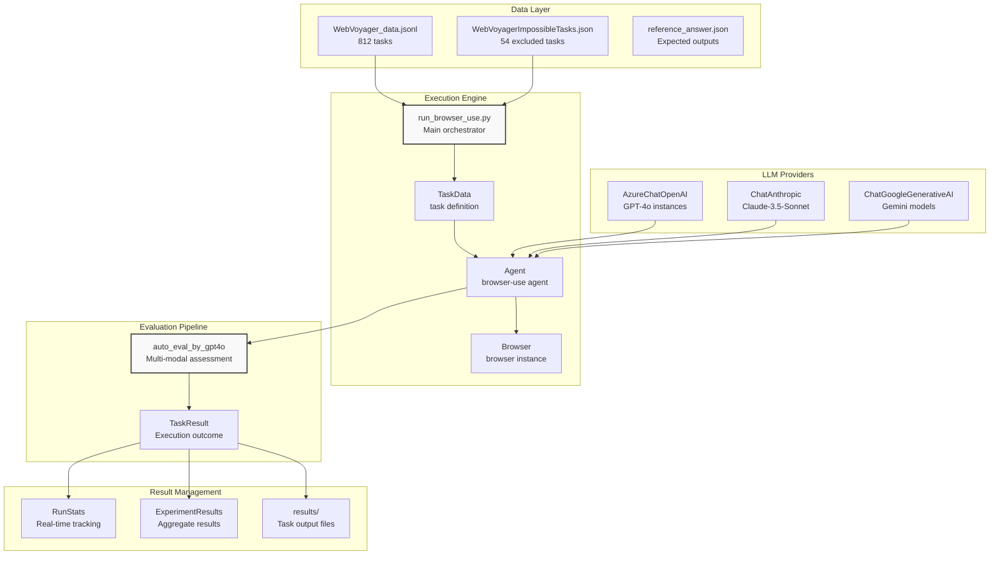
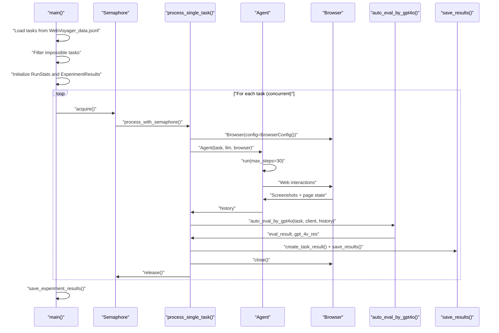
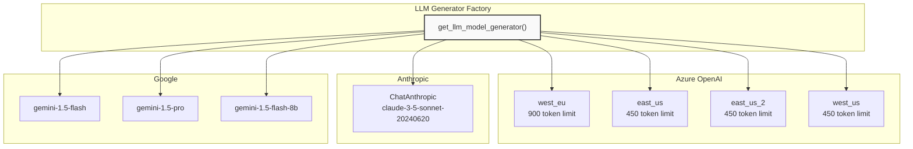
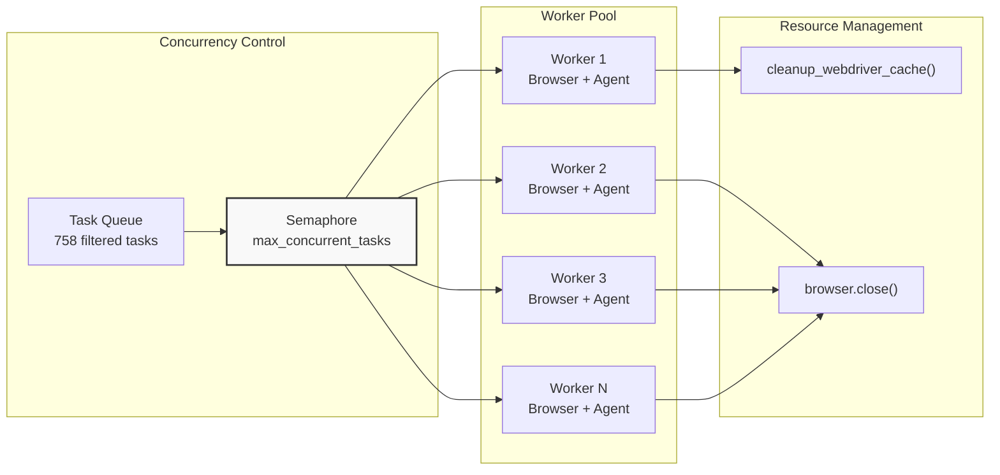

<!-- source: DeepWiki mcp.deepwiki.com · repo browser-use/eval · page 1 Overview · fetched 2026-10-30 -->

# Overview

Relevant source files

The following files were used as context for generating this wiki page:

- [README.md](README.md)
- [run_browser_use.py](run_browser_use.py)

This repository provides a comprehensive evaluation system for browser automation agents using the WebVoyager dataset. The system orchestrates concurrent execution of web tasks, evaluates agent performance using multi-modal LLM assessment, and provides detailed analysis of results. The evaluation framework is built on top of the `browser-use` package and supports multiple LLM providers including Azure OpenAI, Anthropic, and Google's models.

The system processes up to 812 web tasks from the WebVoyager dataset, filtering out 54 impossible tasks, and executes them with configurable concurrency to evaluate browser agent capabilities across diverse websites and task types. For information about the specific task datasets and their structure, see [Task Datasets](#5.1). For details about the evaluation methodology and scoring, see [Evaluation System](#3).

## System Purpose and Architecture

The browser-use evaluation system serves as a research platform for assessing AI agent performance on real-world web interaction tasks. It combines automated task execution, multi-modal evaluation, and comprehensive result analysis to provide insights into agent capabilities and failure modes.

### Core System Architecture

**System Architecture Overview**
This diagram shows how the main execution engine orchestrates browser automation tasks with multiple LLM providers and evaluation components.

Sources: [run_browser_use.py:1-440](), [evaluation/auto_eval_browser_use.py:22]()

### Task Execution Flow

**Task Execution Sequence**
This diagram illustrates the concurrent task processing workflow from initialization through evaluation and result storage.

Sources: [run_browser_use.py:313-404](), [run_browser_use.py:240-311](), [run_browser_use.py:342-388]()

## Key Components and Data Structures

### Core Data Models

The system uses several key data structures to manage task execution and results:

| Component | Purpose | Key Fields |
|-----------|---------|------------|
| `TaskData` | Represents a web task | `id`, `web`, `ques` |
| `TaskResult` | Stores execution outcome | `task_id`, `success`, `num_steps`, `duration_seconds` |
| `RunStats` | Tracks real-time progress | `successful_tasks`, `failed_tasks`, `current_task` |
| `ExperimentResults` | Aggregates all results | `total_tasks`, `total_success`, `all_tasks` |

Sources: [run_browser_use.py:27-31](), [run_browser_use.py:69-80](), [run_browser_use.py:36-66](), [run_browser_use.py:82-88]()

### LLM Provider Management

**LLM Provider Integration**
This diagram shows how the system manages multiple LLM providers with different token limits and models for task execution.

Sources: [run_browser_use.py:161-238](), [run_browser_use.py:178-222]()

### Concurrent Execution Architecture

The system implements sophisticated concurrency management using asyncio semaphores to control resource usage while maximizing throughput:

**Concurrent Execution Management**
This diagram shows how the system manages concurrent task execution with proper resource cleanup and semaphore-based throttling.

Sources: [run_browser_use.py:317](), [run_browser_use.py:342-388](), [run_browser_use.py:90-101](), [run_browser_use.py:310]()

## Evaluation and Result Management

The system employs a multi-modal evaluation approach using GPT-4o to assess task completion by analyzing both the final answer and screenshots from the browser interaction history. Results are categorized as `"success"`, `"failed"`, or `"unknown"` when the evaluator cannot make a confident assessment.

### Result Storage Structure

Each task execution generates comprehensive output stored in organized directories:

- `results/examples-browser-use/{task_id}/task_result.json` - Complete task metadata and results
- `results/examples-browser-use/{task_id}/history.json` - Full interaction history with screenshots
- `results/examples-browser-use/experiment_results.json` - Aggregated experiment summary

The system supports both fresh execution and result caching, checking for existing `task_result.json` files to avoid redundant computation.

Sources: [run_browser_use.py:127-136](), [run_browser_use.py:149-152](), [run_browser_use.py:254-286]()

## System Configuration and Deployment

The evaluation system is designed for scalable execution with configurable parameters:

| Parameter | Default | Purpose |
|-----------|---------|---------|
| `--max-concurrent` | 3 | Number of parallel browser instances |
| `--model-provider` | "azure" | LLM provider selection |
| `max_steps` | 30 | Maximum steps per task |
| Browser headless mode | `True` | Reduces resource usage |

The system has been tested with 15 concurrent tasks on 16GB RAM, providing a baseline for resource requirements and scaling considerations.

Sources: [run_browser_use.py:407-430](), [run_browser_use.py:266](), [run_browser_use.py:349-365](), [README.md:21]()

---

