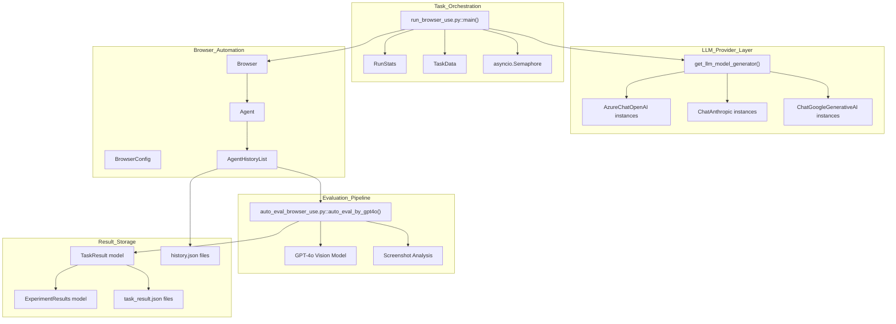
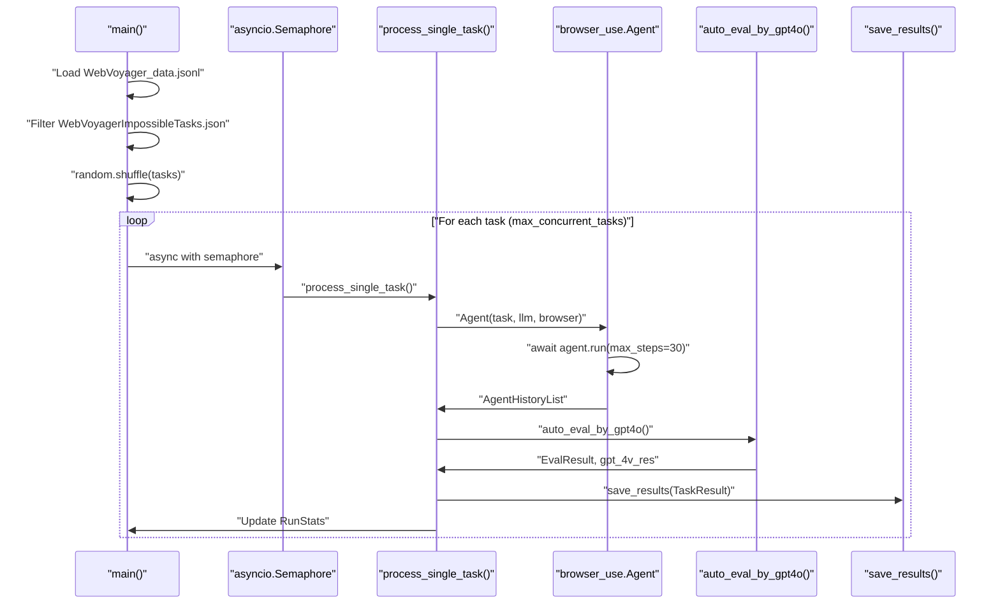
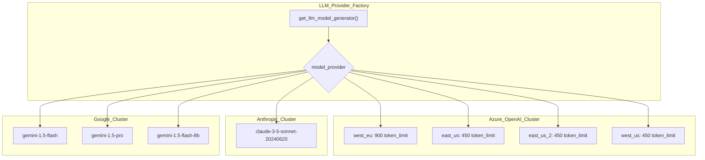
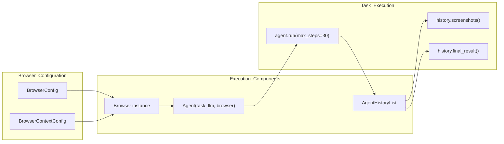
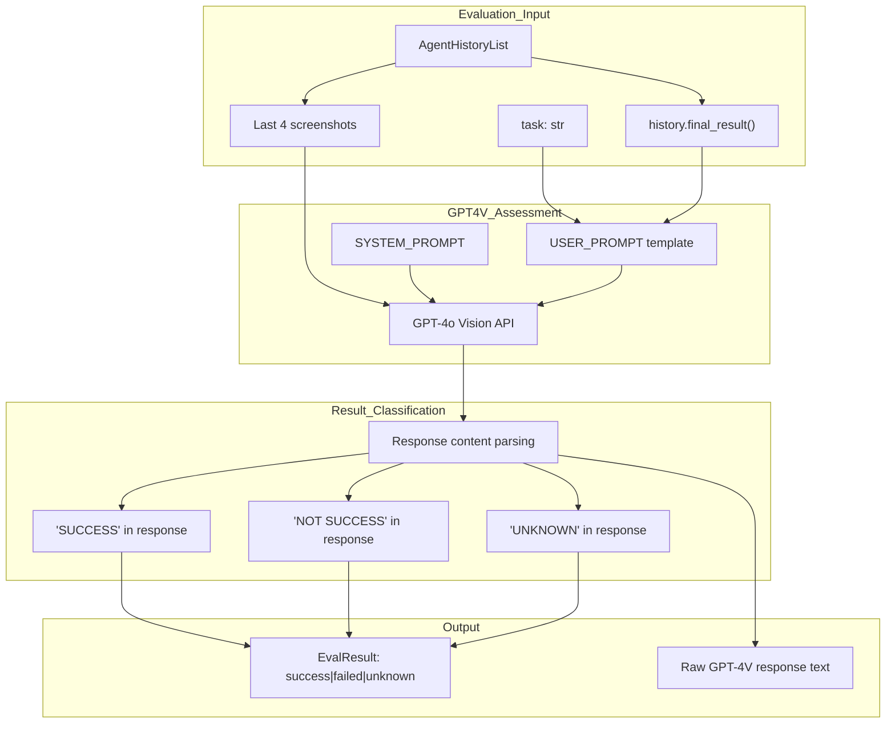
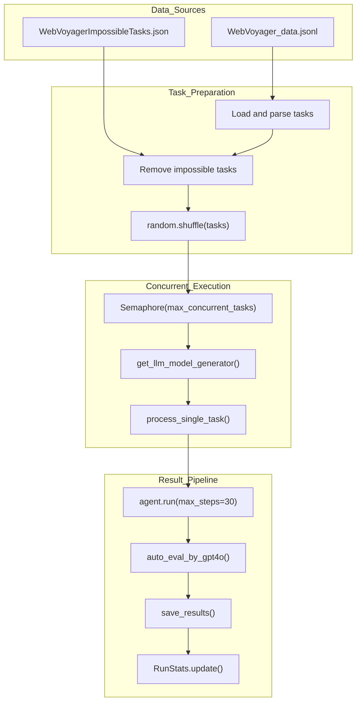

<!-- source: DeepWiki mcp.deepwiki.com · repo browser-use/eval · page 1.1 System Architecture · fetched 2026-10-30 -->

# System Architecture

Relevant source files

The following files were used as context for generating this wiki page:

- [calculate_current_score.py](calculate_current_score.py)
- [evaluation/auto_eval_browser_use.py](evaluation/auto_eval_browser_use.py)
- [run_browser_use.py](run_browser_use.py)

This document provides a high-level technical overview of the browser-use evaluation system architecture, focusing on how the major components interact to execute web automation tasks and evaluate their performance. The system orchestrates concurrent browser automation, multi-provider LLM integration, and automated evaluation workflows.

For detailed information about task data formats and datasets, see [Task Datasets](#5.1). For environment setup and dependencies, see [Environment Setup](#6.1). For evaluation methodologies, see [Evaluation System](#3).

## Overview

The browser-use evaluation system implements a distributed task execution architecture that coordinates browser automation, AI agent interaction, and automated assessment. The system is designed to evaluate AI agent performance on real-world web tasks using the WebVoyager dataset.

### Core System Architecture

**Sources:** [run_browser_use.py:1-440](), [evaluation/auto_eval_browser_use.py:1-107]()

### Concurrent Task Execution Flow

**Sources:** [run_browser_use.py:313-404](), [run_browser_use.py:240-311]()

## Core Components

### Task Orchestration Engine

The `run_browser_use.py` module serves as the central orchestrator, managing all aspects of task execution through several key classes and functions:

| Component | Type | Purpose |
|-----------|------|---------|
| `main()` | Function | Primary entry point coordinating entire execution pipeline |
| `RunStats` | Dataclass | Tracks task progress and success rates across execution |
| `TaskData` | TypedDict | Defines task structure with `id`, `web`, and `ques` fields |
| `process_single_task()` | Async Function | Handles individual task execution with browser automation |
| `asyncio.Semaphore` | Concurrency Control | Limits concurrent browser instances for resource management |

**Sources:** [run_browser_use.py:36-67](), [run_browser_use.py:27-31](), [run_browser_use.py:240-311](), [run_browser_use.py:313-404]()

### Multi-Provider LLM Integration

The `get_llm_model_generator()` function implements a generator pattern that creates fresh LLM instances for each task, supporting load balancing across multiple Azure OpenAI endpoints and different model providers.

**Sources:** [run_browser_use.py:161-238](), [run_browser_use.py:155-159]()

### Browser Automation Layer

The system integrates with the `browser-use` package through a structured configuration approach:

Key browser configuration parameters include:
- `headless=True` for server environments
- `disable_security=True` for testing flexibility  
- Browser window size of 1280x1100 pixels
- Network idle wait times for page loading

**Sources:** [run_browser_use.py:349-365](), [run_browser_use.py:258-267]()

### Automated Evaluation System

The `auto_eval_by_gpt4o()` function implements multimodal evaluation by combining task instructions, final agent responses, and visual screenshots to assess task completion success.

**Sources:** [evaluation/auto_eval_browser_use.py:37-106](), [evaluation/auto_eval_browser_use.py:14-35]()

### Result Storage and Analysis

The system implements structured result storage using Pydantic models:

| Model | Fields | Purpose |
|-------|--------|---------|
| `TaskResult` | `task_id`, `web_name`, `start_time`, `end_time`, `duration_seconds`, `num_steps`, `success`, `task_prompt`, `final_answer`, `gpt_4v_res` | Individual task execution results |
| `ExperimentResults` | `total_tasks`, `total_success`, `total_failed`, `total_unknown`, `all_tasks` | Aggregate experiment statistics |

Results are persisted to the `results/examples-browser-use/` directory structure with separate JSON files for each task.

**Sources:** [run_browser_use.py:69-88](), [run_browser_use.py:127-136](), [calculate_current_score.py:5-26]()

## Data Flow Architecture

### Task Processing Pipeline

**Sources:** [run_browser_use.py:319-333](), [run_browser_use.py:342-394]()

The system processes tasks through a multi-stage pipeline that ensures robust concurrent execution while maintaining detailed result tracking and evaluation accuracy.

---

