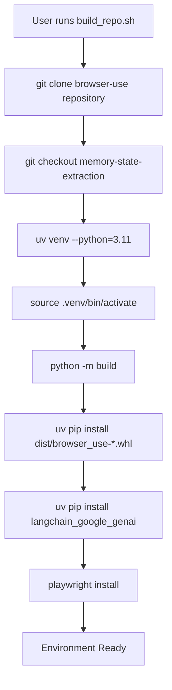
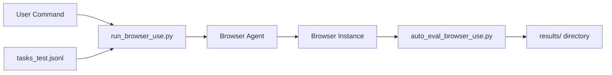

<!-- source: DeepWiki mcp.deepwiki.com · repo browser-use/eval · page 1.2 Getting Started · fetched 2026-10-30 -->

# Getting Started

<details>
<summary>Relevant source files</summary>

The following files were used as context for generating this wiki page:

- [build_repo.sh](build_repo.sh)
- [run.sh](run.sh)

</details>


This guide provides a quick start for setting up the browser-use evaluation environment and running your first WebVoyager task evaluation. It covers environment setup, basic configuration, and executing a simple evaluation run.

For detailed information about the evaluation system architecture, see [System Architecture](#1.1). For comprehensive setup of development tools and dependencies, see [Environment Setup](#6.1).

## Prerequisites

Before starting, ensure you have:

- Linux or macOS operating system
- Git installed
- Python 3.11 available
- `uv` package manager installed
- At least 16GB RAM for concurrent task execution
- API keys for LLM providers (Azure OpenAI, Anthropic, or Google)

## Environment Setup Process

The setup process involves cloning the browser-use repository, installing dependencies, and configuring the evaluation environment.

### Setup Flow



**Setup Process Flow**

Sources: [build_repo.sh:1-57]()

### Running the Setup Script

Execute the automated setup script:

```bash
chmod +x build_repo.sh
./build_repo.sh
```

This script performs the following operations:

1. **Repository Clone**: Clones the browser-use repository from GitHub [build_repo.sh:9]()
2. **Branch Checkout**: Switches to the `memory-state-extraction` branch [build_repo.sh:15]()
3. **Virtual Environment**: Creates a Python 3.11 virtual environment using `uv` [build_repo.sh:21]()
4. **Package Build**: Builds the browser-use package from source [build_repo.sh:25]()
5. **Installation**: Installs the built package and dependencies [build_repo.sh:28-29]()
6. **Browser Setup**: Installs Playwright browsers [build_repo.sh:32]()

Sources: [build_repo.sh:9-32]()

## Basic Configuration

### Environment Variables

Create a `.env` file in the project root with your LLM provider credentials:

```bash
# Azure OpenAI (recommended)
AZURE_OPENAI_API_KEY=your_azure_key
AZURE_OPENAI_ENDPOINT=your_azure_endpoint

# Anthropic (alternative)
ANTHROPIC_API_KEY=your_anthropic_key

# Google (alternative) 
GOOGLE_API_KEY=your_google_key
```

### Activation

Always activate the virtual environment before running evaluations:

```bash
source .venv/bin/activate
```

Sources: [build_repo.sh:22](), [build_repo.sh:39]()

## Running Your First Evaluation

### Basic Execution Command

The simplest way to run an evaluation is using the provided script template:

```bash
python -u run_browser_use.py \
    --test_file ./data/tasks_test.jsonl \
    --api_key YOUR_API_KEY \
    --headless \
    --max_iter 15 \
    --max_attached_imgs 3 \
    --temperature 1 \
    --seed 42
```

### Execution Flow



**Basic Evaluation Execution Flow**

Sources: [run.sh:2-10]()

### Key Parameters

| Parameter | Purpose | Example Value |
|-----------|---------|---------------|
| `--test_file` | Input task dataset | `./data/tasks_test.jsonl` |
| `--api_key` | LLM provider API key | Your API key string |
| `--headless` | Run browser without GUI | Flag (no value) |
| `--max_iter` | Maximum steps per task | `15` |
| `--max_attached_imgs` | Screenshots per evaluation | `3` |
| `--temperature` | LLM response randomness | `1` |
| `--seed` | Reproducibility seed | `42` |

Sources: [run.sh:3-10]()

## Understanding Results

### Output Structure

After execution, results are stored in the `results/` directory with this structure:

```
results/
├── experiment_results.json          # Overall experiment metrics
├── task_1234/                      # Individual task results
│   ├── task_result.json            # Task outcome and evaluation
│   ├── history.json                # Step-by-step execution log
│   └── screenshots/                # Browser screenshots
└── summary_stats.json              # Aggregated performance data
```

### Basic Success Metrics

The system tracks these key metrics:

- **Success Rate**: Percentage of tasks completed successfully
- **Average Steps**: Mean number of actions per task
- **Evaluation Accuracy**: GPT-4o assessment reliability
- **Execution Time**: Task completion duration

Sources: System architecture overview and result analysis components

## Next Steps

After completing your first evaluation:

1. **Analyze Results**: Use the analysis tools to understand performance patterns (see [Performance Metrics](#4.1))
2. **Scale Up**: Run full WebVoyager dataset evaluations (see [Core Execution Engine](#2))
3. **Customize Evaluation**: Configure different LLM providers and parameters (see [LLM Provider Integration](#3.2))
4. **Develop Tasks**: Create custom task datasets (see [Task Datasets](#5.1))

### Quick Verification

To verify your setup is working correctly:

```bash
# Activate environment
source .venv/bin/activate

# Run a single test task
python -u run_browser_use.py --test_file ./data/tasks_test.jsonl --max_tasks 1 --headless

# Check for results
ls results/
```

This should create a results directory with task execution outputs and evaluation results.

Sources: [build_repo.sh:39](), [run.sh:2-10]()

---

