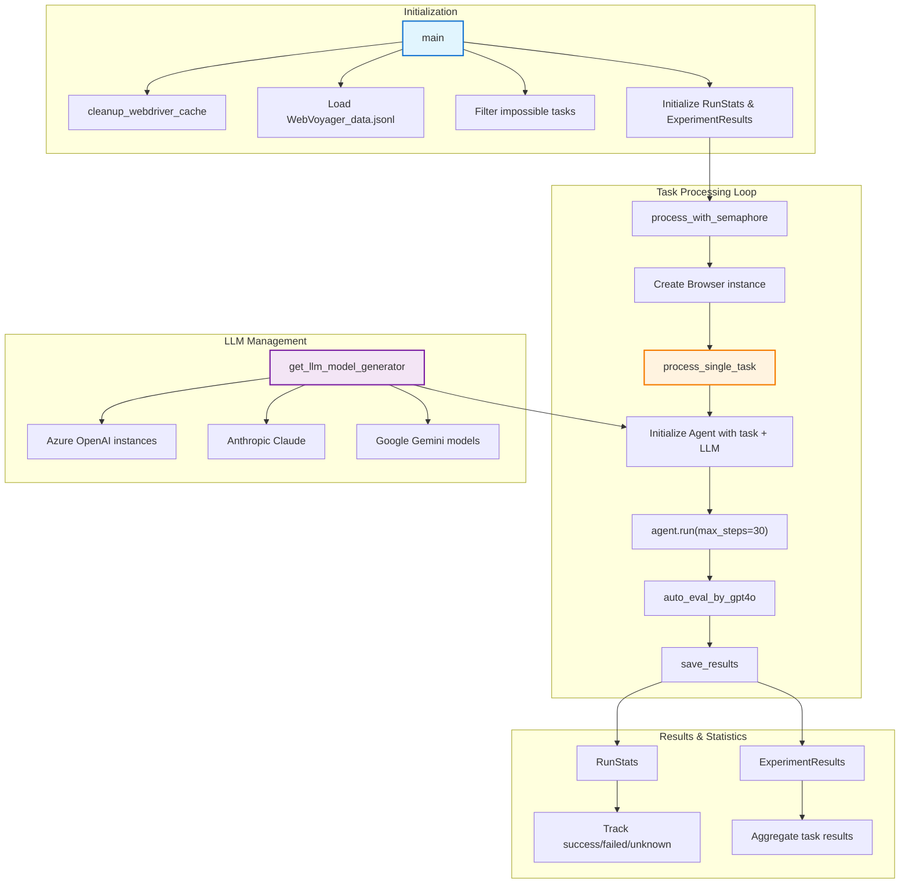
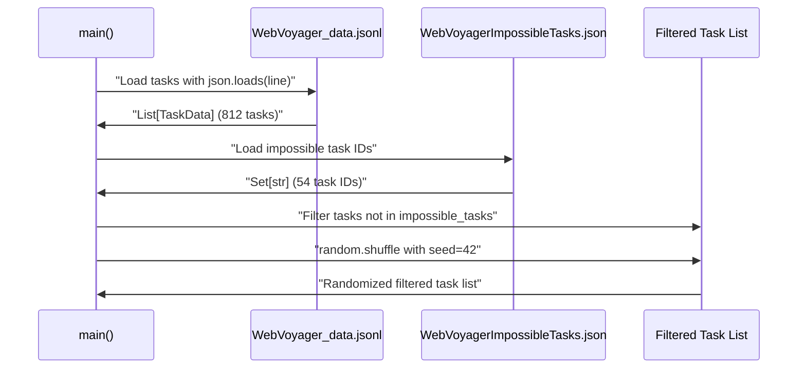
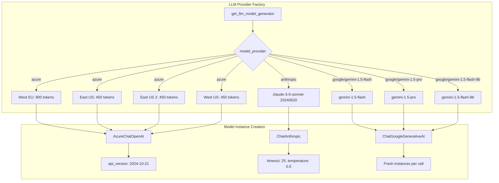
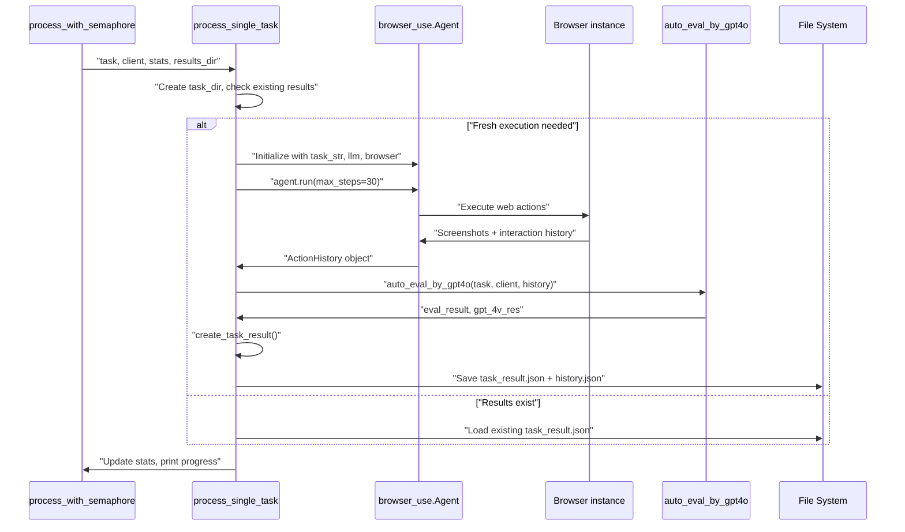
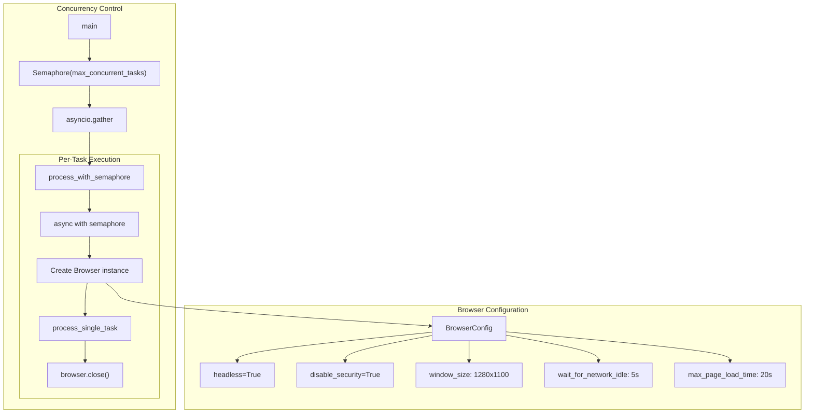
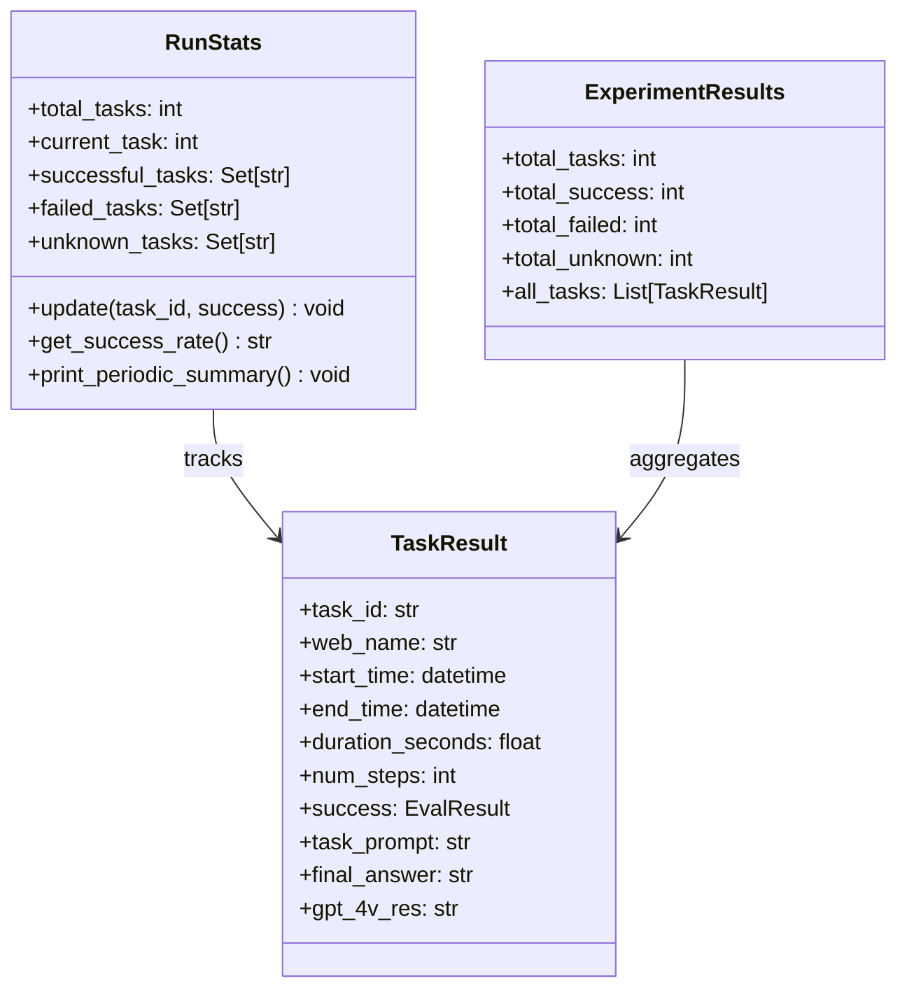

<!-- source: DeepWiki mcp.deepwiki.com · repo browser-use/eval · page 2 Core Execution Engine · fetched 2026-10-30 -->

# Core Execution Engine

Relevant source files

The following files were used as context for generating this wiki page:

- [run_browser_use.py](run_browser_use.py)

The Core Execution Engine is the primary orchestration system that manages the end-to-end execution of browser automation tasks. It coordinates task loading, concurrent browser instance management, LLM provider integration, agent execution, and result evaluation to process hundreds of web navigation tasks efficiently.

This document covers the main task execution pipeline and coordination logic. For browser agent integration details, see [Browser Agent Integration](#2.1). For concurrent task management specifics, see [Concurrent Task Management](#2.2). For evaluation system details, see [Evaluation System](#3).

## System Overview

The execution engine operates as an asynchronous task orchestrator that processes WebVoyager evaluation tasks through a multi-stage pipeline:

**Sources**: [run_browser_use.py:313-434]()

## Core Data Models

The execution engine uses several key data structures to manage task processing:

| Model | Purpose | Key Fields |
|-------|---------|------------|
| `TaskData` | WebVoyager task definition | `id`, `web`, `ques` |
| `TaskResult` | Individual task execution results | `task_id`, `success`, `duration_seconds`, `num_steps` |
| `ExperimentResults` | Aggregate experiment statistics | `total_tasks`, `total_success`, `all_tasks` |
| `RunStats` | Real-time execution tracking | `successful_tasks`, `failed_tasks`, `current_task` |
| `LLMModel` | LLM provider configuration | `model`, `token_limit` |

**Sources**: [run_browser_use.py:27-88]()

## Task Execution Pipeline

### Task Loading and Filtering

The engine begins by loading task definitions from the WebVoyager dataset and applying filtering rules:

**Sources**: [run_browser_use.py:319-332]()

### LLM Provider Factory

The `get_llm_model_generator` function implements a factory pattern that yields fresh LLM instances for each task, supporting multiple providers with different configurations:

**Sources**: [run_browser_use.py:161-237]()

### Single Task Processing

The `process_single_task` function encapsulates the core logic for executing individual browser automation tasks:

**Sources**: [run_browser_use.py:240-311]()

## Concurrent Execution Management

The engine uses an asyncio `Semaphore` to control the number of concurrent browser instances, preventing resource exhaustion while maximizing throughput:

The default configuration allows 3 concurrent tasks, which balances resource usage with execution speed on typical hardware configurations.

**Sources**: [run_browser_use.py:342-389]()

## Statistics and Result Tracking

### Real-time Statistics

The `RunStats` class provides real-time tracking of task execution progress:

**Sources**: [run_browser_use.py:36-88]()

### Result Persistence

Results are saved in a structured format under `results/examples-browser-use/`:

- `{task_id}/task_result.json` - Individual task results
- `{task_id}/history.json` - Complete interaction history  
- `experiment_results.json` - Aggregated experiment statistics

**Sources**: [run_browser_use.py:127-152]()

## Command Line Interface

The execution engine supports configurable execution parameters:

| Parameter | Default | Purpose |
|-----------|---------|---------|
| `--max-concurrent` | 3 | Number of simultaneous browser instances |
| `--model-provider` | azure | LLM provider selection |

Supported model providers: `azure`, `anthropic`, `google/gemini-1.5-flash`, `google/gemini-1.5-flash-8b`, `google/gemini-1.5-pro`

**Sources**: [run_browser_use.py:406-434]()

## Error Handling and Cleanup

The engine includes comprehensive error handling and resource cleanup:

- **WebDriver Cache Cleanup**: Removes stale selenium cache directories before execution
- **Browser Instance Cleanup**: Ensures browser instances are properly closed even on exceptions
- **Task-level Error Isolation**: Individual task failures don't crash the entire pipeline
- **Graceful Shutdown**: Handles keyboard interrupts and fatal errors appropriately

**Sources**: [run_browser_use.py:90-101](), [run_browser_use.py:377-382](), [run_browser_use.py:435-439]()

---

