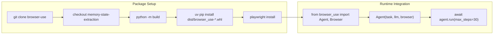
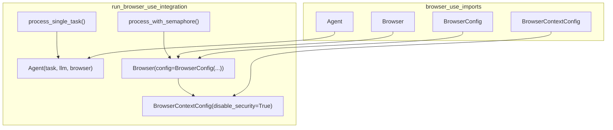
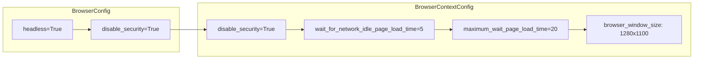
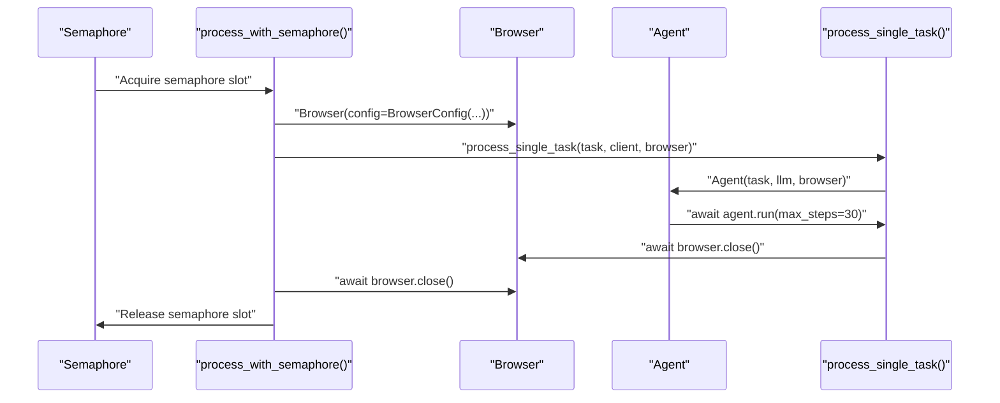
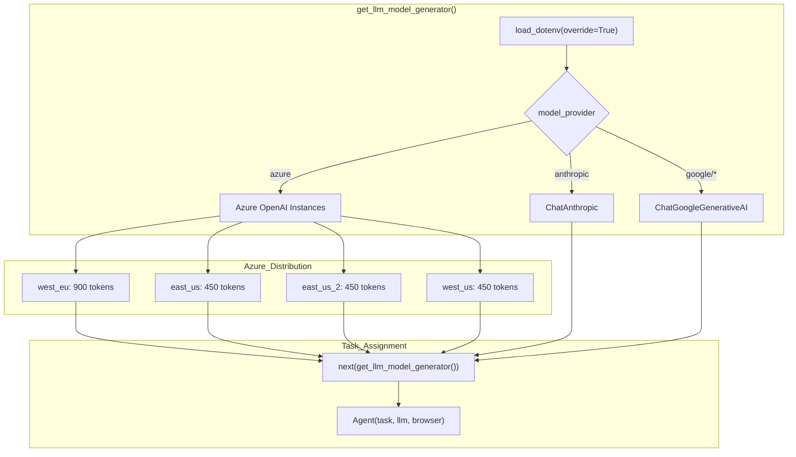
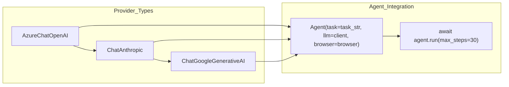
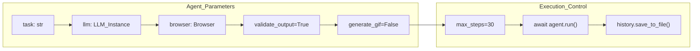
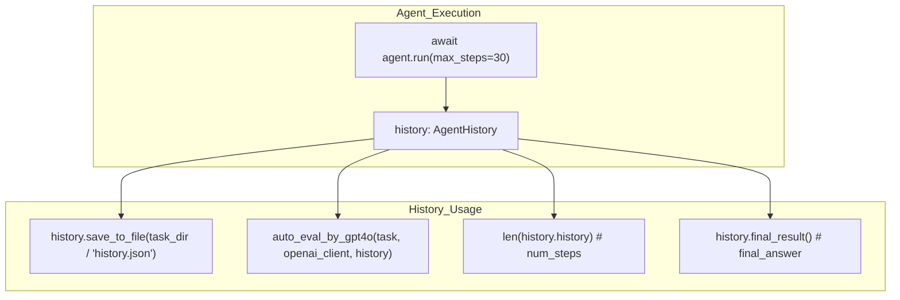

<!-- source: DeepWiki mcp.deepwiki.com · repo browser-use/eval · page 2.1 Browser Agent Integration · fetched 2026-10-30 -->

# Browser Agent Integration

<details>
<summary>Relevant source files</summary>

The following files were used as context for generating this wiki page:

- [build_repo.sh](build_repo.sh)
- [run_browser_use.py](run_browser_use.py)

</details>


This document covers how the browser-use evaluation system integrates with the external browser-use package, manages browser instances throughout task execution, and coordinates the interaction between browser automation and multiple LLM providers. For detailed information about LLM provider configuration and failover mechanisms, see [LLM Provider Integration](#3.2). For environment setup and package installation, see [Environment Setup](#6.1).

## Browser-use Package Integration

The system integrates with the external `browser-use` package by cloning, building, and installing it locally during environment setup. The integration provides the core browser automation capabilities through the `Agent`, `Browser`, and configuration classes.

### Package Installation Process

The `build_repo.sh` script handles the complete integration workflow:


**Package Installation and Runtime Integration**

The system specifically uses the `memory-state-extraction` branch and installs the package from a locally built wheel file. This ensures version consistency and allows for customizations to the browser automation behavior.

Sources: [build_repo.sh:9-32]()

### Core Class Integration

The evaluation system imports and utilizes three primary browser-use classes:

| Class | Purpose | Usage Context |
|-------|---------|---------------|
| `Agent` | Main automation orchestrator | Created per task with specific LLM and browser instances |
| `Browser` | Browser instance management | Created with custom configuration for each concurrent task |
| `BrowserConfig` | Browser-level configuration | Defines headless mode, security settings, and context defaults |


**Browser-use Class Integration in Task Processing**

Sources: [run_browser_use.py:14-15](), [run_browser_use.py:258-264](), [run_browser_use.py:349-365]()

## Browser Instance Lifecycle Management

Each task execution requires a dedicated browser instance to ensure isolation and prevent interference between concurrent tasks. The system manages browser lifecycles through careful creation, configuration, and cleanup processes.

### Browser Configuration

Browser instances are created with specific configurations optimized for automated task execution:


**Browser Configuration Hierarchy**

The configuration prioritizes automation reliability over security, with extended timeouts to handle slow-loading web pages and standardized viewport dimensions for consistent screenshot capture.

Sources: [run_browser_use.py:349-365]()

### Instance Lifecycle Control

The browser lifecycle is tightly controlled within the semaphore-protected task execution:


**Browser Instance Lifecycle During Task Execution**

The system implements a defensive approach with browser cleanup occurring both in the task processing function and as a failsafe in the semaphore wrapper.

Sources: [run_browser_use.py:310](), [run_browser_use.py:378-381]()

## Multi-Provider LLM Coordination

The browser agent integrates with multiple LLM providers through a generator-based factory pattern that ensures fresh model instances and handles provider-specific configurations.

### LLM Model Generator Pattern

The `get_llm_model_generator` function creates fresh LLM instances for each task, preventing state leakage between concurrent executions:


**LLM Provider Selection and Distribution**

The generator pattern ensures environment variables are reloaded for each instance and provides load distribution across Azure regions for the primary provider.

Sources: [run_browser_use.py:161-237](), [run_browser_use.py:393]()

### Provider-Specific Configurations

Each LLM provider requires different configuration parameters and capabilities:

| Provider | Model | Configuration | Token Limits |
|----------|-------|---------------|--------------|
| Azure OpenAI | gpt-4o | 4 regional endpoints with API keys | 900 (west_eu), 450 (others) |
| Anthropic | claude-3-5-sonnet-20240620 | Timeout and temperature settings | Not specified |
| Google | gemini-1.5-flash/pro/flash-8b | Model variant selection | Not specified |


**LLM Provider Integration with Browser Agent**

Sources: [run_browser_use.py:169-235](), [run_browser_use.py:258-266]()

## Agent Configuration and Execution

The `Agent` class from browser-use serves as the primary interface between LLM reasoning and browser automation, configured with task-specific parameters and execution constraints.

### Agent Initialization Parameters

Each agent instance is configured with specific parameters that control its behavior and capabilities:


**Agent Configuration and Execution Flow**

The agent is configured to validate outputs but skip GIF generation for performance, with a maximum step limit to prevent infinite loops.

Sources: [run_browser_use.py:258-267]()

### Task String Formation

Tasks are formatted into natural language strings that combine the question and target website:

```mermaid
graph LR
    A["task['ques']"] --> B["task string formation"]
    C["task['web']"] --> B
    B --> D["f\"{task['ques']} on {task['web']}\"]
    D --> E["Agent(task=task_str, ...)"]
```
**Task String Construction for Agent Execution**

This formatting provides the agent with both the objective and the specific website context needed for task completion.

Sources: [run_browser_use.py:249](), [run_browser_use.py:259]()

### Execution History Capture

The agent execution produces a detailed history object that captures all interactions and is used for both storage and evaluation:


**Agent History Capture and Utilization**

The history object serves multiple purposes: persistence for debugging, input for automated evaluation, and source for task result metrics.

Sources: [run_browser_use.py:266-267](), [run_browser_use.py:269-273](), [run_browser_use.py:279-280]()

---

