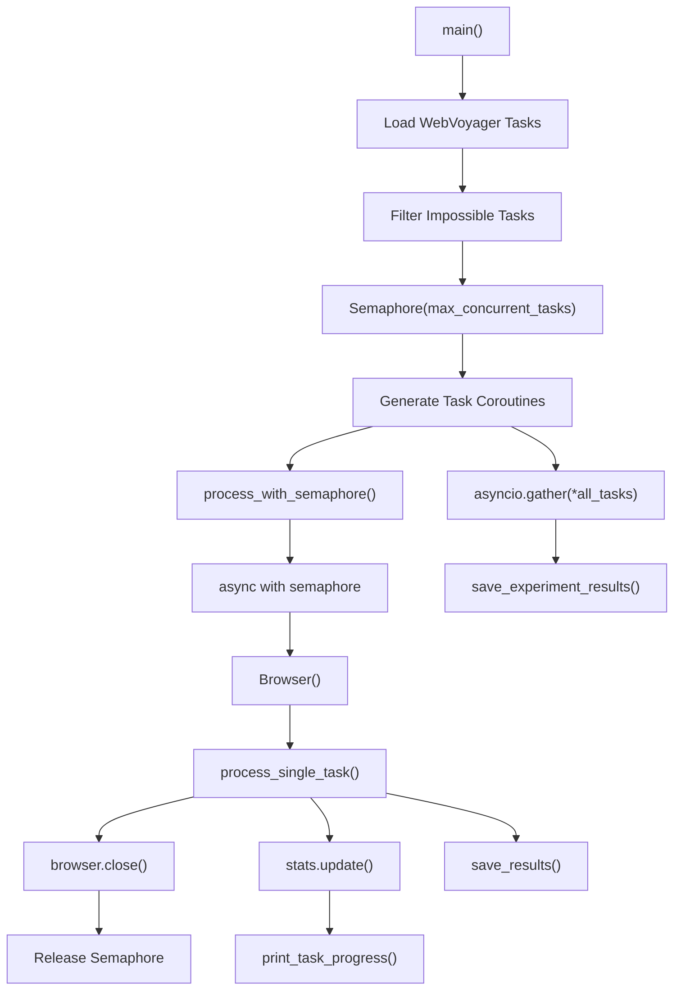
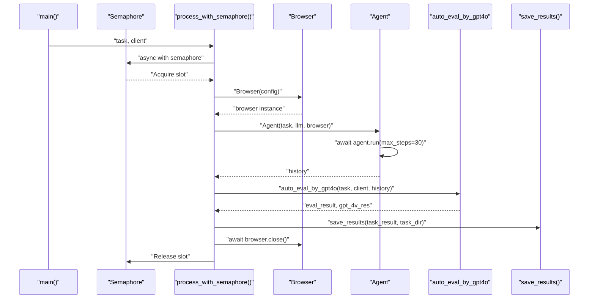
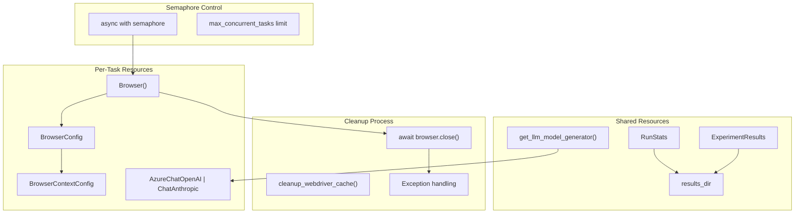
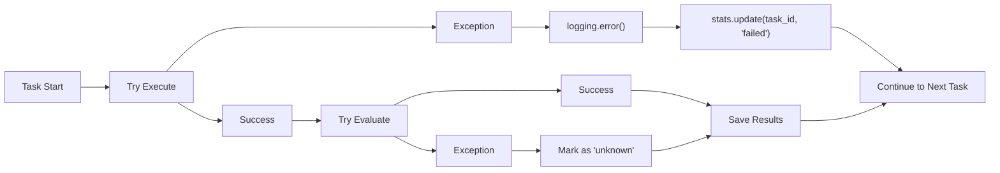
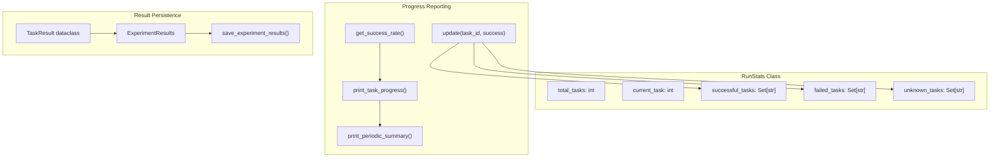

<!-- source: DeepWiki mcp.deepwiki.com · repo browser-use/eval · page 2.2 Concurrent Task Management · fetched 2026-10-30 -->

# Concurrent Task Management

Relevant source files

The following files were used as context for generating this wiki page:

- [run_browser_use.py](run_browser_use.py)

This document explains how the browser-use evaluation system manages parallel execution of web automation tasks. The concurrent task management system coordinates multiple browser instances, LLM providers, and evaluation processes to efficiently process large datasets while maintaining resource constraints and error resilience.

For information about browser agent integration and LLM coordination, see [Browser Agent Integration](#2.1). For evaluation pipeline details, see [Evaluation System](#3).

## Concurrency Architecture

The system implements a semaphore-based concurrency model that controls resource allocation and prevents system overload. The main orchestrator coordinates task distribution, browser lifecycle management, and result aggregation.

**Concurrent Execution Flow**

Sources: [run_browser_use.py:313-404]()

The `main()` function serves as the central orchestrator, managing the entire concurrent execution lifecycle. It creates an `asyncio.Semaphore` to limit concurrent tasks and coordinates task distribution across multiple browser instances.

## Task Execution Pipeline

Each task flows through a standardized pipeline that includes browser initialization, agent execution, evaluation, and result storage. The pipeline is designed to handle failures gracefully without affecting other concurrent tasks.

**Task Processing Lifecycle**

Sources: [run_browser_use.py:240-311](), [run_browser_use.py:342-389]()

The `process_with_semaphore()` function wraps each task execution to ensure proper resource acquisition and cleanup. The `process_single_task()` function handles the core execution logic including agent creation, task execution, and evaluation.

## Resource Management

The system carefully manages browser instances, LLM connections, and memory to prevent resource exhaustion. Each task receives its own browser instance that is created within the semaphore block and properly cleaned up afterward.

**Resource Allocation Strategy**

Sources: [run_browser_use.py:348-365](), [run_browser_use.py:90-101](), [run_browser_use.py:377-382]()

The `Browser` is configured with specific settings including headless mode, security disabled, and standardized window size (1280x1100). The `BrowserContextConfig` sets network idle times and page load timeouts to optimize performance.

## Error Handling and Recovery

The concurrent system implements multiple layers of error handling to ensure that individual task failures don't compromise the entire evaluation run. Failed tasks are logged and marked appropriately while allowing other tasks to continue.

| Error Type | Handling Strategy | Code Location |
|------------|------------------|---------------|
| Task execution failure | Mark as "failed", continue processing | [run_browser_use.py:304-307]() |
| Browser close error | Log error, continue cleanup | [run_browser_use.py:378-381]() |
| LLM provider failure | Use next provider in rotation | [run_browser_use.py:161-237]() |
| Evaluation failure | Mark as "unknown" | [run_browser_use.py:269-273]() |

**Error Recovery Flow**

Sources: [run_browser_use.py:304-311](), [run_browser_use.py:377-382]()

The `try-except` blocks in `process_single_task()` ensure that exceptions are caught and logged without terminating the entire process. The `RunStats.update()` method tracks success, failure, and unknown outcomes.

## Performance Monitoring

The system provides real-time progress tracking and periodic summaries to monitor concurrent execution performance. Statistics are maintained across all concurrent tasks and saved periodically.

**Progress Tracking Components**

Sources: [run_browser_use.py:36-67](), [run_browser_use.py:138-147](), [run_browser_use.py:149-153]()

The `RunStats` class maintains real-time counters for task outcomes and provides methods for calculating success rates. The `print_task_progress()` function displays concise status updates with visual indicators (✓, ✗, ?) for task outcomes.

**Default Concurrency Settings**

| Parameter | Default Value | Purpose |
|-----------|---------------|---------|
| `max_concurrent_tasks` | 3 | Prevents resource exhaustion |
| `max_steps` | 30 | Limits task execution time |
| `wait_for_network_idle_page_load_time` | 5 seconds | Browser stability |
| `maximum_wait_page_load_time` | 20 seconds | Timeout protection |

Sources: [run_browser_use.py:412-416](), [run_browser_use.py:266](), [run_browser_use.py:355-356]()

The system defaults to 3 concurrent tasks but supports scaling based on available system resources through command-line arguments. The semaphore ensures that no more than the specified number of browser instances run simultaneously.

---

